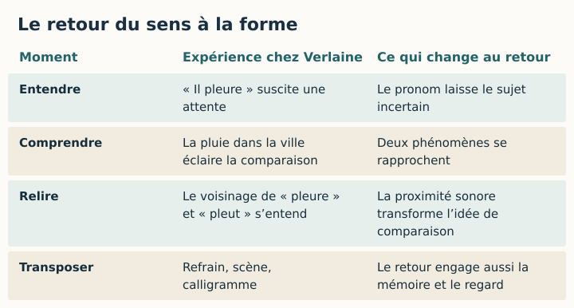

# ENS-PSL · Sélection internationale Lettres · Littérature — Paul Valéry 2023 — Corrigé guidé

*Corrigé rédigé par IA, non officiel. Signalez toute erreur.*

**Rédaction** · GPT-6.2 Astra Ultra · vitesse non renseignée

**Révision (tour 1)** · GPT-6.2 Astra Ultra · vitesse non renseignée

[Sujet officiel](https://www.ens.psl.eu/sites/default/files/litterature-ecrit1-sil2023.pdf) · [Second exemplaire officiel](https://www.ens.psl.eu/sites/default/files/litterature-ecrit2-sil2023.pdf)

Les deux exemplaires de l’épreuve de deux heures proposent la même citation de « Poésie et pensée abstraite » et le même travail. L’expérience de lecture demandée est ici développée à partir de Verlaine, de Racine et d’Apollinaire.

## Sujet de l’écrit

Vous analyserez et commenterez la citation ci-dessous sous la forme d’un écrit organisé. Vous pouvez éclairer ces propos par des éléments de contexte, par vos connaissances d’histoire et de théorie littéraires et poétiques. Vous ferez appel à votre expérience de lectrice, sans vous limiter au corpus de votre projet de recherche.

Paul Valéry, « Poésie et pensée abstraite » (1939), *Variétés*, Gallimard, 1957, selon le feuillet. Le passage commence par « Pensez à un pendule qui oscille » et se termine par « qui lui a donné naissance. ». La coupure entre parenthèses appartient au texte proposé. Les deux exemplaires reproduisent la même citation. Le premier dit « expérience de lectrice » et « de théorie », le second « expérience de lecteur » et « de théories ».

## Préparer la réponse

**Qu’est-ce qui redemande la forme ?** Essayez une paraphrase de l’aveu de Phèdre. Notez ce qu’elle préserve, puis revenez au mouvement qui va de la rougeur à la pâleur. Dans la dernière phrase du feuillet, observez à quoi renvoient les deux emplois de « même ». Cette insistance vous demande de retrouver la forme particulière qui a rendu cette perception possible.

Le pendule n’oppose pas deux écoles poétiques. Il donne à imaginer une durée de lecture. Relever dans la citation les premières opérations prescrites au lecteur, de la construction d’un modèle abstrait à l’observation de ce qui arrive dans un vers. Le mouvement décisif est le retour du sens vers la forme qui l’a suscité. Une équivalence entre poésie et musicalité omettrait toute la deuxième moitié de l’expérience.

Essayer sur un exemple deux gestes différents. Paraphraser le propos de Verlaine, puis relire ses deux premiers vers en prêtant attention à « pleure » et « pleut ». L’idée obtenue permet-elle de prévoir le détail sonore auquel on revient ? Le théâtre de Racine teste le modèle avec un vers soumis au temps de l’action. Le poème d’Apollinaire oblige à distinguer retour d’une forme et retour d’un instant.

## Pourquoi revenir au vers que l’on vient de comprendre ?

J’ai compris la première strophe de Verlaine lorsque je puis expliquer qu’une tristesse intérieure ressemble à la pluie qui tombe sur la ville. Pourtant, une fois cette phrase dite, j’ai envie de retourner au vers. Que peut-il me donner encore puisque j’en ai compris le sens ? Dans « Poésie et pensée abstraite », Paul Valéry choisit, pour rendre compte de cette expérience, un instrument qui donne à voir le mouvement et qui revient sur ses pas. Il invite à observer un pendule dont les deux extrêmes figurent les qualités sensibles de la parole et les significations auxquelles elle donne lieu. Le passage du premier terme au second paraît décrire toute lecture. C’est au retour que se reconnaîtrait la poésie. Je voudrais examiner ce qu’explique cette expérience, puis ce qui, dans un poème, empêche le retour d’être une simple répétition. Il faudra enfin demander ce que peut l’image du pendule devant des œuvres dont la forme excède une suite de sons.

Valéry commence en demandant un petit travail à son lecteur. Il faut imaginer un objet, en construire les positions extrêmes, leur associer des valeurs différentes. La pensée abstraite du titre se met au service d’une expérience accessible à qui veut bien lire un vers à haute voix. La première position du pendule réunit beaucoup plus que l’agrément des sonorités. Un timbre, une accentuation ou la durée d’un silence peuvent modifier la manière dont j’entends quelqu’un parler. Valéry rassemble ces phénomènes sous le nom de voix et il la saisit en action. À l’autre extrême, il place notamment les images. Le sens ne se réduit donc pas davantage à un énoncé intellectuel que la voix à une sonorité. Il y a place, des deux côtés, pour une impression qui se précise à mesure que le poème avance.

Revenons au début de la troisième des *Ariettes oubliées*. « Il pleure dans mon cœur / Comme il pleut sur la ville. » Si je remplace le premier groupe par « je suis triste », je puis achever la comparaison et conserver une information. Mais j’ai perdu le pronom impersonnel qui fait arriver la peine à la manière d’un phénomène météorologique. En entendant d’abord « il pleure », je peux un instant attendre une personne qui pleure. La ville et la pluie, au vers suivant, me font revenir à ces premiers mots. C’est alors que j’entends mieux l’étrange proximité de deux verbes dont l’un semble avoir prolongé l’autre d’un son. Impossible de dire d’abord que l’eau est dehors et la peine dedans, puis de considérer le vers comme l’agréable revêtement de cette idée. C’est en prononçant deux fois presque la même chose que je découvre la difficulté de les séparer. Le retour décrit par Valéry a trouvé là sa nécessité.

L’image présente cependant un trait dont il faut se méfier. Une masse suspendue revient vers un point déjà occupé. Le lecteur qui revient à « il pleure » a désormais entendu « il pleut ». Il n’occupe plus la même position. Même une répétition littérale peut faire entendre un changement irréversible. Lorsque revient le refrain du « Pont Mirabeau » d’Apollinaire, j’en reconnais chaque mot et la cadence qui me permettait de l’attendre. Cependant le temps du poème a passé. La Seine, l’amour perdu, les journées qui s’en vont ont donné à l’affirmation « je demeure » une valeur de plus en plus incertaine. Est-ce la force de celui qui persiste ou la solitude de celui qui reste lorsque tout est parti ? Le refrain permet de soutenir les deux lectures et de percevoir combien la seconde pèse à présent sur la première. À imaginer seulement une oscillation régulière, on perdrait cette action de la mémoire sur le vers qui revient.

Valéry prend précisément la précaution de rendre son pendule « vivant ». Une vie n’est pas le déplacement d’un objet que l’on pourrait observer de l’extérieur sans le modifier. Il s’agit de discerner l’effet produit en soi. C’est particulièrement sensible au théâtre. Lorsque Phèdre, dans son aveu à Œnone, fait suivre la vue d’Hippolyte de la rougeur, puis de la pâleur, les segments du vers de Racine paraissent d’abord restituer, dans l’ordre, trois événements physiques. À la représentation, on ne dispose pas du temps nécessaire pour arrêter l’actrice et revenir au premier segment. Pourtant l’arrivée du dernier modifie le souvenir immédiat des précédents. La pâleur ne succède pas tranquillement à la rougeur. Leur réunion dans la mesure d’un alexandrin fait sentir ce que le personnage a éprouvé avant de pouvoir se l’expliquer. De retour au texte écrit, je peux essayer plusieurs vitesses de diction. Le maintien du mètre et les ruptures introduites par la ponctuation donnent à l’interprète des choix qu’une paraphrase de l’aveu n’aurait jamais indiqués. La signification redemande la forme parce qu’il reste à l’éprouver, non parce qu’une analyse savante aurait décrété leurs rapports.

La fin de la citation laisse entendre ce que le retour a de singulier. Les mots « issue », « expression », « réponse » se succèdent avant que Valéry ne retrouve cette musique-là. On ne peut substituer à la phrase qu’on a entendue un son quelconque, comme on changerait le décor d’une idée toute faite. Je peux l’éprouver chez Racine en disant « j’ai vu Hippolyte et j’ai changé de couleur ». Je conserve une information très sommaire. Je perds l’insistance des premières personnes successives et le contraste entre les deux couleurs, logés dans une seule mesure de vers. Ces détails redeviennent nécessaires au moment précis où je tente de dire ce que j’avais compris. Voilà en quel sens le point de départ sensible peut être une réponse.

Il serait toutefois difficile de tirer de ce retour un critère qui déciderait de toute poésie. Le regard du lecteur importe autant que sa voix dans certains poèmes. Dans « Il pleut », Apollinaire fait descendre selon plusieurs lignes obliques des paroles qui ont déjà pris sur la page l’aspect d’une pluie. Pour lire, je dois choisir une ligne, avancer de mot en mot et momentanément perdre de vue la simultanéité du dessin. Une fois un groupe compris, je reprends de la distance et je regarde l’ensemble. Ici encore la signification me reconduit jusqu’à la forme qui l’a suscitée, mais il faut passer de l’œil à l’oreille, puis revenir à la page. S’en tenir à deux extrêmes bien distincts appauvrirait l’expérience. Le dispositif de Valéry retrouve son pouvoir si on l’entend comme une question posée à chaque lecture. À quel détail sensible ce que j’ai compris me rend-il aujourd’hui attentive ?

Il y a donc un gain jusque dans ce que le modèle laisse inexact. Le passage par un pendule idéal permet de découvrir un mouvement que l’habitude de chercher un message aurait laissé échapper. Puis l’examen des œuvres fait découvrir des retours inégaux, chargés de mémoire, parfois imaginés en pleine représentation, parfois accomplis par le regard. L’expérience de lecture ne s’achève pas quand j’ai trouvé des mots pour dire ce que signifie le poème. Elle s’approfondit quand ces mots me ramènent à un accent, à une pause ou à un tracé que j’étais passée sans entendre ou sans voir. Au terme de la course, la différence est dans le lecteur qui recommence.
