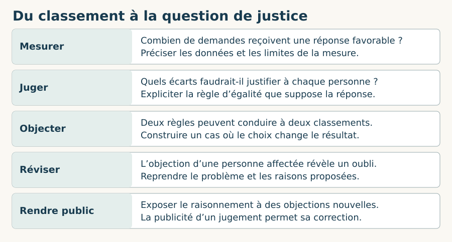

# ENS-PSL · Sélection internationale Lettres — Philosophie 2023 · Corrigé guidé

*Corrigé rédigé par IA, non officiel. Signalez toute erreur.*

**Rédaction** · GPT-6.2 Astra Ultra · vitesse non renseignée

**Autocontrôle** · GPT-6.2 Astra Ultra · vitesse non renseignée

**Révision (tour 1)** · GPT-6.2 Astra Ultra · vitesse non renseignée

## Donner un contenu distinct aux trois mots

**Être.** Un titre, une profession ou un acte isolé n’épuisent pas une manière durable de conduire sa pensée. **Philosophe.** Cherchez un critère permettant de distinguer examen raisonné, opinion et expertise spécialisée. **Aujourd’hui.** Faites varier le cas : la question de la justice précède les classements numériques, mais ceux-ci lui donnent des formes qu’il faut connaître pour pouvoir les interroger.

### Trois objections à faire travailler

- Une enseignante lit un texte ancien et n’intervient jamais dans le débat médiatique. Peut-elle être philosophe aujourd’hui ? Oui, si le problème qu’elle reconstruit demeure accessible à l’objection et fait travailler des raisons. La visibilité médiatique n’est pas un critère.
- Une personne sans diplôme conteste une règle administrative. Quand l’objection devient-elle philosophique ? Lorsqu’elle explicite un principe de justification, l’éprouve sur d’autres cas et se rend disponible à sa révision.
- Une experte établit une inégalité statistique. Pourquoi le philosophe ne peut-il se substituer à elle ? La mesure des effets, son domaine de validité et ses limites demandent des méthodes empiriques. La question des raisons susceptibles de justifier ces effets ajoute un problème distinct.

**Éprouver le mot « être ».** Un élu choisit la rotation entre établissements parce qu’elle avantage ses électeurs. Une enseignante défend la même règle en expliquant ce qu’elle entend par égalité d’accès, puis l’abandonne lorsque des élèves lui montrent un effet qu’elle avait négligé. Le résultat de la première décision ne permet pas, à lui seul, d’identifier une conduite philosophique. Quel rôle a joué la possibilité de réviser les raisons avancées ? Répondez en reliant une manière de penser à une manière d’agir.

Quand vous mobilisez Socrate ou Kant, demandez quel pas la référence permet d’accomplir. Le premier met à l’épreuve la certitude de savoir. Le second éclaire la publicité d’un jugement qui s’adresse à des interlocuteurs capables de le critiquer. Ni l’un ni l’autre ne dispense de construire un cas de notre temps.

## Qu’est-ce qu’être philosophe aujourd’hui ?

Un spécialiste des données peut établir qu’un dispositif de sélection produit une proportion constante de décisions défavorables pour certains groupes. Deux personnes peuvent admettre ses calculs et continuer de s’opposer sur leur justice. Laquelle faut-il alors appeler philosophe ? Celle qui a lu l’histoire des doctrines, celle qui dit ce qu’il convient de faire, ou celle qui demande ce que signifie ici traiter également des personnes ? La question engage une façon d’être et porte un indice temporel déconcertant. Si être philosophe consiste à se plier aux opinions de son temps, on comprend mal qu’un philosophe puisse en faire la critique. Si cela consiste à s’en abstraire entièrement, on ne voit plus ce que signifie « aujourd’hui ». Être philosophe suppose une pratique durable de l’examen qui se laisse instruire et déplacer par les problèmes singuliers de son présent. Il reste à comprendre comment elle conserve son autonomie sans usurper les savoirs et les décisions d’autrui.

### Une activité dont le titre ne suffit pas à garantir l’exercice

La figure de Socrate dans l’*Apologie* de Platon apporte une difficulté à la recherche d’une définition par le métier. Socrate n’y fait valoir ni un corps de résultats qu’il posséderait à titre exclusif ni une charge publique qui lui en réserverait l’usage. Après la réponse de l’oracle, Socrate va voir un homme politique qui passe pour sage. Leur entretien met au jour un écart entre la réputation de savoir et la capacité d’en rendre raison. Socrate en tire un avantage modeste. Ce qu’il ignore, il ne croit pas le savoir (*Apologie*, 21b–d). L’ignorance reconnue constitue un gain parce qu’elle porte sur une assurance précise qui vient de perdre son fondement. Un doute général, auquel aucune réponse ne pourrait rien changer, ne produirait pas ce gain. L’interrogateur s’expose lui aussi. Il accepte que des raisons, fussent-elles présentées par un interlocuteur sans titre, aient prise sur son jugement et sur sa vie.

Une première réponse se dessine. Est philosophe celui pour qui donner et demander des raisons devient une exigence constante, même quand la question touche aux évidences dont il tire sa position. Cela n’implique ni que la précision historique soit facultative ni que toute conversation soit déjà philosophique. Une interprétation de Kant peut être brillante et se réduire à une démonstration d’érudition si l’on ne peut formuler le problème auquel elle répond. Inversement, une contestation fort vive du sens commun demeure une opinion si celui qui la soutient refuse d’indiquer ce qui pourrait la faire réviser. L’enseignement, la recherche et les livres instituent des conditions précieuses de durée et de transmission. Ils rendent possible une pratique dont le critère reste interne à la conduite de l’enquête.

### Appartenir au présent pour en rendre visibles les présupposés

Aucune interrogation ne part de rien. L’*aujourd’hui* du sujet désigne d’abord l’ensemble des pratiques et des savoirs à partir desquels certaines questions deviennent urgentes et d’autres paraissent aller de soi. Le pouvoir de calculer un score en fournit un exemple. Le calcul peut reposer sur des données correctement décrites. Il faut pourtant décider si une distribution est juste lorsque chaque individu de même score reçoit la même réponse, ou lorsque des groupes différents ont les mêmes chances d’accéder à un bien. Ces critères répondent à des descriptions différentes de l’égalité. Le philosophe commence son travail en demandant ce que la procédure tient pour un bien, pour une différence pertinente et pour une justification due à la personne. Si l’on découvrait une erreur de mesure, elle devrait être corrigée par l’enquête empirique. En supposant la mesure irréprochable, la question de la justification demeurerait.

Supposons qu’une ville offre deux places dans un atelier gratuit. Un classement par note les attribue à deux élèves du même établissement, qui disposait déjà d’un atelier. Une rotation entre établissements donnerait une place à un élève moins bien classé qui n’y avait jamais eu accès. Les notes peuvent être exactes dans les deux cas. La première règle récompense un résultat obtenu, la seconde accorde de la valeur à une première occasion d’apprendre. Dire publiquement quel est le but de l’atelier permet de demander laquelle de ces différences compte. Un relevé des notes ne pose pas cette question à la place de la ville.

La critique requiert donc d’apprendre comment fonctionne la pratique que l’on interroge. Faute de quoi l’on attribue à la machine, à la science ou à l’institution une volonté que l’examen précis aurait dissipée. Elle requiert en sens inverse de ne pas accepter sans discussion la définition du problème que la pratique s’est donnée. Qu’un service ait appris à classer les demandes plus vite ne décide pas si le classement est la juste réponse à leur rareté. On peut découvrir que la question initiale, « comment ordonner ces personnes ? », doit devenir « quels motifs de refus pourrions-nous justifier à chacune ? ». L’originalité philosophique réside parfois dans cette transformation. Répéter la dernière controverse médiatique ne la produit pas davantage que répéter une formule antique.

### Rendre une pensée publiquement responsable de ses conséquences

Dans sa *Réponse à la question : Qu’est-ce que les Lumières ?*, Kant distingue l’exercice de la raison attaché à une fonction et l’usage public par lequel quelqu’un s’adresse, en savant, à l’ensemble du public des lecteurs. Le sens des termes surprend. Une personne investie d’une charge publique peut suivre les règles de cette charge, tandis que sa critique écrite et argumentée relève de l’usage public de la raison. De cette distinction, on peut retenir une condition d’autonomie actuelle. Celui qui expose une justification philosophique doit pouvoir la soumettre à des objections que n’a pas sélectionnées son employeur, son public privilégié ou sa propre école. Cette possibilité resterait abstraite si aucune objection ne pouvait modifier une pratique. Elle prend un sens précis lorsque les personnes écartées d’une décision peuvent en connaître les raisons et y répondre. La taille du public ne mesure pas cette liberté.

Cette exigence a une dimension pratique. La personne exclue par un classement peut en révéler un effet négligé. L’écouter oblige à reprendre la description du cas. Lui offrir seulement une définition abstraite de l’égalité reviendrait à transformer l’exercice critique en magistère. Mais substituer son indignation à tout argument ne rendrait pas davantage justice à son objection. Le philosophe doit faire apparaître pourquoi une expérience fait problème, à quelles autres situations l’objection s’applique et quelle réponse pourrait la satisfaire. Il contribue à une décision collective sans s’en déclarer l’unique auteur. Une vie philosophique se reconnaît aussi au temps qu’elle accorde à une objection incommode, au lien qu’elle maintient entre ce qu’elle prône et ce qu’elle est prête à modifier dans sa conduite.

Être philosophe aujourd’hui, c’est ainsi assumer une double contemporanéité. On partage les institutions, les outils et les mots en usage, assez pour savoir ce qu’ils font aux personnes. On rend leurs présupposés discutables en s’adressant à des interlocuteurs dont le désaccord pourrait changer la question. Le présent fournit les épreuves de cette activité. La fidélité aux raisons que l’on peut y donner, puis corriger, en fournit le critère.

[Sujet officiel](https://www.ens.psl.eu/sites/default/files/philosophie-ecrit-sil2023.pdf) · [Kant et l’usage public de la raison](https://plato.stanford.edu/entries/kant-reason/)
