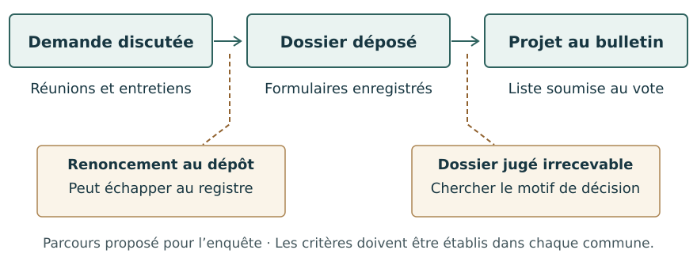

# ENS-PSL · Sélection internationale Lettres — Sciences sociales 2023 · Corrigé brut

*Corrigé rédigé par IA, non officiel. Signalez toute erreur.*

**Rédaction** · GPT-6.2 Astra Ultra · vitesse non renseignée

*Le sujet invite chaque candidat à mobiliser sa formation, ses lectures et son projet de recherche. Cet essai illustre la consigne par un projet proposé sur le budget participatif. Les opérations d’enquête sont présentées au conditionnel.*

## Une même science sociale ?

Une commune pourrait publier le palmarès des projets que ses habitants ont choisis de financer. Imaginons que je veuille comprendre comment un collectif de quartier parvient à y faire figurer un jardin. L’historien réclamera les dossiers des éditions précédentes, l’anthropologue voudra entendre ce que les habitants appellent « notre jardin », la politiste demandera qui a pu fixer la liste des projets admissibles, la sociologue cherchera les ressources qui ont permis à ce groupe de prendre la parole. Étudient-ils quatre réalités ? Ils parlent du même jardin. Pourtant ils ne peuvent pas, sans examen, appeler « participation » la même série d’actes. Le problème est donc double. Quelles opérations leur permettent de rectifier ensemble une explication ? Quelles différences doivent-ils préserver pour que cette rectification ait lieu ? Je défendrai une unité dans la pratique de la preuve, compatible avec plusieurs manières de construire l’objet.

### Rendre une interprétation discutable

Je retiens de l’apprentissage du commentaire de document et de la lecture d’un tableau une même question préalable. Qui a rendu possible la trace que je suis en train de lire ? Un tableau municipal qui recense les projets admis au vote porte la marque d’un règlement de recevabilité. Il renseigne sur ce qu’est devenue une proposition après l’examen du dossier. Pour comprendre qui propose, il faut remonter aux dépôts, voire aux discussions antérieures au dépôt. Un groupe qui a conçu un jardin et renoncé à remplir le formulaire disparaît avant la première ligne du tableau. Ce silence documentaire deviendrait une erreur de raisonnement si je le comptais comme une preuve d’indifférence.

Dans l’*Apologie pour l’histoire ou Métier d’historien*, Marc Bloch invite à interroger les témoignages à partir de ce qu’on cherche à savoir et des conditions dans lesquelles ils nous parviennent. La leçon vaut pour une transcription tout juste réalisée. En présence d’une agente municipale, un participant peut se présenter comme porte-parole de tout le quartier. Au café, des voisins peuvent discuter ce titre. Où s’est tenu l’entretien ? À qui l’orateur s’adressait-il ? La divergence fournit un indice sur les occasions où une autorité est reconnue. Chaque discipline peut exiger de l’autre qu’elle précise ce qui justifie son interprétation, qu’elle donne accès au chemin entre trace et conclusion et qu’elle indique ce qui la conduirait à réviser son jugement.

### Comprendre pourquoi les disciplines ne voient pas la même chose

La chronologie change le contenu de l’objet. Si, d’une édition à l’autre, la municipalité passe du dépôt individuel au dépôt par une association, la hausse du nombre de projets associatifs peut résulter de la règle d’enregistrement. Un travail d’archives daterait la modification, suivrait sa discussion et rétablirait le sens que le terme de « projet associatif » avait à chaque date. Comparer des totaux annuels exige de reconstruire cette histoire des catégories. L’histoire fournit ici davantage qu’un arrière-plan.

L’observation ethnographique poserait un autre problème. Au cours d’une réunion, celle qui traduit une demande pour plusieurs voisins accomplit un travail collectif. Le formulaire, signé plus tard par un seul déposant, lui donne peu de chances d’apparaître. Dans « La politique du terrain », Jean-Pierre Olivier de Sardan montre l’intérêt de croiser observations, entretiens et autres sources, en identifiant la position des interlocuteurs. Cette démarche aiderait à comprendre les différents sens de « nous » dans les discussions autour du jardin. Le travail de traduction et la procédure de signature font exister deux collectifs dont les contours peuvent diverger.

La sociologie justifierait alors le choix de personnes à comparer. Le temps disponible pour une réunion, l’expérience des formulaires et les relations associatives peuvent compter tout autant que l’intérêt déclaré pour le jardin. *Le Cens caché* de Daniel Gaxie relie la participation politique aux inégalités de compétence politique et de sentiment de compétence. On peut en tirer une hypothèse que l’enquête pourrait contredire. À souhait d’aménagement comparable, le dépôt serait plus fréquent parmi ceux qui se sentent autorisés à défendre un dossier. Je chercherais donc aussi des personnes qui soutiennent l’aménagement mais délèguent la parole ou renoncent à participer.

La science politique obligerait à préciser sur quoi porte cette parole. Il existe une différence entre suggérer un projet, décider de sa recevabilité et voter pour un projet déjà inscrit. Une commission qui applique un plafond de dépense ou écarte des demandes hors des compétences municipales exerce un pouvoir sur les choix proposés, même si le vote final est ouvert à tous les habitants. Qui peut modifier ces critères ? Qui peut demander le réexamen d’un dossier ? Le règlement, les décisions et des cas de contestation permettraient d’en juger. Ces opérations sont accessibles aux quatre disciplines. Ce qui diffère est la question à laquelle chacune attend d’abord une réponse.

### Organiser la confrontation autour d’un projet de recherche

Mon projet serait de suivre, sur deux éditions d’un budget participatif dans deux quartiers d’une même commune, le passage d’une demande locale à un choix effectivement soumis au vote. L’unité d’observation serait une demande suivie dans le temps. Une pétition demandant un jardin peut donner naissance à deux dossiers concurrents, ou fusionner avec une autre proposition. Il faudrait conserver la trace de ces transformations pour éviter de prendre le nombre de dossiers pour le nombre de groupes mobilisés.

Je commencerais par mettre en parallèle les règlements, les dossiers déposés et les motifs de refus accessibles pour les deux éditions. J’observerais les réunions de préparation avant la clôture et mènerais, avec leur accord, des entretiens avec des personnes qui ont déposé, hésité ou renoncé. Je chercherais ces dernières aussi en dehors des ateliers municipaux. Cette précaution ne rendrait pas tous les absents observables. Elle élargirait la comparaison au-delà des personnes que le dispositif a déjà sélectionnées. Je traiterais séparément les personnes, les demandes et les votes pour ne pas attribuer la réussite d’un dossier à chaque habitant de son quartier.

Deux explications pourraient alors être distinguées. Si les écarts apparaissaient surtout avant le dépôt, et que des entretiens et des observations concordaient sur le coût en temps ou la difficulté de rédaction, l’hypothèse d’une sélection par les ressources des groupes gagnerait du poids. Si des demandes comparables étaient déposées dans les deux quartiers, mais qu’après une modification datée du règlement une catégorie de demandes cesse d’être admise, l’effet de la définition administrative de la recevabilité deviendrait plus plausible. Il resterait à contrôler que les demandes comparées sont de même nature et à examiner les décisions concrètes de la commission. Les deux explications peuvent aussi se renforcer, par exemple si les collectifs familiers de la mairie sont les premiers à adapter leurs dossiers aux nouveaux critères.

L’unité des sciences sociales se vérifierait ici au moment où une preuve en corrige une autre. Le registre oblige à préciser la fréquence d’un phénomène entendu en entretien. L’observation révèle ce que le registre laisse hors champ. L’histoire détermine si deux inscriptions sont comparables. L’analyse des institutions identifie l’acteur qui a le pouvoir de modifier les inscriptions futures. L’anthropologie, l’histoire, la science politique et la sociologie forment à ce titre une même entreprise de connaissance. Elle tire sa force de la possibilité de mettre des interprétations différentes à l’épreuve d’une même difficulté empirique.

[Feuillet officiel de l’écrit de sciences sociales, ENS-PSL, 2023](https://www.ens.psl.eu/sites/default/files/sc.sociales-ecrit-sil2023.pdf)
