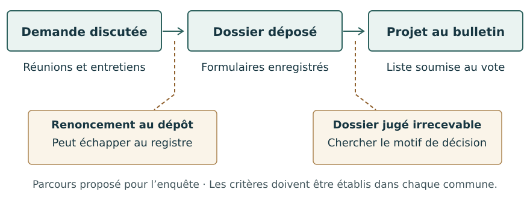

# ENS-PSL · Sélection internationale Lettres — Sciences sociales 2023 · Corrigé guidé

*Corrigé rédigé par IA, non officiel. Signalez toute erreur.*

**Rédaction** · GPT-6.2 Astra Ultra · vitesse non renseignée

## Partir des trois appuis du feuillet

La consigne demande un essai unique sur l’unité de quatre disciplines. Pour l’appuyer sur votre formation, choisissez un geste précis que vous avez appris, comme établir une chronologie, mener un entretien ou interpréter un pourcentage. Pour mobiliser une lecture, retenez une opération que l’auteur vous apprend à faire. Pour introduire votre projet, indiquez ce que vous souhaiteriez découvrir, quelles traces vous pourriez recueillir et quel résultat vous ferait changer d’explication. Un projet en préparation peut se discuter au conditionnel.

L’exemple qui suit propose d’étudier le passage d’une demande d’habitants à son inscription sur le bulletin d’un budget participatif. Le parcours et le projet du candidat restent à adapter. Aucune enquête réalisée n’est présumée.

## Construire le problème à partir d’un résultat possible

Imaginez un tableau de la mairie dans lequel figurent les projets soumis au vote. Le quartier A en compte davantage que le quartier B. Peut-on en conclure que ses habitants participent davantage ? Avant tout calcul, interrogez la fabrication du tableau. Une liste de projets recevables ne compte ni les propositions abandonnées ni les dossiers écartés. Elle confondrait aussi une association qui soumet trois projets avec trois associations qui en soumettent chacune un, si l’on s’en servait pour compter les groupes.

L’énigme de l’essai tient dans cet exemple. Les quatre disciplines peuvent demander comment le tableau a été fabriqué. Mais une enquête sur la durée des catégories, sur les usages du mot « collectif », sur la position des déposants ou sur le rôle d’une commission ne vérifie pas la même chose. On peut donc défendre l’unité des manières de soumettre une explication à la critique tout en montrant ce que la diversité des manières d’enquêter rend connaissable.

Lisez la figure de droite à gauche. Pour expliquer la présence d’un dossier sur le bulletin, il faut retrouver celui qui a décidé de sa recevabilité. Pour comprendre son dépôt, il faut remonter aux échanges qui ont rendu possible sa rédaction. Les occasions d’abandon ne laissent pas toutes une trace administrative.

## Une proposition d’essai

**Ouverture.** Un jardin figure au palmarès d’un budget participatif. Dire que « le quartier a choisi le jardin » soulève plusieurs questions. Qui a imaginé le projet, qui a pu le déposer, qui a décidé qu’il serait offert au vote et qui a effectivement voté ? Le commentaire de sources et la lecture de tableaux m’apprennent à distinguer les opérations résumées dans une seule phrase. Je voudrais me servir de ce problème pour défendre une thèse. Les quatre disciplines peuvent produire ensemble une explication du monde social quand leurs preuves se répondent et se corrigent. Cette unité demande de conserver plusieurs échelles d’analyse.

**Le travail que l’on peut soumettre à la critique des quatre disciplines.** Une preuve s’obtient en posant une question déterminée à une trace. Marc Bloch, dans l’*Apologie pour l’histoire*, invite à examiner la formation et la transmission des témoignages. Un compte rendu municipal est destiné à conserver des décisions. Il peut donner la date à laquelle un dossier a été accepté, tout en disant très peu de la négociation qui l’a précédée. De même, un entretien avec le signataire donne un récit situé de la mise en forme du projet. Si le signataire se présente comme l’auteur unique alors que le brouillon porte plusieurs écritures, le désaccord m’apprend quelque chose. Il faut reconstruire comment le travail initial de plusieurs personnes devient ensuite imputable à une seule. Un historien ou une anthropologue peuvent critiquer la même inférence en demandant qui parle, quand et dans quelles circonstances.

**Ce que la pluralité des questions fait découvrir.** Je commencerais par suivre l’histoire de la catégorie « déposant ». Si le règlement change, la même colonne peut désigner tantôt une personne, tantôt une association. Une série chiffrée exige cette vérification préalable. J’examinerais ensuite le groupe au travail. Qui parle au nom des voisins pendant la réunion et qui prend le temps, après celle-ci, de reformuler la demande ? Jean-Pierre Olivier de Sardan, dans « La politique du terrain », montre comment l’enquête ethnographique construit ses données en combinant plusieurs situations et interlocuteurs. Cette lecture me permet de rechercher aussi les désaccords de ceux pour qui le porte-parole officiel représente mal le groupe.

Comparer systématiquement ces situations soulèverait une question sociologique. Daniel Gaxie met en rapport, dans *Le Cens caché*, les inégalités de participation et la distribution sociale de la compétence politique. Cette lecture conduit à chercher quand des personnes qui soutiennent un aménagement se sentent ou non autorisées à le défendre publiquement. Je confronterais cette explication à une autre, portant sur la distribution institutionnelle du pouvoir. Une commission peut écarter les projets trop coûteux avant le scrutin. Même très mobilisé, un groupe peut alors échouer à faire soumettre sa demande au choix collectif. Qui contrôle la liste des possibles ? C’est ici que la science politique déplace l’explication, en amont du vote.

**Ce que permettrait de trancher le projet.** Je comparerais deux quartiers de la même commune au cours de deux éditions soumises à des règles que je pourrais dater. Je suivrais des demandes depuis leur mise en discussion, y compris celles qui sont retirées. J’associerais les archives de la procédure, l’observation de réunions et des entretiens menés aussi avec des habitants qui les ont quittées. Je distinguerais chaque fois les personnes, les projets déposés et les projets jugés recevables. Pour expliquer un abandon antérieur au dépôt, je chercherais par exemple qui a dû rédiger le dossier et à quel moment le temps lui a manqué. Pour expliquer un rejet au stade suivant, je lirais le motif de la commission et comparerais son application à des dossiers du même type.

Si des demandes semblables arrivaient à la commission mais y connaissaient des issues différentes après un changement de règle, j’examinerais en priorité l’évolution des critères et leurs usages. Si un quartier déposait très peu de dossiers malgré de nombreuses discussions observées, j’étudierais au contraire la transformation d’un souhait en formulaire. L’enquête pourrait révéler que les ressources associatives aident justement à anticiper les critères de la commission. Les deux mécanismes seraient alors liés. Cette possibilité rend nécessaire une enquête où chacun peut réexaminer la définition de la participation employée par les autres.

**Conclusion.** Une science sociale commune se reconnaît à la possibilité de discuter une interprétation sur des traces dont les conditions de production sont explicites. Pour expliquer le sort d’un même projet, il faut comprendre ce qu’un groupe appelle sa demande, comment il obtient la parole et comment des règles historiquement constituées transforment cette parole en décision. La coopération réussit quand le résultat obtenu dans une discipline oblige les autres à modifier leur question ou la portée de leur conclusion.

## Vérifier la place du parcours personnel

Relisez le passage où vous évoquez votre formation. Un lecteur doit pouvoir dire quel savoir-faire vous utilisez et quelle erreur il vous évite. Dans cet exemple, distinguer les unités d’un tableau évite de confondre des dossiers avec des personnes. Relisez ensuite chaque référence et cherchez la décision d’enquête qu’elle justifie. Enfin, demandez quels documents ou observations pourraient mettre votre projet en difficulté. Le recrutement des enquêtés par la seule mairie exclurait par exemple une partie des habitants qui ont renoncé avant le dépôt. Nommer ce manque donne déjà une indication sur le terrain à chercher.

[Feuillet officiel de l’écrit de sciences sociales, ENS-PSL, 2023](https://www.ens.psl.eu/sites/default/files/sc.sociales-ecrit-sil2023.pdf)
