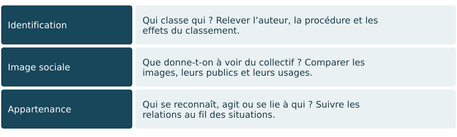

# ENS-PSL · Sociologie — identification, image sociale et appartenance (oral) 2023 — corrigé guidé

*Corrigé rédigé par IA, non officiel. Signalez toute erreur.*

**Rédaction** · GPT-6.2 Astra Ultra · vitesse non renseignée · 26 novembre 2026

## Sujet

Commenter l’extrait de Martina Avanza et Gilles Laferté (2005) sur les limites de la « construction des identités ». La fiche distingue ce texte d’oral de l’intitulé écrit « Classe, race, genre ».

## Préparer le commentaire

**Entrer par un désaccord précis.** Dans la controverse de Kaho‘olawe, suivre trois énonciateurs. Des militants attachent à une île une signification particulière. Une anthropologue étudie l’élaboration des traditions. Trask rapporte un usage militaire de ce raisonnement. Cette chaîne permet d’expliquer comment une proposition sur l’histoire d’une tradition change de sens et d’effet lorsqu’elle passe entre des mains différentes.

**Repérer l’architecture du passage.** L’ouverture accumule des expressions forgées pour rompre avec l’évidence du sens commun. Les auteurs annoncent ensuite trois difficultés. Seule la première reçoit un intertitre et une étude développée dans l’extrait. Présenter les deux autres en montrant comment on les étudierait, sans leur attribuer un développement absent du feuillet.

**Préparer une relance.** Si une personne revendique une appartenance immémoriale et que des archives montrent une reformulation récente, que vérifier ? Dater les formulations, étudier leur transmission, puis demander ce qui compte pour les personnes qui s’en réclament. Un premier document écrit tardif ne date pas nécessairement le début de toute pratique. L’efficacité actuelle se vérifie séparément, par exemple dans l’organisation collective de l’accès à un lieu.

## Commentaire proposé

L’expression « construction des identités » voulait introduire du mouvement là où le sens commun voyait une donnée naturelle. Comment a-t-elle pu devenir, à son tour, un obstacle à l’enquête ? Dans cet extrait de *Genèses*, Avanza et Laferté déplacent la discussion. Retracer une histoire éclaire la formation d’un groupe. Conclure de cette genèse à l’inconsistance du groupe ajoute au constat historique un jugement dont les usages peuvent échapper au chercheur.

### Des mots qui semblent prononcer un verdict

« Construction », « fabrique » et « invention » attirent l’attention sur des intermédiaires, des choix et des dates. En ce sens, ces mots permettent de poser une question vérifiable. Qui a sélectionné des pratiques pour les présenter comme une tradition commune ? Mais « invention » possède aussi, dans la conversation ordinaire, le sens de fabrication mensongère. Pour une personne qui a appris ces pratiques dans sa famille ou y a engagé sa vie, l’annonce savante d’une invention peut sonner comme une accusation d’imposture. Les auteurs analysent ce choc de registres. Le malentendu a une base sociale. Le chercheur dispose d’une autorité de publication que l’enquêté ne possède pas toujours.

### Une controverse sur le pouvoir de définir

Dans l’Océanie des indépendances et des mobilisations des années 1970 et 1980, la revalorisation des traditions soutient des revendications d’autonomie. Roger Keesing examine l’invention de la tradition dans cette conjoncture. Haunani-Kay Trask conteste le pouvoir que s’arrogent des chercheurs extérieurs de décider ce qu’est une culture légitime. L’exemple hawaïen fait passer du débat académique à un conflit territorial. D’après Trask, la marine américaine s’est servie de travaux de Jocelyn Linnekin sur les traditions pour écarter l’argument des opposants aux exercices sur l’île de Kaho‘olawe. Le texte rapporte cette accusation. Il ne permet d’établir ni une intention de Linnekin en faveur de ces exercices ni, à lui seul, le poids causal de sa publication dans la décision. Pour l’étudier, il faudrait confronter les raisons données par l’administration aux dossiers de mobilisation et aux témoignages des intéressés.

### Observer séparément la désignation, les images et l’expérience

La seconde difficulté annoncée tient au privilège accordé aux producteurs des catégories. Identifier qui formule une image collective n’explique pas pourquoi certains la reprennent, d’autres la refusent ou s’y reconnaissent partiellement. La troisième difficulté touche aux institutions. Un classement peut être révisable et pourtant régler durablement l’allocation d’un droit, d’un espace ou d’une reconnaissance. L’indication finale empruntée à Ian Hacking vise le passage trop rapide du caractère historique d’une chose à l’espoir de la dissoudre par son dévoilement.

La distinction proposée dans le titre conduit alors à trois opérations. L’identification pose la question de qui classe qui, avec quel instrument et quelle autorité. L’image sociale conduit aux représentations publiques, à leurs auteurs et à leurs destinataires. L’appartenance se saisit dans des liens vécus, des obligations, des pratiques et des attachements. Il peut y avoir désaccord entre les trois. Une personne peut figurer dans une catégorie administrative, refuser l’image publique qui lui est associée et entretenir des liens forts avec d’autres personnes classées de même. Les archives des institutions, l’étude des discours et l’enquête auprès des personnes éclairent alors des relations différentes. La portée du constructivisme se mesure à ce qu’il permet d’expliquer de ces écarts, y compris lorsqu’une catégorie finit par s’imposer à ceux qui l’avaient contestée.

## Source

[Sujet officiel](https://web.archive.org/web/20251105050415id_/https://www.ens.psl.eu/sites/default/files/oral-6.pdf)
