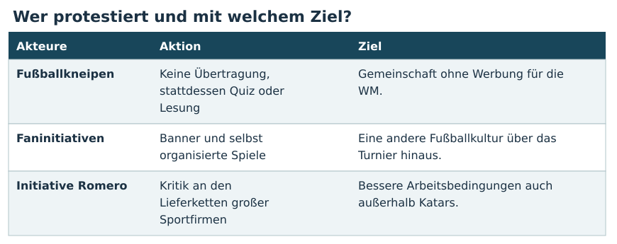

# ENS Rennes · D-E · Allemand 2023 — Corrigé guidé

*Corrigé rédigé par IA, non officiel. Signalez toute erreur.*

**Rédaction** · GPT-6.2 Astra Ultra · vitesse non renseignée

## I. Version

> [!INDICATION]
> Le journaliste demande d’imaginer une carte avant de revenir au rapport des Nations unies. *Derweil* introduit ce qui arrive dans le même temps. Le *nur* isolé insiste sur l’insuffisance des intentions elles-mêmes, avant même de se demander si elles seront suivies d’effet.

Voici, entre autres, ce qui s’est passé cette semaine : des inondations extrêmes ont frappé le Nigeria et risquent fort d’y déclencher une épidémie de choléra. Pendant ce temps, aux États-Unis, le Mississippi s’assèche. L’eau salée du golfe du Mexique a déjà pénétré à l’intérieur des terres américaines sur cent kilomètres de plus qu’en temps normal. Le gouvernement pakistanais estime à plus de quarante milliards de dollars les dégâts causés par les inondations d’il y a trois semaines.

Imaginez, je vous prie, un globe terrestre avec trois points rouges indiquant le sud des États-Unis, le Nigeria et le Pakistan. D’ici à dix ans, lorsque le seuil de 1,5 degré aura très probablement été franchi, les catastrophes qui constellent déjà le globe se seront multipliées à un rythme vertigineux, comme des boutons de varicelle. Toujours plus de points rouges, partout.

Des mouvements migratoires sans précédent attendent donc le monde, et cela dans un avenir très proche, bien avant 2050. Ici, comme partout dans ce qu’on appelle les pays du Nord, on continue pourtant de faire comme si nous avions encore le temps.

L’ONU vient de dresser un constat amer : c’est une erreur. Les engagements actuels des pays du monde, leurs seules intentions, sont très loin de suffire pour atteindre l’objectif fixé par l’accord de Paris sur le climat, à savoir limiter la hausse de la température terrestre à 1,5 degré par rapport à l’ère préindustrielle. Le rapport de l’ONU sur l’écart entre les émissions que nous pourrions nous permettre et celles que nous produisons s’intitule « La fenêtre se referme ».

## II. Thème

> [!INDICATION]
> Avec *obwohl*, placer le verbe conjugué en fin de proposition. *In Deutschland* restitue le point de vue français de « outre-Rhin » dans un article allemand. Le discours rapporté de Merz conserve le moment du congrès, la sortie de Hu Jintao et la référence à Taïwan.

Obwohl die Reise nur kurz dauert, wird sie alles andere als eine reine Formsache sein. Am Freitag, dem 4. November, wird Olaf Scholz nur elf Stunden in Peking bleiben. Doch schon bevor er überhaupt aufbricht, zeichnet sich ab, dass dieser erste China-Besuch des Bundeskanzlers heikler sein wird als sämtliche zwölf Reisen, die Angela Merkel in ihren sechzehn Amtsjahren von 2005 bis 2021 in das Land unternommen hat.

In Deutschland stößt der Kurzbesuch vielfach auf Kritik. Viele halten den Zeitpunkt für verfehlt. Der Vorsitzende der deutschen Christdemokraten, Friedrich Merz (CDU), findet, Olaf Scholz hätte sich für seine Reise nach Peking „keinen schlechteren Zeitpunkt aussuchen können“. Sie findet weniger als zwei Wochen nach dem zwanzigsten Parteitag der Kommunistischen Partei Chinas statt, „auf dem massive Drohungen gegen Taiwan ausgesprochen wurden und der Vorgänger von Staatspräsident Xi Jinping, Hu Jintao, vor den Augen der ganzen Welt aus dem Saal geführt wurde“. Selbst in der Bundesregierung sorgt der Zeitpunkt dieses offiziellen Besuchs, des ersten eines europäischen Spitzenpolitikers in China seit Beginn der Covid-Pandemie, für erhebliches Unbehagen. „Der Bundeskanzler hat entschieden, diese Reise zu diesem Zeitpunkt zu machen“, sagte Annalena Baerbock.

## III.1. Warum werden im Artikel die Widerstandsinitiativen gegen die Fußballweltmeisterschaft in Qatar als heterogen bezeichnet?

> [!INDICATION]
> Deux listes de noms ne suffisent pas. Relier chaque acteur à sa motivation, à sa pratique et à l’horizon de son engagement. Le document parle d’un réseau visible avant le tournoi, pas d’un boycott unanime en Allemagne.

Die Initiativen sind heterogen, weil Menschen und Organisationen mit unterschiedlichen Erfahrungen aus demselben Anlass tätig werden. In der Fußballkneipe Lotta gehört das gemeinsame Zuschauen normalerweise zur Freude an einer Weltmeisterschaft. Gerade deshalb fällt ein schwarzer Bildschirm dort auf. Die Betreiber laden zu einer Lesung, einem Quiz oder einem Dartsturnier ein. Sie möchten ihre Gäste weiterhin zusammenbringen und zeigen, dass man den Fußball lieben kann, ohne jede Entscheidung der Veranstalter mitzutragen.

Andere Beteiligte kommen aus der organisierten Fanszene, der Kultur oder der politischen Bildungsarbeit. Fangruppen zeigen im Stadion Banner, während Musiker und Kinobetreiber ein anderes Publikum erreichen können. Für die christliche Initiative Romero endet die Frage der Menschenwürde nicht bei den Baustellen in Katar. Sie interessiert sich ebenfalls für die Bedingungen, unter denen Trikots und andere Sportartikel in den Lieferketten internationaler Unternehmen hergestellt werden. Diese Perspektive richtet sich auch dann noch an die Fans, wenn das Endspiel längst vorbei ist.

Unterschiedlich sind somit die Mittel, die Adressaten und der zeitliche Horizont. Manche hoffen auf sinkende Einschaltquoten, andere wollen vor allem eine dauerhafte Diskussion über Macht und Verantwortung im Profifußball anstoßen. Eine Vertreterin der Initiative Back2Bolzen lehnt es ab, jedem Zuschauer ein schlechtes Gewissen zu machen. Gerade diese Offenheit kann Menschen verbinden, die sich über einen vollständigen Boykott sonst kaum einigen würden. Der Artikel bezeichnet das Netzwerk allerdings nicht als Massenbewegung. Seine Bedeutung liegt vielmehr darin, dass Gruppen, die selten gemeinsam auftreten, ihre verschiedenen Anliegen öffentlich miteinander verknüpfen.

*236 mots.*

## III.2. Halten Sie es für richtig, dass Sport sich in Politik einmischt?

> [!INDICATION]
> Distinguer l’expression d’un sportif, les obligations d’une fédération et une prise de position imposée à toute l’équipe. Pour défendre la liberté de parole, traiter également le cas de l’athlète qui préfère se taire.

Ich halte es für richtig, wenn Sportler und Verbände zu politischen Fragen Stellung nehmen, die mit ihrem Handeln unmittelbar zusammenhängen. Wer einen internationalen Wettbewerb vergibt, entscheidet schließlich auch darüber, wohin Geld fließt und unter welchen Bedingungen Stadien gebaut werden. Es wäre widersprüchlich, über Eintrittspreise und Sponsorenverträge zu verhandeln, berechtigte Fragen zu Löhnen und Sicherheit aber grundsätzlich als sachfremd abzutun. Verbände sollten vor einer Vergabe überprüfbare Kriterien veröffentlichen und Beschäftigten eine Möglichkeit geben, Beschwerden vorzubringen.

Daneben haben einzelne Sportler als Bürger das Recht, ihre Meinung zu äußern. Wenn eine Spielerin von rassistischen Beschimpfungen berichtet, kann sie mit ihrer Bekanntheit Menschen erreichen, die einen gewöhnlichen Beschwerdebrief nie lesen würden. Ihre Aussage gewinnt nicht automatisch durch ihre sportlichen Erfolge an Sachkenntnis. Sie verdient jedoch denselben Schutz wie die öffentliche Äußerung anderer Bürger. Zu dieser Freiheit gehört auch die Möglichkeit, eine Stellungnahme abzulehnen. Ein Mannschaftskapitän kann nicht ohne Weiteres für alle Mitspieler sprechen.

Problematisch wird die politische Rolle des Sports, wenn Regierungen Siege zur Werbung für ihre gesamte Politik verwenden oder ein Verein die Zugehörigkeit von einer bestimmten Parteimeinung abhängig macht. Fans sollten trotz unterschiedlicher Überzeugungen gemeinsam spielen und feiern können. Für mich verläuft die Grenze daher dort, wo freiwilliges Engagement in erzwungene Zustimmung übergeht. Im Fall eines großen Turniers würde ich die Verantwortlichen zuerst nach den Folgen ihrer eigenen Entscheidungen fragen. Ein Verband, der die Arbeitsbedingungen bei seinen Vertragspartnern überprüfen lässt und die Ergebnisse veröffentlicht, leistet mehr als mit einem feierlichen Bekenntnis vor dem Anpfiff.

*242 mots.*

[Sujet](https://www.ens-rennes.fr/medias/fichier/sujet-e-crit-allemand-d-e-2023_1682689391162-pdf) · [Rapport](https://www.ens-rennes.fr/medias/fichier/rapport-de-jury-lve-e-crit-allemand-d-e-2023_1698423068759-pdf)
