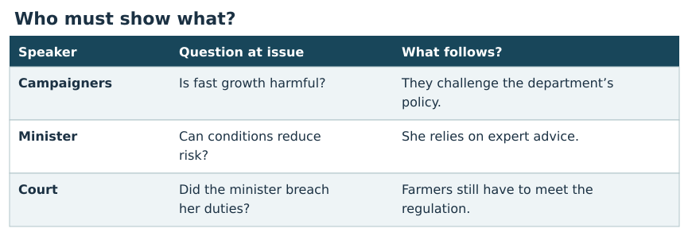
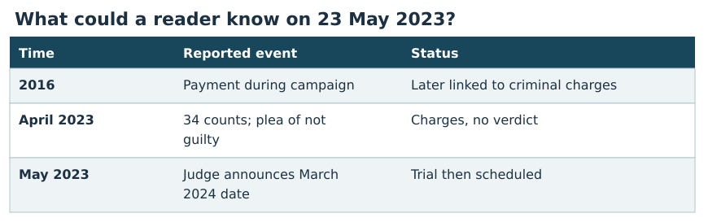

# ENS Rennes · D-E · Anglais (oral) 2023 — Corrigé brut

*Corrigé rédigé par IA, non officiel. Signalez toute erreur.*

**Rédaction** · GPT-6.2 Astra Ultra · vitesse non renseignée

Le fascicule propose quatre articles des 23 au 30 mai 2023, imprimés sous les numéros 1, 3, 4 et 5. Les quatre analyses suivent les pages dans cet ordre. Les questions d’entretien sont proposées pour l’entraînement.

## Sujet 1 (p. 1) — Australian judge apologises after claiming that colleagues are appointed regardless of merit

**Presentation.** How did a speech that had yet to be delivered become a matter of judicial confidence? In his report of 26 May, Nino Bucci follows a draft through several settings: a judge’s desk, an official Australian court website and an international conference which the judge was planning to attend in Taiwan. I will first examine what the judge alleged and then explain why the place of publication mattered.

Justice Joshua Wilson argued that politics influenced most judicial appointments. He went further when discussing progressive governments: he suggested that some valued gender and ethnic diversity at the expense of professional ability. These are two claims with different burdens of proof. A government may make an appointment and take representation into account while still appointing an excellent lawyer. Bucci quotes Wilson directly, so that readers can hear how confident his generalisations sound. Yet the report supplies no selection records or comparisons from which readers could test them.

The next voice is Chief Justice William Alstergren’s. Other judges drew his attention to the paper, which had appeared online without his permission. He had it removed, dissociated the courts from its contents and said Wilson would no longer go to the meeting. Wilson apologised to colleagues. Contrast the two audiences: conference delegates might have understood that Wilson was speaking as an association member, whereas a reader on a court website might reasonably have assumed institutional approval. Removing the draft therefore addressed a problem that a personal apology alone could hardly solve.

The public has a legitimate interest in how judges are selected. Publishing criteria or explaining the appointments process could help people scrutinise it. To imply that diverse colleagues owe their position to politics without showing how any selection was made may instead undermine confidence in particular judges. The article reports the response in considerable detail, but readers hear little from individual appointees or from those who choose them.

**Could an apology settle the question of merit?** It acknowledges the harm felt by colleagues. Evidence about how candidates were assessed would still be needed to decide the merits of the argument.

**Was Wilson speaking for the courts?** The chief justice says he was going to the conference as an association member. The official website is precisely what made that distinction hard to see.

## Sujet 3 (p. 2) — Animal welfare groups lose court challenge over ‘Frankenchickens’

**Presentation.** A judicial defeat and an argument about suffering sit side by side in Haroon Siddique’s report of 24 May. I will explain the campaigners’ challenge and then look at the narrower question the High Court answered.

The Humane League UK objected to England’s policy on fast-growing broiler chickens. These birds can reach about 2.2 kilograms in 34 to 36 days. Campaigners associated rapid growth with painful health problems. They invoked a 2007 rule under which keeping an animal for farming must be compatible with a reasonable expectation that its inherited characteristics and observable traits allow it to live without harm to its health or welfare. Their case therefore concerned both biology and what the department should do about the evidence.

The environment secretary accepted that fast-growing birds might face greater risks. Her position, as the judge describes it, was that housing and other environmental conditions also affect outcomes. She had reviewed research and sought expert advice. The judge dismissed the challenge and located the immediate responsibility for keeping birds in appropriate conditions with farmers. The ruling described in this article did not inspect every farm or give each flock a clean bill of health.

Notice how the story moves from the campaigners’ emotionally charged nickname in the headline to the judge’s careful vocabulary. The claim that roughly a million birds die on farms each week is attributed to the organisation. A reader would also want comparative mortality rates for different breeds under similar conditions and independent evidence about how inspections work. My own conclusion is that an unsuccessful legal challenge can leave a policy question open. The public can ask whether existing safeguards are effective and whether monitoring should change even after the minister’s conduct survives judicial review.

**Would better housing settle the issue?** It could reduce some avoidable harms. To know how far it compensates for inherited risks, researchers would need to compare breeds living under similar conditions.

**Why use the nickname in quotation marks?** It captures the campaigners’ fear that intensive breeding has gone too far. The quotation marks also help the reporter identify the label as advocacy.

## Sujet 4 (p. 3) — CBI sought legal advice over possible insolvency after misconduct scandal

**Presentation.** How could misconduct inside a lobby group threaten its very existence? In her 30 May article Anna Isaac traces the connection between staff safety, the confidence of members and the Confederation of British Industry’s finances. The CBI claimed to be the “voice of business”. Its ability to speak depended on companies staying and politicians listening.

The immediate news was the board’s decision to seek legal advice about possible insolvency and restructuring. More than fifty members, including NatWest and John Lewis, had left after reports of serious misconduct. Both the government and the Labour Party had suspended engagement. Those events weakened two sources of the organisation’s value at once: the breadth of the membership it represented and the political access it could offer. For around three hundred employees, that meant uncertainty about their jobs. Seeking advice was prudent in those circumstances. It did not establish that the group had already become insolvent.

Isaac also reports what president Brian McBride admitted. He described failings in recruitment, promotion, training and responses to complaints. His distinction between competence and behaviour raises a question about how organisations define professional performance. If managers are rewarded while their handling of complaints goes unexamined, the incentive to protect staff remains weak. Providing an independent way to report concerns and checking what happens to those reports can make accountability observable.

The timetable creates urgency. Members were due to vote on 6 June, after the publication of a recovery proposal. A vote could authorise the new leadership to work, but rebuilding trust among staff would take evidence over time. The report gives substantial space to the leadership’s words. The employees’ anxiety appears near the end, and we hear little directly from people who raised complaints. That distribution of voices helps explain why a convincing prospectus alone might fall short.

**Why would the parties suspend contact?** Meeting the CBI had become reputationally costly, and its claim to represent businesses was weaker after major departures. Neither consequence in itself determines the outcome of an investigation.

**What would reassure employees after a successful vote?** A confidential route for reporting concerns, clear response deadlines and independent checks on how senior managers act would allow staff to judge progress for themselves.

## Sujet 5 (p. 4) — Trump hush money trial set for March 2024 during Republican primaries

**Presentation.** On 23 May 2023 Martin Pengelly and the agencies report on a hearing in Manhattan. There are two overlapping calendars: one for criminal proceedings, the other for a candidate seeking the Republican nomination. I will distinguish the judge’s scheduling decision from the political interpretation Donald Trump gave it.

At the time of the report, the trial was due to start on 25 March 2024. Trump had pleaded not guilty to 34 counts of falsifying business records linked to a payment made during the 2016 campaign. The distinction matters: the payment explains the setting, while the way the records were kept is the conduct at issue in the charges. The hearing set arrangements for a future trial. It delivered no verdict.

Judge Juan Merchan asked Trump to keep the trial period free. The hearing also addressed disclosure: the order restricted sharing previously non-public prosecution material, with some material available only to the lawyers. Trump, who appeared by video, subsequently claimed on his own social platform that the timetable infringed his freedom of speech and amounted to electoral interference. The reporter quotes those claims and gives the judge’s response that he sought to leave room for campaigning. Restrictions on the use of evidence and a blanket restriction on campaigning would have very different implications.

What is at stake is equality before the law during an election. Suspending every case involving a candidate could create an incentive to run for office to obtain a delay. Courts also have reason to acknowledge practical conflicts and explain decisions publicly. The article places Trump’s choice of the words “election interference” in the context of their earlier use about 2016. That is a piece of journalistic framing. It helps explain the political force of the accusation without proving its truth. The separate civil proceedings mentioned at the end provide news context and do not resolve the criminal case.

**Could the defendant discuss the case in public?** The reported order addressed the release of specified evidence. The judge said he intended to leave the candidate able to campaign, though practical scheduling conflicts remained.

**Why mention the flags behind the defendant?** They describe what viewers saw on the video link. They also remind readers that one appearance could be read simultaneously as a court hearing and as a political image.

[Sujet](https://www.ens-rennes.fr/medias/fichier/annales-oral-anglais-d-e-2023_1698768003648-pdf) · [Rapport](https://www.ens-rennes.fr/medias/fichier/rapport-de-jury-lve-oral-anglais-d-e-2023_1698421690709-pdf)
