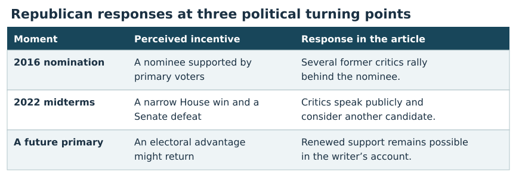

# ENS Rennes · D-E · Anglais 2023 — Corrigé brut

*Corrigé rédigé par IA, non officiel. Signalez toute erreur.*

**Rédaction** · GPT-6.2 Astra Ultra · vitesse non renseignée

## I. Version

Depuis environ trois siècles que l’ère des énergies fossiles a véritablement commencé, niveau de vie et émissions ont augmenté de concert. Pourtant, au cours de la dernière décennie, de plus en plus de pays ont réussi à accroître leur PIB tout en réduisant leurs émissions. Selon le décompte de *The Economist*, ils sont 33 et rassemblent plus d’un milliard d’habitants.

Après un pic en 2007, les États-Unis ont ramené leurs émissions territoriales de 6,13 milliards de tonnes équivalent CO₂ à 5,26 milliards avant la pandémie. Ce résultat ne tient pas simplement au fait que les Américains importeraient désormais leurs jouets et leurs appareils électroniques de pays plus polluants. Fait remarquable, les émissions liées à la consommation, dont le calcul prend en compte le carbone incorporé aux importations, ont reculé de 15 % sur la même période.

Ce découplage tient en grande partie à deux changements majeurs. Le premier touche à la structure des économies. À mesure qu’ils s’enrichissaient, les pays ont développé leur secteur des services, moins gourmand en énergie que l’industrie manufacturière. En Grande-Bretagne, berceau de la révolution industrielle, les comptables, les employés de magasin et les autres travailleurs des services assurent aujourd’hui les quatre cinquièmes de la production. Même en Allemagne, réputée pour ses prouesses industrielles, la part de l’industrie manufacturière dans le PIB diminue. La croissance nécessite donc moins d’énergie pour chaque unité de richesse produite.

Deuxièmement, les importations deviennent moins polluantes. Durant la décennie qui a suivi la crise financière, le secteur exportateur chinois s’est décarboné plus rapidement que le reste de l’économie du pays. Cela a contribué à réduire l’empreinte carbone globale des pays riches. En outre, la production manufacturière se déplace hors de Chine, pays qui, par dollar de PIB, pollue davantage que l’Inde ou l’Indonésie.

## II. Thème

Creative art projects, classes in drama, photography, dance, music or art history, student drawing and sewing clubs and more: like many engineering students, twenty-year-old Lily Houël was somewhat “surprised” when she discovered the unusual teaching methods at the École de biologie industrielle (EBI) in 2020.

“When they give us ten minutes, for instance, to make up a story of our choice, with a plot, a middle and an ending, and tell it to our classmates, our first thought is that it’s a strange thing to do at engineering school and that we’ll never manage it,” Lily Houël explains. “But we do, and people come up with some really original stories. You realise you can try things that are a little crazy without getting a negative response, that you can go off the beaten track, embrace what makes you different and, above all, put it into practice at work.”

Are tomorrow’s young engineers now also expected to know how to do “things that are a little crazy”, as she puts it? Although she had never heard of “mad skills” until someone mentioned them to her, employers today are said to be looking for them more and more. The conference of directors of French engineering schools (CDEFI) even devoted a discussion to them at its annual meeting in June, which explored the jobs of the future and the skills that the engineers of tomorrow will need to develop.

## III.1. Explain and discuss the fluctuations of conservatives over Donald Trump.

Conservative reactions to Donald Trump have fluctuated with their estimates of what he can do for the Republican Party. Before he secured the 2016 nomination, some prominent conservatives objected openly to his conduct. Once voters had chosen him, opposing him meant risking influence within the party and possibly helping the Democrats. Many critics consequently became public supporters. Even events that might have warranted a lasting break produced only brief departures from that pattern.

The 2022 midterms changed the calculation. Republicans regained the House by a narrow margin and failed to win the Senate, despite circumstances that seemed favourable to the opposition. Leading conservatives could now argue that loyalty to Trump was costing their party seats. Their willingness to criticise him on the record mattered because an objection made in public is harder to retract quietly than a remark made anonymously. The attention given to Ron DeSantis nevertheless suggested that some wanted a more effective candidate who would pursue much the same political agenda.

The article persuasively distinguishes a breach with one politician from a rejection of his ideas. It is less easy to establish precisely why each individual changed position. A disappointing election may give people who had genuine objections the opportunity to voice them. The best test would be their behaviour when speaking out was once again costly. Would they defend electoral procedures against a popular nominee from their own party? The author's account leaves considerable room for another reversal if the electoral incentives change again.

*247 mots.*

## III.2. Should we always oppose self-interests and principles in politics?

Interests and principles can point in the same direction. A representative who supports cleaner drinking water may believe that everyone deserves a safe water supply and also know that voters will reward her for securing it. The prospect of re-election gives her a reason to listen carefully to residents. It would be odd to dismiss the resulting improvement simply because she benefits politically from a decision she can defend on its merits.

There are situations, however, in which the distinction is essential. Imagine that the same representative is asked to support a recount in a close election. An accurate count is a principle she has previously invoked when her party was behind. If she now opposes it solely because her candidate is ahead, she has made the rule depend on who stands to gain. The useful question is whether she would accept the same procedure if the positions of the candidates were reversed. A public commitment made before the votes are cast makes that question easier to answer.

Institutions can bring the two motives closer together. Publishing the criteria for awarding local contracts, for instance, allows taxpayers and rival bidders to examine decisions. An officeholder who wants to retain public trust then has a personal reason to apply the criteria consistently. Such arrangements leave room for ambition while directing it towards a defensible end. Citizens cannot reliably read their representatives’ minds, but they can ask for reasons, compare votes over time and watch what happens when defending a rule carries an electoral cost.

*253 mots.*

[Sujet](https://www.ens-rennes.fr/medias/fichier/sujet-e-crit-anglais-d-e-2023_1682689417872-pdf) · [Rapport](https://www.ens-rennes.fr/medias/fichier/rapport-de-jury-lve-e-crit-anglais-d-e-2023_1698422078589-pdf)
