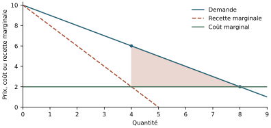
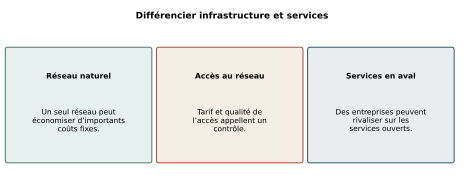

# ENS Rennes D-E — Composition d’ordre économique 2023 · Corrigé brut

*Corrigé rédigé par IA, non officiel.*

**Rédaction** · GPT-6.2 Astra Ultra · vitesse non renseignée

## La défense de la concurrence doit-elle être une préoccupation des politiques publiques ?

### Introduction

En 2019, la Commission européenne a interdit le rapprochement entre les activités ferroviaires de Siemens et d’Alstom en raison de ses effets attendus sur certains marchés de la signalisation et de la très grande vitesse. Une politique industrielle pouvait pourtant y voir un moyen de faire émerger un acteur européen de grande taille. Le différend rend manifeste la question du sujet. Par quel raisonnement justifier la protection de la rivalité entre producteurs et jusqu’où doit-elle orienter les autres décisions publiques ? [Décision annoncée par la Commission, 6 février 2019](https://ec.europa.eu/commission/presscorner/api/files/document/print/nl/ip_19_881/IP_19_881_EN.pdf)

La concurrence est un processus par lequel des offreurs cherchent à attirer des clients et des entrants peuvent contester les positions acquises. Sa défense suppose une intervention lorsque des pratiques ou des structures risquent de neutraliser cette rivalité. Elle ne se confond pas avec la sauvegarde de chaque entreprise existante. Une entreprise peut disparaître parce qu’une autre offre un produit meilleur. Les politiques publiques poursuivent aussi l’innovation, la sécurité d’approvisionnement, la réduction des externalités et la redistribution.

Une défense de la concurrence est nécessaire parce que le processus peut se détruire lui-même et que sa disparition a des coûts mesurables. Sa place dans l’action publique dépend cependant du mécanisme concret et des autres objectifs à atteindre. Le simple comptage des entreprises ne suffit à décider ni d’une sanction ni d’une dérogation.

### I. La rivalité soutient l’efficacité mais ne garantit pas sa propre préservation

#### A. Les prix concurrentiels peuvent coordonner les décisions privées

Sous les hypothèses du premier théorème de l’économie du bien-être, un équilibre concurrentiel est efficace au sens de Pareto. Les agents prennent les prix comme donnés, les marchés pertinents existent, les effets des choix sur autrui sont pris en compte, et les préférences satisfont notamment à la non-satiété locale. Lorsque la dernière unité consommée vaut autant que la dernière unité produite coûte, il n’existe plus de gain mutuel simple à accroître ou réduire cet échange. L’atomisation est un moyen d’illustrer la prise des prix comme donnés, non une mesure suffisante de l’efficacité.

Une entreprise qui peut fixer son prix tient compte de la recette perdue sur les unités antérieures lorsqu’elle augmente la quantité. Avec une demande inverse $P=10-Q$ et un coût marginal constant égal à 2, l’équilibre concurrentiel conduit à $Q=8$ et $P=2$. Le monopole choisit la quantité où la recette marginale $10-2Q$ atteint 2. Il vend 4 unités à 6. Entre 4 et 8, chaque unité aurait valu davantage à son acheteur qu’elle n’aurait coûté à produire. La perte de surplus total est $4\times4/2=8$ dans les unités de l’exemple. Une partie de la baisse de surplus des consommateurs est par ailleurs transférée au producteur.

Cette démonstration rend intelligible l’objectif de discipline sur les prix. La rivalité porte également sur la fiabilité, la variété, les conditions d’accès et la qualité du service. Elle incite les entreprises à rechercher des procédés plus efficaces quand un rival peut attirer leur clientèle. Sur une plateforme à prix monétaire nul, dégrader la confidentialité ou le choix peut imposer un coût réel que la seule observation du prix manque.

#### B. Des règles publiques empêchent certaines stratégies d’étouffer la rivalité

Un marché n’est pas protégé par le seul intérêt individuel de ses producteurs. Une entente sur les prix ou le partage de clientèle augmente leurs profits en supprimant la concurrence qu’ils devraient se livrer. Une entreprise déjà dominante peut exploiter des exclusivités, empêcher l’interopérabilité ou verrouiller une infrastructure essentielle. Une fusion peut supprimer une contrainte concurrentielle avant même qu’un comportement illicite ait lieu.

Le droit de l’Union combine interdiction des ententes restrictives, contrôle des abus de position dominante et examen préalable de certaines concentrations. L’instruction doit délimiter le marché pertinent, examiner les substituts, les possibilités d’entrée, les gains d’efficacité vérifiables et la situation vraisemblable sans l’opération. La position dominante seule ne constitue pas un abus. Maintenir artificiellement un concurrent inefficace peut au contraire réduire le surplus sans rendre le marché plus contestable.

Dans le numérique, économies d’échelle, données, coûts de changement et effets de réseau peuvent transformer un succès initial en avantage cumulatif. Le règlement européen sur les marchés numériques, entré en vigueur en novembre 2022, prévoit des obligations ciblées pour les contrôleurs d’accès et une application générale à partir du 2 mai 2023. Il complète l’intervention au cas par cas par des obligations préventives. Le règlement sur les services numériques vise d’autres risques des services en ligne. Les deux textes ne se substituent pas l’un à l’autre. [Règlement européen sur les marchés numériques](https://eur-lex.europa.eu/legal-content/FR/TXT/?uri=CELEX:32022R1925)

### II. La politique de concurrence doit s’articuler avec les autres objectifs collectifs

#### A. L’efficacité statique n’épuise ni l’innovation ni le service public

Une baisse de prix aujourd’hui est un gain important, mais l’investissement dans la recherche supporte des coûts irrécouvrables. Si un concurrent peut copier immédiatement sans contribuer aux frais, un inventeur peut renoncer à un projet socialement utile. Un brevet temporaire présente donc une contrepartie possible en innovation, au prix d’un pouvoir de marché et parfois de barrières à l’innovation suivante. La durée, l’étendue de la protection, les financements publics et les licences modifient cet arbitrage. Des rentes durables peuvent aussi décourager une entreprise installée d’innover.

Dans un réseau à coûts fixes élevés, un monopole naturel peut desservir la demande à un coût total inférieur à celui de plusieurs réseaux concurrents. Obliger à doubler les canalisations permettrait le choix du fournisseur au prix d’un gaspillage d’infrastructure. Il reste possible d’ouvrir les segments contestables, d’encadrer les tarifs d’accès et de contrôler la qualité. Lorsque le coût marginal est inférieur au coût moyen, la tarification au coût marginal ne finance pas seule le réseau. Abonnement, aide publique ou mécanisme de péréquation engagent des choix de répartition.

La concurrence peut même amplifier un dommage insuffisamment tarifé. Si toutes les entreprises ignorent le coût social d’une pollution, intensifier la rivalité peut accroître les quantités au-delà de l’optimum social. La théorie du second rang rappelle que corriger isolément une imperfection lorsque d’autres contraintes subsistent ne garantit pas un gain de bien-être. Tarifer la nuisance et maintenir la contestabilité poursuivent des objectifs complémentaires. L’exemple interdit de transformer le modèle concurrentiel en prescription identique pour tous les marchés.

#### B. Comparer les institutions et contrôler les dérogations

Les deux théorèmes du bien-être éclairent la distinction entre efficacité et répartition. Sous des conditions supplémentaires, notamment de convexité, un optimum peut être soutenu par un équilibre concurrentiel après redistribution appropriée des dotations. En pratique, des transferts forfaitaires parfaits sont rarement disponibles. Garantir l’accès à un service sur un territoire isolé ou financer un bien public nécessite parfois une obligation de service ou un financement collectif. Le choix doit préciser qui paie, qui reçoit et quelles marges de concurrence peuvent être conservées.

Une politique industrielle peut favoriser la recherche mutualisée, la formation ou l’infrastructure et ainsi faciliter l’entrée. À d’autres moments elle souhaite soutenir une grande entreprise existante. Invoquer la concurrence mondiale ne suffit pas à justifier toute concentration locale. Inversement, la taille requise pour mener un programme de recherche ou assumer un coût fixe ne peut être écartée par principe. Il faut établir la vraisemblance des gains, leur transmission aux demandeurs et l’absence d’un instrument moins restrictif, tel un programme commun de recherche à accès ouvert.

L’autorité publique peut elle-même créer des barrières par des licences rares, des clauses de marchés publics ou des normes dessinées pour les producteurs installés. Une politique cohérente teste l’effet concurrentiel des règles qu’elle adopte et fixe un horizon de réexamen aux aides. Elle compare les résultats, en prix, qualité, innovation et entrée, au scénario qu’aurait produit l’absence d’intervention. Une grande entreprise efficace peut alors être laissée prospérer, tandis qu’une pratique d’exclusion fait l’objet d’un remède ciblé.

### Conclusion

La défense de la concurrence mérite une place explicite parmi les politiques publiques parce que la rivalité discipline les producteurs et que les acteurs en place peuvent neutraliser cette discipline. L’efficacité de la démarche dépend toutefois du marché, des externalités, de l’horizon de l’innovation et de l’accès de tous aux services essentiels. Décider consiste à identifier un dommage concurrentiel, à le comparer à des gains vérifiables et à retenir l’intervention qui protège les possibilités de choix et d’entrée au moindre coût collectif.

[Sujet distribué](https://www.ens-rennes.fr/medias/fichier/sujet-economie-2023_1682689319222-pdf) · [Rapport du jury](https://www.ens-rennes.fr/medias/fichier/rapport-de-jury-e-crit-e-conomie-d-e-2023_1699435786817-pdf)
