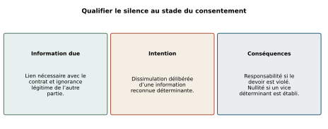
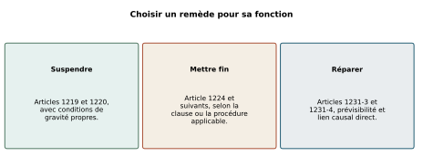

# ENS Rennes D-E — Droit civil 2023 · Corrigé guidé

*Corrigé rédigé par IA, non officiel.*

**Rédaction** · GPT-6.2 Astra Ultra · vitesse non renseignée

## La malhonnêteté du cocontractant

### Introduction

> [!INDICATION]
> Comparer deux silences dont l’enjeu économique paraît analogue.

Un vendeur tait sciemment des infiltrations derrière une cloison que l’acheteur ne peut inspecter. Un autre vendeur se contente de ne pas révéler qu’il juge très faible le prix offert pour un tableau. Dans les deux cas une partie connaît une information dont la révélation changerait peut-être l’échange. Le droit civil peut pourtant sanctionner le premier silence et admettre le second. Le respect des intérêts légitimes de l’autre partie ne commande pas de lui abandonner toute supériorité d’appréciation.

La malhonnêteté appartient au vocabulaire ordinaire. Le Code civil emploie des qualifications plus précises, telles la mauvaise foi, le dol, la fraude, la violence ou la faute dolosive. Les parties doivent négocier, former et exécuter le contrat de bonne foi, et cette exigence est d’ordre public (art. 1104). Elle encadre la recherche d’un avantage individuel sans faire du cocontractant le garant de tous les intérêts de son partenaire. Il faut donc comprendre comment un jugement sur la conduite devient une prétention juridiquement fondée et quelles sanctions dépendent réellement de la déloyauté.

Le droit délimite d’abord les comportements qui faussent le choix de contracter. Dans le rapport contractuel formé, il encadre ensuite l’exercice des prérogatives et ajuste les remèdes au manquement et à ses effets.

### I. La protection du choix contractuel distingue le silence permis de la tromperie sanctionnée

#### A. La négociation impose une loyauté définie par son objet

> [!INDICATION]
> Définir le champ du devoir d’information avant d’examiner une intention de tromper.

Chacun demeure libre de négocier et de rompre des pourparlers, notamment si le prix ne lui convient plus. En revanche, poursuivre des discussions pour obtenir des informations confidentielles sans intention sérieuse de conclure, ou laisser un partenaire engager inutilement des frais alors que la décision de rompre est arrêtée, peut constituer une faute au regard de l’article 1112. La victime peut prétendre au remboursement d’une dépense inutile causée par cette faute. Elle ne peut réclamer les avantages attendus du contrat non conclu, ni la perte de chance d’obtenir ces avantages. La responsabilité protège la loyauté du processus sans contraindre à contracter.

Le devoir précontractuel d’information porte sur une information déterminante pour le consentement lorsque l’autre partie l’ignore légitimement ou fait confiance à son partenaire. Le lien direct et nécessaire avec le contenu du contrat ou la qualité des parties limite ce qui est dû. L’article 1112-1 exclut expressément l’estimation de la valeur de la prestation. L’acheteur d’un tableau ne doit donc pas dévoiler son jugement personnel sur son potentiel commercial. La connaissance d’un vice physique, d’une interdiction ou d’une caractéristique essentielle peut en revanche entrer dans le champ du devoir. La partie qui affirme qu’une information lui était due doit le démontrer, puis son partenaire doit établir qu’il l’a délivrée.

Un défaut d’information peut engager la responsabilité sans avoir été animé par une volonté de tromper. Inversement, ne pas révéler un élément que la loi permet de taire ne devient pas automatiquement dolosif par le seul fait que la transaction est avantageuse. Ces deux distinctions empêchent de réduire l’analyse à la sympathie éprouvée pour l’un des contractants. L’objet de l’information, le savoir de chacun et sa portée pour le consentement sont décisifs. [Article 1112-1](https://www.legifrance.gouv.fr/codes/article_lc/LEGIARTI000032007138/2023-04-01)

#### B. Le dol et la violence saisissent la volonté d’obtenir un engagement faussé

> [!INDICATION]
> Prouver séparément manœuvre, intention et caractère déterminant.

L’article 1137 vise manœuvres, mensonges ou dissimulation intentionnelle d’une information dont l’auteur sait le caractère déterminant pour l’autre. Dans l’exemple du logement, repeindre la cloison pour cacher une infiltration récurrente peut établir une intention qu’une simple ignorance du vendeur n’établirait pas. La victime doit prouver le comportement, l’intention et son effet sur sa décision. Ordinairement, elle peut le faire par indices concordants, tels les travaux antérieurs, des échanges relatifs aux infiltrations et leur dissimulation avant les visites. Un jugement général de malhonnêteté ne remplace aucun de ces éléments.

Le dol doit émaner du cocontractant ou des personnes que l’article 1138 lui rattache, ou encore d’un tiers de connivence. L’erreur qui en résulte est toujours excusable et entraîne la nullité même lorsqu’elle porte sur la valeur ou sur un simple motif (art. 1139), à condition que la tromperie déterminante soit constituée. Cela ne rend pas obligatoire la révélation de l’estimation de la valeur. Sans preuve d’intention, une erreur sur une qualité essentielle peut encore être discutée suivant ses propres conditions, dont l’excusabilité et l’absence d’aléa accepté.

La déloyauté peut aussi atteindre la liberté de dire non. L’abus d’un état de dépendance envers le partenaire, entraînant un engagement qui n’aurait pas été souscrit et un avantage manifestement excessif, constitue une violence au sens de l’article 1143. L’inégalité des forces économiques seule ne suffit pas. Si les conditions du vice sont réunies, la nullité relative protège le consentement, avec restitutions et, si un dommage est prouvé, réparation dans les conditions de l’article 1178. La victime peut préférer conserver l’opération et rechercher la réparation du dommage effectivement subi.

### II. Pendant l’exécution, l’exigence de loyauté encadre les prérogatives et influence les sanctions sans les commander toutes

#### A. La bonne foi contrôle la manière d’exercer les droits et de coopérer

> [!INDICATION]
> Distinguer le contrôle de l’usage d’un droit et la réécriture de son contenu.

Un contrat n’élimine pas l’opposition d’intérêts. Un créancier peut exiger une prestation qui lui est due. Mais un créancier qui empêche volontairement son débiteur d’exécuter dans le délai convenu, puis cherche à tirer profit de ce retard, expose son comportement au contrôle de la bonne foi. Celle-ci peut imposer coopération, avertissement ou cohérence dans l’exercice d’une prérogative. Elle ne donne pas au juge le pouvoir général d’effacer la substance des droits et obligations librement convenus.

Le droit positif combine contrôle du comportement et règles objectives. Ainsi une clause non négociable, déterminée à l’avance par une partie et créant un déséquilibre significatif dans un contrat d’adhésion, peut être réputée non écrite dans les conditions de l’article 1171. Le contrôle ne porte ni sur l’objet principal ni sur l’adéquation du prix à la prestation. Il n’exige pas de prouver que le rédacteur avait l’intention de nuire. Une protection concrète du partenaire peut donc réussir même là où l’état d’esprit malhonnête reste indémontrable.

L’imprévision précise pareillement la limite entre l’avantage permis et l’instrumentalisation de l’accord. Un événement imprévisible rendant l’exécution excessivement onéreuse pour une partie qui n’a pas accepté ce risque permet une demande de renégociation (art. 1195). Cette partie doit continuer à exécuter pendant la renégociation. Son partenaire n’est pas tenu d’accepter tout nouveau prix. Une obstruction ou une conduite déloyale s’apprécient selon les faits et la bonne foi, mais un refus n’est pas par lui-même frauduleux. Le texte organise les suites du refus ou de l’échec et la possibilité d’une intervention judiciaire sous ses conditions.

#### B. Les remèdes dépendent du manquement, de sa gravité et parfois de l’intention

> [!INDICATION]
> Comparer les seuils de la suspension et la portée de la faute dolosive pour la réparation.

L’article 1217 offre des réponses différentes. Le créancier peut, selon leurs conditions, suspendre sa prestation, poursuivre l’exécution en nature, demander une réduction du prix, provoquer la résolution ou obtenir réparation. Pour une prestation de résultat, constater que le résultat attendu n’est pas atteint peut suffire à caractériser un manquement, sous réserve des causes d’exonération. Pour une obligation de moyens, établir un défaut de diligence demeure nécessaire. Le retard peut provenir d’une négligence ou d’un empêchement extérieur. Toute inexécution ne constitue pas une tromperie.

L’exception d’inexécution de l’article 1219 fonctionne si l’autre partie n’exécute pas son obligation et que cette inexécution est suffisamment grave. L’article 1220 permet une suspension anticipée lorsqu’il est manifeste que le cocontractant n’exécutera pas à l’échéance et que les conséquences seraient suffisamment graves, avec notification dans les meilleurs délais. Dans les deux cas le créancier doit justifier les conditions objectives de sa riposte. Le rapport de jury cite par coquille « 1129 » et, dans l’intitulé de la suite, « 1120 ». Les règles exposées relèvent bien des articles 1219 et 1220. L’article 1129 concerne la santé d’esprit pour consentir, et l’article 1120 le silence face à une offre. [Article 1219](https://www.legifrance.gouv.fr/codes/article_lc/LEGIARTI000032041509/2023-04-01) · [Article 1220](https://www.legifrance.gouv.fr/codes/article_lc/LEGIARTI000032041503/2023-04-01)

La résolution suppose les conditions de la clause ou les mécanismes de notification ou de décision judiciaire prévus à l’article 1224 et suivants. La faute dolosive influe en revanche directement sur l’étendue des dommages réparables. L’article 1231-3 limite normalement la réparation au dommage prévu ou prévisible lors de la conclusion, mais écarte cette limite en présence d’une faute lourde ou dolosive. Le dommage doit encore être la suite immédiate et directe de l’inexécution (art. 1231-4). La déloyauté délibérée aggrave donc éventuellement la réparation sans instituer des dommages-intérêts punitifs ni dispenser de prouver causalité et préjudice.

### Conclusion

> [!INDICATION]
> Identifier ce qui exige une intention et ce qui protège la victime sans cette preuve.

La malhonnêteté éclaire ce qui justifie de protéger la confiance, mais elle n’est pas une cause autonome et uniforme d’annulation ou de réparation. Le droit distingue l’information due du jugement que l’on peut garder pour soi, le consentement trompé de l’inexécution et la faute intentionnelle du simple défaut de résultat. Cette précision permet simultanément de préserver la négociation des intérêts, de protéger la décision de contracter et de sanctionner la conduite qui prive l’autre du bénéfice légitime de son engagement.

[Sujet distribué](https://www.ens-rennes.fr/medias/fichier/sujet-droit-civil-2023_1682689329757-pdf) · [Rapport du jury](https://www.ens-rennes.fr/medias/fichier/rapport-de-jury-e-crit-droit-civil-d-e-2023_1694185984301-pdf)
