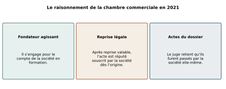

# ENS Rennes D-E — Droit commercial 2023 · Corrigé brut

*Corrigé rédigé par IA, non officiel.*

**Rédaction** · GPT-6.2 Astra Ultra · vitesse non renseignée

## Commentaire de Cass. com., 10 février 2021, n° 19-10.006 — Contrats conclus avant l’immatriculation d’une EURL

### Introduction

Signer « pour le compte d’une société en formation » et faire signer « la société, représentée par son gérant » peuvent paraître deux façons de démarrer la même entreprise. Dans l’arrêt soumis au concours, la différence détermine pourtant si le fournisseur peut se retourner contre une personne physique lorsque la société nouvellement constituée fait l’objet d’une liquidation judiciaire.

Le 18 mai 2015, Coop Atlantique signe plusieurs contrats désignant comme cocontractante une EURL en cours d’immatriculation, représentée par M. F., son gérant. L’immatriculation au registre du commerce et des sociétés intervient le 26 juin. La liquidation judiciaire est ouverte le 6 octobre suivant. Coop Atlantique demande alors paiement à M. F., qu’elle tient pour personnellement et solidairement responsable des engagements antérieurs à l’immatriculation. La cour d’appel de Poitiers rejette cette demande. Sa décision est datée du 6 novembre 2018 dans l’en-tête et les références officielles. La mention « 2008 » figurant au paragraphe 1 de l’extrait est incompatible avec les faits de 2015. [Arrêt du 10 février 2021](https://www.courdecassation.fr/decision/6026b6147dd7d31c57522e0d)

Selon le pourvoi, la mention de la formation, la qualité de gérant et la signature permettaient d’imputer les engagements à M. F. La seconde branche invoquait en outre une dénaturation de la date des statuts. La chambre commerciale rejette le pourvoi. L’enjeu est de distinguer celui qui contracte aujourd’hui du patrimoine auquel l’acte pourra être imputé demain. Dans son raisonnement de 2021, la Cour exige l’intervention en nom propre d’une personne agissant pour le compte de la société future, puis refuse de la déduire de la seule signature du gérant au bas d’un contrat qui désigne la société elle-même comme partie.

### I. L’immatriculation commande l’identification du débiteur des actes préparatoires

#### A. La société est un futur sujet de droit au jour des contrats

L’article 1842 du Code civil et l’article L. 210-6 du Code de commerce rattachent en principe la personnalité morale de la société commerciale à son immatriculation. Rédiger les statuts, choisir un nom, déterminer le siège et désigner le futur gérant permettent de préparer l’exploitation, mais ne créent pas encore la personne morale capable de contracter elle-même avec Coop Atlantique. L’EURL illustre nettement ce point. Parce qu’elle n’a qu’un associé, on peut être tenté de confondre la personne du fondateur et celle de la société. L’unicité d’associé ne supprime pas leur séparation juridique.

Le raisonnement part d’une comparaison de dates. Les contrats sont signés le 18 mai et l’immatriculation le 26 juin. Au jour pertinent, la société ne peut donc pas avoir constitué M. F. comme son représentant ordinaire auprès du fournisseur. La liquidation d’octobre explique l’intérêt pratique de poursuivre un autre débiteur mais ne modifie ni la capacité de la société en mai ni l’identité du cocontractant initial.

La discussion sur la date précise de signature des statuts, invoquée par la seconde branche, ne résout rien sur ces deux points. Que la correction manuscrite donne telle ou telle date, le juge dispose d’une date d’immatriculation certaine et postérieure aux conventions. La branche qui discute des motifs surabondants ne peut entraîner la cassation d’une décision légalement justifiée par les autres motifs.

#### B. Le mécanisme des actes de formation permet d’agir avant la naissance de la personne morale

Un entrepreneur doit souvent réserver des locaux, commander du matériel ou négocier une fourniture avant de pouvoir commercialiser. Les articles 1843 du Code civil et L. 210-6 du Code de commerce permettent à des personnes existantes d’agir au nom ou pour le compte de la société en formation. Ces personnes sont tenues des obligations nées des actes accomplis. Pour une société commerciale, la solidarité et l’absence de limitation prévues par la loi concernent les personnes qui ont effectivement agi. Elles ne font pas de chaque associé, par cette seule qualité, la caution de tous les engagements envisagés.

La société régulièrement constituée et immatriculée peut ensuite reprendre un engagement éligible. Lorsque les conditions de reprise sont satisfaites, l’engagement est réputé avoir été contracté dès l’origine par elle. L’état des actes accomplis annexé aux statuts, le mandat préalable suffisamment déterminé ou la décision postérieure de reprise répondent, selon les règles applicables, à ce souci d’identification. L’immatriculation ne reprend pas indistinctement toute opération qui pourrait avoir été utile au projet.

Ce mécanisme est précisément ce que voudrait invoquer Coop Atlantique contre M. F. Il faut d’abord un acte de celui-ci, souscrit pour le compte de la société future. Il serait circulaire de le tenir personnellement sur le seul fondement des textes réservés à celui qui a agi sans avoir préalablement établi que c’est bien lui qui a contracté.

### II. Dans l’arrêt de 2021, la désignation de l’EURL comme partie empêche de condamner personnellement le gérant sur ce fondement

#### A. La distinction formelle sur laquelle repose le rejet

Les actes mentionnent une EURL en cours d’immatriculation « représentée par son gérant ». Selon l’interprétation approuvée, la partie désignée est l’EURL elle-même. M. F. figure comme représentant. La mention de l’immatriculation en cours avertit le fournisseur de la situation mais ne transforme pas celui qui signe comme représentant en une personne qui contracterait pour le compte de la structure à créer. La Cour valide explicitement la différence entre ces deux qualités.

Le droit alors appliqué attachait des conséquences rigoureuses à cette rédaction. L’acte conclu par la personne morale dépourvue d’existence, tel que qualifié par les juges, ne relève pas du régime des actes souscrits personnellement pour son compte et susceptibles de reprise. L’objet précis du litige est toutefois une demande de paiement contre M. F. La chambre commerciale constate l’absence du préalable de cette responsabilité, puis rejette le recours. Elle ne prononce pas dans son dispositif la nullité de chacun des contrats et ne condamne pas l’EURL à payer Coop Atlantique.

L’arrêt ne permet pas davantage d’inventer une caution personnelle, une faute séparable ou un enrichissement du gérant. Ces mécanismes auraient leurs conditions propres. Les contrats produits et l’argumentation du pourvoi portaient sur la qualité de celui qui avait agi durant la formation. Le défaut de preuve sur ce point explique l’issue sans qu’il soit nécessaire d’examiner la situation patrimoniale personnelle de M. F.

#### B. Une sécurité fondée sur l’identification du signataire, au prix d’un risque pour le tiers

La solution de 2021 est lisible pour le rédacteur. Avant l’immatriculation, une personne physique identifiée peut souscrire un acte pour le compte d’une société à constituer, à charge d’une reprise régulière. Les parties peuvent aussi reporter la conclusion à l’immatriculation. Une signature présentée comme celle d’un organe d’une entité déjà contractante exposait le fournisseur à perdre le fondement personnel qu’il croyait posséder.

Ce formalisme protégeait le futur associé contre une condamnation automatique et évitait qu’une reprise non organisée charge le patrimoine social. Son coût apparaît dans l’espèce. Le tiers savait que la société était en formation, le signataire agissait en vue de son exploitation et l’objectif économique semblait compréhensible. Une erreur de rédaction pouvait néanmoins priver le tiers de l’action personnelle attendue. La personnalité distincte de l’EURL ne commandait pas, à elle seule, que l’intention commune soit déduite de mots aussi strictement.

Pour dater correctement le commentaire, il faut distinguer la solution proposée au concours et son devenir. Après l’épreuve, le 29 novembre 2023, la chambre commerciale a admis que le juge peut rechercher, en examinant les circonstances tant intrinsèques qu’extrinsèques à l’acte, si la commune intention était qu’il fût conclu au nom ou pour le compte de la société en formation malgré une rédaction défectueuse. Cette évolution ne confère toujours pas la personnalité morale avant l’immatriculation et n’opère pas automatiquement reprise ou condamnation du signataire. Elle éclaire la portée historique du formalisme de l’arrêt commenté. [Com., 29 novembre 2023, n° 22-12.865](https://www.courdecassation.fr/decision/6566e2b618106f8318ba9e76)

### Conclusion

En 2021, la Cour déduit de la désignation de l’EURL comme partie que Coop Atlantique n’a pas établi un engagement personnel de M. F. pour le compte de la société en formation. L’immatriculation et la liquidation ultérieures n’y changent rien. Le commentaire fait ainsi apparaître deux questions successives, la capacité de la société à la date des actes et l’identité de celui qui a voulu contracter avant sa naissance juridique.

[Sujet distribué](https://www.ens-rennes.fr/medias/fichier/sujet-e-preuve-a-options-droit-commmercial-2023_1682689343621-pdf) · [Rapport du jury](https://www.ens-rennes.fr/medias/fichier/rapport-de-jury-e-crit-droit-commercial-d-e-2023_1694186006015-pdf)
