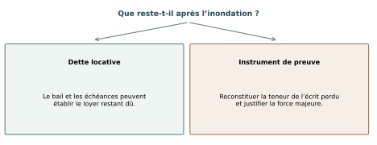
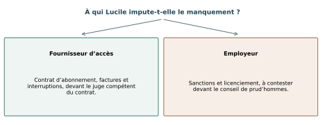
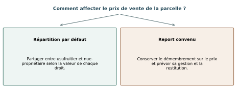

# ENS Rennes D-E — Droit (oral) 2023 · Corrigé brut

*Corrigé rédigé par IA, non officiel.*

**Rédaction** · GPT-6.2 Astra Ultra · vitesse non renseignée

Le fascicule présente 23 tirages. Chaque numéro reprend une question de cours et un cas autonome, traités dans le droit en vigueur à la session. Les numéros reproduisent ceux des pages distribuées.

## Sujet 01 — La coutume et les peupliers de Jacques

*Fascicule, page 1.*

### Question théorique

La coutume associe une pratique répétée à la conviction de son caractère obligatoire. Un usage local peut déterminer le contenu d’une règle lorsque la loi y renvoie expressément. Celui qui l’invoque établit sa teneur et son champ, par exemple au moyen d’attestations, d’un recueil professionnel ou d’un document municipal. Le comportement observé chez quelques personnes ne prouve ni l’ancienneté ni la reconnaissance d’une règle commune. Une coutume ne neutralise pas librement une loi impérative.

### Application au cas

L’article 671 appelle d’abord les règlements particuliers et les usages constants et reconnus. À défaut, il impose deux mètres de recul pour les plantations dépassant deux mètres de hauteur, et un demi-mètre pour les autres. Mesurer du milieu du tronc à la ligne séparative et vérifier que le mur marque cette limite. À un mètre, les petits peupliers peuvent donc être licites tant qu’ils restent dans la seconde catégorie, sauf règle locale différente. Leur hauteur adulte potentielle ne suffit pas. Marcel pourra demander l’arrachage ou la réduction à la hauteur légale en cas de dépassement dans les conditions de l’article 672, sous réserve d’un titre, de la destination du père de famille ou de la prescription trentenaire. La plantation reproduite dans le quartier est un indice à vérifier, non une coutume démontrée.

## Sujet 02 — La preuve libre et la reconnaissance de dette perdue

*Fascicule, page 2.*

### Question théorique

Les faits juridiques se prouvent en principe par tout moyen. Les actes au-dessus de 1 500 euros doivent en principe être prouvés par écrit, et il faut un écrit pour prouver outre ou contre un écrit (art. 1358 et 1359). Des exceptions existent, notamment l’impossibilité matérielle ou morale de se procurer l’écrit, l’usage de ne pas en établir ou sa perte par force majeure (art. 1360). La charge de prouver le fait ouvrant l’exception demeure.

### Application au cas

La perte de l’original n’éteint pas les loyers. Le bailleur peut présenter bail, échéancier, échanges et quittances, Jeanne devant justifier les paiements dont elle se prévaut. Si l’inondation irrésistible a emporté l’écrit, il doit prouver son existence passée, sa perte par force majeure et la créance par les moyens disponibles. S’il sollicite un nouvel engagement unilatéral, l’article 1376 exige la signature de Jeanne et la mention écrite par elle-même de la somme en chiffres et en lettres. « Deux mois de loyer » est une formulation insuffisante pour obtenir d’emblée la force probante de cet acte. Un écrit imparfait pouvant émaner de Jeanne peut servir de commencement de preuve par écrit, complété par d’autres éléments (art. 1361 et 1362). Le montant total et l’effet éventuellement novatoire de la première reconnaissance restent à vérifier, la novation ne se présumant pas.

## Sujet 03 — Les troubles anormaux et le mur de six mètres

*Fascicule, page 3.*

### Question théorique

En 2023 la responsabilité pour troubles anormaux de voisinage procède d’un principe jurisprudentiel. Le demandeur établit un trouble excédant les inconvénients ordinaires selon le lieu et la durée, un dommage et le lien de causalité. Le respect des règles urbanistiques n’exclut pas à lui seul l’anormalité. À l’inverse, des difficultés ordinaires de voisinage peuvent ne pas franchir le seuil. Une remise en état, une mesure de réduction ou des dommages-intérêts peuvent être demandés.

### Application au cas

Le mur initial de trois mètres peut déjà entraîner une perte excessive d’ensoleillement. Produire mesures, photographies et comparaison avant/après, vérifier règles d’urbanisme et usages dans ce quartier dense. L’article 663 traite, dans son champ, d’une clôture dont la construction est imposée au voisin. Ses hauteurs ne constituent pas une autorisation universelle d’élever tout mur. Le rehaussement à six mètres face au seul plaignant, dès le lendemain de sa demande, manifeste en outre une possible intention de nuire sans utilité légitime. Ce second acte étaye l’abus de propriété et la faute au sens de l’article 1240. Le voisin peut demander la suppression du rehaussement et la réparation de la privation de lumière, puis démontrer s’il reste un trouble au niveau initial. Éviter une double indemnisation du même préjudice.

## Sujet 04 — La personne morale et le compte de Shirley

*Fascicule, page 4.*

### Question théorique

Une personne morale est un groupement ou une entité auxquels le droit reconnaît la personnalité juridique suivant le régime applicable. Elle possède patrimoine, dénomination et siège distincts, agit par ses organes et exerce les droits compatibles avec sa nature et ses règles (art. 1145). Une société acquiert en principe sa personnalité à son immatriculation. Une personne physique a, quant à elle, une personnalité dès sa naissance vivante et viable. La capacité de jouissance est distincte de celle d’accomplir seule les actes.

### Application au cas

Shirley peut posséder 1 000 euros à trois semaines. Ses représentants légaux exercent pour elle les droits liés au compte et gèrent les fonds dans son intérêt. Son grand-père peut effectuer un don manuel et alimenter un compte ouvert à son nom dans le respect des règles bancaires. Être grand-père ne lui confère pas l’administration légale ni le pouvoir général de conclure seul la convention de compte ordinaire pour l’enfant. Il peut s’adresser aux titulaires de l’autorité parentale ou présenter un mandat valable, selon le produit et les formalités de la banque. L’argent donné appartient à Shirley. Ni sa majorité ni une émancipation ne sont nécessaires pour qu’elle en soit propriétaire ou qu’un compte puisse être ouvert pour elle.

## Sujet 05 — Le prénom et le nom commercial Lagadec

*Fascicule, page 5.*

### Question théorique

Le ou les prénoms choisis par les parents figurent dans l’acte de naissance (art. 57). L’officier d’état civil avertit le procureur si le choix lui paraît contraire à l’intérêt de l’enfant ou au droit d’un tiers à voir protéger son nom de famille. Le juge peut être saisi. Tout prénom inscrit peut servir de prénom usuel. L’article 60 organise la demande de changement justifiée par un intérêt légitime.

### Application au cas

Le nom civil de Francis reste le sien après la cession. En revanche un patronyme inséré avec l’accord de son titulaire dans la dénomination sociale peut devenir un signe distinctif de la société (Cass. com., 12 mars 1985, Bordas). S’il s’agit d’une cession de titres, la société demeure la même et peut en principe continuer à utiliser sa dénomination. En cas de cession du fonds ou d’autres actifs, examiner nom commercial, enseigne, éventuelles marques, clientèle et périmètre cédé. La seule absence d’une « cession du patronyme » ne suffit pas à interdire l’usage commercial déjà autorisé. Renommer un nouvel ensemble, déposer une marque distincte ou suggérer un soutien personnel de Francis pourrait dépasser le consentement initial. L’étendue du réseau antérieur et la nature exacte de la vente commandent la réponse.

## Sujet 06 — La rétroactivité et le projet de décret

*Fascicule, page 6.*

### Question théorique

Une règle rétroactive modifie les conséquences juridiques assignées à des faits déjà accomplis. L’application immédiate de règles nouvelles aux effets futurs d’une situation en cours s’en distingue. L’article 2 du Code civil consacre le principe de non-rétroactivité. Le législateur civil peut y déroger sous garanties, notamment pour la sécurité juridique et les procès en cours. En matière pénale la norme plus sévère ne rétroagit pas, tandis que la norme de fond plus douce bénéficie en principe aux affaires non définitivement jugées.

### Application au cas

L’importance de l’intelligence artificielle ne détermine pas à elle seule la compétence. Comparer le contenu du décret aux matières de l’article 34 de la Constitution, par exemple les garanties fondamentales des libertés publiques et la définition des délits et peines. Le gouvernement peut appliquer une loi et exercer son pouvoir autonome dans le reste du domaine réglementaire (art. 21 et 37). Un décret empiétant sur le domaine législatif peut encourir annulation. Karl peut proposer une loi, interroger le gouvernement ou jouer son rôle dans une délibération. Un député isolé ne défère pas un décret au Conseil constitutionnel. Le recours pour excès de pouvoir contre un décret relève du Conseil d’État et suppose un intérêt à agir. Une QPC porterait sur une disposition législative applicable au litige. Le contrôle a priori d’une loi peut être sollicité par soixante députés, entre autres autorités.

## Sujet 07 — Les traités et le projet de règlement européen

*Fascicule, page 7.*

### Question théorique

L’article 55 de la Constitution confère, dès publication, aux engagements régulièrement ratifiés ou approuvés une autorité supérieure aux lois, sous la condition de réciprocité lorsqu’elle s’applique. L’effet direct de la stipulation invoquée s’apprécie séparément. Les juges judiciaire et administratif contrôlent la compatibilité de la loi avec ces engagements. Dans l’ordre interne, la Constitution conserve sa primauté. L’article 54 permet d’exiger sa révision avant la ratification si l’engagement lui est contraire.

### Application au cas

Tant qu’il s’agit d’un projet, le texte ne prohibe pas le produit de Simone. Elle peut contribuer au débat et saisir ses représentants au Parlement européen ou les autorités nationales participant au Conseil pendant la négociation. Une commune ou un élu local n’a aucun droit de faire obstacle sur son territoire à un règlement de l’Union applicable. Une fois adopté et à sa date d’application, le règlement oblige dans tous ses éléments et ne requiert pas de transposition (art. 288 TFUE). Lire définitions, exclusions et transitions. Si le critère est la catégorie « désherbants », l’appartenance ou non à la sous-catégorie évoquée ne suffit pas pour être exempté. Les voies juridictionnelles éventuellement ouvertes permettent de discuter validité ou interprétation, sans veto individuel ou local.

## Sujet 08 — Les juridictions et les deux litiges de Lucile

*Fascicule, page 8.*

### Question théorique

Les deux ordres juridictionnels répartissent les litiges administratifs et judiciaires, les conflits entre ordres pouvant relever du Tribunal des conflits. Dans l’ordre judiciaire, des juridictions civiles, commerciales, sociales et pénales tranchent en première instance selon la matière. L’appel, lorsqu’il est ouvert, rejoue dans ses limites des questions de fait et de droit. La cassation contrôle la conformité juridique de la décision sans constituer un troisième degré de jugement des faits.

### Application au cas

Le fournisseur réclame le prix de l’abonnement à Lucile. Si elle est une cliente non commerçante, cet acte mixte ne permet pas au professionnel de lui imposer la juridiction commerciale. Elle doit soulever l’incompétence en temps utile et désigner la juridiction civile compétente. Le siège du demandeur à Nanterre ne suffit pas à établir la compétence territoriale. Le domicile de la défenderesse à Lille fournit en principe un rattachement. Face au fournisseur, elle peut contester les factures et demander sur le terrain contractuel réparation des coupures et du dommage prévisible prouvé, en discutant le lien avec le licenciement. Devant les prud’hommes elle peut agir contre son employeur pour contester sanctions et licenciement, dans les délais applicables. Le conseil ne tranche pas son contrat avec le fournisseur. Identifier la finalité et le souscripteur de l’abonnement si la ligne était professionnelle.

## Sujet 09 — La directive et la ratification du traité

*Fascicule, page 9.*

### Question théorique

Selon l’article 288 TFUE, la directive lie l’État destinataire quant au résultat et laisse le choix de la forme et des moyens. La transposition doit être complète et respecter le délai. Ensuite une disposition suffisamment précise et inconditionnelle peut être invoquée contre l’État. Le juge recherche une interprétation nationale conforme, dans ses limites. Une directive seule ne met pas directement d’obligations à la charge d’un autre particulier dans un litige horizontal.

### Application au cas

La signature du traité sur la personnalité juridique des éléments naturels ne se confond pas avec sa ratification. Le président négocie et ratifie les traités (art. 52). L’article 53 soumet certaines catégories, notamment les engagements modifiant des dispositions de nature législative, à une autorisation par la loi. Attribuer une personnalité et des droits nouveaux en droit interne peut bien nécessiter cette autorisation, selon les obligations précises du texte. Le Parlement vote alors l’autorisation de ratifier. Il ne procède pas lui-même à la ratification. Francis ne peut l’imposer seul ni garantir le rejet, mais il peut débattre et voter lorsque le projet est soumis. En présence d’un doute constitutionnel, la saisine préalable de l’article 54 est ouverte notamment à soixante députés et non à un député isolé.

## Sujet 10 — Le trésor et le téléphone retrouvé

*Fascicule, page 10.*

### Question théorique

Le trésor est une chose cachée ou enfouie sur laquelle personne ne peut justifier sa propriété et qui est découverte par le pur effet du hasard (art. 716). S’il est découvert par le propriétaire dans son propre fonds, il lui appartient. Découvert dans le fonds d’autrui, il se partage en principe par moitié entre inventeur et propriétaire du fonds, sous réserve notamment du droit spécial des biens archéologiques. Un objet identifiable appartenant à un tiers ne remplit pas la définition.

### Application au cas

La propriétaire du smartphone identifié sur les vidéos peut en demander la restitution. En fait de meubles, possession vaut titre, mais le propriétaire d’un objet perdu ou volé dispose d’une revendication pendant trois ans à compter de la perte ou du vol contre tout détenteur (art. 2276). Ici Jules l’a soustrait, Jacques connaît sa provenance et sa première intention déclarée était de le restituer. Ni l’usage temporaire ni l’affirmation soudaine d’en être propriétaire ne font de lui un acquéreur de bonne foi. Aucune vente dans les circonstances donnant droit au remboursement du prix (art. 2277) n’apparaît. L’intéressée peut prouver son droit par la facture ou l’identification de l’appareil et solliciter la remise et, s’il existe un dommage distinct, réparation. Le fait que Jules soit mineur et ses troubles ne suppriment pas la revendication.

## Sujet 11 — La cassation et la destruction du logement

*Fascicule, page 11.*

### Question théorique

La cassation sanctionne une erreur de droit, de qualification, une irrégularité ou un défaut de base légale de la décision attaquée. La Cour de cassation vérifie les moyens au regard des constatations souveraines des juges du fond. Elle peut rejeter le pourvoi ou casser en tout ou partie. Une cassation entraîne généralement un renvoi, parfois la solution est acquise sans renvoi. Il faut préciser quels chefs du dispositif sont atteints.

### Application au cas

Pour le bail, l’article 1722 règle expressément la destruction de la chose par cas fortuit pendant la durée du contrat. Si l’appartement est entièrement détruit, le bail est résilié de plein droit. Sylvie peut faire constater la date et l’étendue de la destruction, sans devoir obtenir une « résolution » pour éviter la poursuite des loyers. Si la perte n’était que partielle, Adèle pourrait demander la diminution du prix ou la résiliation selon les circonstances. Le texte écarte le dédommagement pour la perte fortuite elle-même. La cause de l’incendie n’est pas indiquée. Examiner séparément la responsabilité éventuelle du bailleur ou du locataire, les assurances et d’éventuelles obligations spéciales d’hébergement en cas d’arrêté de police. Le seul bail du logement totalement détruit par cas fortuit ne garantit pas un relogement.

## Sujet 12 — La curatelle et les frais de séjour de la mère d’Estelle

*Fascicule, page 12.*

### Question théorique

La curatelle bénéficie à un majeur qui a besoin d’être assisté ou contrôlé dans les actes importants sans nécessiter une représentation continue (art. 425 et 440). Une altération corporelle ne justifie le régime que si elle empêche l’expression de la volonté. Le juge examine nécessité, subsidiarité et proportionnalité, sur la base d’un certificat médical circonstancié. Le handicap moteur ne présume pas une perte de discernement.

### Application au cas

Les enfants doivent des aliments à leurs parents dans le besoin (art. 205). L’article 208 proportionne les aliments aux besoins du créancier et aux ressources du débiteur. Les frais annoncés de 4 000 euros et la retraite de 3 000 euros laissent un écart apparent de 1 000 euros par mois. Il faut encore apprécier autres ressources ou patrimoine de la mère, aides, coût nécessaire du séjour et charges et moyens d’Estelle. Si elles ne s’entendent pas, le juge aux affaires familiales peut fixer une contribution révisable. La fille n’est pas automatiquement débitrice envers l’institution de la totalité de l’écart par le seul lien de filiation. Vérifier séparément tout engagement qu’elle aurait personnellement signé. Tant que la mère peut exprimer sa volonté, elle peut préparer une procuration adaptée ou un mandat de protection future.

## Sujet 13 — La caducité et le yacht vendu deux fois

*Fascicule, page 13.*

### Question théorique

Un contrat valablement formé devient caduc si un de ses éléments essentiels disparaît (art. 1186). Pour des contrats nécessaires à une même opération, la disparition de l’un peut atteindre les autres dans les conditions posées par le texte, notamment la connaissance de l’opération d’ensemble. La caducité met fin au contrat et peut entraîner des restitutions (art. 1187). La caducité de l’offre, qui n’est pas encore un contrat, a ses propres causes (art. 1117).

### Application au cas

Le document décrit et chiffre le yacht et fixe le 30 septembre. Une offre ferme reçue par Job contenant un délai doit être maintenue (art. 1114 à 1116). Identifier si une rétractation lui a été communiquée avant son acceptation. La simple vente cachée à Vladimir n’équivaut pas nécessairement à cette notification. Une rétractation irrégulière empêche le contrat mais engage la responsabilité extracontractuelle sans indemniser les avantages attendus. Si Job avait accepté dès l’été une promesse unilatérale lui laissant l’option d’acheter, sa levée le 25 septembre dans le délai forme la vente malgré la révocation. Le contrat avec Vladimir peut être annulé s’il connaissait l’existence de la promesse (art. 1124). Si deux ventes sont formées, vérifier pour ce navire les règles spéciales d’écrit, d’enregistrement et d’opposabilité, l’éventuelle délivrance, la connaissance du tiers et les recours indemnitaires. Une lettre non contresignée ne démontre pas à elle seule l’accord à l’avant-contrat.

## Sujet 14 — La violence et les soins dentaires

*Fascicule, page 14.*

### Question théorique

La violence vicie le consentement lorsqu’une contrainte inspire la crainte d’exposer sa personne, sa fortune ou ses proches à un mal considérable (art. 1140). Elle peut venir d’un tiers. L’abus de la dépendance envers le cocontractant exige notamment un engagement que la victime n’aurait pas souscrit sans la contrainte et un avantage manifestement excessif (art. 1143). La nullité relative protège la partie victime. L’urgence ou la souffrance ne suffisent pas à montrer une pression exercée par l’autre partie.

### Application au cas

Milena peut rechercher la responsabilité de l’odontologue sur le terrain de la faute de soins (art. L. 1142-1 du Code de la santé publique). Distinguer le diagnostic initial, apprécié au vu des signes disponibles à sa date, l’indication thérapeutique et la pose techniquement défectueuse, puis les relier au surcroît de souffrance et aux soins correctifs. Le devis accepté ne décharge pas le praticien. La conception de l’appareil met en cause le prothésiste. Identifier fabricant, défaut de sécurité, dommage et causalité pour le régime des produits défectueux, ou démontrer une faute de conception à son égard selon les rapports entre les parties. Le praticien répond de sa propre pose. L’avis obtenu appuie la demande de dossier et d’expertise contradictoire. Chiffrer dommages corporels et frais, perte de chance si le lien avec un meilleur résultat reste probabiliste. Aucun fait donné ne caractérise une violence contractuelle.

## Sujet 17 — Le règlement de l’Union et les plateformes PEAR

*Fascicule, page 15.*

### Question théorique

Le règlement de l’Union est de portée générale, obligatoire dans tous ses éléments et directement applicable (art. 288 TFUE). Dans son champ d’application, il s’impose au juge national qui laisse inappliquée la loi incompatible, même postérieure. Il faut identifier sa date d’entrée en vigueur, sa date d’application, son objet et ses destinataires. Certaines dispositions peuvent appeler des mesures nationales d’exécution, sans transposition du règlement.

### Application au cas

La filiale française ne peut opposer l’absence de reprise dans une loi française. La nationalité américaine de la maison mère ne la dispense pas davantage des obligations portant sur des services offerts sur le marché de l’Union. Lire toutefois les critères exacts du règlement évoqué, la désignation de l’opérateur, les seuils de taille et les échéances prévues. Un groupe détenant quinze plateformes n’est pas nécessairement quinze fois le fournisseur désigné, et la taille mondiale ne prouve pas mécaniquement un seuil européen. Identifier qui fournit chaque service et s’il vise les utilisateurs de l’Union. À titre d’illustration, le règlement 2022/2065 sur les services numériques organise une désignation et des dates différenciées, dont une application générale en février 2024. Le cas de juin 2023 ne permet donc pas de présumer toutes les obligations déjà exigibles.

## Sujet 18 — Le transfert de propriété et la maison des concubins

*Fascicule, page 16.*

### Question théorique

L’article 1196 prévoit en principe le transfert du droit dès la formation du contrat. Les parties, la nature de la chose ou la loi peuvent le retarder. Les risques suivent en principe la propriété. Ils reviennent au débiteur de la délivrance lorsqu’il est mis en demeure, sous les réserves indiquées par le texte. Distinguer entre les parties la date de transfert, l’exécution matérielle et, envers les tiers, les exigences de publicité ou de possession.

### Application au cas

La construction est incorporée au terrain de M. X. Les articles 552 et 553 de l’accession présument la propriété des constructions au profit du propriétaire du sol. Souscrire solidairement l’emprunt et en payer une partie ne donne pas à Mme Y une quote-part du bien vendu. Il faut distinguer la solidarité envers la banque et les recours entre coemprunteurs selon la charge définitive de la dette et les sommes réellement payées. Vérifier tout accord de remboursement, la contribution aux dépenses de la vie commune, une libéralité ou, si les conditions en sont réunies, l’indemnisation du tiers constructeur (art. 555). L’enrichissement injustifié est subsidiaire et suppose l’absence de justification. Aucune moitié automatique de la plus-value ne résulte du financement. L’indemnité dépend du fondement retenu et de sa preuve.

## Sujet 19 — La nullité et la partition mise aux enchères

*Fascicule, page 17.*

### Question théorique

La nullité sanctionne un défaut lors de la formation du contrat (art. 1178). Le contrat annulé est censé n’avoir jamais existé et les prestations sont restituées. Selon que la règle protège l’intérêt général ou un intérêt privé, la nullité est absolue ou relative (art. 1179). Un vice du consentement autorise la partie protégée à agir. L’erreur doit notamment avoir été déterminante, porter sur une qualité essentielle et être excusable, sauf dol.

### Application au cas

La mise à prix d’un million est un indice de valeur, non une adjudication acquise. L’amie doit préciser ce qu’elle pensait vendre pour 1 000 euros. Si elle excluait une attribution certaine qui constituait une qualité essentielle entrée dans le champ contractuel, une expertise pourrait révéler une erreur sur l’authenticité. Si les deux avaient accepté l’aléa d’une attribution incertaine, l’article 1133 écarte l’erreur correspondante. Une simple erreur d’estimation économique n’est pas une cause de nullité (art. 1136). Hélène n’avait pas un devoir général de renseigner la vendeuse sur sa propre estimation, mais un mensonge ou la dissimulation dolosive d’une information déterminante autre que la valeur changerait l’analyse. L’écart de prix d’un meuble ne suffit pas à établir une lésion sanctionnée. Une demande de mesure conservatoire avant l’enchère devrait être justifiée par un droit et une urgence concrets.

## Sujet 20 — Le porte-fort et la commande de mobilier

*Fascicule, page 18.*

### Question théorique

La stipulation pour autrui fait naître au bénéfice d’un tiers un droit direct à la prestation promise (art. 1205). Le porte-fort garantit le fait d’un tiers, sans obliger le tiers lui-même (art. 1204). Une promesse de ratification, si elle est suivie d’une ratification, produit effet depuis l’engagement initial. Ces mécanismes supposent un contenu identifiable. L’initiative matérielle de payer n’a pas, à elle seule, l’un ou l’autre de ces effets.

### Application au cas

Identifier l’acheteur ou les acheteurs à partir du bon, de la négociation et des éventuels mandats. Le concubinage ne crée pas de solidarité ménagère analogue à celle des époux. Un tiers peut acquitter l’acompte pour un contractant (art. 1342-1). Si seul le signataire a commandé, son accord sur le nouveau délai modifie en principe sa commande. Le payeur n’obtient pas automatiquement le remboursement du magasin et doit examiner sa relation avec son compagnon. Si les deux sont coacheteurs, un seul ne peut en principe modifier les droits de l’autre sans pouvoir ni ratification. Vérifier dans cette branche le droit de résolution pour retard de livraison et ses conditions de mise en demeure à la date du contrat. Un acompte confirme en principe l’engagement. Il ne se perd ni ne se reprend à volonté comme de simples arrhes.

## Sujet 21 — L’ordre public et l’image de Francesca

*Fascicule, page 19.*

### Question théorique

L’article 6 interdit aux conventions de déroger aux lois d’ordre public et l’article 1162 vise les stipulations et le but du contrat. Les libertés individuelles, la dignité et l’intérêt d’un enfant peuvent limiter la liberté contractuelle. La sanction dépend de la règle et de l’étendue du vice. La nullité absolue ou relative, la clause réputée non écrite et la cessation d’une atteinte à un droit de la personnalité répondent à des conditions différentes.

### Application au cas

Au moment du contrat, Francesca avait deux mois. Ses parents administrent dans l’intérêt de leur enfant et doivent l’associer aux décisions selon son âge et sa maturité (art. 371-1, version 2023). Leur signature n’équivaut pas à une autorisation générale irrévocable sur toute image et toute diffusion durant vingt ans, y compris après la majorité. Vérifier qui a promis personnellement de poser ou s’est porté fort pour autrui, les usages expressément autorisés, le contexte concret et le respect de sa vie privée (art. 9). À seize ans, son refus exprimé et sa protection ont un poids particulier. Elle peut demander l’arrêt des séances ou diffusions attentatoires, notamment en urgence par un représentant approprié. En cas de conflit d’intérêts avec ses parents, un administrateur ad hoc peut être désigné (art. 388-2) et elle peut demander à être entendue (art. 388-1). Vingt ans est une durée déterminée. La seule interdiction des engagements perpétuels ne résout pas l’affaire.

## Sujet 22 — Le nom de famille et la répartition du prix de vente

*Fascicule, page 20.*

### Question théorique

Le nom rattache la personne à une filiation. Les parents peuvent, dans les conditions de l’article 311-21, choisir le nom de l’un, de l’autre ou leurs deux noms dans l’ordre choisi. Distinguer nom à l’état civil et nom d’usage. Depuis juillet 2022, l’adulte peut une fois choisir, par procédure simplifiée, un nom issu de la filiation (art. 61-3-1). Une autre demande de changement pour intérêt légitime relève notamment de l’article 61.

### Application au cas

Marc possède l’usufruit, Marie la nue-propriété. Tous deux consentent à vendre simultanément la pleine propriété. Selon l’article 621, le prix se répartit par défaut selon la valeur respective de chaque droit. La durée probable de l’usufruit viager, les revenus et la valeur réelle de la parcelle peuvent servir à la valorisation. Le barème fiscal de l’article 669 du CGI donne un repère selon l’âge mais ne s’impose pas comme partage civil entre parties. L’âge de Marc et le prix manquent pour chiffrer. Un accord peut reporter l’usufruit sur le prix. S’agissant d’argent consommable, préciser le quasi-usufruit, la créance de restitution de Marie et les garanties, ou organiser un remploi démembré. La moitié pour chacun ne se présume pas.

## Sujet 23 — La loi dans le temps et les photographies d’anniversaire

*Fascicule, page 21.*

### Question théorique

L’article 2 consacre la non-rétroactivité civile. Une loi nouvelle gouverne en principe les situations nouvelles et les effets futurs des situations légales en cours. Les contrats restent en principe soumis à la loi en vigueur à leur conclusion, sous réserve des règles transitoires et des effets légaux. Distinguer la loi de fond des règles de procédure souvent d’application immédiate. En droit pénal, la loi de fond plus douce bénéficie aux affaires non définitivement jugées.

### Application au cas

La publication concerne les images identifiables d’un enfant de 14 ans à un anniversaire privé et renseigne sur sa vie personnelle. Les parents peuvent agir comme représentants du fils pour la protection de sa vie privée et de son droit à l’image, et pour leur préjudice propre s’il est caractérisé (art. 9). Vérifier consentement à la prise et à la publication. Le dossier de football et la célébrité du père ne suffisent pas à établir un débat d’intérêt général sur cette fête. Des mesures proportionnées de retrait, d’interdiction de rediffusion et de réparation peuvent être sollicitées, en référé si besoin. Pour le titre dépréciatif et l’association à des bières, distinguer jugement de valeur, injure éventuelle et imputation d’un fait précis portant atteinte à l’honneur, soumise à la loi du 29 juillet 1881 et à ses délais et formalités stricts. La photo de bouteilles ne démontre pas leur consommation.

## Sujet 24 — L’erreur sur les motifs et le changement de nom de Jade

*Fascicule, page 22.*

### Question théorique

Une erreur sur un simple motif étranger aux qualités essentielles de la prestation ou du cocontractant n’entraîne en principe pas la nullité, sauf si les parties en ont expressément fait un élément déterminant. L’erreur sur le motif déterminant d’une libéralité constitue une exception (art. 1135). Le dol peut rendre pertinente même une erreur sur un simple motif (art. 1139). Le juge recherche le motif exact et son caractère causal.

### Application au cas

Jade est majeure. Depuis le 1er juillet 2022, l’article 61-3-1 lui permet de porter le nom de sa mère qui lui a transmis sa filiation, seul ou dans une combinaison autorisée, par déclaration à l’officier de l’état civil du lieu de résidence ou dépositaire de son acte de naissance. Elle doit confirmer sa demande au plus tôt un mois après réception. La procédure n’exige ni faute du père ni accord de celui-ci et ne modifie pas la filiation. Cette faculté simplifiée est utilisable une seule fois. Une réconciliation ne lui permettra donc pas de reprendre de plein droit son ancien nom par la même procédure. Une demande distincte au titre de l’intérêt légitime (art. 61) reste examinée selon ses propres conditions, sans garantie d’acceptation. Le nom d’usage offre une autre possibilité si elle hésite à modifier son état civil.

## Sujet 26 — La preuve électronique et la location avec option d’achat

*Fascicule, page 23.*

### Question théorique

Les articles 1365 à 1367 permettent un écrit et une signature électroniques. Il faut identifier l’auteur et garantir l’intégrité du document. La signature identifie et manifeste le consentement. Le procédé bénéficie d’une présomption de fiabilité dans les conditions réglementaires, notamment la signature électronique qualifiée. L’absence de présomption ne rend pas irrecevable toute signature électronique. Le professionnel doit alors établir la fiabilité du procédé employé. Vérifier la date du contrat pour choisir entre les anciens textes cités par le sujet et le décret du 28 septembre 2017, applicable au régime moderne.

### Application au cas

À 68 000 euros d’engagement initial, un écrit est en principe nécessaire. La banque doit établir contrat, identité du signataire, consentement, intégrité, délivrance, exigibilité et calcul du solde. Produire dossier de signature, certification disponible et pièces de traçabilité permettant de relier l’acte à cette personne. La facture du concessionnaire confirme l’opération matérielle. Échéancier, relances, décompte ou historique établis par le prêteur ne suffisent pas isolément à prouver le consentement. Des pièces émanant du client, des paiements exécutés et leurs concordances peuvent étayer l’écrit ou compléter un commencement de preuve par écrit. Vérifier distinctement les formalités protectrices du crédit à la consommation si applicables à cette LOA. L’absence de réaction du défendeur ne vaut pas aveu et ne dispense pas le juge de contrôler le bien-fondé de la demande (art. 472 CPC). L’absence de certificat qualifié, prise isolément, ne justifie pas davantage un rejet automatique.

## Sources

[Fascicule officiel](https://www.ens-rennes.fr/medias/fichier/annales-oral-droit-2023_1698744431920-pdf) · [Rapport du jury](https://www.ens-rennes.fr/medias/fichier/rapport-de-jury-oral-droit-d-e-2023_1698421485423-pdf)

[Code civil](https://www.legifrance.gouv.fr/codes/texte_lc/LEGITEXT000006070721/2023-06-01/) · [Code de procédure civile](https://www.legifrance.gouv.fr/codes/texte_lc/LEGITEXT000006070716/2023-06-01/) · [Code de la consommation](https://www.legifrance.gouv.fr/codes/texte_lc/LEGITEXT000006069565/2023-06-01/) · [Code pénal](https://www.legifrance.gouv.fr/codes/texte_lc/LEGITEXT000006070719/2023-06-01/) · [Code du travail](https://www.legifrance.gouv.fr/codes/texte_lc/LEGITEXT000006072050/2023-06-01/) · [Code de la santé publique](https://www.legifrance.gouv.fr/codes/texte_lc/LEGITEXT000006072665/2023-06-01/) · [Constitution de 1958](https://www.legifrance.gouv.fr/loda/id/JORFTEXT000000571356/) · [Article 288 TFUE](https://eur-lex.europa.eu/legal-content/FR/TXT/?uri=CELEX%3A12012E288)
