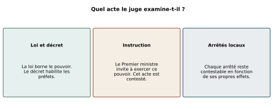
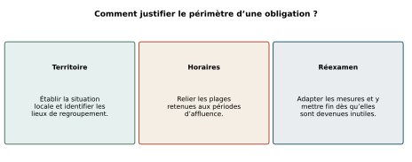

# ENS Rennes D-E — Droit public 2023 · Corrigé brut

*Corrigé rédigé par IA, non officiel.*

**Rédaction** · GPT-6.2 Astra Ultra · vitesse non renseignée

## Commentaire de CE, ord., formation collégiale, 11 janvier 2022, n° 460002 — L’instruction relative au port du masque en extérieur

### Introduction

Un même arrêté pourrait viser la place d’un marché un samedi matin et cette place vide à minuit. Sa base légale serait identique, mais sa justification ne le serait plus. L’ordonnance du 11 janvier 2022 met cette distinction au centre d’un litige engagé contre l’instruction nationale relative au port du masque en extérieur. Le juge des référés indique dans quelles limites les préfets peuvent agir et rejette pourtant la requête qui lui demandait de faire préciser ces limites par le Gouvernement.

La loi du 31 mai 2021 relative à la gestion de la sortie de crise sanitaire permet au Premier ministre de réglementer la circulation pour lutter contre l’épidémie. L’article 1er, II, du décret du 1er juin 2021 habilite le préfet à rendre le masque obligatoire quand les circonstances locales l’exigent, hors des locaux d’habitation, dans les situations où le décret ne l’impose pas déjà. À la suite de la conférence de presse du 27 décembre 2021, M. E. saisit le Conseil d’État le 30 décembre sur le fondement de l’article L. 521-2 du code de justice administrative. Il réclame des constatations scientifiques et plusieurs injonctions, dont l’édiction d’un décret ou, subsidiairement, d’une circulaire précisant des critères objectifs. Il invoque les libertés individuelle, d’aller et venir et de réunion, ainsi que le droit à la protection de la santé. Le ministre des solidarités et de la santé conclut au rejet. [Ordonnance n° 460002](https://www.conseil-etat.fr/fr/arianeweb/CE/decision/2022-01-11/460002)

La décision du Premier ministre d’inviter les préfets à exercer l’habilitation existante porte-t-elle, faute d’un encadrement plus précis, une atteinte grave et manifestement illégale aux libertés invoquées ? Le Conseil d’État répond par la négative au vu de la portée limitée de l’instruction. Il fixe simultanément les exigences qui s’imposent à ses applications locales. Ce résultat s’explique par la délimitation de l’acte national contesté, puis par le caractère territorialisé et révisable du contrôle de proportionnalité.

### I. Le référé-liberté donne au juge une décision nationale déterminée à examiner

#### A. La requalification des demandes circonscrit le litige à l’instruction du Premier ministre

Le requérant commence par demander au juge de constater l’existence d’un consensus scientifique. Il sollicite ensuite des actes généraux par lesquels le Gouvernement préciserait aux préfets ce qu’il conviendrait de faire. Pris à la lettre, ces chefs de demande donneraient au juge le rôle d’un expert chargé d’un avis général ou d’un auteur de politique sanitaire. Le motif 4 donne une portée juridictionnelle à la requête. M. E. est regardé comme demandant la suspension de la décision du Premier ministre de donner aux préfets instruction de mettre en œuvre le dispositif réglementaire. Le débat scientifique devient un élément de l’appréciation de la légalité de cette décision.

Trois échelons doivent être isolés. La loi autorise et borne une police sanitaire spéciale. Le décret habilite l’autorité départementale lorsque les circonstances locales l’exigent. L’instruction de décembre rappelle aux préfets qu’ils peuvent mettre cette habilitation en œuvre. Le juge se prononce sur cet acte du Premier ministre. Il ne suspend pas le décret du 1er juin et ne tranche la légalité d’aucun arrêté particulier. Cette lecture du motif 4 rectifie le raccourci que pourrait suggérer la mention d’un « référé-suspension » contre le décret dans le rapport du concours. Demander une mesure de suspension reste compatible avec le référé-liberté effectivement exercé.

La compétence nationale du Conseil d’État s’explique par l’auteur et la portée de l’acte dont le juge est ici saisi. Un particulier affecté par le périmètre d’un arrêté préfectoral pourrait contester cet autre acte devant le juge administratif territorialement compétent. Les deux recours mobiliseraient des faits différents. Le premier interroge le pouvoir donné à l’administration, le second confronte une obligation précise aux caractéristiques d’un lieu et d’une période.

#### B. La gravité et le caractère manifeste de l’atteinte déterminent la portée du rejet

L’article L. 521-2 permet au juge statuant dans un délai de quarante-huit heures d’ordonner les mesures nécessaires à la sauvegarde d’une liberté fondamentale. Il faut une urgence justifiant cette intervention et une atteinte grave et manifestement illégale portée à la liberté dans l’exercice d’un pouvoir public. Ce régime se distingue du référé-suspension de l’article L. 521-1, fondé sur l’urgence et un moyen propre à créer un doute sérieux sur la légalité. La qualification du recours modifie donc le seuil du contrôle. La seule préférence du requérant pour une autre rédaction du décret ne le satisfait pas.

Le motif 1 nomme expressément la liberté individuelle, la liberté d’aller et venir et la liberté de réunion. Il rappelle qu’elles protègent contre les contraintes excédant celles que requièrent l’ordre public et les droits d’autrui. Le requérant invoquait aussi la protection de la santé. Le motif 7 répond, « en tout état de cause », aux atteintes invoquées, sans ériger à cette occasion un droit général à la santé en liberté fondamentale distincte au sens du référé. De même, aucune déduction générale sur l’urgence ne peut être tirée du contexte sanitaire. Le motif 9 dispense expressément le juge de statuer sur cette condition. Il lui suffit qu’une autre condition cumulative fasse défaut.

### II. L’instruction nationale ne peut recevoir que des applications locales proportionnées

#### A. Les données de l’instruction justifient la possibilité d’une obligation ciblée

L’obligation doit d’abord pouvoir contribuer au but sanitaire fixé par le législateur. Le requérant déduit de la moindre exposition en plein air l’inutilité de l’obligation extérieure, sous réserve de situations de concentration exceptionnelle. Au motif 5, le juge accepte la prémisse d’un risque généralement moindre. Il constate qu’au vu du dossier disponible le 11 janvier 2022, une protection en extérieur pouvait néanmoins conserver un intérêt lors de regroupements où la distance physique était difficile à maintenir. Le qualificatif retenu est mesuré. Une obligation limitée, si la situation locale la justifie, n’apparaît pas « manifestement dénuée de nécessité ». La juridiction apprécie les pièces à la date où elle statue, sans fixer de vérité scientifique intemporelle.

Le raisonnement est celui de la police administrative. L’administration doit pouvoir rattacher la mesure à un risque, expliquer en quoi elle y répond et en limiter les effets sur les libertés. Dans la tradition de la décision *Benjamin* du 19 mai 1933, la nécessité se distingue de la simple utilité d’une restriction. Prouver qu’un masque peut être utile dans un rassemblement permet de maintenir une habilitation ciblée. Cette preuve ne suffirait pas à justifier une obligation permanente dans tout un département. À l’inverse, le moindre risque d’une promenade isolée ne prouve pas que tout exercice du pouvoir réglementaire serait manifestement illégal.

#### B. Les limites de temps et de lieu conditionnent la légalité des mesures préfectorales

Le motif 6 articule ces exigences avec le IV de l’article 1er de la loi. Il faut justifier la mesure par la situation épidémiologique du territoire, la réserver aux lieux et heures de forte circulation empêchant la distanciation ou aux lieux de regroupement, et adapter les plages horaires au risque identifié. Un marché fréquenté ou un centre-ville commerçant peut entrer dans cette catégorie. Le préfet peut délimiter une zone assez large pour que chacun comprenne la règle et que son application reste cohérente. Cette faculté d’arrondir un périmètre ne dispense pas de justifier son étendue. Les formalités prévues par le III de la loi s’ajoutent à cette exigence de fond, notamment l’avis rendu public du directeur général de l’agence régionale de santé et la consultation prévue pour les mesures limitées au département.

Le cas de la place du marché éclaire le résultat. Sa fréquentation pendant le marché peut justifier une plage de quelques heures et l’inclusion des rues immédiatement attenantes. Une extension continue à des espaces ou des heures sans affluence demanderait une justification que l’invocation du seul marché ne fournit pas. Les ordonnances rendues en septembre 2020 avaient déjà fait place à la lisibilité des zones réglementées. Ici, l’explicitation des horaires et de la situation locale permet un contrôle plus précis. Les exemples du Conseil ne créent aucune obligation automatique applicable à toute place commerciale.

Le motif 7 tire la conséquence du niveau auquel le juge a placé le litige. Le Premier ministre a demandé d’exercer un pouvoir déjà soumis aux limites de la loi, sous le contrôle du juge. Son instruction, ainsi comprise, ne porte pas l’atteinte grave et manifestement illégale alléguée. Le motif 8 impose une dernière limite, celle du temps qui passe. Le Premier ministre doit adapter ses instructions à l’évolution des connaissances et il faut mettre fin sans délai aux mesures qui ne sont plus nécessaires. Un acte local pourrait ainsi devenir excessif après avoir été justifié lors de son adoption.

### Conclusion

Le rejet laisse subsister l’instruction nationale tout en donnant un critère de contrôle aux personnes concernées par une décision locale. Le risque constaté, les lieux de regroupement et les heures d’affluence doivent expliquer la restriction. Le juge de l’urgence n’a prononcé aucune injonction générale. Il a précisé les conditions de légalité d’un pouvoir dont l’exercice et la durée demeurent contestables devant lui.

[Sujet distribué](https://www.ens-rennes.fr/medias/fichier/sujet-e-preuve-a-options-droit-public-2023_1682689354582-pdf) · [Rapport du jury](https://www.ens-rennes.fr/medias/fichier/rapport-de-jury-ecrit-droit-public-d-e-2023_1700577043989-pdf)
