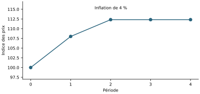
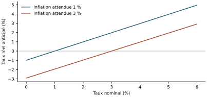
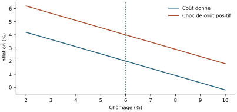
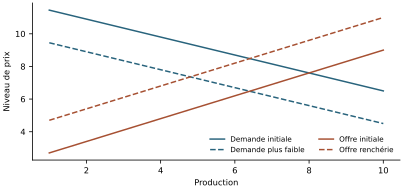
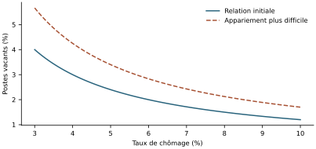

# ENS Rennes D-E — Économie (oral) 2023 · Corrigé guidé

*Corrigé rédigé par IA, non officiel.*

**Rédaction** · GPT-6.2 Astra Ultra · vitesse non renseignée

Le fascicule énumère 23 sujets. Le rapport prévoit trente minutes de préparation, dix minutes environ d’exposé et quinze à vingt minutes de questions. Les développements ci-dessous proposent une argumentation à exposer et les relances servent d’exercices.

## Sujet 1 — A quoi sert une banque centrale ?

> [!INDICATION]
> Suivre un virement entre banques avant de présenter les taux directeurs et le prêteur en dernier ressort.

La banque centrale émet la monnaie dans laquelle les banques règlent finalement leurs créances réciproques. Lorsqu’un client vire 100 euros à son fournisseur dans une autre banque, ses dépôts sont débités et crédités dans deux établissements. Le règlement interbancaire porte sur leurs réserves en monnaie centrale. La banque centrale a donc une responsabilité dans le bon fonctionnement des paiements. L’emprunteur qui obtient un crédit commercial ne reçoit pas pour autant une fraction de réserves préexistantes.

La politique monétaire agit sur les prix et l’activité en influençant taux, crédit, anticipations et conditions de financement. Dans la zone euro, la stabilité des prix est l’objectif principal. En outre, le refinancement contre garanties peut éviter qu’une banque solvable mais illiquide ne vende des actifs en catastrophe. Il ne substitue pas une création de réserves à la résolution d’un problème de solvabilité. La stabilité des prix et la stabilité financière ne demandent pas toujours le même instrument. En 2023, une banque centrale peut resserrer les taux pour limiter l’inflation tout en fournissant temporairement de la liquidité au système de paiement.

**Relance.** Qui choisit le montant de tous les crédits aux entreprises ?

Les banques choisissent leurs concours sous contraintes de risque, de financement et de fonds propres. La banque centrale modifie leurs conditions d’activité sans fixer chaque prêt.

## Sujet 2 — La politique budgétaire dans le cadre de l’Union Economique et Monétaire (UEM)

> [!INDICATION]
> Comparer une récession propre à un membre avec un choc simultané dans toute l’union.

Dans l’UEM, une politique monétaire commune coexiste avec des budgets principalement nationaux. Les stabilisateurs automatiques nationaux peuvent répondre à un choc local auquel le taux commun n’est pas adapté. Mais une relance dans un pays profite aussi aux exportateurs des partenaires. Inversement des restrictions simultanées peuvent se renforcer. Les décisions budgétaires doivent donc être jugées à la fois par leur effet national, leurs retombées transfrontalières et la crédibilité de leur financement.

Les règles communes de surveillance recherchent de la discipline, sans empêcher un ajustement conjoncturel approprié. Les déficits observés mêlent stabilisation automatique et actions discrétionnaires. L’application de la clause dérogatoire pendant la crise sanitaire et le recours à l’emprunt commun pour NextGenerationEU ont renouvelé le débat. Au printemps 2023, la réforme des règles proposée par la Commission reste un projet. Les prêts et subventions destinés à investir ne constituent pas une assurance fédérale permanente contre chaque choc. L’enjeu est d’articuler une trajectoire crédible par pays, une réaction commune face à un choc partagé et l’évaluation des projets dont les gains traversent les frontières.

**Relance.** Pourquoi deux budgets nationaux équilibrés peuvent-ils produire une orientation commune inadaptée ?

L’équilibre comptable n’indique ni la phase du cycle ni l’effet sur les partenaires. Des consolidations simultanées en récession peuvent aggraver le manque de demande dans l’union.

## Sujet 3 — Peut-on encore lutter contre l’inflation ?

> [!INDICATION]
> Distinguer trois étapes, choc initial, propagation et retour du taux d’inflation vers la cible.

L’inflation est l’augmentation durable du niveau général des prix. Un prix de l’énergie qui double une fois relève immédiatement l’indice mais ne maintient le taux d’inflation au même niveau que si le choc se répète ou se propage. En 2023, la question porte sur cette propagation après les chocs de 2021-2022, et sur le coût de la désinflation. Il faut observer les services, les salaires, les marges, les anticipations et les mesures d’inflation sous-jacente, en plus des variations de l’énergie.

La hausse des taux pèse sur les dépenses financées à crédit et peut ancrer les anticipations. Elle ne restaure pas instantanément les approvisionnements. Une aide au revenu ciblée protège les personnes les plus exposées tout en offrant moins de soutien généralisé à la demande qu’une subvention universelle. Les mesures de concurrence, de capacités et d’efficacité énergétique ont des délais plus longs. Un plafonnement peut limiter temporairement le prix payé sans supprimer le coût des ressources, réparti autrement. La stratégie doit tenir compte des délais, des anticipations et de la répartition des pertes de revenu réel. La baisse du taux d’inflation n’implique pas le retour à l’ancien niveau des prix.

**Relance.** Que signifie une inflation qui ralentit de 8 % à 4 % ?

Le niveau général des prix continue d’augmenter. Après 100 puis 108, l’indice atteint 112,32 si la hausse suivante est de 4 %.

## Sujet 4 — La politique monétaire de la Banque centrale Européenne redevient elle conventionnelle ?

> [!INDICATION]
> Mettre en regard décisions de taux, flux d’achats et stock d’actifs à une même date de 2023.

Depuis juillet 2022, la BCE a relevé ses taux directeurs après plusieurs années de taux très bas ou négatifs. En mars 2023, elle a continué ce relèvement. L’instrument conventionnel – fixer le prix de la liquidité à court terme pour influencer les conditions monétaires – réoccupe le premier plan. Cette description des décisions n’établit pas que l’ensemble des instruments non conventionnels a disparu. Il faut distinguer nouveaux achats, stock de titres détenus, réinvestissement des remboursements et opérations de refinancement.

Le taux court influe sur les taux futurs anticipés, les marges bancaires et le crédit. Les achats de titres modifient aussi l’offre de risque de durée sur le marché et la transmission entre pays. Un portefeuille constitué pendant une période d’achat ne disparaît pas au premier relèvement de taux. Les conditions de refinancement ciblé peuvent être recalibrées tandis que le bilan se réduit progressivement. Au printemps 2023, il est donc plus exact de parler du retour de la primauté des taux dans la lutte contre l’inflation et de gestion simultanée du bilan. Les outils répondent à des difficultés différentes, notamment une orientation générale jugée trop accommodante ou un défaut local de transmission.

**Relance.** Le resserrement signifie-t-il nécessairement que tous les taux de crédit montent du même montant ?

Non. Risque de crédit, échéances, structures bancaires et anticipation de la trajectoire future produisent des transmissions différentes selon les emprunteurs.

## Sujet 5 — Les déterminants du solde du compte courant de la balance des paiements

> [!INDICATION]
> Construire le même solde par une hausse de l’investissement et par une chute de l’épargne.

Le compte courant rassemble biens et services, revenus primaires et transferts courants internationaux. Il se distingue donc du seul solde des marchandises. Dans une présentation cohérente des comptes, son solde correspond à l’écart entre épargne nationale et investissement intérieur. Si les résidents épargnent 22 et investissent 25, le besoin de financement courant vaut trois unités hors distinctions additionnelles du compte de capital. L’égalité comptable ne dit pas pourquoi la dépense excède l’épargne.

Une forte demande intérieure peut stimuler les importations, une hausse du prix de l’énergie détériorer les termes de l’échange d’un importateur, ou un effort rentable d’équipement créer temporairement un déficit. La spécialisation, la qualité et le prix influencent les exportations. Revenus d’actifs extérieurs et transferts peuvent compenser ou accentuer le solde commercial. La position extérieure nette, la devise des dettes et leur échéance éclairent la soutenabilité. On comparerait un déficit finançant un équipement exportateur et un déficit finançant une bulle non échangeable. Une dépréciation ne corrige pas aussitôt le solde si les quantités réagissent lentement ou si des importations essentielles sont peu substituables.

**Relance.** Un excédent est-il automatiquement un signe de bonne santé ?

Il peut refléter de fortes exportations, mais aussi un investissement ou une demande intérieure faibles. La composition et les causes décident du diagnostic.

## Sujet 6 — Quel est l’apport de Robert Lucas à l’analyse économique de la fin du XXème siècle ?

> [!INDICATION]
> Faire répéter plusieurs fois une politique d’abord inattendue et préciser ce qui change dans les contrats.

Lucas a replacé les anticipations et les décisions individuelles au centre de l’évaluation des politiques. Sa critique de 1976 souligne que les relations agrégées estimées sous un régime peuvent changer lorsque la règle de politique change. Supposons que les salaires aient jusque-là été négociés sur la base d’une inflation faible. Une surprise de prix réduit provisoirement le salaire réel. Si les autorités veulent exploiter systématiquement cette relation, les négociations intègrent la nouvelle règle et l’effet initial peut disparaître.

Cette critique n’affirme ni la prévision parfaite ni l’inutilité de l’État. Elle impose d’expliciter les contraintes, l’information et les comportements qui pourraient rester stables lorsque la politique varie. Les modèles de fluctuations à information imparfaite et les recherches sur les fondements des décisions macroéconomiques prolongent cette exigence. Les travaux de Lucas sur le capital humain ouvrent aussi une explication de la croissance fondée sur l’accumulation de compétences et leurs effets externes. Ces contributions doivent être distinguées, sans attribuer à Lucas toutes les hypothèses des modèles ultérieurs ni écarter les rigidités nominales que d’autres modèles introduisent.

**Relance.** La découverte d’une corrélation historique la rend-elle inutile ?

Elle reste descriptive et peut aider à prévoir sous un régime suffisamment stable. L’utiliser pour évaluer un changement de règle exige de tester la stabilité de ses déterminants.

## Sujet 7 — Imperfections et défaillances des marchés

> [!INDICATION]
> Associer chaque exemple à un prix absent, une information cachée ou un pouvoir de marché.

Le marché en concurrence parfaite sert de référence lorsque prix, information et droits permettent de comparer tous les coûts et avantages. Une imperfection désigne un écart à une hypothèse du modèle. Une défaillance au sens économique s’établit lorsqu’un mécanisme empêche une allocation efficace. Une petite différence de qualité entre produits n’implique pas mécaniquement qu’une intervention donnée améliorerait le bien-être. Il faut montrer le mécanisme, son ampleur et une alternative.

Le pollueur tient compte de son coût privé mais peut négliger le dommage aux riverains. Une taxe alignée sur le dommage marginal peut rapprocher ses choix de l’optimum si les émissions et le dommage sont mesurables. Dans l’assurance, une information cachée avant le contrat produit de la sélection adverse ; après le contrat, un effort caché produit de l’aléa moral. Une obligation d’assurance ou une franchise n’agit pas sur les deux de la même façon. Pour un bien public, additionner les disponibilités marginales à payer éclaire la quantité socialement souhaitable, mais chacun peut dissimuler sa préférence. La mise en œuvre publique a aussi des coûts d’information et de contrôle.

**Relance.** Une inégalité de revenu constitue-t-elle au même sens une défaillance du marché ?

Elle peut justifier une politique distributive même si l’allocation est efficace au sens de Pareto. Il faut distinguer l’objectif d’équité et la correction d’une inefficacité.

## Sujet 8 — La politique économique en système de change fixe

> [!INDICATION]
> Partir d’une baisse de taux et suivre les capitaux, les réserves puis la base monétaire.

Un système de change fixe engage la banque centrale à défendre une parité. Si les capitaux sont mobiles, l’arbitrage entre actifs lie le taux domestique au taux extérieur, aux anticipations de change et à une prime de risque. Une expansion monétaire indépendante qui abaisse trop le taux crée une pression à la sortie de capitaux. Les ventes de devises nécessaires à la parité absorbent alors de la liquidité et sollicitent les réserves. C’est une forme du triangle d’incompatibilité entre change fixe, mobilité des capitaux et autonomie monétaire.

Une expansion budgétaire peut davantage soutenir la demande lorsque la pression à l’appréciation oblige à fournir de la liquidité, dans le modèle simple à prix rigides et mobilité forte. Les importations, les primes de risque et la crédibilité de la parité limitent le résultat. Le contrôle de certains mouvements de capitaux ouvre une marge de politique mais entraîne des coûts d’application et de financement. Une parité crédible réduit un risque de change ; une parité jugée incompatible avec les fondamentaux peut susciter des sorties préventives. Les avantages d’ancrage nominal doivent être comparés au coût de l’ajustement interne en cas de choc asymétrique.

**Relance.** Une banque centrale peut-elle défendre indéfiniment la parité avec des réserves limitées ?

Sa crédibilité dépend des réserves, du financement accessible et de la cohérence des politiques. Les anticipations de dévaluation peuvent accélérer la pression sur ces ressources.

## Sujet 9 — Le taux d’intérêt naturel

> [!INDICATION]
> Calculer deux écarts opposés en conservant le même taux nominal.

Le taux d’intérêt naturel est un taux réel de référence. Dans l’approche de Wicksell et dans des modèles modernes, il correspond, selon le cadre, au taux compatible avec un équilibre réel et une inflation stable lorsque la production rejoint sa référence. Il ne s’agit ni du taux directeur nominal observable ni d’une constante physique. Les préférences d’épargne, les perspectives de productivité, la démographie et la demande d’actifs sûrs peuvent le modifier.

La comparaison de politique pertinente porte sur le taux réel anticipé et le taux naturel estimé. Si le taux nominal est de 3 % et l’inflation anticipée de 2 %, le taux réel approximatif est de 1 %. Il peut être stimulant si le taux naturel vaut 2 %, restrictif s’il vaut zéro. Une banque centrale ne connaît pas ce dernier avec certitude. Elle confronte des estimations de modèle aux conditions de crédit, aux capacités et aux anticipations. La forte variation des prix et des primes de risque autour de 2022-2023 accroît l’incertitude. Il faut encore distinguer le taux sans risque de référence des taux que paient effectivement des ménages différents.

**Relance.** Un taux nominal historiquement élevé suffit-il à diagnostiquer une politique restrictive ?

Non. Il faut aussi l’inflation attendue, l’horizon, les primes de financement et le taux réel de référence estimé.

## Sujet 10 — Comment lutter contre le chômage aujourd’hui ?

> [!INDICATION]
> Associer une observation discriminante et un instrument à chaque type de chômage.

Le chômage agrège des situations dont les remèdes diffèrent. Un ralentissement des ventes conduit des entreprises à réduire emploi et embauches. Des emplois peuvent aussi rester vacants parce que qualification, localisation, rémunération ou conditions de travail ne correspondent pas aux personnes disponibles. Enfin, une transition normale entre postes produit du chômage frictionnel. Le taux de chômage rapporte les chômeurs aux actifs et peut baisser lors de retraits découragés du marché du travail. Il faut le lire avec le taux d’emploi, la participation et le sous-emploi.

Au printemps 2023, il serait imprudent de proposer une relance générale sans tenir compte de tensions inflationnistes et de métiers en difficulté de recrutement. Un soutien ciblé à la demande si elle manque, une garde d’enfant accessible, une formation reliée à des postes réellement ouverts ou des horaires améliorés répondent à des obstacles distincts. L’activité partielle peut préserver une relation d’emploi viable pendant un choc temporaire ; la prolonger dans un secteur durablement en recul peut freiner une reconversion. L’évaluation doit suivre emplois supplémentaires et durables, salaires, qualité des postes et déplacements éventuels d’autres candidats.

**Relance.** Une formation réussie pour son bénéficiaire augmente-t-elle nécessairement l’emploi total ?

Elle peut aussi améliorer son rang dans une file d’emplois inchangée. Mesurer les offres, les recrutements totaux et les effets sur les non-participants complète le suivi individuel.

## Sujet 11 — Les théorèmes du bien-être ont-ils une utilité ?

> [!INDICATION]
> Énoncer le résultat de chaque théorème et donner une hypothèse dont l’absence change l’application.

Le premier théorème du bien-être précise sous quelles conditions un équilibre concurrentiel est efficace au sens de Pareto. Si les agents prennent les prix comme donnés, si les marchés et les informations nécessaires existent et si les effets sur autrui sont intégrés, il n’y a plus d’amélioration mutuellement accessible sans perdant. Le théorème ne garantit pas l’égalité. Une distribution très inégale de la dotation initiale peut conduire à un équilibre efficace et socialement contesté.

Le second théorème énonce, sous des hypothèses supplémentaires telles que la convexité et des transferts appropriés des dotations, une possibilité de décentraliser certaines allocations efficaces. Il distingue conceptuellement redistribution et allocation. Son utilité pratique est diagnostique. Taxer le revenu réel d’une personne peut modifier ses choix car l’autorité ne dispose pas d’un transfert forfaitaire parfaitement informé. Dans un réseau à coûts fixes, l’hypothèse de convexité peut échouer. Dans un marché polluant, le prix ne porte pas le coût social marginal. Les théorèmes aident alors à localiser ce qui manque avant de comparer des institutions réalisables.

**Relance.** Une taxe correctrice contredit-elle le premier théorème ?

L’externalité indique qu’une hypothèse de l’équilibre efficace manque. Une taxe bien construite cherche à introduire le signal de coût collectif absent.

## Sujet 12 — Un état peut-il faire faillite ?

> [!INDICATION]
> Comparer deux dettes de même montant, à maturités et devises différentes.

Un État fait défaut lorsqu’il ne respecte pas les paiements promis ou modifie sous contrainte les conditions de remboursement. Il n’est pas liquidé comme une entreprise. La capacité de lever l’impôt, l’usage d’une monnaie propre, la devise de la dette, la maturité et les institutions changent les contraintes. Un déficit élevé un an ne suffit pas à conclure à l’insolvabilité. Il faut comparer les ressources futures et la trajectoire de dette dans des conditions de financement plausibles.

Une crise de liquidité survient lorsqu’un refinancement de court terme devient impossible, même si les ressources futures pourraient couvrir les engagements. Si plusieurs investisseurs anticipent des difficultés, la hausse des primes peut rendre la dette plus lourde et confirmer une partie des craintes. Lorsque le taux nominal effectif dépasse durablement la croissance nominale, un excédent primaire plus important est nécessaire pour stabiliser le ratio dette/PIB. Une banque centrale nationale peut fournir des liquidités en monnaie locale, mais la création de monnaie, l’inflation et la dépréciation peuvent imposer de lourds coûts et ne règlent pas une dette en devise étrangère. Les membres de la zone euro ne disposent pas individuellement du pouvoir d’émission commun.

**Relance.** Pourquoi un État solvable pourrait-il quand même négocier une aide d’urgence ?

Une concentration des échéances peut créer une difficulté de trésorerie. Une aide ou un allongement des maturités peut éviter que cette difficulté ne devienne une crise de solvabilité.

## Sujet 13 — A qui servent les règles de politique monétaire ?

> [!INDICATION]
> Préciser quel acteur utilise la règle et quel comportement sa prévisibilité change.

Une règle monétaire rend plus prévisible la réaction de la banque centrale à l’inflation et à l’activité. Elle sert aux ménages et entreprises qui forment des anticipations, aux marchés qui valorisent des titres et à l’autorité qui doit rendre ses décisions intelligibles. Une règle de type Taylor relie un taux directeur à un taux réel de référence, à l’inflation et à des écarts d’inflation et d’activité. Des coefficients différents ne distribuent pas de la même façon le coût de stabilisation entre emprunteurs, épargnants et travailleurs.

L’intérêt d’une règle tient à la cohérence intertemporelle. Une autorité tentée de stimuler l’activité après la négociation des salaires peut susciter en retour des anticipations inflationnistes qui annulent le gain réel. Un engagement crédible réduit ce problème. Mais prix énergétiques, écart de production et taux naturel sont mal connus, les indicateurs révisés et les crises financières hétérogènes. Une formule purement mécanique pourrait amplifier une erreur d’information. Une règle de référence assortie d’explications sur les écarts permet à la fois de guider les anticipations et de préserver une réponse aux circonstances exceptionnelles dans le mandat attribué.

**Relance.** Pour qui la prévisibilité peut-elle avoir un coût ?

Une règle rigide peut maintenir un resserrement inadapté à une perte temporaire d’offre ou à une crise de liquidité. Le gain de crédibilité doit être comparé aux marges de réaction souhaitables.

## Sujet 14 — Quels déterminants pour la croissance ?

> [!INDICATION]
> Décomposer le PIB par habitant puis appliquer à un exemple la différence entre croissance de transition et croissance durable.

La croissance du produit par habitant peut être décomposée entre utilisation du travail et productivité par personne ou par heure. L’accumulation du capital équipe mieux les travailleurs et peut porter une phase de rattrapage. Dans le modèle de Solow à rendements décroissants, un taux d’investissement supérieur relève le niveau de long terme du capital par travailleur efficace, sans changer automatiquement le taux durable de progrès technique. Une machine de remplacement ne constitue pas toute une augmentation du stock net.

Les connaissances, le capital humain et les infrastructures expliquent pourquoi des investissements complémentaires peuvent modifier la trajectoire de productivité. Une innovation non rivale bénéficie parfois à d’autres que son financeur. Des institutions protégeant l’initiative et l’accès à la finance, une politique de recherche ou une formation adaptée peuvent soutenir la diffusion. Le calcul d’un résidu de productivité ne suffit pas à expliquer les institutions ou les innovations qui en sont la cause. Croissance de la production et soutenabilité doivent par ailleurs être distinguées. Un investissement émetteur peut accroître le PIB actuel tout en imposant des coûts ultérieurs. Un bilan digne de ce nom suit les stocks, l’usage des capacités et les dommages évités.

**Relance.** Quel investissement a une contribution possible à la croissance sans entrer entièrement dans la FBCF ?

La formation augmente le capital humain économique, alors que ses dépenses ne sont pas toutes comptées en formation brute de capital fixe. Le mécanisme et la convention comptable sont distincts.

## Sujet 15 — Retrouve-t-on aujourd’hui une forme d’arbitrage entre l’inflation et le chômage ?

> [!INDICATION]
> Tracer d’abord le mouvement après une hausse de demande, puis le déplacement causé par un choc d’offre.

La courbe de Phillips décrit sous certaines conditions une relation négative entre chômage et accélération des salaires ou inflation. Si la demande accélère, les entreprises vendent davantage, embauchent et peuvent relever leurs prix alors que les contrats nominaux réagissent progressivement. Cela explique un arbitrage de court terme sous anticipations et choc d’offre donnés. Dans une relation stylisée, l’inflation dépend des anticipations, de l’écart de chômage à sa référence et d’un terme de coût.

Le retour de l’inflation en 2021-2022, toujours important pour les décisions en 2023, rappelle le rôle des chocs d’offre. Une énergie plus chère peut augmenter les prix et réduire la production simultanément, déplaçant la relation. Une baisse de l’inflation pendant la normalisation des approvisionnements ne mesure donc pas nécessairement le sacrifice d’emploi dû aux taux. Si les anticipations se dégradent, obtenir durablement plus d’emploi par davantage d’inflation devient illusoire. La crédibilité de la cible, le soutien ciblé aux ménages et l’adaptation de l’offre modifient le coût de la désinflation. Il faut comparer les trajectoires à choc comparable avant de conclure à la disparition ou au retour d’une relation stable.

**Relance.** Un pays où chômage et inflation augmentent ensemble réfute-t-il toute relation de Phillips ?

Un choc de coût peut déplacer la courbe pendant que l’économie s’y ajuste. Une corrélation brute mélange déplacements de la relation et mouvements le long de celle-ci.

## Sujet 16 — Le taux d’intérêt est-il une variable nominale ?

> [!INDICATION]
> Calculer le rendement en nombre de paniers achetables avant de parler du taux nominal.

Le taux stipulé dans un emprunt en euros exprime un rendement nominal. Un prêteur veut pourtant savoir quelle consommation il pourra obtenir demain. Si i est le taux nominal et π l’inflation attendue, le taux réel anticipé vérifie 1+r = (1+i)/(1+π). À 5 % nominal et 3 % d’inflation anticipée, le taux réel est environ 1,94 %, et non exactement 2 %. Si l’inflation réalisée atteint 7 %, le rendement réel réalisé est négatif, environ −1,87 %. Le débiteur et le créancier ne subissent pas les mêmes conséquences.

Le partage entre dimension réelle et nominale dépend de l’horizon. À court terme la banque centrale fixe un taux nominal et, si les anticipations sont assez stables, influence le taux réel pertinent pour l’investissement. À long terme, préférences, productivité du capital et épargne déterminent des taux réels de référence, tandis que les contrats monétaires incorporent des anticipations de prix et des primes. Même deux taux nominaux à même date ne sont pas directement comparables si maturité, liquidité ou risque de défaut diffèrent. Le taux d’intérêt a donc une expression nominale et une pertinence réelle qu’il faut reconstruire avec les bonnes anticipations.

**Relance.** Pourquoi le taux réel observé après un an diffère-t-il du taux réel utilisé pour investir ?

La décision utilisait une prévision d’inflation disponible à la signature. Le calcul ex post utilise la variation des prix effectivement réalisée.

## Sujet 17 — Dans quelle mesure peut-on contourner les limites de la politique budgétaire ?

> [!INDICATION]
> Pour chaque limite, nommer l’instrument qui l’atténue et le coût ou le risque qui subsiste.

Une politique budgétaire peut être limitée par l’information, les délais, la mobilité des dépenses, l’endettement ou l’état des capacités. Ces limites n’appellent pas la même réponse. Face au délai de vote des mesures, des stabilisateurs automatiques réagissent sans nouvelle loi. Face à une propension élevée à épargner les transferts, un soutien ciblé aux ménages contraints ou une commande prête à démarrer peut agir davantage sur la demande. Le ciblage imparfait et le coût de gestion restent à mesurer.

Une relance nationale dont les achats vont partiellement aux partenaires peut gagner à être coordonnée. Lorsque les taux monétaires sont proches de leur borne, une orientation budgétaire et monétaire cohérente peut mieux soutenir une demande déprimée ; lorsque l’inflation est forte, une stimulation indistincte peut contrarier la banque centrale. L’investissement public dont le rendement social est suffisamment élevé peut accroître le potentiel, mais l’étiquette d’investissement n’annule pas son coût de financement. Des règles pluriannuelles et l’évaluation des résultats peuvent préserver la crédibilité. Une garantie ou une dépense reportée hors bilan ne fait pas disparaître le risque, elle change seulement le moment et parfois la visibilité de sa prise en charge.

**Relance.** Peut-on réduire une contrainte d’endettement en transférant la dépense à une autre entité publique ?

Le périmètre comptable et les garanties réelles importent. Si le contribuable conserve l’engagement économique, un changement d’étiquette ne crée pas de ressources.

## Sujet 18 — La rémunération des facteurs de production doit elle être opérée à leur productivité marginale ?

> [!INDICATION]
> Écrire le problème d’embauche du dernier travailleur avant de passer du résultat positif au jugement normatif.

Dans un modèle concurrentiel, une entreprise qui maximise son profit embauche jusqu’à ce que le coût d’une unité supplémentaire d’un facteur égale la valeur de sa productivité marginale, sous les conditions d’un optimum intérieur. À prix du produit égal à 2 et produit marginal d’une heure égal à 10 unités, une heure rapporte 20 avant le coût du travail. Cette condition explique une demande de facteur sous des hypothèses données. Elle ne prescrit pas d’emblée une distribution moralement juste des revenus.

Complémentarité des facteurs, incertitude et travail d’équipe rendent parfois difficile l’attribution d’un produit individuel. Une entreprise avec pouvoir sur le marché du travail peut fixer un salaire inférieur à la productivité marginale en valeur ; un syndicat et des normes salariales peuvent modifier l’issue de la négociation. Sous rendements constants et marchés concurrentiels, le théorème d’Euler aide à établir l’épuisement du produit en rémunérant chaque facteur à sa productivité marginale. Cette propriété n’est pas universelle. Enfin, rémunérer les facteurs et décider d’un revenu disponible après impôts et prestations constituent deux questions. Les objectifs d’efficacité, de partage des rentes et d’assurance conduisent à examiner des institutions différentes.

**Relance.** La valeur créée par un salarié se lit-elle dans son salaire ?

Cette lecture suppose notamment un prix pertinent et l’absence de pouvoir de marché. L’observation du salaire seul ne permet pas de reconstituer la contribution marginale.

## Sujet 19 — Les chocs d’offre et de demande keynésiens.

> [!INDICATION]
> Comparer le sens de variation des prix et des quantités, puis envisager un premier choc qui en entraîne un second.

Un choc de demande est une variation autonome des dépenses désirées à prix donnés. Une chute de confiance réduit consommation ou investissement, donc ventes et production ; si les prix réagissent lentement, l’emploi baisse et la contraction se transmet par les revenus. Un choc d’offre modifie les coûts ou les capacités de production. Une énergie plus coûteuse peut réduire le produit et augmenter les prix. Deux baisses du PIB semblables peuvent donc appeler des réponses différentes selon le comportement des prix et les contraintes de capacité.

L’expression « choc d’offre keynésien » peut aussi désigner un choc initialement sectoriel d’offre qui provoque une contraction supplémentaire de la demande. La fermeture d’une activité prive certains salariés de revenu, et les dépenses manquent ensuite dans d’autres secteurs restés ouverts. Les biens peuvent être complémentaires et les ménages ont des possibilités inégales d’épargne ou d’emprunt. Le soutien au revenu ou aux relations d’emploi agit sur cette seconde propagation sans rouvrir à lui seul une capacité fermée. Pendant la crise sanitaire, la coexistence de contraintes d’offre et de perturbations de demande montre la limite de l’étiquette unique. Au tableau, on doit expliquer dans quel ordre se déplacent les courbes.

**Relance.** Une relance générale restaure-t-elle la production d’un secteur physiquement fermé ?

Elle peut préserver les revenus et soutenir les activités disponibles. La contrainte d’offre précise exige sa propre réponse et peut sinon transformer une partie de la dépense en hausse des prix.

## Sujet 20 — Les marchés financiers contraignent ils la politique économique ?

> [!INDICATION]
> Comparer une dette entièrement renouvelée sous un an et une dette à taux fixe de longue maturité.

Les marchés financiers peuvent augmenter le coût d’une politique lorsque les prêteurs exigent une prime supérieure ou refusent de renouveler certaines dettes. Un État qui emprunte à court terme en devise étrangère est particulièrement exposé à un changement de confiance et à une dépréciation. Mais les marchés financent aussi des investissements utiles. Un accroissement de la dette ne provoque pas automatiquement une hausse de taux : demande d’actifs sûrs, crédibilité de la politique monétaire et qualité du projet modifient la réaction.

La contrainte est parfois auto-entretenue. Une hausse du coût de refinancement aggravant les perspectives budgétaires peut sembler confirmer le pessimisme initial. Un soutien de liquidité conditionnel ou une maturité plus longue peuvent casser cette boucle. En sens inverse, un déficit persistant sans rendement futur impose un arbitrage réel qu’aucune communication ne supprime. La politique économique façonne aussi les marchés par les règles prudentielles, la fiscalité et les institutions de financement. Pour apprécier les marges de décision en 2023, on distinguerait le taux sur les nouvelles émissions et le coût moyen du stock, qui ne réagit que progressivement.

**Relance.** Une même hausse de taux de marché pèse-t-elle immédiatement autant sur deux États ?

La maturité moyenne, la part indexée et le besoin de nouvelles émissions peuvent différer. La transmission au coût moyen se fait à des rythmes distincts.

## Sujet 21 — Faut il contrôler les flux financiers internationaux ?

> [!INDICATION]
> Comparer une usine financée en fonds propres avec une dette à court terme en devise étrangère.

Les mouvements internationaux de capitaux peuvent financer un investissement et partager le risque entre épargnants et entreprises de pays différents. Une entrée massive de dette à court terme en devise peut aussi alimenter crédit et prix des actifs, puis s’inverser brutalement. Il faut distinguer investissement direct durable, actions et dette courte, ainsi que les entrées et sorties. Leur traitement uniforme sacrifierait des financements sans nécessairement réduire les risques les plus importants.

Un contrôle ciblé, temporaire et explicable peut compléter des mesures prudentielles lorsque les banques ou emprunteurs accumulent des expositions que leurs décisions privées ne prennent pas en compte. Une taxe ou une réserve obligatoire sur certaines entrées peut changer leur maturité ; un contrôle de sorties en pleine crise peut ralentir la fuite mais dissuader des financements futurs. On doit comparer avec réglementation bancaire, flexibilité du change ou ajustement de la politique domestique. Dans un régime fixe, une limitation de la mobilité peut redonner une marge monétaire, au prix de coûts de vérification et de distorsions. Le succès se juge à la composition des expositions et au risque de crise, pas à la seule baisse des flux bruts.

**Relance.** Un afflux de capitaux est-il toujours la preuve de confiance dans la productivité d’un pays ?

Il peut aussi répondre à un écart de taux de courte durée ou à une anticipation de change. L’échéance, la devise et l’usage du financement changent sa signification.

## Sujet 22 — Les déséquilibres du marché du travail.

> [!INDICATION]
> Observer simultanément chômage et vacances avant de choisir entre relance, formation et modification des conditions d’emploi.

Les déséquilibres du marché du travail peuvent désigner demande globale insuffisante, inadéquation de compétences ou de localisation, difficultés de recrutement et emplois de durée ou de qualité insuffisantes. Ces faits coexistent. Un taux de chômage agrégé peut être élevé tandis que des employeurs déclarent des postes vacants. La courbe de Beveridge représente le rapport entre chômage et vacances. Un mouvement le long d’une relation stable peut refléter la conjoncture ; un déplacement vers davantage de chômage pour autant de vacances peut signaler une moindre efficacité d’appariement, sous réserve d’autres changements structurels.

Il faut observer durée du chômage, transitions vers l’emploi, taux d’activité et caractéristiques des offres. Une qualification rare appelle formation ou mobilité ; une offre avec horaires imprévisibles et faible rémunération peut rester vacante parce que les conditions ne compensent pas les coûts pour les candidats. Une politique de formation ne règle pas ce second problème. Inversement, subventionner tous les emplois dans un secteur sans débouché durable peut seulement déplacer le chômage dans le temps. Une politique efficace combine diagnostic local et situation macroéconomique, puis vérifie l’emploi net en tenant compte des effets d’aubaine et de substitution.

**Relance.** Quel indicateur distingue chômage élevé et forte exclusion de la population active ?

Le taux d’emploi rapporte les personnes occupées à la population correspondante. Le compléter par le taux d’activité et le sous-emploi évite d’interpréter tout recul du chômage comme une amélioration.

## Sujet 23 — La France doit-elle reconstruire son industrie ?

> [!INDICATION]
> Séparer l’objectif d’emploi, l’objectif de valeur ajoutée et celui de sécurité d’approvisionnement.

« Reconstruire » l’industrie française peut viser la part de l’emploi manufacturier, la capacité à produire certains biens essentiels ou la valeur ajoutée d’activités innovantes. Ces objectifs ne coïncident pas. Une usine plus productive peut accroître sa production avec moins d’emplois et externaliser des services qui sortent statistiquement de l’industrie. La vulnérabilité d’une chaîne dépend, elle, de la concentration des fournisseurs et de la possibilité de substituts, pas seulement du territoire de la dernière étape d’assemblage.

En 2023, les difficultés d’approvisionnement et la transition bas carbone donnent des raisons d’étudier des externalités d’apprentissage, de coordination et de résilience. Formation et réseaux, recherche, commandes à exigences de résultat ou soutien temporaire à une filière peuvent compléter l’investissement privé. Une protection durable peut cependant figer des entreprises inefficaces, renchérir les intrants ou déplacer les aides entre pays européens. L’évaluation comparerait la valeur ajoutée, les émissions sur le cycle de vie, l’emploi net, le gain de sécurité et le coût budgétaire par rapport à une diversification internationale. Relocaliser chaque étape serait une réponse plus coûteuse et parfois moins robuste qu’avoir plusieurs sources réellement indépendantes.

**Relance.** Un déficit commercial prouve-t-il qu’il faut subventionner toute la branche importatrice ?

Il peut refléter une spécialisation ou l’achat d’un équipement productif. Il faut identifier l’externalité ou le risque précis et choisir l’instrument qui l’atténue au moindre coût.

[Sujets officiels](https://www.ens-rennes.fr/medias/fichier/annales-oral-eco-d-e-2023_1698767962419-pdf) · [Rapport du jury](https://www.ens-rennes.fr/medias/fichier/rapport-de-jury-oral-e-conomie-d-e-2023_1699435898347-pdf)
