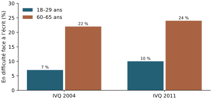

# ENS Rennes D-E — Entretien (oral) 2023 · Corrigé brut

*Corrigé rédigé par IA, non officiel.*

**Rédaction** · GPT-6.2 Astra Ultra · vitesse non renseignée

Les 23 tirages de ce fascicule de 62 pages appellent une réflexion personnelle de dix minutes au maximum. Les questions servant de titres et les relances sont proposées pour l’entraînement. Les renvois de pages suivent le fascicule distribué, y compris pour les extraits de la même œuvre.

## Sujet 1 — Comment passer d’une recommandation sportive à une activité durable ?

*Fascicule, pages 1 à 3.*

Perrier, Collinet, Dalla Pria et Honta recensent les recherches sur le sport et la santé, depuis la construction d’un problème public jusqu’à l’expérience des pratiquants. La coexistence d’une littérature abondante et de politiques de promotion ne dit pas comment une personne confrontée à des horaires incompatibles ou à une limitation physique peut se saisir de l’offre. Quel est le mécanisme à observer ?

Il faut d’abord suivre la traduction de la recommandation dans un établissement ou une association. Une activité annoncée peut demeurer inaccessible par son prix, par la distance ou par la sélection tacite des participants. Puis il faut suivre les personnes, y compris celles qui ne commencent pas ou s’interrompent. Examiner uniquement les pratiquants assidus fait passer leur état initial favorable pour un effet du dispositif. Les travaux sur les conduites à risque rappellent également que la catégorie de sport ne garantit pas à elle seule tous les bénéfices attendus. Proposer plusieurs formes d’engagement, recueillir les motifs d’abandon et observer l’évolution dans le temps donneraient à la politique publique des critères plus justes que le seul nombre d’inscriptions.

**Relance.** Une hausse des inscriptions prouve-t-elle un effet de santé ?

Elle renseigne sur l’accès initial. Il faut aussi mesurer la participation effective et tenir compte du profil de départ de ceux qui s’inscrivent.

## Sujet 2 — Que devient une pratique sportive lorsqu’elle change de pays ?

*Fascicule, pages 4 à 6.*

L’extrait de Gasparini, Le Noé et Bancel distingue plusieurs échelles d’étude des relations internationales. Le cricket importé dans l’Inde coloniale et le contentieux du footballeur Bosman permettent de déplacer le regard du seul face-à-face entre États vers les institutions, les clubs et les pratiquants. Comment éviter de confondre la circulation d’une règle avec l’imposition de son sens ?

Une institution sportive héritée de la colonisation peut conserver un règlement et devenir le lieu de revendications nouvelles. Son origine renseigne sur ses conditions d’entrée dans le pays. Elle ne suffit pas à expliquer les appropriations et les publics ultérieurs. L’affaire Bosman illustre un autre changement d’échelle. Le joueur demande réparation et des syndicats portent un problème collectif, tandis que le juge raisonne en matière de circulation des travailleurs. La convergence des effets n’implique pas l’identité des intentions. Le texte invite à des enquêtes proches des acteurs. La séparation entre experts et chercheurs spécialisés ne garantit cependant pas par elle-même la qualité d’une preuve. Croiser archives institutionnelles, récits locaux et droit applicable permet de tester les explications concurrentes.

**Relance.** Pourquoi un cas individuel éclaire-t-il une transformation collective ?

Il révèle les règles contestées et les acteurs capables de généraliser la décision. Il ne suffit pas à connaître les effets sur tous les sportifs.

## Sujet 3 — Comment un journal construit-il un débat sur la fin de vie ?

*Fascicule, pages 7 à 9.*

Pascal Hintermeyer étudie le traitement de la fin de vie par *Le Monde* de 1998 à 2010. L’appel public de 132 signataires en janvier 1999 illustre le passage d’histoires individuelles à une question collective. La révélation et la polarisation rendent le sujet visible. Elles peuvent aussi faire passer les voix choisies par la rédaction pour la totalité de l’opinion. Que peut prouver un corpus journalistique ?

Il permet d’observer qui parle, quels mots sont retenus et comment un cas devient une demande de décision publique. Le rappel des pratiques d’autres pays déplace le débat en donnant à voir des cadres différents. Mais un pays cité en exemple, une tribune et un article de journal ne fournissent pas la même preuve. Pour analyser l’opinion il faudrait d’autres sources. Pour comparer des législations il faudrait connaître les textes et leur mise en œuvre aux dates pertinentes. Il convient enfin de laisser une place aux personnes concernées, aux proches et aux soignants, dont les besoins d’écoute et d’accompagnement ne se réduisent pas à deux camps. La conclusion porte sur la présentation du débat dans ce quotidien et à cette période.

**Relance.** Comment vérifier que le journal polarise la discussion ?

Définir des catégories à l’avance et comparer les personnes citées, les objections et leur place dans le temps avec celles d’autres journaux.

## Sujet 4 — Que change la précision des mots dans la discussion sur la fin de vie ?

*Fascicule, pages 10 à 12.*

Jocelyne Saint-Arnaud retrace dans un texte publié initialement en 1992 les sens historiquement opposés donnés aux mots du débat. Un même adjectif peut renvoyer à l’intention d’un acte, à sa conséquence ou à la manière dont un observateur le décrit. Deux interlocuteurs peuvent ainsi croire s’opposer sur une décision alors qu’ils ne désignent pas la même chose.

La clarification permet de demander ce que le terme signifie dans le passage lu, qui parle et à quelle époque. Elle rend possibles l’écoute d’un patient, la prise en compte de sa volonté et la discussion sur l’accompagnement de sa souffrance. Mais choisir des termes ne règle pas tout. Des personnes d’accord sur une description peuvent encore accorder des poids différents à l’autonomie, à la solidarité et à la protection d’une personne vulnérable. Les références morales et religieuses mobilisées dans l’extrait ont une histoire. Le jury de 2023 ne demande pas d’en faire le droit français actuel. Une argumentation rigoureuse précisera à quel moment elle décrit un vocabulaire et à quel moment elle défend une valeur, en gardant la dignité et l’accès aux soins au centre de la discussion.

**Relance.** Une définition neutre suffit-elle à produire un accord ?

Elle réduit un malentendu, mais un désaccord de valeurs peut persister. Il faut alors exposer les raisons des parties et les protections dont chacune se soucie.

## Sujet 5 — Comment comparer historiquement des sociétés réputées violentes ?

*Fascicule, pages 13 à 14.*

Charles Tilly conteste les réputations nationales figées. Le souvenir de la mobilisation de 1947 s’estompe, tandis que 1968 devient un point de comparaison commode. Si la mémoire publique sélectionne les épisodes, comment construire une série historique moins dépendante de ce qui fait encore événement aujourd’hui ?

Il faut fixer des critères comparables, une période et des sources multiples. Un événement davantage couvert peut sembler plus fréquent. Un changement de définition peut modifier les décomptes avant même que les conduites ne changent. La construction de l’État et l’organisation des revendications offrent une explication institutionnelle à tester. Elles invitent à regarder à qui s’adresse la revendication et comment les autorités la qualifient, plutôt qu’à attribuer une disposition immuable aux populations. Cette approche risque à son tour de sous-estimer les différences locales et les expériences des personnes touchées. Comparer des archives de même nature et signaler les lacunes aiderait à distinguer évolution du phénomène, évolution de son enregistrement et usages ultérieurs de la mémoire. La fréquence historique ne justifie aucune conduite.

**Relance.** Comment un pays peut-il changer de rang sans changement réel ?

Une nouvelle procédure de déclaration ou une conservation inégale des archives rend certaines catégories visibles sans modifier leur fréquence effective.

## Sujet 6 — À quoi reconnaît-on une organisation de santé publique prête à entendre une alerte ?

*Fascicule, pages 15 à 17.*

Patrice Debré écrit en 2018, avant la crise de 2020. Il recommande une meilleure coopération entre autorités de santé humaine, animale et alimentaire, une attention aux sciences sociales et un partage plus équitable de l’expertise. Le texte identifie un problème institutionnel. Des observations pertinentes peuvent rester inutilisées lorsque les responsabilités sont dispersées. Comment savoir si une réforme de la coordination y répond ?

Il faut d’abord savoir à qui une collectivité peut signaler une inquiétude, quelle autorité lui répond et comment cette réponse est expliquée au public. Un organisme commun peut raccourcir les délais. Il peut également ajouter une validation supplémentaire si les rôles restent ambigus. Ensuite, appeler à une coopération entre Nord et Sud ne garantit pas une décision partagée. Il faut observer qui dispose des moyens d’agir et si les partenaires locaux peuvent définir leurs priorités. Les sciences sociales aident à comprendre l’accès aux soins, les langues de communication et la confiance. Elles doivent aussi permettre aux populations de contester une mesure inadaptée. Le critère de réussite est la possibilité d’accéder à une information fiable et à une aide effective, avec des responsabilités publiquement identifiables.

**Relance.** Davantage de messages améliore-t-il toujours la confiance ?

Des instructions incohérentes peuvent la réduire. Mesurer la compréhension des messages, l’accès aux services et la possibilité de poser une question est plus instructif.

## Sujet 7 — Que peut promettre la prospective sur les conflits ?

*Fascicule, pages 18 à 20.*

Dominique David écrit en 2018 à partir d’un monde qui ne ressemble plus aux projections de l’immédiat après-guerre froide. Des séries sur les conflits entre États, les victimes recensées ou la durée des crises donnent des images différentes. Quelle conclusion prospective reste défendable sans convertir une tendance passée en loi ?

Il faut décrire la fenêtre d’observation, la catégorie de conflit et la fiabilité du dénombrement. Une baisse des occurrences pendant un intervalle ne permet pas de prédire le prochain événement, et une moyenne peut masquer des situations humaines extrêmes. Le texte relie ensuite fragmentation intérieure, rapports de puissance et faiblesse d’une interprétation européenne commune. Ces relations proposent des hypothèses. Elles demandent des cas comparables et des mécanismes reliant effectivement les échelles. Au moment du concours, les événements ultérieurs à 2018 incitent à relire les catégories utilisées, en évitant de prêter à l’auteur une information qu’il ne pouvait avoir. Une prospective responsable aide des institutions civiles à maintenir le dialogue, protéger les droits et réviser leurs hypothèses. Elle indique explicitement ce qu’elle ne peut dater ou prévoir.

**Relance.** Un événement inattendu invalide-t-il toujours une étude prospective ?

Il invite à vérifier si l’étude excluait ce type d’événement ou décrivait une évolution moyenne compatible avec des exceptions, puis à réexaminer ses hypothèses.

## Sujet 8 — Le déclassement se mesure-t-il par ce que les personnes ressentent ?

*Fascicule, pages 21 à 23.*

Nicolas Charles rend compte de l’étude de Camille Peugny qui associe l’enquête Formation et qualification professionnelle de 2003 et des récits de trajectoire. Un adulte peut occuper une position classée plus basse que celle de son parent et interpréter cette trajectoire de façons très différentes. Les attentes liées à la scolarité accentuent parfois le sentiment d’un décalage.

Le tableau de mobilité mesure une position relative à une nomenclature. Il dépend du parent choisi, de l’âge comparé et de la transformation générale des emplois. Un déclassement intergénérationnel ne signifie pas nécessairement une perte absolue de revenu. Les entretiens éclairent ensuite la manière dont la famille donne sens à l’écart. Ils expliquent des contrastes qu’un tableau ne permet pas de déduire, sans fournir à eux seuls les fréquences nationales. Enfin la proximité politique observée avec le groupe d’origine n’établit pas que le déclassement a causé le vote. Comparer des parcours de même origine et différentes trajectoires, en tenant compte de la génération, préciserait l’argument. L’articulation des deux méthodes permet de poser des questions plus fines sur les effets propres du parcours.

**Relance.** Un diplôme plus élevé que celui du père interdit-il le déclassement ?

Le niveau de formation et la position de l’emploi sont deux grandeurs différentes. Leur relation évolue avec la structure des emplois et la diffusion des diplômes.

## Sujet 9 — Comment les métiers fabriquent-ils des conduites attendues ?

*Fascicule, pages 24 à 25.*

Bouffartigue et Fortino présentent des enquêtes sur les agents de sécurité privée et des apprentis électriciens et conseillères-clientèle. La forte majorité masculine des premiers coexiste avec un métier socialement peu reconnu. La sélection des apprentis dans une grande entreprise donne à leurs places un autre statut. Comment comparer ces expériences sans réduire les personnes à leur sexe ou à leur origine ?

Les attentes de virilité, de présentation ou de relation au public s’apprennent dans des situations professionnelles concrètes. La discussion des agents sur la véritable nature de leur activité est une tentative de faire reconnaître une compétence. Chez les apprentis, l’enjeu de respecter les comportements attendus tient aussi à l’espoir d’une embauche. Les entretiens et l’observation permettent de comprendre ce que ces conduites veulent dire. Mais ils ne démontrent pas que tous les métiers ou tous les salariés répondent de la même manière. Il faut comparer conditions de sélection, rémunération, marge de décision et personnes qui échappent à l’attente dominante. La reconnaissance du travail réel peut alors devenir un levier différent d’une simple modification des intitulés professionnels.

**Relance.** Pourquoi ne pas comparer seulement les taux de féminisation ?

Un pourcentage situe la composition du métier. Il ne décrit ni les tâches distribuées, ni les évaluations, ni les conditions d’une progression.

## Sujet 10 — Que devient la valeur d’un métier qui se féminise ?

*Fascicule, pages 26 à 28.*

Le deuxième extrait du dossier sur le genre au travail prend notamment pour exemple la médecine du travail et la redéfinition du médecin comme manager. Les horaires, la relation globale au patient et la hiérarchie entre spécialités pèsent dans les trajectoires. L’entrée de femmes et la faible reconnaissance d’un segment peuvent se produire ensemble. Dans quel sens joue la causalité ?

Un emploi déjà moins valorisé peut s’ouvrir davantage à celles qui étaient exclues d’autres spécialités. Sa perception peut aussi changer avec sa composition. Il faut dater les recrutements, les rémunérations et les réformes pour départager ces mécanismes. Les contraintes domestiques éclairent certains choix sans faire de l’intérêt pour des horaires prévisibles une préférence féminine naturelle. Les hommes peuvent avoir les mêmes motifs. La promotion d’une posture managériale modifie ensuite les critères qui donnent accès à l’autorité. Certaines résistances défendent le travail médical, d’autres peuvent reconduire des exclusions. Observer qui intervient, quels arguments sont repris et quelles décisions suivent permet d’apprécier si l’engagement collectif transforme les hiérarchies de genre.

**Relance.** Le nombre de femmes cadres mesure-t-il toute l’égalité ?

Il faut aussi examiner les moyens de leurs services et les responsabilités qui leur sont confiées, ainsi que les trajectoires des personnes restées hors de ces postes.

## Sujet 11 — La mobilité professionnelle rend-elle les rôles de genre plus souples ?

*Fascicule, pages 29 à 30.*

Le troisième extrait associe plusieurs points de vue, dont le journal de Fumiko Hayashi, l’analyse des personnes qui passent certaines nuits loin du domicile pour le travail et les expériences de collectifs de production. Les déplacements et les nouvelles formes d’activité semblent ouvrir un écart avec la division ordinaire des rôles. Comment savoir si cet écart dure ?

Une femme appelée à séjourner loin de chez elle peut devoir renégocier la prise en charge du foyer. Cette mobilité n’a pas le même sens selon qu’elle est choisie, rémunérée ou imposée sous peine de perdre son emploi. En parallèle, une organisation qui valorise l’échange de savoirs peut ouvrir un espace à des compétences auparavant invisibles. Elle peut aussi reconduire une distribution des tâches de coordination ou d’entretien. Ces observations établissent des possibilités, sans démontrer que le changement d’organisation suffit à redistribuer les responsabilités familiales. Suivre les mêmes personnes avant, pendant et après le changement, et interroger leurs proches, aiderait à distinguer arrangement temporaire et évolution du rapport social. Une expérience littéraire éclaire le vécu mais ne vaut pas échantillon représentatif.

**Relance.** Qu’observer après le retour au domicile ?

La répartition des tâches, la maîtrise du temps disponible et la possibilité de refuser le prochain déplacement renseignent sur la permanence du changement.

## Sujet 12 — Un revenu de base libérerait-il du temps pour d’autres activités ?

*Fascicule, pages 31 à 32.*

Dans le dossier collectif, Raphaël Liogier préfère parler de revenu de base existentiel. Il distingue emploi rémunéré et activité socialement utile, et souligne que la réduction du temps contraint pourrait rendre plus visible l’engagement bénévole ou domestique. La reconnaissance d’une activité résulte-t-elle du seul versement d’une somme identique à chacun ?

Un revenu individuel régulier peut réduire le coût d’une transition et permettre le refus d’un emploi incompatible avec une formation ou avec la santé. L’effet dépend du niveau réel du versement, de sa stabilité et des prestations qu’il remplace. Changer le nom d’un temps non rémunéré n’accorde pas à tous la même faculté d’en choisir l’usage. Une personne assumant déjà les charges domestiques pourrait en faire davantage si aucun service collectif ne les partage. La proposition de passer du plein emploi à la pleine activité doit donc être examinée en regard de ce que l’emploi apporte aussi, notamment les droits collectifs et l’assurance. Une évaluation suivrait les revenus nets, le temps effectivement choisi et la participation aux décisions du foyer, en tenant compte du financement.

**Relance.** Pourquoi le coût brut ne suffit-il pas à juger le projet ?

Des impôts et prestations seraient modifiés. Les gagnants et perdants se déterminent sur le montant net et l’accès aux services, puis sur les effets de comportement.

## Sujet 13 — Un revenu universel reconnaît-il le travail de soin ?

*Fascicule, pages 33 à 35.*

Sandra Laugier, dans le même dossier, place au centre le *care*, ensemble d’activités nécessaires pour entretenir les conditions d’une vie digne. Le droit à des moyens d’existence peut renforcer une personne dépendante d’un proche. Mais une allocation versée à tous ne désigne pas qui assure quotidiennement le soin ni dans quelles conditions. Qu’est-ce qui rend ce travail vraiment visible ?

Le versement individuel peut accroître l’autonomie matérielle, notamment pour des personnes dont le travail familial ne donne pas de salaire. Son caractère universel peut éviter un stigmate et faciliter l’accès des personnes que découragent les démarches. Cependant une somme uniforme ne remplace ni un service d’aide ni la reconnaissance salariale et professionnelle de celles et ceux qui le rendent. Si un employeur ou une famille y voit un substitut au soutien collectif, des inégalités pourraient se déplacer. L’argument conduit à mesurer en même temps le pouvoir de décision des aidants, la répartition des heures et la qualité du service reçu. Des besoins de dépendance très différents peuvent exiger des soutiens différenciés en plus d’un socle commun. L’extrait examine ces tensions sans fournir une étude de financement complète.

**Relance.** Une même somme distribuée à tous réalise-t-elle l’égalité ?

Elle instaure une égalité de versement. La capacité d’en tirer parti varie selon les besoins, les charges et les services disponibles.

## Sujet 14 — Que peut établir une expérience sur la communication non verbale ?

*Fascicule, pages 36 à 38.*

Guéguen et de Gail rapportent des expériences où un bref contact est associé à une appréciation ou à un comportement différent. Le fil directeur est le lien entre communication non verbale, statut et contexte. Comment savoir si les résultats décrivent un mécanisme général ou une réponse propre à la situation expérimentale ?

Un protocole à conditions comparables peut isoler un écart de réponse, à condition de contrôler la sélection, le comportement de l’observateur et la mesure retenue. Un jugement sur une forme géométrique et un comportement dans une interaction réelle n’ont ni le même enjeu ni la même validité externe. Les auteurs eux-mêmes signalent des limites liées à la familiarité et au contexte. Une moyenne ne prédit pas le vécu d’une personne particulière. La position d’autorité d’un adulte, les conventions culturelles et les limites corporelles propres à chacun changent la signification de l’interaction. Ces travaux appellent un examen du consentement des participants et des conditions éthiques de l’enquête. Un résultat descriptif ne donne aucune autorisation de franchir les limites personnelles d’autrui.

**Relance.** Comment tester une explication concurrente ?

Comparer, avec consentement et conditions appropriées, les effets de l’attention verbale et de la situation sociale, puis demander aux participants le sens qu’ils ont attribué à l’interaction.

## Sujet 15 — L’argent éloigne-t-il nécessairement les personnes les unes des autres ?

*Fascicule, pages 39 à 41.*

De Blic et Lazarus présentent les sociologies de la monnaie, notamment Weber et Simmel. Un moyen de paiement général rend des prestations comparables et autorise des relations entre inconnus. La monétarisation, la ville et la division du travail progressent de concert. Le paiement transforme-t-il toute relation en un rapport anonyme ?

Les échanges gagnent en extension. On peut quitter une dépendance personnelle lorsqu’un revenu permet de s’adresser ailleurs. Mais cette alternative dépend du pouvoir d’achat et du nombre d’options réellement accessibles. La monnaie peut remplacer une obligation coutumière sans faire disparaître toute contrainte. D’autre part, la même somme prend différents sens selon qu’elle règle une dette, rémunère un salarié ou exprime une solidarité. Comparer ces usages évite de traiter un moyen de paiement commun comme une culture uniforme. Une enquête peut demander qui décide de son affectation et comment une dépense devient légitime dans un groupe. L’intérêt du raisonnement de Simmel est de maintenir ensemble une possibilité de liberté individuelle et un nouveau pouvoir des rapports abstraits. Leur importance respective varie selon les situations.

**Relance.** Donner de l’argent rend-il toujours un lien plus impersonnel ?

Un don monétaire peut s’accompagner d’une histoire, d’une destination et d’une attente de reconnaissance. La forme du transfert ne définit pas seule la relation.

## Sujet 16 — Que gagne un fleuve à recevoir une personnalité juridique ?

*Fascicule, pages 42 à 43.*

Le podcast anonyme rapproche récit mythique, analogies et dispositifs récents de protection d’entités naturelles. Son humour, notamment la question d’une éventuelle action contre la rivière après une crue, teste les limites du vocabulaire de la personne. Quelle différence fait la reconnaissance juridique dans un litige réel ?

Une personne juridique peut être titulaire de droits sans être un être humain. Un représentant peut saisir une autorité pour défendre l’intégrité d’un milieu. Il faut préciser qui le nomme, quels intérêts il porte et quels remèdes sont accessibles. Une personnalité ne déclenche pas un ensemble identique de droits et de responsabilités pour tout titulaire. La crue ne fait donc pas du fleuve un débiteur ordinaire sans régime juridique correspondant. Ensuite des associations ou autorités peuvent déjà protéger un milieu sans lui attribuer de personnalité. Pour comparer les dispositifs, suivre la possibilité d’alerter, d’agir en justice et d’obtenir un résultat exécuté. Une innovation de vocabulaire a une portée politique et symbolique. Elle acquiert un effet juridique identifiable lorsque des personnes habilitées disposent effectivement de moyens et de recours.

**Relance.** Comment éviter un représentant purement symbolique ?

Prévoir accès à l’information, ressources, indépendance et obligation de rendre compte aux communautés concernées, puis examiner les décisions obtenues.

## Sujet 17 — Comment évaluer une méthode d’intelligence juridique ?

*Fascicule, pages 44 à 46.*

Véronique Chapuis propose une approche transversale du droit et présente une méthode dont elle participe à la diffusion. L’idée que le juriste puisse intervenir avant la signature d’un contrat, en rapprochant métiers et disciplines, répond à une difficulté réelle. Comment tester la plus-value de cette pratique au-delà de son vocabulaire promotionnel ?

Une équipe de projet peut découvrir qu’une solution permise dans un domaine crée une obligation dans un autre. Associer juriste, opérationnels et personnes affectées permet de poser la question plus tôt et de documenter un arbitrage. Mais une meilleure appréciation de la probabilité d’un litige ne tranche pas la question de la licéité ou celle des droits fondamentaux. Une pratique rarement sanctionnée peut demeurer illégale. L’intérêt professionnel de l’autrice justifie de chercher des évaluations indépendantes, sans suffire à invalider l’argument. On comparerait délais de résolution, désaccords détectés et situations où l’équipe a décidé de renoncer à un projet. Une démarche crédible doit prévoir des conditions d’échec, un droit d’objection et une trace du raisonnement.

**Relance.** L’absence de contentieux prouve-t-elle que la méthode fonctionne ?

Elle peut refléter la chance, le renoncement d’une victime ou un projet très simple. Comparer des projets proches et examiner les difficultés résolues est plus probant.

## Sujet 18 — Qu’a réellement assuré la continuité pédagogique en 2020 ?

*Fascicule, pages 47 à 48.*

Jean-Louis Durpaire décrit à partir de 2020 des décisions prises dans des contextes nationaux différents. Le 25 mars, 165 pays avaient fermé leurs écoles, affectant près de 1,5 milliard d’élèves selon le texte. Ce chiffre mesure l’ampleur d’une fermeture matérielle. Il ne mesure pas le nombre d’enfants ayant cessé d’apprendre. Comment comparer les continuités effectives ?

Une instruction de poursuivre le programme fixe une attente publique. Sa mise en œuvre dépend des contacts entre élèves, familles et enseignants. L’exemple de Neuchâtel traduit cette distinction entre maintien d’une obligation et réorganisation du travail. L’accueil d’enfants de soignants en France rappelle aussi la fonction sociale des établissements. Il faut ensuite distinguer disponibilité d’un équipement, capacité d’étudier et qualité du retour reçu sur un travail. Deux élèves officiellement connectés peuvent connaître des situations très différentes. Un bilan rigoureux associerait fréquence du contact, décrochages repérés et acquisitions ultérieures, en tenant compte des différences initiales et du caractère précoce des observations. Comparer seulement des moyennes nationales risque d’effacer l’hétérogénéité des établissements et des foyers.

**Relance.** Une connexion quotidienne atteste-t-elle un apprentissage ?

Elle atteste au mieux un contact mesuré. Examiner la production de l’élève, le retour de l’enseignant et sa capacité à réutiliser un acquis donne des informations complémentaires.

## Sujet 19 — Un écart entre générations prouve-t-il un déclin avec l’âge ?

*Fascicule, pages 49 à 51.*

Murat et Rocher étudient les compétences des adultes à partir d’enquêtes répétées. En 2004, 7 % des 18–29 ans et 22 % des 60–65 ans rencontrent des difficultés face à l’écrit. En 2011 ces parts atteignent 10 % et 24 %. Les écarts sont donc de 15 puis 14 points. Que permettent-ils d’attribuer au vieillissement individuel ?

Les groupes d’âge observés à une date n’ont pas reçu la même formation, ni occupé les mêmes emplois. Une différence transversale peut refléter la génération, l’âge ou des conditions communes à la période. Les personnes de 60–65 ans en 2011 ne sont pas le même groupe de naissance que celles du même âge en 2004. Suivre une cohorte ou les mêmes personnes améliorerait l’identification, tout en discutant attrition et effet de familiarité avec l’épreuve. La construction des exercices et l’orientation des participants vers des modules différents comptent aussi pour interpréter les scores. Ces données peuvent donc signaler un besoin d’accès à la formation pour plusieurs âges sans transformer une moyenne de groupe en jugement sur un individu.

**Relance.** La réduction d’un point de l’écart prouve-t-elle une amélioration ?

Les deux proportions de difficultés ont augmenté. La précision statistique et la comparabilité des enquêtes doivent en outre être établies avant d’interpréter ce seul point.

## Sujet 20 — Un outil de prévision peut-il rendre la justice plus prévisible sans la figer ?

*Fascicule, pages 52 à 54.*

Gaylord Marchesseau interroge l’effet de l’ouverture des décisions et des outils statistiques sur le travail des juges. Un avocat peut mieux situer un montant d’indemnisation à partir d’affaires antérieures. Une fréquence relevée dans les dossiers publiés n’est pourtant pas une règle que le juge devrait appliquer à un dossier futur. Où se situe le risque de circularité ?

Un outil descriptif peut révéler une dispersion auparavant invisible et orienter la recherche d’arrêts comparables. Sa qualité dépend de la sélection des décisions, de leur date, des variables disponibles et de la possibilité de vérifier les motifs. Les règlements amiables et certaines situations mal documentées peuvent demeurer absents. Si les parties anticipent le score et renoncent à des demandes atypiques, la prochaine base semblera encore plus homogène. Distinguer information et décision suppose que le juge examine contradictoirement les particularités, motive sa solution et puisse s’écarter d’une statistique. Transparence des données et protection des personnes doivent également être tenues ensemble. Une justice prévisible permet de comprendre les raisons d’une décision. Elle ne promet pas un résultat identique à partir de quelques étiquettes.

**Relance.** Publier davantage de décisions suffit-il à corriger les biais ?

Le volume peut augmenter sans faire apparaître les litiges jamais jugés. Il faut décrire la sélection et la portée des variables avant de généraliser.

## Sujet 21 — Un magasin conçu pour une génération répond-il à des besoins durables ?

*Fascicule, pages 55 à 57.*

Lechartre et Collin-Lachaud rapprochent les attentes commerciales de la génération Z, le bien-être et l’expérience du Covid. Le commerce physique peut offrir des occasions de rencontre ou de conseil que l’achat à distance ne remplace pas toujours. Comment distinguer un effet durable de génération d’un effet d’âge ou de période ?

De jeunes adultes disposant de budgets limités et découvrant l’autonomie peuvent avoir des préférences communes à d’autres générations au même âge. Les restrictions sanitaires ont en outre touché différentes classes d’âge simultanément. Une enquête réalisée pendant cette période ne démontre pas à elle seule une identité de consommation durable. Comparer plusieurs cohortes au même âge, puis suivre la même cohorte après la levée des restrictions, donnerait un test plus solide. Les attentes déclarées envers le bien-être ne prédisent pas mécaniquement un achat. Le prix, l’accessibilité et la présence d’un service de qualité peuvent modifier le choix. Le commerçant peut expérimenter un aménagement accessible et en mesurer les usages effectifs, en incluant les personnes qui quittent la boutique ou n’y entraient déjà pas.

**Relance.** Une préférence pour le conseil en magasin annonce-t-elle davantage d’achats ?

Le conseil peut informer un achat effectué ailleurs. Distinguer fréquentation, satisfaction et transactions évite de confondre trois résultats.

## Sujet 22 — Que signifie rendre une intelligence artificielle plus inclusive ?

*Fascicule, pages 58 à 60.*

Hamilton Mann met en rapport la pluralité humaine et les recommandations de systèmes artificiels. Une diversité d’expériences peut rendre visibles des besoins ignorés lors de la conception. Mais demander à un outil d’exprimer « le meilleur » de l’humanité suppose un accord sur ce qui compte et sur la manière de trancher les conflits de valeurs. À qui appartient cette décision ?

Une équipe plus diverse peut identifier plus tôt les usages et les erreurs qui affectent inégalement les groupes. Encore faut-il que chacun ait le pouvoir de signaler un problème et d’obtenir une modification. Ensuite aucun indicateur unique ne mesure toutes les formes de justice. Une moyenne satisfaisante peut masquer des erreurs coûteuses concentrées sur un groupe. Une évaluation publique doit préciser la tâche, les populations concernées et les types d’erreurs pertinents. Un mécanisme accessible de contestation permet d’entendre les conséquences que les concepteurs n’avaient pas prévues. La présence d’humains dans la boucle n’est pas une garantie suffisante si leur intervention est purement formelle. L’inclusion devient observable lorsque des personnes affectées peuvent peser sur les choix, y compris celui de ne pas automatiser une décision particulière.

**Relance.** Des données plus représentatives suffisent-elles ?

Elles corrigent certains angles morts. Un objectif mal choisi ou une absence de recours peuvent continuer à produire des décisions injustes avec des données mieux équilibrées.

## Sujet 23 — Exigence scolaire et adaptation sont-elles incompatibles ?

*Fascicule, pages 61 à 62.*

Réjean Bergeron part d’une expérience d’enseignement où une discipline de travail rend aux élèves le temps d’écouter et de réfléchir. Il rapproche cette exigence des pratiques de conservatoires ou d’établissements sélectifs, et critique les ambitions réduites dont souffriraient les élèves moins favorisés. Comment défendre une exigence commune sans confondre discipline et apprentissage ?

Le texte identifie un risque réel. Sous prétexte d’adapter, une institution peut réserver aux plus favorisés l’accès aux raisonnements complexes. Définir un objectif commun et donner du temps pour s’y exercer protège le droit d’apprendre. Mais les conservatoires accueillent des participants sélectionnés et souvent soutenus par des ressources familiales. L’observation ne démontre pas que la seule discipline explique leurs résultats. Adapter les étapes ou l’aide matérielle peut précisément permettre aux élèves d’atteindre l’objectif exigeant. Comparer deux méthodes suppose de regarder les progrès à départ comparable et les élèves qui restent à l’écart. L’enseignant peut ainsi maintenir une tâche intellectuellement ambitieuse, expliciter les attentes et différencier l’étayage, puis examiner ce que chaque élève parvient à faire seul.

**Relance.** Comment reconnaître un abaissement réel des exigences ?

Comparer la complexité des tâches finalement accessibles et l’autonomie acquise. Des étapes intermédiaires différentes peuvent conduire au même objectif de maîtrise.

## Dialogue avec le jury sur le projet professionnel

Le rapport de 2023 relève des projets mieux construits et plus personnels. Pour amorcer le dialogue, choisir une activité effectivement pratiquée, expliquer la question qu’elle a suscitée, puis indiquer ce qui demeure incertain. Une personne qui hésite entre enseignement et analyse économique peut préciser ce qu’elle a apprécié en aidant un camarade à interpréter un graphique et ce qu’elle voudrait découvrir lors d’une enquête de terrain. À une relance sur le métier, distinguer les tâches connues, les suppositions et le moyen réaliste de vérifier celles-ci. Les options restent ouvertes si l’on peut expliquer ce qui permettrait de choisir.

[Fascicule de la session](https://www.ens-rennes.fr/medias/fichier/annales-entretien-2023_1713878315473-pdf) · [Rapport du jury](https://www.ens-rennes.fr/medias/fichier/rapport-de-jury-oral-entretien-d-e-2023_1694186071911-pdf)
