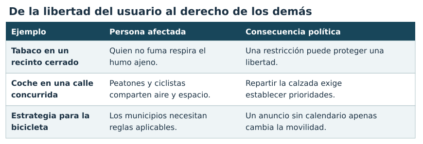

# ENS Rennes · D-E · Espagnol 2023 — Corrigé guidé

*Corrigé rédigé par IA, non officiel. Signalez toute erreur.*

**Rédaction** · GPT-6.2 Astra Ultra · vitesse non renseignée

## I. Version

> [!INDICATION]
> *Entornos urbanos* désigne un milieu, pas nécessairement le seul centre-ville. *Dar buena cuenta de* introduit l’expérience récente des Européens. Distinguer l’atténuation, qui agit sur les émissions, de l’adaptation aux phénomènes extrêmes.

Dans une conjoncture géopolitique extrêmement difficile, où plusieurs crises s’entrecroisent, les villes du monde continuent de faire entendre leur voix pour que les États revoient à la hausse leurs ambitions climatiques. Environ 70 % des émissions de gaz à effet de serre étant produites en milieu urbain, la prise en compte du rôle des villes dans la lutte contre le changement climatique est essentielle au succès de tout accord international. Qui plus est, voilà des années que les villes prennent des mesures climatiques courageuses et ambitieuses. Elles publient des plans d’action conformes à l’accord de Paris et interviennent directement dans des secteurs décisifs comme les déplacements, l’énergie, les bâtiments ou la gestion des déchets.

Au-delà des mesures de réduction des émissions, les villes s’adaptent aussi rapidement aux phénomènes climatiques extrêmes que le changement climatique rend plus fréquents : vagues de chaleur ou de froid, sécheresses ou inondations, dont l’Europe peut malheureusement témoigner, surtout ces dernières années. Les maires mettent rapidement en œuvre des solutions pour renforcer la capacité de leurs villes à faire face à ces phénomènes. Ils s’appuient par exemple sur la nature en créant des toitures et des infrastructures végétalisées, en reboisant les zones urbaines ou en adoptant des revêtements perméables. Toutes ces actions sont en outre menées avec les principaux acteurs de la ville, comme les associations de quartier, les organisations citoyennes et le secteur privé. Elles tiennent compte des groupes les plus vulnérables de la population pour que l’action climatique soit juste, inclusive et équitable.

## II. Thème

> [!INDICATION]
> Restituer le sens français de *laïcité* par *laicidad* et le vivre-ensemble par *convivencia*. Dans la longue phrase centrale, *si bien* introduit une concession. Le meurtre est daté de 2020, l’article de 2022.

Dos años después del inmenso trauma que supuso, el 16 de octubre de 2020, el asesinato de Samuel Paty para todo el país y para el profesorado en particular, la cuestión de la laicidad en la escuela, principio fundamental de la convivencia en la República, sigue alimentando el debate público.

La dificultad estriba en que, si bien los centros educativos siguen siendo el primer lugar donde deben resolverse, con estricto respeto a la ley y mediante el diálogo, las controversias relacionadas con manifestaciones de afirmación religiosa, o incluso de proselitismo, la clave de algunos de esos conflictos no se encuentra únicamente entre las paredes de los centros de secundaria, ya que se originan e incluso se avivan en las redes sociales. Ante esta realidad, ningún docente ni ningún director de centro debe quedarse solo.

En términos más generales, hay que recordar sin descanso que la laicidad es un antiguo principio de libertad y de convivencia pacífica entre todas las confesiones y todas las formas de no creencia, y no un arma antimusulmana. Combatir las manifestaciones de intolerancia o de repliegue comunitario exige dar mayor credibilidad al lema de la República fomentando, en todos los niveles del sistema educativo, la diversidad social y la igualdad de oportunidades.

## III.1. ¿Cómo está presentado el tema de la transición climática en el artículo?

> [!INDICATION]
> La question demande *cómo* : analyser la comparaison initiale, l’ironie et l’image finale. Attribuer à l’auteur le jugement porté sur le gouvernement. Les données et les exemples n’épuisent pas la portée polémique de sa tribune.

Francisco Bastida presenta la transición climática como una disputa sobre el reparto de un espacio común. Empieza por una comparación deliberadamente cotidiana. Quien fuma en un recinto cerrado afecta a personas que no han elegido respirar su humo. Del mismo modo, quien conduce ocupa una parte de la calle y expone a los demás al ruido, a la contaminación y al riesgo de un accidente. Al cambiar el punto de vista, el autor cuestiona la idea de que cualquier límite al coche constituya un ataque a la libertad. También el peatón necesita libertad para desplazarse sin peligro.

La argumentación pasa después de los principios a una decisión material: hacer sitio a un carril bici puede exigir quitar espacio a los vehículos de motor. El lector entiende así por qué un discurso favorable a todos los medios de transporte a la vez evita el conflicto decisivo. El articulista reconoce las iniciativas de algunos ayuntamientos, pero reprocha al Gobierno central que favorezca el coche eléctrico y deje a los municipios sin normas suficientemente concretas para proteger al ciclista.

El tono combina la urgencia con la ironía. La imagen del día de la marmota convierte las reuniones repetidas y las promesas aplazadas en una escena reconocible. La alusión final a un invierno largo prolonga esa crítica. En conjunto, el texto invita a juzgar la transición por los cambios que una persona puede experimentar al cruzar una calle, y no por la cantidad de declaraciones oficiales sobre movilidad sostenible.

*245 mots.*

## III.2. ¿En qué medida le parece a usted que es necesaria una nueva estrategia para luchar contra el cambio climático?

> [!INDICATION]
> Une stratégie peut conserver son objectif et modifier ses crédits, ses instruments ou son calendrier. Examiner un cas en dehors des transports et préciser comment mesurer à la fois la baisse des émissions et ses effets sociaux.

Hace falta una nueva estrategia en la medida en que los compromisos existentes no se traduzcan en decisiones verificables. Cambiar continuamente de objetivo puede retrasar inversiones necesarias: una empresa que va a renovar una red eléctrica necesita saber qué normas regirán dentro de diez años. La prioridad sería mantener el rumbo de reducción de emisiones y revisar los instrumentos que no producen resultados o que cargan el esfuerzo sobre quienes disponen de menos alternativas.

Pensemos en la calefacción de los edificios. Una subida del precio de los combustibles puede animar a un propietario solvente a aislar su vivienda. En cambio, una familia arrendataria que vive en un piso mal aislado pagará más sin poder decidir la reforma. Una estrategia más justa combinaría requisitos de eficiencia, ayuda inicial a los hogares modestos y garantías para que una renovación subvencionada no acabe expulsando a los residentes. El consumo energético antes y después de las obras permitiría comprobar si la inversión cumple su función.

También es necesario coordinar las escalas de decisión. Un municipio puede mejorar el transporte público, pero necesita financiación estable y una red que conecte con los municipios vecinos. A escala internacional, la cooperación facilita tecnologías y recursos a países que afrontan riesgos graves con menos medios. En definitiva, no sustituiría automáticamente cada plan por otro de nombre distinto. Exigiría responsables identificables, plazos intermedios y datos públicos sobre emisiones y costes. Cuando esos indicadores revelen un fracaso, sí habrá razones concretas para cambiar de estrategia.

*245 mots.*

[Sujet](https://www.ens-rennes.fr/medias/fichier/sujet-e-crit-espagnol-d-e-2023_1682689432627-pdf) · [Rapport](https://www.ens-rennes.fr/medias/fichier/rapport-de-jury-lve-e-crit-espagnol-d-e-2023_1698422123293-pdf)
