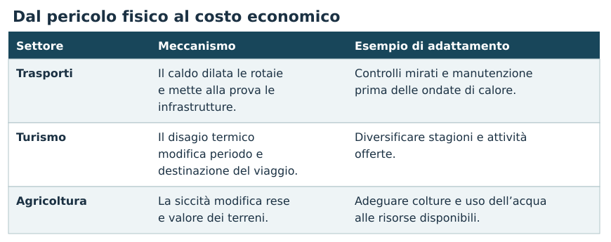

# ENS Rennes · D-E · Italien (oral) 2023 — Corrigé brut

*Corrigé rédigé par IA, non officiel. Signalez toute erreur.*

**Rédaction** · GPT-6.2 Astra Ultra · vitesse non renseignée

Le billet unique reproduit une adaptation d’un article de Manuela Perrone. Les relances sont proposées pour l’entraînement.

## Billet 1 — Clima, l’Italia è più fragile

### Una carta dei rischi, dal clima alle attività quotidiane

Come può un Paese avere meno pioggia e, nello stesso tempo, temere alluvioni più distruttive? Una quantità media di pioggia più bassa non dice come l’acqua si distribuisca nelle singole giornate o nei diversi territori. È questo uno dei motivi per cui il titolo «Clima, l’Italia è più fragile» va oltre una semplice previsione meteorologica. Nel dicembre del 2022 Manuela Perrone riferisce del Piano nazionale di adattamento ai cambiamenti climatici, aggiornato dopo un lungo periodo di stallo. La questione posta dall’articolo è come una variazione fisica diventi un costo per persone, imprese e infrastrutture.

La prima parte presenta segnali già osservati. Il 2022, secondo la formulazione prudente del testo, sembra candidarsi a essere l’anno più caldo dal 1961. Le precipitazioni nel Centro-Nord risultano inferiori del quaranta per cento rispetto al riferimento 1991-2020. La seconda parte guarda a scenari futuri: entro il 2100 la temperatura media potrebbe aumentare da uno a cinque gradi. La forbice è ampia; attribuirle il valore di una previsione puntuale sarebbe fuorviante. Anche il riscaldamento dei mari varia a seconda delle aree, e le stime per le precipitazioni restano più incerte. Questa incertezza suggerisce di prepararsi a più esiti plausibili.

### Leggere le catene economiche

Consideriamo una linea ferroviaria. Un’ondata di calore può dilatare le rotaie. Se occorre rallentare o interrompere i treni, il danno non coincide con la sola spesa per la riparazione: anche i viaggiatori perdono tempo e le imprese affrontano ritardi. In una città molto calda, alcuni spostamenti a piedi o in bicicletta diventano inoltre meno agevoli, mentre aumenta il bisogno di raffreddare i mezzi e le stazioni. Un’infrastruttura che sembrava efficiente sotto il clima passato può quindi diventare un punto debole.

Il turismo trasforma il disagio termico in una possibile variazione della domanda. Il testo riferisce che, nello scenario considerato con due gradi in più, la sola variazione del comfort potrebbe ridurre del quindici per cento gli arrivi internazionali. Non è un calo già registrato, né il risultato di un calcolo che includa ogni possibile reazione degli operatori. Alcuni visitatori potrebbero scegliere altri mesi o altre località. In agricoltura, invece, la disponibilità di acqua e la resa incidono sul valore della produzione e, nel tempo, sul prezzo dei terreni. Il valore di 12,5 miliardi di euro di minore produzione aggregata nel 2050 appartiene a una stima. Non va sommato a una percentuale di arrivi turistici, che misura tutt’altra grandezza.

### Conclusione e rilancio

Ritengo utile che il piano sia nazionale e venga discusso per settori. Le risorse idriche, le reti ferroviarie e i flussi turistici non si fermano ai confini di un comune. Gli interventi, però, dovranno tener conto dell’esposizione locale e di chi ha meno risorse per proteggersi. Distinguerei inoltre adattamento e riduzione delle emissioni. Ombreggiare le fermate degli autobus protegge oggi i passeggeri; ridurre i gas serra limita l’intensità futura del problema. Una politica coerente deve poter spiegare quale dei due effetti cerca di ottenere e con quale indicatore lo verificherà.

**Perché non basta la media annuale della temperatura?** Un servizio ferroviario può entrare in crisi durante pochi giorni eccezionalmente caldi. La frequenza e la durata degli estremi possono contare più della media per decidere quando intervenire.

**Si dovrebbe abbandonare il turismo estivo?** Il testo non autorizza una conclusione così generale. Una località potrebbe offrire attività in altre stagioni o migliorare i servizi nelle ore più calde. Bisognerebbe valutare anche i costi, la disponibilità d’acqua e le condizioni di lavoro.

**Come scegliere un investimento urgente?** Confronterei il rischio di interruzione, il numero di persone coinvolte e il costo delle misure preventive. Dare priorità a un ponte che garantisce l’unico accesso a un ospedale può essere sensato anche se non è l’opera con il maggior valore commerciale.

[Sujet](https://www.ens-rennes.fr/medias/fichier/annales-oral-italien-d-e-2023_1698769099652-pdf)
