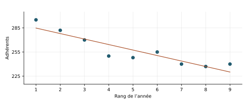
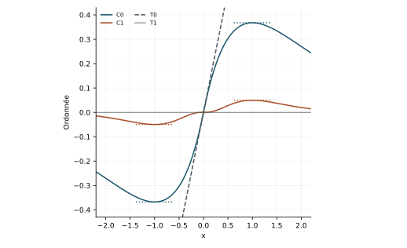

# ENS Rennes D-E — Mathématiques appliquées et statistiques 2023 · Corrigé guidé

*Corrigé rédigé par IA, non officiel. Signalez toute erreur.*

**Rédaction** · GPT-6.2 Astra Ultra · vitesse non renseignée

**Révision** · GPT-6.2 Astra Ultra · vitesse non renseignée

**Triathlon, étude de fonctions et probabilités.** Le premier exercice emploie les séries fictives du sujet. Les deux suivants étudient une famille de courbes et plusieurs modèles indépendants de participation et d’entraînement.

## 1. Statistiques du triathlon

### Question 1.1.a

> [!INDICATION]
> Identifier l’observation par ville et la nature de la grandeur.

#### Solution

La proportion de licenciés, exprimée en pourcentage, est l’unique variable numérique observée par épreuve. C’est une série univariée quantitative, traitée comme continue, dont les valeurs sont arrondies dans le tableau. L’effectif de la série est 26.

### Question 1.1.b

> [!INDICATION]
> Ranger les observations. Les quartiles français sont les valeurs des rangs arrondis vers le haut.

#### Solution

Après tri, les observations de rangs 7, 13, 14 et 20 sont respectivement $23{,}5$, $43{,}5$, $44{,}3$ et $65$. Comme $26/4=6{,}5$ et $3\times26/4=19{,}5$, les quartiles sont $Q_1=23{,}5\%$ et $Q_3=65\%$. La médiane, moyenne des deux observations centrales, est $43{,}9\%$. L’écart interquartile vaut $65-23{,}5=41{,}5$ points de pourcentage.

### Question 1.1.c

> [!INDICATION]
> Diviser par l’effectif total pour les deux moments descriptifs.

#### Solution

La somme des 26 pourcentages vaut $1196{,}5$. Leur moyenne est $\bar x=26^{-1}\sum_{i=1}^{26}x_i=46{,}019\%$ à $10^{-3}$ près. L’écart-type de la série est $\sqrt{26^{-1}\sum_{i=1}^{26}x_i^2-\bar x^2}=23{,}398$ points de pourcentage. Le calcul utilise la moyenne avant arrondi.

### Question 1.2.a

> [!INDICATION]
> Utiliser les rangs de 1 à 9 et non les dates civiles.

#### Solution

Les points sont $(1,295),(2,282),(3,270),(4,250),(5,248),(6,255),(7,240),(8,237),(9,240)$. Sur papier, on compte 1 cm par rang horizontalement et 1 cm pour 30 adhérents verticalement.

### Question 1.2.b

> [!INDICATION]
> Utiliser la moyenne des carrés moins le carré de la moyenne.

#### Solution

La moyenne est $\bar y=9^{-1}\sum_{i=1}^9 y_i=2317/9\simeq257{,}444$ adhérents. La variance $V(y)=9^{-1}\sum_{i=1}^9 y_i^2-\bar y^2\simeq372{,}025$ est exprimée en adhérents au carré.

### Question 1.2.c

> [!INDICATION]
> Standardiser la covariance en utilisant les deux écarts-types.

#### Solution

On a $\bar x=5$, $V(x)=20/3$ et $\operatorname{Cov}(x,y)=9^{-1}\sum_{i=1}^9(x_i-\bar x)(y_i-\bar y)=-410/9$. Alors $r=\operatorname{Cov}(x,y)/\sqrt{V(x)V(y)}\simeq-0{,}915$. La liaison décroissante marquée et le nuage rendent raisonnable un ajustement affine sur la période observée.

### Question 1.2.d

> [!INDICATION]
> Calculer la pente de la régression de y sur x et faire passer la droite par le point moyen.

#### Solution

Sa pente vaut $a=\operatorname{Cov}(x,y)/V(x)=-41/6\simeq-6{,}833$, et son ordonnée à l’origine $b=\bar y-a\bar x=5249/18\simeq291{,}611$. La droite $y=ax+b$ apparaît avec les points en 1.2.a.

### Question 1.2.e

> [!INDICATION]
> Déterminer le rang de 2030 à partir de celui de 2014.

#### Solution

L’année 2030 a rang $2030-2014+1=17$. La droite donne $-41\times17/6+5249/18\simeq175{,}444$, soit une prévision d’environ **175 adhérents**.

## 2.I. Dérivabilité de l’exponentielle

### Question 2.I.1

> [!INDICATION]
> Composer les deux fonctions usuelles qui interviennent dans la définition.

#### Solution

La fonction $x\mapsto ax$ est dérivable partout, ainsi que l’exponentielle. Leur composée l’est et $h_a'(x)=ae^{ax}$.

### Question 2.I.2

> [!INDICATION]
> Identifier la limite qui définit le nombre dérivé.

#### Solution

La dérivabilité en 0 signifie qu’il existe une limite réelle finie de $(h_a(x)-h_a(0))/(x-0)$ lorsque $x\to0$, $x\ne0$. Cette limite est $h_a'(0)$.

### Question 2.I.3

> [!INDICATION]
> Calculer la valeur et la dérivée en zéro.

#### Solution

On a $h_a(0)=1$ et $h_a'(0)=a$. Le taux d’accroissement de la question précédente donne $\lim_{x\to0}(e^{ax}-1)/x=a$.

## 2.II. Fonctions et tangentes

### Question 2.II.1

> [!INDICATION]
> Comparer l’exponentielle décroissante à une puissance sur la demi-droite positive, puis utiliser la parité.

#### Solution

Posons $m=2n+1$. À droite, $x^me^{-mx}\to0$ par croissances comparées. Comme $f_n$ est impaire, à gauche $f_n(x)$ tend aussi vers 0, par valeurs négatives.

### Question 2.II.2

> [!INDICATION]
> Le facteur exponentiel ne change pas le signe.

#### Solution

La puissance $2n+1$ est impaire et l’exponentielle strictement positive. Ainsi $f_n(x)<0$ pour $x<0$, $f_n(0)=0$ et $f_n(x)>0$ pour $x>0$.

### Question 2.II.3

> [!INDICATION]
> Revenir au quotient de différence en zéro au lieu de dériver la valeur absolue.

#### Solution

Comme $f_n(0)=0$, le quotient pour $x\ne0$ est $x^{2n}e^{-(2n+1)|x|}$. Sa limite vaut 1 pour $n=0$ et 0 pour $n\ge1$. Cette limite commune des deux côtés prouve la dérivabilité en 0 et donne $f_n'(0)$.

### Question 2.II.4.a

> [!INDICATION]
> Séparer les deux demi-droites et ajouter la valeur en zéro calculée directement.

#### Solution

Pour $x>0$, $f_0(x)=xe^{-x}$ et $f_0'(x)=(1-x)e^{-x}$. Pour $x<0$, $f_0(x)=xe^x$ et $f_0'(x)=(1+x)e^x$. Les deux expressions sont dérivables sur leur intervalle et 2.II.3 donne $f_0'(0)=1$. Ainsi $f_0$ est dérivable partout.

### Question 2.II.4.b

> [!INDICATION]
> Repérer les points où la dérivée change de signe.

#### Solution

Sur les intervalles de coupure $-\infty,-1,0,1,+\infty$, les valeurs ou limites successives de $f_0$ sont $0,-1/e,0,1/e,0$. La fonction décroît jusqu’à $-1$, croît de $-1$ à $1$ et décroît ensuite. Les tangentes en $\pm1$ sont horizontales.

### Question 2.II.4.c

> [!INDICATION]
> Une tangente en zéro se lit sur la valeur et le premier coefficient de l’accroissement.

#### Solution

La tangente est $y=f_0(0)+f_0'(0)x=x$.

### Question 2.II.4.d

> [!INDICATION]
> La question porte sur la dérivée première elle-même. Comparer ses limites puis ses deux dérivées latérales.

#### Solution

La fonction $f_0'$ est continue sur les deux demi-droites et ses limites en 0 valent $1=f_0'(0)$. Elle est donc continue sur $\mathbb R$. À droite sa dérivée est $(x-2)e^{-x}$ et à gauche $(x+2)e^x$. Les dérivées latérales en 0 valent respectivement $-2$ et $2$ (par prolongement lisse des expressions). Ainsi $f_0'$ est dérivable hors de 0 seulement.

On peut lire les deux pentes directement dans le taux d’accroissement de $f_0'$. À droite, $((1-h)e^{-h}-1)/h\to-1-1=-2$. À gauche, $((1+h)e^h-1)/h\to1+1=2$. Le rapport entre la continuité de $f_0'$ et la rupture de pente en zéro apparaît ainsi dans deux limites distinctes.

### Question 2.II.5.a

> [!INDICATION]
> Factoriser la dérivée sur chaque demi-droite pour obtenir une même expression.

#### Solution

Pour $n\ge1$ et $m=2n+1$, on obtient pour $x\ne0$ par la règle du produit $f_n'(x)=m x^{m-1}e^{-m|x|}(1-|x|)$. En 0 cette même formule vaut zéro, comme la dérivée démontrée en 2.II.3. Elle est valable sur tout $\mathbb R$.

### Question 2.II.5.b

> [!INDICATION]
> Le facteur de puissance paire est positif sauf en zéro. La dérivée change-t-elle de signe à cet endroit ?

#### Solution

La fonction décroît sur $]-\infty,-1]$, croît strictement sur $[-1,1]$ et décroît sur $[1,+\infty[$. Sur la partie centrale la dérivée s’annule aussi en 0 mais reste positive de part et d’autre. Aux bornes $-\infty,-1,0,1,+\infty$, on lit $0,-e^{-m},0,e^{-m},0$.

### Question 2.II.5.c

> [!INDICATION]
> Comparer les dérivées en zéro pour les indices non nuls.

#### Solution

Pour chaque $n\ge1$, $f_n(0)=f_n'(0)=0$. Toutes les tangentes $T_n$ considérées ici ont l’équation $y=0$.

### Question 2.II.6.a

> [!INDICATION]
> Partir du signe de la dérivée seconde et redescendre successivement vers la dérivée première puis la fonction.

#### Solution

Sur $[0,+\infty[$, $p'(x)=2x-2e^{2x}$ et $p''(x)=2-4e^{2x}\le-2$. Donc $p'$ décroît et $p'(x)\le p'(0)=-2<0$. La fonction $p$ décroît, d’où $p(x)\le p(0)=-1<0$.

### Question 2.II.6.b

> [!INDICATION]
> Multiplier l’inégalité précédente par une quantité positive.

#### Solution

Comme $x^2<e^{2x}$, on a $x^2e^{-2x}<1$ pour $x\ge0$.

### Question 2.II.6.c

> [!INDICATION]
> Remplacer une abscisse négative par son opposée.

#### Solution

$\tilde p(-x)=(-x)^2 e^{-2|-x|}=\tilde p(x)$. Si $x\le0$, on applique 6.b à $-x\ge0$ et on obtient $x^2e^{2x}<1$.

### Question 2.II.6.d

> [!INDICATION]
> À x fixé, identifier le facteur multiplicatif entre deux termes successifs, puis tenir compte du signe.

#### Solution

La relation $f_{n+1}(x)=x^2e^{-2|x|}f_n(x)$ a un facteur strictement compris entre 0 et 1 pour $x\ne0$. À droite les termes positifs décroissent strictement, à gauche les termes négatifs croissent strictement. En $x=0$ ils sont tous nuls.

### Question 2.II.6.e

> [!INDICATION]
> Comparer les ordonnées des deux courbes pour la même abscisse.

#### Solution

Sur $x>0$, $C_{n+1}$ est strictement sous $C_n$. Sur $x<0$, elle est strictement au-dessus. Elles se coupent en l’origine uniquement.

### Question 2.II.6.f

> [!INDICATION]
> Placer d’abord l’origine et les extrémums, puis respecter l’ordre des courbes et les tangentes.

#### Solution

L’échelle imposée se traduit par un rapport de 5 entre les longueurs graphiques d’une unité en ordonnée et d’une unité en abscisse. Les points remarquables ont pour coordonnées $(\pm1,\pm e^{-1})$ sur $C_0$ et $(\pm1,\pm e^{-3})$ sur $C_1$, avec les signes associés. En plus des tangentes horizontales à ces points, $C_1$ admet en zéro la tangente horizontale $T_1$.

## 2.III. Densité symétrique

### Question 2.III.1

> [!INDICATION]
> La valeur absolue est continue, comme l’exponentielle.

#### Solution

La composition $x\mapsto e^{-n|x|}$ est continue et la multiplication par la constante $\alpha_n$ conserve la continuité.

### Question 2.III.2

> [!INDICATION]
> Utiliser la parité et intégrer sur une demi-droite.

#### Solution

Pour $R>0$, $\int_0^R e^{-nx}dx=(1-e^{-nR})/n\to1/n$, puisque $n\ge1$. L’intégrande est paire et positive, donc les deux intégrales impropres convergent et leur somme vaut $2/n$.

### Question 2.III.3

> [!INDICATION]
> Imposer la positivité et la normalisation de la densité.

#### Solution

Le choix $\alpha_n=n/2$ est positif et donne $\int_{\mathbb R}g_n=(n/2)(2/n)=1$. La fonction est continue et non négative. La normalisation impose cette valeur de façon unique.

### Question 2.III.4.a

> [!INDICATION]
> Calculer directement l’intégrale à gauche, puis la probabilité de queue à droite.

#### Solution

Pour $x\le0$, $G_n(x)=\int_{-\infty}^x(n/2)e^{nt}dt=e^{nx}/2$. Pour $x\ge0$, $1-G_n(x)=\int_x^\infty(n/2)e^{-nt}dt=e^{-nx}/2$. Les deux expressions de $G_n$ donnent $1/2$ en 0.

### Question 2.III.4.b

> [!INDICATION]
> Employer la formule de la queue sur la demi-droite positive.

#### Solution

$\mathbb P(X_n>2/3)=1-G_n(2/3)=\tfrac12 e^{-2n/3}$.

### Question 2.III.4.c

> [!INDICATION]
> Vérifier l’intégrabilité des moments avant d’utiliser la symétrie.

#### Solution

Pour $j=1,2$, $\int_0^\infty x^j e^{-nx}dx$ converge par décroissance exponentielle. Par la parité de la densité, $\mathbb E X_n=0$. Deux intégrations par parties donnent $\int_0^\infty x^2e^{-nx}dx=2/n^3$ (les termes de bord à l’infini sont nuls). Alors $\operatorname{Var}(X_n)=\mathbb EX_n^2=n(2/n^3)=2/n^2$.

## 2.IV. Intégrale à borne variable

### Question 2.IV.1

> [!INDICATION]
> Utiliser des primitives pour chacun des deux petits indices.

#### Solution

$\varphi_0(x)=1-e^{-2x}$. Une primitive de $te^{-t}$ est $-(t+1)e^{-t}$, d’où $\varphi_1(x)=1-(2x+1)e^{-2x}$.

### Question 2.IV.2

> [!INDICATION]
> Appliquer le théorème fondamental de l’analyse à l’intégrande.

#### Solution

La fonction $t\mapsto t^n e^{-t}$ est continue sur $[0,+\infty[$. Elle admet donc une primitive $F_n$ de classe $C^1$ sur ce domaine. L’intégrale demandée est $F_n(2x)-F_n(0)$.

### Question 2.IV.3

> [!INDICATION]
> Tenir compte de la dérivée de la borne supérieure.

#### Solution

La formule de la question précédente est une composée de classe $C^1$ moins une constante. Donc $\varphi_n'(x)=2F_n'(2x)=2(2x)^n e^{-2x}$, avec dérivée à droite en 0.

### Question 2.IV.4

> [!INDICATION]
> Lire le signe de la dérivée et traiter l’intégrale à l’infini par récurrence.

#### Solution

$\varphi_n(0)=0$ et sa dérivée est strictement positive pour $x>0$. À l’infini, $\int_0^\infty t^n e^{-t}dt=n!$ : pour $n=0$ l’intégrale vaut 1, et une intégration par parties donne $n$ fois celle du rang précédent, le bord s’annulant. La fonction croît donc strictement de 0 vers $n!$ sur $[0,+\infty[$.

## 3.I. Formats du triathlon

### Question 3.I.1

> [!INDICATION]
> Distinguer probabilités d’inscription et probabilités conditionnelles de terminer.

#### Solution

Les données donnent $P(M)=0{,}650$, $P(I)=0{,}250$, $P(F\mid M)=0{,}900$, $P(F\mid I)=0{,}500$, $P(F\mid R)=0{,}700$.

### Question 3.I.2

> [!INDICATION]
> Les trois inscriptions possibles forment une partition.

#### Solution

Comme $M,I,R$ forment un système complet d’événements, $P(R)=1-0{,}65-0{,}25=0{,}100$. L’événement $L$ est l’union disjointe de $I,R$, donc $P(L)=0{,}350$.

### Question 3.I.3

> [!INDICATION]
> Pondérer la probabilité de finir par la fréquence de chaque format.

#### Solution

Les probabilités totales pour $M,I,R$ donnent $P(F)=0{,}65\times0{,}9+0{,}25\times0{,}5+0{,}10\times0{,}7=0{,}780$.

### Question 3.I.4

> [!INDICATION]
> Utiliser la définition de la probabilité conditionnelle.

#### Solution

$P(M\cap F)=P(M)P(F\mid M)=0{,}65\times0{,}9=0{,}585$.

### Question 3.I.5

> [!INDICATION]
> La condition est désormais de connaître le fait que la personne a terminé.

#### Solution

$P(M\mid F)=P(M\cap F)/P(F)=0{,}585/0{,}780=0{,}750$.

## 3.II. Inscriptions et bénéfices

### Question 3.II.1.a

> [!INDICATION]
> Vérifier nombre d’essais, indépendance et probabilité constante.

#### Solution

Le choix olympique est un succès de probabilité $3/4$ pour chacun des 500 inscrits. Les choix sont indépendants et $X$ compte les succès, donc $X\sim\mathcal B(500,3/4)$.

### Question 3.II.1.b

> [!INDICATION]
> Le nombre de succès est compris entre les deux valeurs extrêmes incluses.

#### Solution

Le support de $X$ est $\{0,1,\ldots,500\}$, chaque valeur ayant une probabilité strictement positive.

### Question 3.II.1.c

> [!INDICATION]
> Choisir les k personnes qui font le choix olympique.

#### Solution

Pour $0\le k\le500$, $P(X=k)=\binom{500}{k}(3/4)^k(1/4)^{500-k}$, et la probabilité est nulle hors de ce support.

### Question 3.II.1.d

> [!INDICATION]
> Sommer les moments des indicatrices indépendantes.

#### Solution

$\mathbb E X=500(3/4)=375$, et $\operatorname{Var}(X)=500(3/4)(1/4)=93{,}75$.

### Question 3.II.2.a

> [!INDICATION]
> Le nombre de participants du second format est le complément de celui du premier.

#### Solution

Les $X$ inscriptions olympiques rapportent chacune 35 euros et les $500-X$ autres, 65 euros. Donc $B=35X+65(500-X)=32500-30X$ euros.

### Question 3.II.2.b

> [!INDICATION]
> Employer la linéarité de l’espérance et le carré du coefficient dans la variance.

#### Solution

$\mathbb EB=32500-30\times375=21250$ euros. $\operatorname{Var}(B)=(-30)^2\times93{,}75=84375$ euros carrés.

### Question 3.II.2.c

> [!INDICATION]
> La relation affine est bijective sur les 501 valeurs du support.

#### Solution

Pour $k\in\{0,\ldots,500\}$, $P(B=32500-30k)=\binom{500}{k}(3/4)^k(1/4)^{500-k}$. Cette liste donne toute la loi, les autres valeurs ayant probabilité nulle.

### Question 3.II.3.a

> [!INDICATION]
> Traduire séparément les deux capacités et remplacer le nombre d’inscriptions au second format par 500 moins celui du premier. Chercher ensuite l’intersection des contraintes.

#### Solution

Il faut $X\le360$ **et** $500-X\le140$, soit $X=360$. L’événement de refus est donc $A=\{X\ne360\}$.

Par exemple, avec 359 demandes olympiques, il y a 141 demandes pour les 140 places de l’autre format. Avec 361 demandes olympiques, la capacité olympique est dépassée d’une place. Les 500 demandes et les 500 places ne s’équilibrent format par format que pour la répartition $(360,140)$.

### Question 3.II.3.b

> [!INDICATION]
> Calculer une seule probabilité binomiale puis prendre le complément.

#### Solution

$P(A)=1-\binom{500}{360}(3/4)^{360}(1/4)^{140}\simeq0{,}987677$, soit environ $98{,}77\%$.

## 3.III. Entraînement

### Question 3.III.1

> [!INDICATION]
> Le premier jour est fixé. Utiliser la transition conditionnelle depuis ce premier état.

#### Solution

Le premier jour est consacré à la course, donc $c_1=1$, $s_1=0$. Par probabilités totales sur les activités du jour 1, $c_2=(1/2)c_1+(3/5)s_1=1/2$ et $s_2=1-c_2=1/2$.

### Question 3.III.2

> [!INDICATION]
> Conditionner par l’activité du jour n.

#### Solution

Les événements $C_n,S_n$ forment une partition. Donc $c_{n+1}=(1/2)c_n+(3/5)(1-c_n)=-(1/10)c_n+3/5$.

### Question 3.III.3

> [!INDICATION]
> Rassembler les termes en k du même côté.

#### Solution

$k=-k/10+6/10$ donne $11k=6$, soit $k=6/11$.

### Question 3.III.4.a

> [!INDICATION]
> Soustraire la relation du point fixe de la relation de récurrence.

#### Solution

$v_{n+1}=c_{n+1}-k=-(c_n-k)/10=-v_n/10$ et $v_1=1-6/11=5/11$. C’est la suite géométrique annoncée.

### Question 3.III.4.b

> [!INDICATION]
> Le premier terme a indice 1.

#### Solution

$v_n=(5/11)(-1/10)^{n-1}$ pour tout $n\ge1$.

### Question 3.III.4.c

> [!INDICATION]
> Réintroduire le point fixe.

#### Solution

$c_n=\frac6{11}+\frac5{11}(-1/10)^{n-1}$.

### Question 3.III.4.d

> [!INDICATION]
> Vérifier le module de la raison avant de passer à la limite.

#### Solution

Puisque $|-1/10|<1$, $c_n\to6/11$ et $s_n=1-c_n\to5/11$. Pour une journée de rang élevé, les probabilités de courir et de nager se rapprochent respectivement de ces deux proportions.

### Question 3.III.4.e

> [!INDICATION]
> Une condition nécessaire de convergence d’une série est que son terme général tende vers zéro.

#### Solution

Les termes $c_n$ tendent vers $6/11>0$. Ils dépassent finalement $3/11$, donc les sommes partielles divergent vers $+\infty$.

## 3.IV. Âge de meilleure performance

### Question 3.IV.1

> [!INDICATION]
> Placer l’écart-type dans le coefficient de normalisation et sa variance dans l’exposant.

#### Solution

Une densité de la loi normale de moyenne 30 et d’écart-type 5 est $f_T(t)=\frac1{5\sqrt{2\pi}}\exp(-(t-30)^2/50)$ sur $\mathbb R$.

### Question 3.IV.2

> [!INDICATION]
> Centrer puis diviser par l’écart-type.

#### Solution

On peut poser $T^*=(T-30)/5$, qui suit $\mathcal N(0,1)$, ou écrire $T=30+5T^*$.

### Question 3.IV.3

> [!INDICATION]
> Convertir l’âge 40 en nombre d’écarts-types.

#### Solution

$P(T>40)=P(T^*>2)=1-\Phi(2)\simeq0{,}0228$.

### Question 3.IV.4

> [!INDICATION]
> Standardiser les deux bornes et utiliser la symétrie pour la borne négative.

#### Solution

$P(25<T<45)=\Phi(3)-\Phi(-1)=\Phi(3)+\Phi(1)-1\simeq0{,}8400$ à quatre décimales avec les valeurs non arrondies. La table du sujet affiche $0{,}9987$ et $0{,}8413$, qui donnent également $0{,}8400$.

### Question 3.IV.5

> [!INDICATION]
> Réfléchir les intervalles par rapport à la moyenne.

#### Solution

Les intervalles $[30,45]$ et $[15,30]$ sont images l’un de l’autre par $t\mapsto60-t$. La densité normale est symétrique autour de 30, donc les deux probabilités sont égales.

En lisant la table, la probabilité commune vaut $\Phi(3)-\Phi(0)\simeq0{,}9987-0{,}5000=0{,}4987$. La probabilité complémentaire dans chacune des deux demi-droites est celle d’une queue au-delà de trois écarts-types.
