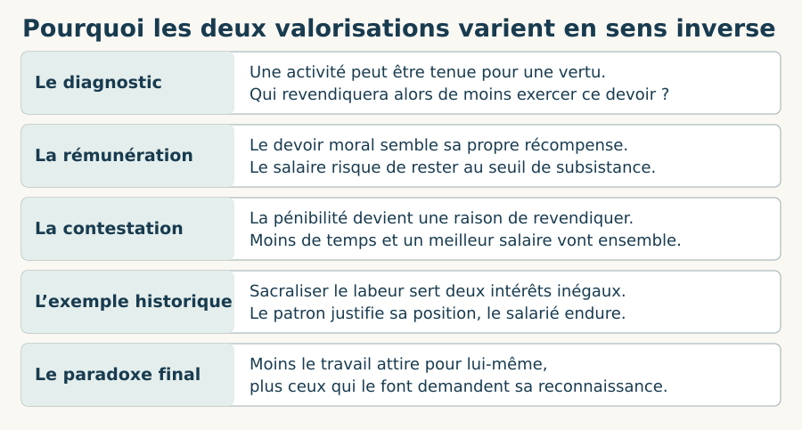

# ENS · Cycle master mathématiques — Français et culture générale 2023 · Corrigé brut

*Corrigé rédigé par IA, non officiel. Signalez toute erreur.*

**Rédaction** · GPT-6.2 Astra Ultra · vitesse non renseignée

**Autocontrôle** · GPT-6.2 Astra Ultra · vitesse non renseignée

**Révision (tour 1)** · GPT-6.2 Astra Ultra · vitesse non renseignée · 26 novembre 2026

## Sujet et consignes

École normale supérieure Paris Saclay et École normale supérieure Rennes. Vendredi 24 mars 2023, de 8 h 30 à 11 h 30. La garde désigne la voie « 2A/CCM Mathématiques » et la matière « Français ». Calculatrices interdites. Durée de l’épreuve, trois heures.

Giuseppe Rensi, Contre le travail, « La dévalorisation morale du travail crée la survalorisation économique », publié en italien en 1923, traduction de Marie-José Tramuta (2017). Texte p. 2–3 du PDF. Le résumé est demandé p. 3 et les deux développements au choix figurent p. 4.

Résumer le texte en 250 mots (avec une marge de tolérance de + ou – 10%). Le nombre exact de mots utilisés sera indiqué en fin de résumé. L’intervalle admis va de 225 à 275 mots.

Sous forme d’un développement construit, commenter, au choix, l’une des deux réflexions suivantes de l’auteur : Chaque exercice vaut dix points. Les deux options sont traitées ici.

Le site classe le rapport de 2023 à l’oral. Son unique page identifie le texte de Rensi et commente successivement le résumé et le développement écrit.

## 1. Résumé

La dignité morale conférée au travail et le prix social reconnu aux travailleurs varient en raison inverse. Lorsque leurs conditions occupent le débat public, la peine consentie perd son prestige religieux. Inversement, une société indifférente à leur sort peut faire de cette peine une obligation sacrée, voire le prix du bonheur futur.

Cette opposition est nécessaire. Personne ne songerait à écourter la pratique de la tempérance ou à demander salaire pour cet accomplissement. Tenir le travail pour un devoir permet seulement de rétribuer celui qui le fournit assez pour maintenir son existence matérielle, au tarif que fixent les échanges. Obtenir que les rémunérations augmentent et que la journée diminue suppose au contraire que cette activité soit pénible en soi. Alors peuvent naître une lutte et une approbation collectives.

Le capitalisme de ses débuts avait donc intérêt à consacrer religieusement le travail. Les possédants y gagnaient une justification des conditions imposées aux salariés, lesquels pouvaient ainsi supporter leur peine plus aisément. Dans la société présente, en revanche, le pouvoir des travailleurs grandit. Malgré leurs discours exaltant le travail, il faut reconnaître chez eux une aversion qui précède cette conquête et la rend possible. Ils recherchent du repos. Les samedis écourtés, les congés et les grèves attestent ce refus dans la répartition concrète de leur temps et jusque dans la fréquence des interruptions. Plus ils voient dans leur activité une nécessité matérielle pesante dont ils voudraient se dégager, plus ils demandent que les autres en reconnaissent la valeur économique, sociale et politique.

**250 mots.**

## 2a. Le travail peut-il réconcilier « point de vue moral » et « point de vue social » ?

Une infirmière peut tenir à bien faire son travail et demander que sa charge diminue. Faudrait-il voir dans cette demande le signe que le métier a perdu à ses yeux sa valeur morale ? Rensi rend cette question difficile. Il oppose le jugement porté sur la valeur du travail à celui qui porte sur la condition des travailleurs, la durée de leur effort, leurs revenus et leur pouvoir collectif. Sa thèse interdit une réconciliation trop facile, celle qui consisterait à louer le dévouement à la place de le rémunérer. Il reste à déterminer si les institutions du travail peuvent rendre solidaires le souci de bien faire et celui de vivre justement.

**L’éloge de l’effort peut entretenir une injustice.** Considérons une usine où les heures s’allongent à mesure que les commandes augmentent. Si consentir à la fatigue est un devoir envers la collectivité, celui qui réclame du repos paraît se soustraire à une obligation. L’employeur bénéficie de cette qualification sans avoir lui-même à prouver la justice de la répartition des bénéfices. Rensi explique ce déplacement en rapprochant le travail de la tempérance. On ne mesure pas le prix dû à quelqu’un pour avoir été tempérant pendant huit heures. Appliquer ce raisonnement au salarié fait disparaître derrière sa conduite vertueuse le contrat qui met son temps à la disposition d’autrui. La louange formulée par celui qui profite de l’effort requiert donc un contrôle particulièrement sévère.

**On peut contester une organisation au nom de la valeur même de l’activité.** Lorsque Simone Weil entre en usine en 1934, puis raconte ce que la cadence et la subordination font à l’attention, elle rend perceptible un tort que le montant du salaire n’épuise pas. Bien travailler pourrait engager le jugement de celui qui exécute. Or l’organisation peut le priver du temps de comprendre ce qu’on lui fait faire. Réclamer une modification de cette organisation peut exprimer un attachement à la qualité du travail. Les grèves de 1936 apportent une autre précision. Les conventions collectives, la législation des quarante heures et les deux semaines de congés payés reconnaissent aux travailleurs le pouvoir de négocier et le droit de disposer d’une partie de leur temps. Demander une vie hors du travail n’oblige personne à mépriser son métier.

Le « samedi anglais » invoqué par Rensi désigne le repos du samedi après-midi. Pour un salarié, défendre cette demi-journée peut signifier vouloir passer du temps avec ses enfants. Rensi y lit la répugnance qui soutient une revendication. L’exemple établit avec certitude que le temps libre possède un prix aux yeux du salarié. Pour en déduire que son travail lui est entièrement odieux, il faudrait encore connaître le motif de sa demande. La convergence des deux points de vue trouve ici sa place.

**La réconciliation exige que les intéressés aient voix au chapitre.** Dans un service de soins, invoquer la continuité du service règle mal un désaccord sur des horaires excessifs. Le patient a besoin de professionnels disponibles. Il a aussi intérêt à leur repos et à la stabilité des équipes. L’enquête sur la charge réelle, la négociation d’effectifs et le droit de signaler une difficulté donnent un contenu commun aux deux points de vue. Le Préambule constitutionnel français de 1946 donne un principe à une telle démarche en prévoyant la participation des travailleurs, par leurs délégués, à la détermination collective des conditions de travail. Il reconnaît que ceux qui font le travail ont une compétence pour juger des règles qui leur sont faites.

La réconciliation reste donc possible à une condition précise. La valeur que l’on attache à l’activité doit pouvoir devenir, entre les mains de ceux qui l’exercent, une raison d’en discuter les conditions. Sans ce pouvoir, le mot de « vertu » continue de dispenser les bénéficiaires de répondre de son coût.

## 2b. En quoi le travail « constitue-t-il l’exercice d’une vertu » ?

Un menuisier reprend un assemblage qu’aucun client ne verrait, simplement parce qu’il sait qu’il cédera. Qu’est-ce qui mérite ici le nom de vertu ? Est-ce le fait de travailler davantage, la qualité technique du résultat, ou le souci d’un utilisateur encore absent ? La « vertu » désigne une disposition stable à bien agir, qui se manifeste dans des choix. Le travail, activité suivie qui transforme un matériau ou rend un service sous certaines contraintes, offre un lieu d’exercice à ces dispositions. Rensi oblige cependant à distinguer ce que fait une personne dans son métier et la prétendue valeur morale de toute dépense de travail.

**Apprendre un métier peut former le jugement.** Le débutant répète un geste, observe ses erreurs, se laisse reprendre. Une compétence se constitue par l’exercice. Il arrive que ce travail cultive avec elle la patience et la probité. Aristote distingue la production d’une chose et l’action dont la valeur réside dans la manière d’agir. Cette distinction éclaire notre exemple. Un assemblage peut être impeccable par hasard ou sous surveillance. Refaire librement celui dont on connaît le défaut fait intervenir un autre critère, la fidélité à ce qu’on doit à l’usager. La vertu se juge alors à l’orientation donnée au savoir acquis.

Supposons que deux personnes corrigent le même assemblage avec une adresse égale. La première sait qu’un contrôleur passera dans une heure. La seconde sait que personne ne verra le défaut et le corrige pour le futur usager. La première peut elle aussi être consciencieuse. Mais, pour juger la vertu à partir de ce geste, il faut connaître ce que chacune avait compris et choisi. L’objet achevé porte la trace de leur compétence. La raison de leur décision reste à établir.

**La contrainte ou l’efficacité ne suffisent pourtant jamais à prouver le mérite.** Un employé peut supporter une longue journée parce qu’il redoute de perdre son emploi. Prendre sa fatigue pour une preuve de consentement à une discipline morale ajoute à l’injustice une erreur de description. Rensi montre encore qu’en proclamant le travail vertueux en soi on retire au travailleur une raison de réclamer une meilleure rétribution. Il ne viendrait à personne l’idée de fixer le prix horaire de la modération. Mais le salaire paie la mise à disposition d’un temps et d’une capacité dans une relation économique. Il ne récompense pas la somme de mérite d’une personne. Une activité terriblement efficace peut également remplir une fin injuste. La fidélité à une consigne doit pouvoir rencontrer la limite du jugement.

**Dans certaines circonstances, bien travailler exige même d’interrompre le travail.** Une technicienne s’aperçoit qu’une série de mesures est faussée. Achever le rapport à l’heure serait conforme à l’objectif immédiat de son service. Signaler l’erreur, recommencer les mesures et accepter de déplaire fait intervenir une responsabilité à l’égard de ceux qui se fieront aux résultats. Pour que cette conduite soit possible, il faut aussi que l’organisation laisse du temps à la vérification et protège celui qui fait remonter l’incident. La vertu engage une personne, mais ses occasions d’exercice et le prix que coûte son choix dépendent de conditions collectives.

Le travail constitue donc l’exercice d’une vertu lorsqu’une personne y forme et y met en œuvre un jugement sur les fins et les conséquences de son activité. On peut lui reconnaître ce mérite tout en lui devant un salaire, du repos et la possibilité de refuser une tâche indéfendable.

[Sujet officiel](https://ens-paris-saclay.fr/sites/default/files/CONCOURS/ANNALES_2C/2C_Math/2023_sujet%202A%20Maths_Francais.pdf) · [Rapport du jury](https://ens-paris-saclay.fr/sites/default/files/CONCOURS/ANNALES_2C/2C_Math/2023_rapport_oral_Francais_2A%20Maths.pdf)
