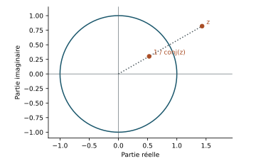
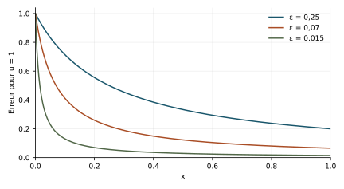

# ENS — Concours cycle master mathématiques 2023 · Corrigé guidé

*Corrigé rédigé par IA, non officiel. Signalez toute erreur.*

**Rédaction** · GPT-6.2 Astra Ultra · vitesse non renseignée

**Révision** · GPT-6.2 Astra Ultra · vitesse non renseignée · 26 novembre 2026

**Diviseurs de polynômes et opérateur de Hardy.** Les deux parties de cinq heures au total ont le même poids. L’algèbre distingue les coefficients entiers et les réductions dans un corps fini. L’analyse considère le spectre réel et compare deux normes sur l’espace d’arrivée.

## Algèbre I. Racines et réduction modulo un premier

### Question Algèbre 1

> [!INDICATION]
> Choisir une racine réelle irrationnelle.

#### Solution

Le polynôme $X^2-2$ admet la racine réelle $\sqrt2$. Il n’a pas de racine entière car 2 est strictement entre les carrés consécutifs 1 et 4.

### Question Algèbre 2

> [!INDICATION]
> Dans un produit égal à 1, comparer les degrés puis les constantes.

#### Solution

Pour des polynômes non nuls sur $\mathbb Z$, le degré du produit est la somme des degrés. Un produit égal à 1 impose donc deux constantes entières dont le produit vaut 1. Les inversibles sont exactement $1$ et $-1$.

### Question Algèbre 3

> [!INDICATION]
> L’image de chaque monôme est imposée par les images du coefficient et de X.

#### Solution

Le morphisme recherché est $\sum_i a_iX^i\mapsto\sum_i\overline {a_i}X^i$. Il conserve la somme et le produit, car la réduction modulo $p$ conserve les additions et multiplications des coefficients, y compris dans la convolution du produit. Il prolonge la réduction des entiers et fixe $X$. Inversement ces deux conditions imposent cette formule sur tout polynôme.

### Question Algèbre 4

> [!INDICATION]
> Faire commuter réduction et évaluation en une racine.

#### Solution

Si $m\in\mathbb Z$ satisfait $P(m)=0$, alors pour tout premier $p$, $[P]_p(\bar m)=\overline{P(m)}=0$ dans $\mathbb F_p$. Ceci vaut même si la réduction du polynôme est nulle.

### Question Algèbre 5

> [!INDICATION]
> Réutiliser un polynôme sans racines entières en choisissant bien sa constante paire.

#### Solution

Pour $P=X^2-2$, la question 1 exclut une racine entière. Sa réduction modulo 2 est $X^2$, qui s’annule en 0.

### Question Algèbre 6

> [!INDICATION]
> Regarder séparément les trois facteurs du produit.

#### Solution

Pour un entier $m$, $m^2+1$ et $m^2+3$ sont strictement positifs. Quant à $m^2-3$, il n’est jamais nul car 3 n’est pas un carré entier. Leur produit $H(m)$ n’est donc jamais nul.

### Question Algèbre 7

> [!INDICATION]
> Dans le corps à deux éléments, examiner la valeur 1.

#### Solution

Modulo 2, les trois facteurs de $H$ sont égaux à $X^2+1$. Ils s’annulent en 1. Le polynôme $[H]_2$ admet donc la racine 1.

### Question Algèbre 8.a

> [!INDICATION]
> Une puissance entière respecte la multiplication dans un groupe commutatif.

#### Solution

Pour $k=2$ comme pour $k=(p-1)/2$, $(ab)^k=a^kb^k$ dans $\mathbb F_p^\times$ et $1^k=1$. Les deux applications sont donc des morphismes de ce groupe dans lui-même.

### Question Algèbre 8.b

> [!INDICATION]
> Factoriser le polynôme qui définit le noyau, puis utiliser le petit théorème de Fermat.

#### Solution

$a^2=1$ équivaut à $(a-1)(a+1)=0$. Dans le corps de caractéristique impaire, les deux solutions sont $1,-1$, distinctes. De plus pour $a\ne0$, $(a^{(p-1)/2})^2=a^{p-1}=1$ par Fermat. Donc $a^{(p-1)/2}\in\{1,-1\}$.

### Question Algèbre 8.c

> [!INDICATION]
> Élever une valeur carrée à la puissance qui définit le second morphisme.

#### Solution

Si $b=a^2$ avec $a\ne0$, $\psi(b)=(a^2)^{(p-1)/2}=a^{p-1}=1$. Ainsi $\mathrm{Im}(\phi)\subset\ker\psi$.

### Question Algèbre 8.d

> [!INDICATION]
> Comparer le nombre de carrés au nombre maximal de racines d’un polynôme.

#### Solution

La taille de l’image de $\phi$ vaut $(p-1)/2$ car chaque fibre est un translaté du noyau à deux éléments. Le noyau de $\psi$ est l’ensemble des racines de $X^{(p-1)/2}-1$, de cardinal au plus $(p-1)/2$. L’inclusion précédente est donc une égalité. Pour $a\ne0$, être un carré revient exactement à $a^{(p-1)/2}=1$.

### Question Algèbre 8.e

> [!INDICATION]
> Isoler le premier 3 avant d’appliquer le critère sur le groupe multiplicatif.

#### Solution

Pour $p=3$, $H(0)=0$ modulo 3. Pour un premier impair $p\ne3$, les trois scalaires $-1,-3,3$ sont non nuls et leur produit $9$ est un carré. Le produit de leurs images par $\psi$ vaut donc 1. Si aucun n’était carré, ces trois images seraient $-1$, dont le produit est $-1$. L’un au moins est donc un carré et une de ses racines carrées annule le facteur correspondant de $H$.

### Question Algèbre 9

> [!INDICATION]
> Confronter les résultats pour le même polynôme à tous les nombres premiers.

#### Solution

Non. Les questions 7 et 8.e donnent une racine de $H$ dans chaque $\mathbb F_p$, alors que la question 6 exclut toute racine dans $\mathbb Z$.

## Algèbre II. Divisibilité et réduction

### Question Algèbre 10

> [!INDICATION]
> La définition des inversibles dans Z[X] laisse une possibilité absente sur un corps. Vérifier le cas d’un facteur constant entier.

#### Solution

Avec les hypothèses imprimées, l’assertion est **fausse**. Prenons $P=2X+2$ et $p=3$. Le coefficient dominant 2 est premier à 3. La réduction $2X+2$ est de degré 1, donc irréductible sur $\mathbb F_3$. Dans $\mathbb Z[X]$, $P=2(X+1)$ est un produit de deux non-inversibles.

La conclusion devient vraie si $P$ est **primitif**, ce qui inclut le cas unitaire. En effet, dans une factorisation en deux non-inversibles, aucun facteur constant entier de module supérieur à 1 ne pourrait diviser tous les coefficients. Les deux facteurs auraient donc des degrés positifs. Le produit de leurs coefficients dominants vaut $a_n$, premier à $p$, donc les deux degrés subsisteraient modulo $p$. Cela contredirait l’irréductibilité de $[P]_p$.

### Question Algèbre 11.a

> [!INDICATION]
> Exploiter le fait que le polynôme est unitaire pour exclure les facteurs de degré un.

#### Solution

$G(m)=m^4+1>0$ pour tout entier $m$. Un facteur entier de degré 1 d’un polynôme unitaire aurait coefficient dominant $\pm1$, donc une racine entière. Un facteur constant non inversible est impossible par monicité. Dans une factorisation non triviale, les degrés sont donc nécessairement 2 et 2.

### Question Algèbre 11.b

> [!INDICATION]
> La translation de la variable est un automorphisme qui préserve les degrés.

#### Solution

On trouve $G_1=X^4+4X^3+6X^2+4X+2$. L’application $P(X)\mapsto P(X+1)$ est un automorphisme de $\mathbb Z[X]$ d’inverse $P(X)\mapsto P(X-1)$, et conserve les degrés. Par 11.a, toute factorisation non triviale de $G_1$ serait $(aX^2+bX+c)(a'X^2+b'X+c')$ à coefficients entiers.

### Question Algèbre 11.c

> [!INDICATION]
> Réduire les deux facteurs modulo 2, puis revenir au terme constant entier.

#### Solution

On a $aa'=1$, donc $a,a'$ sont impairs. Modulo 2 le produit des deux quadratiques de degré 2 vaut $X^4$. Dans $\mathbb F_2[X]$ chaque facteur unitaire doit être $X^2$, par unicité de la factorisation. Ainsi $c,c'$ sont tous deux pairs. Pourtant $cc'=2$, impossible car leur produit serait divisible par 4. Donc $G_1$ et, par translation inverse, $G$ sont irréductibles dans $\mathbb Z[X]$.

### Question Algèbre 12.a

> [!INDICATION]
> Utiliser la puissance quatrième en caractéristique deux.

#### Solution

Dans $\mathbb F_2[X]$, $X^4+1=(X^2+1)^2=(X+1)^4$.

### Question Algèbre 12.b

> [!INDICATION]
> Voir X puissance quatre plus un comme une différence de carrés.

#### Solution

Si $a^2=-1$ dans $\mathbb F_p$, $X^4+1=(X^2-a)(X^2+a)$ est une factorisation en deux polynômes quadratiques.

### Question Algèbre 12.c

> [!INDICATION]
> Faire apparaître le carré d’un multiple de X dans chacune des identités proposées.

#### Solution

Si $a^2=2$, alors $X^4+1=(X^2+1-aX)(X^2+1+aX)$. Si $b^2=-2$, alors $X^4+1=(X^2-1-bX)(X^2-1+bX)$. Dans chaque cas les deux facteurs ont degré 2.

### Question Algèbre 12.d

> [!INDICATION]
> Le produit de deux non-carrés non nuls a quelle image par le caractère de la question 8 ?

#### Solution

Si $-1$ ou 2 est carré, on a fini. Sinon $\psi(-1)=\psi(2)=-1$, donc $\psi(-2)=1$ et $-2$ est un carré. Avec 12.a à c cela établit que $X^4+1$ est réductible modulo tout premier, bien qu’il soit irréductible sur $\mathbb Z$.

## Algèbre III. Coefficients d’un diviseur

### Question Algèbre 13

> [!INDICATION]
> Écrire la liste des racines d’un produit avec leurs multiplicités.

#### Solution

Chaque facteur $\max(1,|z_j|)$ est au moins 1, donc $M(P)\ge|a_n|$. Les coefficients dominants se multiplient et la liste des racines du produit juxtapose les deux listes, multiplicités comprises. Ainsi $M(PH)=M(P)M(H)$, également si l’un des deux est une constante par la convention du sujet (et si le produit est nul, avec $M(0)=0$).

### Question Algèbre 14

> [!INDICATION]
> Écrire les coefficients des deux produits. L’emploi du conjugué de z dans le second facteur est essentiel.

#### Solution

Prolongeons $a_i$ par zéro hors de $\{0,\ldots,n\}$. Les coefficients des deux produits sont $a_{i-1}-za_i$ et $\bar z a_{i-1}-a_i$. En sommant leurs modules au carré, les termes diagonaux donnent dans les deux cas $(1+|z|^2)\|P\|_2^2$. Les termes croisés sont les mêmes, soit
$$-\sum_{i=1}^n\bigl(a_{i-1}\overline{za_i}+\overline{a_{i-1}}za_i\bigr).$$
On obtient donc $\|(X-z)P\|_2^2=\|(\bar z X-1)P\|_2^2$ et le développement demandé.

### Question Algèbre 15.a

> [!INDICATION]
> Dans le coefficient de plus haut degré, quelles racines ont été retenues ?

#### Solution

Le coefficient dominant de $G$ est $g_n=a_n\prod_{j\le k}\bar z_j$. Son module est donc $|a_n|\prod_{j\le k}|z_j|=M(P)$. Le carré de son module est un des termes positifs ou nuls de $\|G\|_2^2$, d’où l’inégalité.

### Question Algèbre 15.b

> [!INDICATION]
> Isoler un facteur transformé et appliquer la question 14 au polynôme restant.

#### Solution

Pour $k\ge1$, $R=G/(\bar z_1X-1)$ est un polynôme. La question 14 donne $\|G\|_2=\|(\bar z_1 X-1)R\|_2=\|(X-z_1)R\|_2$, comme demandé.

### Question Algèbre 15.c

> [!INDICATION]
> Répéter le remplacement jusqu’à reconstituer P.

#### Solution

En remplaçant successivement les $k$ facteurs $\bar z_j X-1$ par $X-z_j$, la norme des coefficients est inchangée à chaque étape et le polynôme final vaut $P$. Si $k=0$, on avait déjà $G=P$. Ainsi $M(P)=|g_n|\le\|G\|_2=\|P\|_2$.

### Question Algèbre 16

> [!INDICATION]
> Comparer le maximum, les sommes de carrés et la somme des modules.

#### Solution

Un terme de la somme des carrés atteint $\|P\|_\infty^2$, donc $\|P\|_\infty\le\|P\|_2$. En développant $(\sum_i |a_i|)^2$, les termes croisés sont non négatifs, d’où $\|P\|_2\le\|P\|_1$. Chacun des $n+1$ termes étant au plus $\|P\|_\infty$, on a $\|P\|_1\le(n+1)\|P\|_\infty$ et, par la même comparaison pour les carrés, $\|P\|_2\le\sqrt{n+1}\|P\|_\infty$.

### Question Algèbre 17.a

> [!INDICATION]
> Compter les produits de racines intervenant dans le coefficient de rang i.

#### Solution

Si $H=b_m\prod_{j=1}^m(X-w_j)$, le coefficient $b_i$ est $(-1)^{m-i}b_m$ fois la somme des produits de $m-i$ racines distinctes par leurs indices. Chaque produit a module au plus $\prod_j\max(1,|w_j|)$. Il y a $\binom m{m-i}=\binom mi$ produits, donc $|b_i|\le\binom mi M(H)$.

### Question Algèbre 17.b

> [!INDICATION]
> Sommer les coefficients binomiaux du rang m.

#### Solution

La somme du majorant de 17.a sur $i$ vaut $M(H)\sum_{i=0}^m\binom mi=2^m M(H)$. C’est une borne de $\|H\|_1$.

### Question Algèbre 17.c

> [!INDICATION]
> Utiliser le coefficient dominant du quotient pour minorer sa mesure.

#### Solution

Posons $P=HQ$. Le coefficient dominant de $Q$ est $a_n/b_m$, donc $M(Q)\ge|a_n/b_m|$ par 13. Par multiplicativité, $M(H)\le |b_m/a_n|M(P)$. Avec 15.c, 16 et 17.b, cela donne $\|H\|_2\le\|H\|_1\le2^m|b_m/a_n|\,\|P\|_2$.

### Question Algèbre 17.d

> [!INDICATION]
> Passer de la norme quadratique à la norme maximale, en distinguant les degrés m et n.

#### Solution

On a $\|H\|_\infty\le\|H\|_2$ et $\|P\|_2\le\sqrt{n+1}\|P\|_\infty$. En les appliquant à 17.c, $\|H\|_\infty\le|b_m/a_n|\sqrt{n+1}\,2^m\|P\|_\infty$.

### Question Algèbre 18

> [!INDICATION]
> Délimiter une boîte finie de coefficients, puis tester exactement la divisibilité sur les entiers.

#### Solution

Le quotient $Q\in\mathbb Z[X]$ a un coefficient dominant entier non nul $a_n/b_m$, donc $|b_m/a_n|\le1$. Pour $m=0,\ldots,n$, énumérons les $m+1$-uplets entiers de module au plus $\lfloor\sqrt{n+1}\,2^m\|P\|_\infty\rfloor$, avec $b_m\ne0$ divisant $a_n$. Pour chaque candidat, effectuons la division dans $\mathbb Q[X]$ et gardons-le si le reste est nul et tous les coefficients du quotient sont entiers. La recherche est finie et 17.d assure qu’aucun diviseur entier du polynôme non nul n’est omis.

### Question Algèbre 19.a

> [!INDICATION]
> Regrouper les termes de degré élevé et les deux derniers, puis reconnaître une différence de carrés.

#### Solution

$P=(X^2+1)(X^4-9)=(X^2+1)(X^2-3)(X^2+3)$. Les deux diviseurs demandés apparaissent. Les trois quadratiques sont unitaires, sans racine entière, donc irréductibles sur $\mathbb Z$ : un facteur de degré un serait unitaire au signe près. Cela donne une factorisation complète à unités près.

### Question Algèbre 19.b

> [!INDICATION]
> Prendre le maximum des modules des coefficients de chaque facteur, puis insérer les données de P dans la borne.

#### Solution

Les trois normes maximales sont respectivement 1, 3 et 3, également pour les facteurs opposés. Ici $n=6$ et $\|P\|_\infty=9$. La borne globale demandée vaut $\sqrt7\,2^6\cdot9=576\sqrt7$. Tous les facteurs vérifient largement cette borne. En gardant leur degré $m=2$ dans 17.d on obtient déjà $36\sqrt7$.

## Analyse I. Opérateurs compacts entre espaces de Banach

### Question Analyse 1

> [!INDICATION]
> Pour passer de l’image de la boule à son adhérence, approximer chaque terme d’une suite avec une erreur qui tend vers zéro.

#### Solution

Si $\overline{T(B_E)}$ est compact, toute suite $(Tx_n)$ dans cet ensemble admet une sous-suite convergente. Réciproquement, soit $(y_n)$ dans cette adhérence. Choisissons $x_n\in B_E$ avec $\|Tx_n-y_n\|<1/(n+1)$. Une sous-suite convergente des $Tx_n$ donne une sous-suite des $y_n$ de même limite, qui est dans l’adhérence fermée. La compacité séquentielle équivaut à la compacité en espace métrique.

### Question Analyse 2

> [!INDICATION]
> Extraire successivement pour deux opérateurs compacts.

#### Solution

L’opérateur nul est compact. Si $S,T$ sont compacts et $(x_n)\subset B_E$, on extrait pour que $Sx_n$ converge, puis de cette sous-suite pour que $Tx_n$ converge aussi. Toute combinaison linéaire des deux suites images converge le long de l’extraction finale. Par la question 1, toute combinaison linéaire de $S,T$ est compacte.

### Question Analyse 3

> [!INDICATION]
> Pour une composition avec l’opérateur compact en premier, que fait le second à une suite convergente ?

#### Solution

Pour toute suite dans $B_E$, extrayons une sous-suite dont les images par $T$ convergent dans $F$. En appliquant $R$, continu, les images convergent dans $G$. Donc $R\circ T$ est compact.

### Question Analyse 4

> [!INDICATION]
> Lorsque le second opérateur est compact, ramener les images du premier dans la boule ouverte.

#### Solution

Si $x_n\in B_E$, alors $y_n=Tx_n/(1+\|T\|)\in B_F$. Puisque $R$ est compact, une sous-suite des $Ry_n$ converge. En remultipliant par $1+\|T\|$, on obtient la compacité de $RT$.

### Question Analyse 5

> [!INDICATION]
> Dans un espace de dimension finie, tout fermé borné est compact.

#### Solution

L’ensemble $T(B_E)$ est borné par $\|T\|$. Son adhérence est fermée bornée dans $F$ de dimension finie, donc compacte par Heine–Borel. Ceci prouve la compacité de $T$.

### Question Analyse 6.a

> [!INDICATION]
> Utiliser la caractérisation par suites pour le premier opérateur.

#### Solution

$T_1$ est compact. Par la question 1, la suite $T_1x_n$ admet une sous-suite convergente, dont les indices ordonnés définissent une application strictement croissante $\varphi_1$.

### Question Analyse 6.b

> [!INDICATION]
> Conserver toutes les convergences obtenues en extrayant de la dernière sous-suite.

#### Solution

Posons $F_i=\varphi_1\circ\cdots\circ\varphi_i$. Si $F_k$ a été construit, $(x_{F_k(n)})$ est dans $B_E$ ; la compacité de $T_{k+1}$ fournit $\varphi_{k+1}$ croissante telle que $T_{k+1}x_{F_k(\varphi_{k+1}(n))}$ converge. Les convergences aux rangs précédents persistent sur toute sous-suite. Avec 6.a, ceci construit la famille par récurrence.

### Question Analyse 6.c

> [!INDICATION]
> Chaque extraction croissante domine l’identité. À rang k fixé, écrire la diagonale comme une sous-suite de la k-ième extraction.

#### Solution

Une extraction strictement croissante sur $\mathbb N$ vérifie $\varphi_i(n)\ge n$. Pour $\phi(n)=F_n(n)$ on a $\phi(n+1)=F_n(\varphi_{n+1}(n+1))\ge F_n(n+1)>F_n(n)$. Pour $n\ge k$, $\phi(n)$ est dans l’image de $F_k$. Ces indices s’y présentent en ordre strictement croissant. Par 6.b, $(T_kx_{\phi(n)})$ converge pour chaque $k$ fixé. On peut prendre $F_0$ identité si l’indexation débute à zéro.

### Question Analyse 6.d

> [!INDICATION]
> Fixer un seul opérateur approchant puis comparer deux valeurs de la suite diagonale.

#### Solution

Pour deux rangs $n,m$, en notant $y_n=x_{\phi(n)}$, on a
$$\|Ty_n-Ty_m\|\le2\|T-T_k\|+\|T_ky_n-T_ky_m\|.$$
Pour $\varepsilon>0$, fixons $k$ tel que le premier terme soit $<\varepsilon/2$. La convergence de 6.c rend ensuite le deuxième $<\varepsilon/2$ pour $n,m$ assez grands. C’est la condition de Cauchy.

### Question Analyse 6.e

> [!INDICATION]
> Utiliser la complétude de l’espace d’arrivée, puis la caractérisation de la première question.

#### Solution

La suite de Cauchy de 6.d converge dans $F$ complet. À partir de toute suite dans $B_E$, nous avons donc extrait des images par $T$ convergentes, et $T$ est compact. Toute limite en norme d’opérateur d’opérateurs compacts étant compacte, $K(E,F)$ est fermé.

## Analyse II. Spectre réel et ensemble résolvant

### Question Analyse 7

> [!INDICATION]
> Vérifier les hypothèses du théorème d’isomorphisme.

#### Solution

Pour $\lambda\in\rho(T)$, $T-\lambda I$ est linéaire, continu comme différence d’opérateurs bornés et bijectif sur l’espace de Banach $E$. Le théorème d’isomorphisme de Banach donne un inverse linéaire continu.

### Question Analyse 8

> [!INDICATION]
> Une valeur propre peut-elle laisser l’opérateur translaté injectif ?

#### Solution

Si $Tx=\lambda x$ avec $x\ne0$, $T-\lambda I$ n’est pas injectif, donc n’est pas bijectif. Ainsi $\lambda\in\sigma(T)$ et $VP(T)\subset\sigma(T)$.

### Question Analyse 9

> [!INDICATION]
> En dimension finie, comparer injectivité et bijectivité d’un endomorphisme.

#### Solution

Si $\lambda$ n’est pas une valeur propre, $T-\lambda I$ est injectif et donc bijectif en dimension finie. Il s’ensuit que $\lambda$ n’est pas dans le spectre. Avec 8, $VP(T)=\sigma(T)$ pour le spectre réel défini dans le sujet.

### Question Analyse 10

> [!INDICATION]
> Faire télescoper les sommes géométriques d’opérateurs puis utiliser la complétude.

#### Solution

La série $S=\sum_{k=0}^\infty T^k$ converge en norme dans $L(E)$ complet, car $\|T^k\|\le\|T\|^k$ et $\|T\|<1$. Pour $S_N=\sum_{k=0}^NT^k$, $(I-T)S_N=S_N(I-T)=I-T^{N+1}$. Par continuité du produit et $T^{N+1}\to0$, $(I-T)S=S(I-T)=I$, donc $(I-T)^{-1}=S$.

### Question Analyse 11

> [!INDICATION]
> Autour d’une application inversible, se ramener à un voisinage de l’identité.

#### Solution

Si $T$ est inversible, $T^{-1}$ est borné par le théorème d’isomorphisme. Pour $\|K\|<1/\|T^{-1}\|$, on a $\|-T^{-1}K\|<1$. Par 10, $I+T^{-1}K$ est inversible et $T+K=T(I+T^{-1}K)$ aussi. Chaque inversible admet ainsi une boule d’inversibles autour de lui (le cas de l’espace nul est immédiat).

### Question Analyse 12.a

> [!INDICATION]
> Transformer l’équation avec second membre arbitraire en équation de point fixe.

#### Solution

Fixons $y\in E$. L’équation $(T-\lambda I)x=y$ équivaut à $x=\Phi(x)=(Tx-y)/\lambda$. Le rapport de Lipschitz est au plus $\|T\|/|\lambda|<1$. Par le théorème du point fixe dans $E$ complet, il existe un unique $x$ pour chaque $y$, donc $T-\lambda I$ est bijectif.

### Question Analyse 12.b

> [!INDICATION]
> Passer au complémentaire de la condition suffisante de résolvante.

#### Solution

Par 12.a, chaque réel $\lambda$ de module strictement supérieur à $\|T\|$ appartient à $\rho(T)$. Donc $\sigma(T)\subset[-\|T\|,\|T\|]$.

### Question Analyse 12.c

> [!INDICATION]
> Écrire la résolvante comme préimage de l’ensemble des inversibles.

#### Solution

L’application $\lambda\mapsto T-\lambda I$ est continue en norme d’opérateur. Son image réciproque de l’ouvert $GL(E)$ de 11 est $\rho(T)$, donc la résolvante est ouverte dans $\mathbb R$.

### Question Analyse 12.d

> [!INDICATION]
> Réunir la fermeture et la borne déjà obtenues.

#### Solution

Le complémentaire $\sigma(T)$ est fermé dans $\mathbb R$ par 12.c et borné par 12.b. Il est donc compact.

### Question Analyse 13

> [!INDICATION]
> Passer à l’adhérence dans une inclusion dont le membre de droite est fermé.

#### Solution

La question 8 donne $VP(T)\subset\sigma(T)$ et 12.d montre que $\sigma(T)$ est fermé. Donc $\overline{VP(T)}\subset\sigma(T)$.

### Question Analyse 14

> [!INDICATION]
> Si la valeur zéro était résolvante, composer le compact avec son inverse.

#### Solution

Si $0\notin\sigma(T)$, $T$ serait inversible et $T^{-1}$ borné par 7. Alors $I=T^{-1}T$ serait compact par 3. L’adhérence de sa boule image serait la boule unité fermée, compacte seulement en dimension finie par le théorème de Riesz rappelé. Contradiction. Ainsi $0\in\sigma(T)$.

## Analyse III. L’opérateur de Hardy selon l’espace d’arrivée

### Question Analyse 15

> [!INDICATION]
> Pour les fonctions de classe C¹, faire converger simultanément les fonctions et leurs dérivées.

#### Solution

Une suite de Cauchy en norme uniforme converge point par point dans $\mathbb R$ et uniformément vers cette limite par le critère de Cauchy. Une limite uniforme de fonctions continues est continue, donc $E$ est complet. Dans $F$, si $(u_n)$ est de Cauchy, $u_n$ et $u_n'$ convergent uniformément vers des fonctions continues $u,v$. En passant à la limite dans $u_n(x)=u_n(0)+\int_0^x u_n'(t)\,dt$, on obtient $u(x)=u(0)+\int_0^xv(t)\,dt$. Donc $u\in C^1$, $u'=v$ et $u_n\to u$ pour la norme de $F$.

### Question Analyse 16

> [!INDICATION]
> Réécrire la moyenne sur un intervalle fixe pour comprendre le comportement en zéro.

#### Solution

Pour $x>0$, $Tu(x)=\int_0^1 u(xs)\,ds$. L’expression vaut également $u(0)$ pour $x=0$. La continuité uniforme de $u$ permet de passer à la limite en chaque point $x$, donc $Tu\in E$. La moyenne est linéaire et $|Tu(x)|\le\|u\|_\infty$. Ainsi $T\in L(E)$ et $\|T\|\le1$.

### Question Analyse 17

> [!INDICATION]
> Dériver la relation intégrale sur l’intervalle ouvert, puis imposer la continuité en zéro.

#### Solution

Pour $\lambda=0$, $Tu=0$ impose $\int_0^x u=0$ pour tout $x$, puis $u=0$ par dérivation. Pour $\lambda\ne0$, l’équation $\lambda x u(x)=\int_0^x u(t)dt$ rend $u$ dérivable sur $]0,1]$ et donne $x u'=(1/\lambda-1)u$. Toutes les solutions y sont $C x^{1/\lambda-1}$, comme on le voit en dérivant $x^{1-1/\lambda}u(x)$. Pour $C\ne0$, une extension continue à 0 exige $a=1/\lambda-1\ge0$, donc $0<\lambda\le1$. Pour $a>0$ l’extension vaut zéro en 0 et pour $a=0$ elle est constante. Réciproquement, $T(x^a)=x^a/(a+1)$ pour tout $a\ge0$, en incluant la valeur prescrite en zéro. Ainsi $VP(T)=]0,1]$ et $\ker(T-\lambda I)=\mathbb R(x\mapsto x^{1/\lambda-1})$ pour ces $\lambda$.

### Question Analyse 18

> [!INDICATION]
> Choisir une fonction propre de norme un qui conserve sa valeur.

#### Solution

La fonction constante 1 a norme 1 et $T1=1$. Donc $\|T\|\ge1$, puis $\|T\|=1$ par 16.

### Question Analyse 19

> [!INDICATION]
> Comparer l’ensemble des valeurs propres au théorème spectral annoncé pour les compacts.

#### Solution

Sur $E=C([0,1])$, $T$ n’est pas compact. En effet son spectre contient toutes les valeurs propres de $]0,1]$. Ce sous-ensemble a des points d’accumulation non nuls, par exemple $1/2$. D’après le théorème II.5 du sujet, cela est impossible pour un compact.

### Question Analyse 20

> [!INDICATION]
> La borne sur la dérivée d’une fonction de la boule fournit un module de continuité commun.

#### Solution

L’inclusion $F\to E$ est linéaire de norme au plus 1. Une suite dans $B_F$ est uniformément bornée par 1 et vérifie $|u_n(x)-u_n(y)|\le|x-y|$ par les accroissements finis. Ascoli donne une sous-suite convergente dans $E$, donc l’inclusion est compacte.

### Question Analyse 21

> [!INDICATION]
> Comparer norme uniforme et norme intégrale sur un intervalle de mesure un.

#### Solution

L’inclusion de $E$ dans $G=L^p(]0,1[)$ vérifie $\|f\|_p\le\|f\|_\infty$. En la composant avec $T:E\to E$ de norme 1, on a un opérateur borné $E\to G$ de norme au plus 1.

### Question Analyse 22.a

> [!INDICATION]
> À epsilon fixé, montrer que les images de la boule sont bornées avec des dérivées uniformément bornées.

#### Solution

Posons $U(x)=\int_0^x u(t)dt$. Pour $\varepsilon>0$, $T_\varepsilon u=U/(x+\varepsilon)$ est $C^1$. Pour $\|u\|_\infty\le1$, $|U(x)|\le x$ et $|T_\varepsilon u|\le1$. Sa dérivée vaut $u(x)/(x+\varepsilon)-U(x)/(x+\varepsilon)^2$, de module au plus $2/\varepsilon$. Ainsi $u\mapsto T_\varepsilon u$ est borné de $E$ vers $F$. On compose avec l’inclusion compacte $F\to E$ de 20 puis l’inclusion bornée $E\to G$ de 21. Par 3 et 4, $T_\varepsilon:E\to G$ est compact.

### Question Analyse 22.b

> [!INDICATION]
> L’écart est grand près de zéro. Pour la norme intégrale, combien pèse cette zone ?

#### Solution

Pour $x>0$, $(T-T_\varepsilon)u(x)=\frac{\varepsilon}{x+\varepsilon}Tu(x)$. Ainsi pour $\|u\|_\infty\le1$,
$$\|(T-T_\varepsilon)u\|_p^p\le\int_0^1\left(\frac{\varepsilon}{x+\varepsilon}\right)^p dx.$$
Le majorant intégral ne dépend pas de $u$ ; l’intégrande est dominé par 1 et tend vers 0 pour tout $x>0$. Par convergence dominée, l’intégrale tend vers 0, pour tout $1\le p<\infty$. En prenant le supremum sur $u$, la convergence a donc lieu en norme d’opérateur. Pour $u=1$, l’erreur réalise le majorant à chaque abscisse.

La fonction constante étant extrémale, on peut calculer exactement cette norme :
$$
\|T-T_\varepsilon\|_{E,G}^p=
\begin{cases}
\varepsilon\log(1+1/\varepsilon),&p=1,\\[3pt]
\dfrac{\varepsilon}{p-1}\left[1-\left(\dfrac{\varepsilon}{1+\varepsilon}\right)^{p-1}\right],&p>1.
\end{cases}
$$
Les formules résultent du changement de variable $y=1+x/\varepsilon$ et confirment la limite aux deux régimes.

### Question Analyse 22.c

> [!INDICATION]
> Appliquer le résultat de fermeture avec le nouvel espace de Banach d’arrivée.

#### Solution

Les $T_\varepsilon$ sont compacts de $E$ vers $G$ et convergent vers $T$ en norme d’opérateur. L’espace $G$ est de Banach par Riesz–Fischer. D’après 6.e, $T\in K(E,G)$. La même moyenne a donc des propriétés de compacité différentes suivant la norme choisie à l’arrivée.
