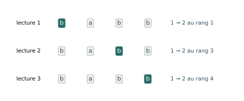
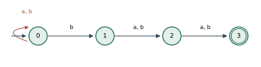
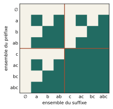

# ENS · MP-MPI · Informatique fondamentale 2023 — corrigé brut

*Corrigé rédigé par IA, non officiel. Signalez toute erreur.*

**Rédaction** · GPT-6.2 Astra Ultra · vitesse non renseignée · 25 novembre 2026

**Concision et ambiguïté.** Les quatre parties du sujet ULSR étudient le nombre de calculs acceptants, la décision d’ambiguïté et deux séparations exponentielles. Un calcul est une suite d’états et comporte donc un état de plus que le nombre de lettres lues.

## I. Déterminisme et ambiguïté

### Question 1.1 · Langage commun

Les trois automates reconnaissent les mots sur $\{a,b\}$ contenant au moins un $b$, soit $\{a,b\}^*b\{a,b\}^*$.

### Question 1.2 · Déterminisme des trois automates

$A_1$ et $A_2$ sont non déterministes : depuis l'état $1$ on peut lire $b$ en restant en $1$ ou en allant en $2$. $A_3$ est déterministe : il a un seul état initial et, depuis chacun des deux états, chaque lettre détermine au plus une sortie. Il est même complet.

### Question 1.3 · Mots admettant deux calculs acceptants

Dans $A_1$, chaque occurrence de $b$ peut être choisie pour aller de $1$ à $2$ ; toutes les autres lettres sont alors lues sur des boucles. On a $d_{A_1}(w)=|w|_b$ et $\operatorname{Amb}(A_1)$ est le langage des mots contenant au moins deux $b$. Dans $A_2$, seule la **dernière** occurrence de $b$ peut être choisie puisque $2$ n'a qu'une boucle en $a$. Dans $A_3$, c'est la **première** qui impose la transition, car $1$ n'a pas de boucle en $b$. Ces deux automates sont non ambigus et leurs ensembles de mots ambigus sont vides.

### Question 1.4 · Calcul miroir

Si $w=a_0\cdots a_{m-1}$, posons $\widetilde w=a_{m-1}\cdots a_0$. Chaque transition $q_j\xrightarrow{a_j}q_{j+1}$ devient $q_{j+1}\xrightarrow{a_j}q_j$ dans le miroir. De plus $q_m\in F=\widetilde I$ et $q_0\in I=\widetilde F$. La suite $q_m,\ldots,q_0$ est donc un calcul acceptant du miroir sur $\widetilde w$. Cela vaut aussi pour le mot vide.

### Question 1.5 · Ambiguïté et miroir

Q1.4 donne une bijection, d'inverse le même renversement, entre calculs acceptants sur $w$ et calculs acceptants du miroir sur $\widetilde w$. Deux suites distinctes restent distinctes. Ainsi $d_A(w)=d_{\widetilde A}(\widetilde w)$ et l'existence d'un mot ambigu est équivalente dans les deux sens.

### Question 1.6 · Un calcul au plus dans un automate déterministe

Il y a au plus un état initial, donc au plus un calcul sur le préfixe vide. À partir d'un préfixe donné, il y a au plus une transition portant la lettre suivante depuis l'unique état atteint. Par induction, il y a au plus un calcul sur chaque mot et par conséquent au plus un calcul acceptant. Aucune hypothèse de complétude n'est nécessaire.

### Question 1.7 · Cas co-déterministe

Si $A$ est co-déterministe, $\widetilde A$ est déterministe et non ambigu par Q1.6. Q1.5 implique alors que $A$ est lui aussi non ambigu.

### Question 1.8 · Trois exemples contrastés

**i.** Prendre quatre états $s_a,s_b,f_a,f_b$, avec $I=\{s_a,s_b\}$, $F=\{f_a,f_b\}$ et les seules transitions $s_a\xrightarrow a f_a$, $s_b\xrightarrow b f_b$. Chaque mot de $\{a,b\}$ de longueur un est accepté d'une seule manière. Les deux états initiaux rendent l'automate non déterministe et les deux finaux rendent son miroir non déterministe.

**ii.** Sur une lettre $a$, prendre deux états isolés l'un de l'autre, tous deux initiaux et finaux, chacun avec une boucle en $a$. Chaque mot de $a^*$, y compris le mot vide, a exactement deux calculs acceptants ; $L=\operatorname{Amb}=a^*$ est infini.

**iii.** $A_1$ de la figure 1 convient : les mots ayant au moins deux $b$ forment un ensemble infini, mais le mot $b$ est accepté sans ambiguïté.

## II. Test d’ambiguïté

### Question 2.1 · Automate de deux lectures synchronisées

Notons $U=(1,1,0)$, $V=(2,2,0)$, $P=(1,2,1)$, $Q=(2,1,1)$ et $R=(2,2,1)$. L'état initial est $U$, l'unique final accessible $R$. La table donne tous les successeurs accessibles.

| État | lettre $a$ | lettre $b$ |
|---|---|---|
| $U$ | $U$ | $U,V,P,Q$ |
| $V$ | $V$ | $V$ |
| $P$ | $P$ | $P,R$ |
| $Q$ | $Q$ | $Q,R$ |
| $R$ | $R$ | $R$ |

Le langage reconnu est celui des mots contenant au moins deux $b$.

### Question 2.2 · Sens du drapeau de divergence

**i.** Dans $\widehat I$, les deux coordonnées sont des états initiaux de $A$. Toute transition de $T_1,T_2,T_3$ projette sur deux transitions de $A$ portant la lettre lue. Les suites $\mu,\mu'$ sont donc des calculs de $A$.

**ii.** Le bit initial vaut un exactement si les deux états initiaux diffèrent. À chaque pas, un bit nul reste nul par $T_1$ en cas d'égalité et passe à un par $T_2$ si les nouveaux états diffèrent. Un bit déjà à un reste à un par $T_3$. Par récurrence, $b_m=0$ équivaut à l'égalité de toutes les coordonnées des deux suites.

**iii.** L'acceptation dans $\widehat A$ impose deux coordonnées finales dans $F$ et le bit un. Les deux projections sont donc acceptantes.

**iv.** Par l'hypothèse $L(A)\ne\varnothing$, il existe un calcul acceptant $\mu$. Le lire deux fois sur la diagonale donne dans $\widehat A$ un calcul dont les deux projections sont $\mu$, mais son bit final reste nul. Il n'est pas acceptant.

### Question 2.3 · Langage du produit

Un calcul acceptant de $\widehat A$ projette sur deux calculs acceptants distincts par Q2.2, donc son mot appartient à $\operatorname{Amb}(A)$. Réciproquement, pour deux calculs acceptants distincts sur un même mot, apparier leurs états pas à pas et mettre le bit à un dès la première différence, dès l'initialisation si nécessaire. La définition de $\widehat I$ et les règles $T_1,T_2,T_3$ autorisent chaque pas. Les coordonnées finales sont acceptantes et le bit final vaut un. On obtient $L(\widehat A)=\operatorname{Amb}(A)$.

### Question 2.4 · Tailles du produit

On a $|\widehat Q|=2|Q|^2$, $|\widehat I|=|I|^2$ et $|\widehat F|=|F|^2$. Il y a $|T|$ transitions diagonales et au plus $|T|^2$ paires ordonnées de transitions portant une même lettre, pour chacun des deux types nécessitant une paire. Donc $|\widehat T|\le |T|+2|T|^2=O(|T|^2)$ pour $|T|\ge1$, et il est nul lorsque $T$ est vide.

### Question 2.5 · Construction effective

**i.** Utiliser des listes d'adjacence étiquetées : pour chaque état, enregistrer les couples (lettre, destination). On dispose aussi de la liste de toutes les transitions.

**ii.** Créer les $2|Q|^2$ listes de sortie du produit. Énumérer $I\times I$ avec le bit de différence, puis $F\times F$ avec le bit un. Pour chaque transition créer son arc $T_1$. Pour chaque paire **ordonnée** de transitions portant la même lettre, créer l'arc $T_3$ et, si les sources sont égales et les destinations différentes, créer aussi $T_2$. Les règles ne se recouvrent pas grâce aux bits, et les paires identiques donnent bien un arc $T_3$ pertinent. Le coût total est $O(|Q|^2+|I|^2+|F|^2+|T|^2)$, donc $O(N^2)$ avec $N=|Q|+|T|+|I|+|F|$.

### Question 2.6 · Décider si un mot ambigu existe

Construire $\widehat A$, puis effectuer un seul parcours en largeur ou en profondeur, initialisé avec **tous** les états de $\widehat I$. Marquer les sommets visités ; répondre oui si un sommet de $\widehat F$ est atteint, y compris avant de traverser une arête, et non si le parcours s'épuise. Un chemin accessible lit un mot et réciproquement. Q2.3 assure la correction. Le parcours est linéaire dans la taille du produit en listes d'adjacence, soit $O(N^2)$ construction comprise.

### Question 2.7 · Ambiguïté maximale pour une longueur donnée

**i.** Une suite de $k+1$ états a au plus $|Q|^{k+1}$ valeurs possibles. Les transitions constituent un ensemble sans duplicata, et chaque calcul est par définition une telle suite. Donc $d_A(w)\le|Q|^{k+1}$.

**ii.** Sur $\Sigma=\{a\}$, rendre tous les $m\ge1$ états à la fois initiaux et finaux et ajouter $q\xrightarrow{a}r$ pour chaque paire ordonnée d'états. Sur $a^k$, les $k+1$ états peuvent être choisis arbitrairement et toute suite accepte. La borne est atteinte pour chaque taille $m$ et chaque longueur $k$.

### Question 2.8 · Reconnaître au moins k calculs

Construisons un automate déterministe dont les états sont les vecteurs $c\in\{0,\ldots,k\}^{Q}$. À l'initialisation, $c_q=1$ si $q\in I$, $0$ sinon. Sur une lettre $a$, calculer simultanément

$$
c'_t=\min\!\left(k,\sum_{(s,a,t)\in T}c_s\right).
$$

Après lecture de $w$, $c_t$ est le minimum de $k$ et du nombre réel de calculs sur $w$ finissant en $t$. C'est vrai pour le mot vide et l'ajout d'une lettre partitionne les calculs selon leur avant-dernier état. Pour des entiers positifs ou nuls, tronquer chaque terme à $k$ avant la somme et tronquer à nouveau à $k$ donne la même valeur que tronquer la somme exacte. Accepter lorsque $\sum_{t\in F}c_t\ge k$ reconnaît donc $\operatorname{Amb}_{\ge k}(A)$. Les états possibles sont en nombre fini, au plus $(k+1)^{|Q|}$.

### Question 2.9 · Reconnaître exactement k calculs

Pour $k\ge1$, $\operatorname{Amb}_k(A)=\operatorname{Amb}_{\ge k}(A)\setminus\operatorname{Amb}_{\ge k+1}(A)$. Les deux langages de seuil sont réguliers par Q2.8 et les langages réguliers sont fermés par différence (produit avec le complément d'un automate déterministe complet). Le langage demandé est régulier.

## III. Concision des automates non ambigus

### Question 3.1 · Deux descriptions de L₃

Pour l'automate non ambigu, prendre les états $0,1,2,3$, initial $0$, final $3$. En $0$, boucler sur $a,b$ et autoriser aussi $0\xrightarrow b1$. De $1$ à $2$ puis de $2$ à $3$, autoriser $a$ ou $b$. Il n'y a pas de sortie de $3$. Pour finir en $3$, il faut changer de branche exactement sur la troisième lettre avant la fin ; le calcul acceptant est unique quand cette lettre est $b$.

Pour le déterministe complet, prendre comme états les huit triplets de $\{a,b\}^3$, initial $aaa$. La transition sur $z$ envoie $xyz'$ sur $yz'z$. Sont finaux $baa,bab,bba,bbb$. Le triplet mémorise les trois dernières lettres, complétées au début par des $a$ pour rejeter les mots trop courts.

### Question 3.2 · Automate non ambigu à n + 1 états

Prendre les états $0,\ldots,n$, initial $0$, final $n$. Munir $0$ de boucles sur les deux lettres, ajouter $0\xrightarrow b1$, puis $i\xrightarrow a i+1$ et $i\xrightarrow b i+1$ pour $1\le i<n$. L'état $n$ n'a pas de sortie. Une lecture acceptante choisit son $b$ exactement $n-1$ lettres avant la fin, à une position entièrement déterminée par la longueur du mot. L'automate reconnaît donc $L_n$ et est non ambigu. Pour $n=1$, il reconnaît les mots finissant en $b$.

### Question 3.3 · Automate déterministe à 2ⁿ états

Prendre $Q=\{a,b\}^n$, état initial $a^n$, et $F$ l'ensemble des fenêtres dont la première lettre est $b$. Sur lecture de $y$, effacer la première lettre de la fenêtre et ajouter $y$ à droite. Pour chaque fenêtre et lettre il existe exactement une transition. Après $w$, la fenêtre est le suffixe de longueur $n$ de $a^n w$. Si $|w|<n$ elle commence par $a$ ; sinon sa première lettre est exactement la $n$-ième lettre de $w$ en partant de la fin. On obtient le langage voulu avec $2^n$ états.

### Question 3.4 · Un calcul exactement

La complétude assure au moins un état initial et le déterminisme au plus un, donc il en existe exactement un. Depuis chaque état, pour chaque lettre, les mêmes hypothèses assurent exactement une transition. On construit donc de proche en proche un unique calcul pour tout mot, vide compris. Son état d'arrivée peut être non final.

### Question 3.5 · Distinguer deux fenêtres

Si $w=w'$, les états atteints coïncident par Q3.4. Sinon, choisissons une position $j\in\{1,\ldots,n\}$ où ils diffèrent, en numérotant depuis la gauche. Ajoutons à chacun $a^{j-1}$. Dans les mots de longueur $n+j-1$ ainsi formés, la $n$-ième lettre depuis la fin est celle de position $j$. Exactement un des deux mots prolongés est donc accepté. S'ils avaient atteint le même état avant ce suffixe commun, la détermination des transitions imposerait la même réponse. Ainsi $q_w\ne q_{w'}$.

### Question 3.6 · Borne inférieure en déterministe

Les $2^n$ mots de longueur $n$ aboutissent à des états deux à deux distincts par Q3.5. Tout automate déterministe complet reconnaissant $L_n$ possède donc au moins $2^n$ états. La construction de Q3.3 réalise cette borne pour le langage défini pour $n\ge1$.

## IV. Concision des automates ambigus

### Question 4.1 · Détecter une lettre répétée sur trois symboles

**i.** Utiliser cinq états $s,p_a,p_b,p_c,f$. En $s$ on peut lire toute lettre en boucle et, sur $x$, aller également en $p_x$. En $p_x$ on peut lire toute lettre en boucle et, sur $x$, aller aussi en $f$. En $f$ toute lettre boucle. L’unique état initial est $s$ et l’unique état final est $f$. Un chemin acceptant choisit deux positions de même lettre. Réciproquement toute répétition fournit ce chemin.

**ii.** Prendre les huit sous-ensembles de $\{a,b,c\}$ et un état final absorbant $f$. L'état initial est $\varnothing$. Depuis $S$, lire $x$ mène à $S\cup\{x\}$ si $x\notin S$, sinon à $f$. L'acceptation signifie qu'une lettre est revenue. Cet automate déterministe, donc non ambigu, a neuf états.

### Question 4.2 · Automate de n + 2 états

Prendre un état initial $s$, un final absorbant $f$ et un état d'attente $p_x$ par lettre $x$. Les transitions sont celles de Q4.1i : boucles sur toutes les lettres en $s,p_x,f$, choix $s\xrightarrow x p_x$ et possibilité $p_x\xrightarrow x f$. Un calcul acceptant certifie deux occurrences distinctes de $x$ ; si un tel couple existe, un calcul peut le choisir. Cela utilise $n+2$ états.

### Question 4.3 · Automate non ambigu de 2ⁿ + 1 états

Utiliser l'ensemble des parties de $\Sigma_n$ et un état absorbant final $f$, avec les transitions de Q4.1ii. Par récurrence, avant la première répétition l'état est l'ensemble des lettres lues. À la première répétition, on rejoint $f$ pour toujours. Cet automate déterministe complet, donc non ambigu, reconnaît $K_n$ et utilise $2^n+1$ états.

### Question 4.4 · Recoller deux calculs

**i.** Soit $q=q_{u,v}=q_{u',v'}$. Accoler le préfixe de la lecture acceptante de $uv$ jusqu'à $q$ au suffixe de la lecture de $u'v'$ partant de $q$. On obtient un calcul acceptant sur $uv'$. L'autre recollement accepte $u'v$. Ainsi les deux mots sont dans $K_n$.

**ii.** L'automate est non ambigu, donc le calcul recollé pour chacun des deux nouveaux mots est son unique calcul acceptant. Dans chacun, l'état après le premier morceau est $q$. Les quatre états de coupe mentionnés sont donc égaux.

### Question 4.5 · Structure par blocs de la matrice

Les mots de la première moitié reproduisent ceux de $s_{n-1}$ sans $\alpha_n$. Les mots de la seconde sont les mêmes avec $\alpha_n$ ajouté. Si l'une des deux moitiés choisies est la première, la présence d'une lettre commune dépend seulement des deux mots de $s_{n-1}$. Si les deux sont la seconde, $\alpha_n$ est commune. Ainsi, avec $J$ la matrice de uns de taille $2^{n-1}$,

$$
M_n=\begin{pmatrix}M_{n-1}&M_{n-1}\\M_{n-1}&J\end{pmatrix}.
$$

### Question 4.6 · Une intersection équivaut à une répétition

Chaque mot $s_i$ énumère en ordre croissant les lettres d'un sous-ensemble. Chacune y apparaît au plus une fois. Ainsi $s_i s_j$ contient une répétition exactement si les deux sous-ensembles ont une lettre commune, c'est-à-dire si $M_n[i,j]=1$.

### Question 4.7 · Décomposition des colonnes par états

Posons $R_q=\{i:\exists j,\ q_{s_i,s_j}=q\}$ et $C_q=\{j:\exists i,\ q_{s_i,s_j}=q\}$. Les témoins correspondent toujours à des mots acceptés. Par Q4.4, pour chaque $(i,j)\in R_q\times C_q$ le mot $s_i s_j$ est accepté et son état de coupe vaut $q$. Réciproquement tout couple accepté appartient au rectangle de son état de coupe. Ces rectangles sont disjoints sur les couples, car cet état est unique. Comme $v_q$ est l'indicatrice de $R_q$, la colonne $u_j$ de $M_n$ est donc

$$
u_j=\sum_{q:\ j\in C_q}v_q .
$$

Cela donne l'inclusion requise pour la minoration du nombre d'états. Pour l'égalité des espaces au sens littéral, chaque $v_q$ a sa coordonnée d'indice zéro nulle, puisque $s_0=\varepsilon$ n'a aucune lettre commune avec les autres mots. Q4.8, indépendante, montre que les colonnes de $M_n$ engendrent tout cet hyperplan ; les $v_q$ lui appartiennent donc aussi.

### Question 4.8 · Rang de Mₙ

Posons $D_n=J_n-M_n$, où $J_n$ est la matrice de uns de taille $2^n$. Q4.5 implique

$$
D_n=\begin{pmatrix}D_{n-1}&D_{n-1}\\D_{n-1}&0\end{pmatrix},\qquad D_0=(1).
$$

Si $D_{n-1}$ est inversible, une paire de vecteurs $(x,y)$ dans le noyau vérifie successivement $D_{n-1}x=0$ puis $D_{n-1}(x+y)=0$. D'où $x=y=0$. Par induction $D_n$ a rang $2^n$. L'inégalité de sous-additivité du rang donne $2^n\le\operatorname{rg}(J_n)+\operatorname{rg}(M_n)=1+\operatorname{rg}(M_n)$. La première ligne de $M_n$ est nulle, car elle correspond au sous-ensemble vide. Les deux bornes donnent $\operatorname{rg}(M_n)=2^n-1$.

### Question 4.9 · Compter les états qui contribuent

Par Q4.7, les colonnes de $M_n$ sont dans l'espace engendré par les $v_q$ non nuls. La dimension de cet espace est au moins $2^n-1$ par Q4.8. Il faut donc au moins $2^n-1$ vecteurs non nuls dans la famille, et autant d'états distincts.

### Question 4.10 · Les états de coupe sont internes

Si $v_q\ne0$, choisir $i,j$ avec $q=q_{s_i,s_j}$. Si $q\in I$, la partie suffixe du calcul accepté donnerait un calcul acceptant sur $s_j$ seul. Si $q\in F$, la partie préfixe accepterait $s_i$ seul. Or aucun mot $s_i$ ni $s_j$ ne contient de répétition. Donc $q\notin I$ et $q\notin F$.

### Question 4.11 · Deux états supplémentaires

Puisque $n\ge2$, le langage $K_n$ est non vide (il contient $\alpha_1\alpha_1$), d'où un état initial et un état final au moins. Comme $\varepsilon\notin K_n$, aucun état ne peut être à la fois initial et final. Il faut donc deux états supplémentaires, distincts entre eux et des $2^n-1$ états internes de Q4.9–Q4.10. Le total est au moins $2^n+1$ et la borne de Q4.3 est atteinte.
