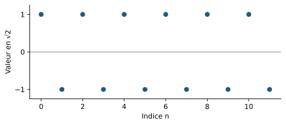
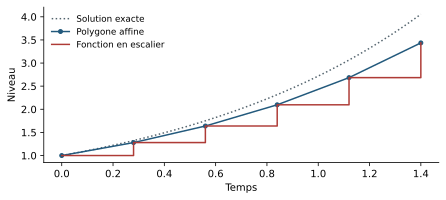
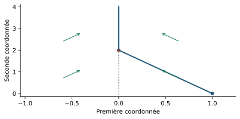
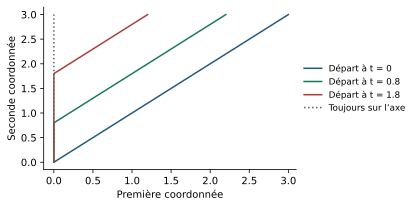

# ENS MP-MPI — Mathématiques C 2023 · Corrigé brut

*Corrigé rédigé par IA, non officiel. Signalez toute erreur.*

**Rédaction** · modèle exact non renseigné (famille GPT-6) · effort non renseigné · vitesse non renseignée

**Révision (tour 1)** · modèle exact non renseigné (famille GPT-6) · effort non renseigné · vitesse non renseignée

**Révision (tour 2)** · GPT-6.2 Astra Ultra · vitesse non renseignée

## Présentation du sujet

L’épreuve commune aux ENS Ulm, Lyon, Paris-Saclay et Rennes du 21 avril 2023 dure quatre heures. Ses 31 questions et sous-questions relient les théorèmes d’Arzelà-Ascoli et de Cauchy-Peano à des trajectoires dont les vitesses permises changent sur un axe. [Sujet officiel](https://banques-ecoles.fr/cms/wp-content/uploads/2023/10/23_mp_sujet_MathC.pdf)

Le jury a signalé deux erreurs dans l’énoncé. Le corrigé traite la densité défaillante en II.6b ainsi que la condition incompatible sur les vitesses en IV.3, dont dépend la réponse pour un départ sur l’axe. [Rapport officiel](https://www.ens.psl.eu/sites/default/files/23_mp_rap_emathc.pdf)

## I — Premiers exemples

On suppose $a,\theta>0$, $0<y_{\rm init}<\theta$ et l’existence d’une unique solution globale de chaque équation. Les champs sont $F_0(y)=ay\log(\theta/y)$ et $F_\mu(y)=(a/\mu)y(1-(y/\theta)^\mu)$ pour $0<\mu\le1$.

### Question I.1a

La dérivée à l’origine vaut $\varphi_0'(0)=a y_{\rm init}\log(\theta/y_{\rm init})>0$. La définition de la dérivée donne $\varphi_0(t)>y_{\rm init}$ pour tout $t>0$ assez petit. Par continuité et puisque $y_{\rm init}<\theta$, on a aussi $\varphi_0(t)<\theta$ sur un voisinage de zéro. Choisissons $\varepsilon>0$ tel que les deux conclusions soient vraies sur $]0,\varepsilon]$.

### Question I.1b

La solution prend ses valeurs dans le domaine $]0,\infty[$ du champ. Ainsi $z_0=\log(\varphi_0/\theta)$ est dérivable et $z_0'=\varphi_0'/\varphi_0=-az_0$. Par intégration, $z_0(t)=e^{-at}\log(y_{\rm init}/\theta)$. D’où l’unique solution admise par le sujet,
$$
\varphi_0(t)=\theta\exp\!\left(e^{-at}\log\frac{y_{\rm init}}{\theta}\right).
$$
Cette expression est positive, vérifie l’équation et prend la valeur initiale prescrite.

### Question I.1c

Pour $t>0$, le facteur $e^{-at}$ est strictement entre $0$ et $1$. Comme $\log(y_{\rm init}/\theta)<0$, l’exposant dans I.1b est strictement entre ce logarithme et zéro. On en déduit $y_{\rm init}<\varphi_0(t)<\theta$. L’équation donne alors $\varphi_0'(t)>0$ pour tout $t\ge0$.

### Question I.2

La solution positive permet de poser $z_\mu=\varphi_\mu^{-\mu}$. L’équation donne $z_\mu'=-az_\mu+a\theta^{-\mu}$, donc
$$
z_\mu(t)=\theta^{-\mu}+(y_{\rm init}^{-\mu}-\theta^{-\mu})e^{-at}.
$$
La quantité de droite est strictement positive car c’est une moyenne pondérée de deux réels positifs. L’inversion donne
$$
\varphi_\mu(t)=\theta\bigl[1+((\theta/y_{\rm init})^\mu-1)e^{-at}\bigr]^{-1/\mu}.
$$
L’expression définit une solution globale par dérivation et respecte la condition initiale, d’où l’identification par unicité.

### Question I.3a

Pour $y>0$ fixé, posons $L=\log(y/\theta)$. On a $(y/\theta)^\mu=1+\mu L+o(\mu)$ lorsque $\mu\downarrow0$. Ainsi $F_\mu(y)=-ayL+o(1)\to ay\log(\theta/y)=F_0(y)$, y compris pour $y=\theta$.

### Question I.3b

Pour $t$ fixé, posons $L=\log(\theta/y_{\rm init})$. Le crochet de I.2 vaut $1+\mu L e^{-at}+o(\mu)$, donc son logarithme vaut $\mu L e^{-at}+o(\mu)$. Par conséquent $\log(\varphi_\mu(t)/\theta)\to -Le^{-at}$. En exponentiant, on retrouve précisément la fonction $\varphi_0$ de I.1b.

## II — Un théorème de compacité

Pour un compact $K\subset\mathbb R$, on munit $C(K,\mathbb R^d)$ de la norme uniforme. La propriété (P1) est l’inclusion de la famille $A$ dans un compact. La propriété (P2) associe équicontinuité et bornitude de chaque ensemble de valeurs $A(x)$.

### Question II.1

Chaque fonction $k$-lipschitzienne est continue. Pour $\varepsilon>0$, prenons $r=\varepsilon/k$, indépendamment de $f$ et de $x$. Si $x,y\in K$ et $|y-x|<r$, alors $\|f(y)-f(x)\|\le k|y-x|<\varepsilon$. La famille est même uniformément équicontinue.

### Question II.2

Si $A$ est incluse dans un compact $C$, toute suite de $A$ possède une sous-suite convergeant dans $C$ pour la norme uniforme. Réciproquement, supposons la condition sur les suites de $A$. Pour montrer que $\overline A$ est compacte, prenons une suite $(h_n)$ de $\overline A$. Choisissons $f_n\in A$ avec $\|h_n-f_n\|_\infty<1/(n+1)$. Une extraction des $f_n$ converge uniformément vers une fonction $f\in C(K,\mathbb R^d)$. La même extraction des $h_n$ tend vers $f$, qui appartient à $\overline A$ puisque celle-ci est fermée. La compacité séquentielle équivaut à la compacité dans cet espace métrique, donc $\overline A$ est le compact cherché. Si $A=\varnothing$, les deux propriétés sont immédiates.

### Question II.3

Si l’équicontinuité échoue, il existe $x\in K$, $\varepsilon>0$, des $f_n\in A$ et des $y_n\in K$ tels que $|y_n-x|<1/n$ et $\|f_n(y_n)-f_n(x)\|>\varepsilon$. Par II.2, une sous-suite $f_{n_j}$ converge uniformément vers $f$ continue. Pourtant
$$
\|f_{n_j}(y_{n_j})-f_{n_j}(x)\|\le2\|f_{n_j}-f\|_\infty+\|f(y_{n_j})-f(x)\|\longrightarrow0,
$$
ce qui contredit le choix de $\varepsilon$.

### Question II.4

Sous (P1), II.3 donne l’équicontinuité. Pour chaque $x$, l’évaluation $f\mapsto f(x)$ est continue car $\|f(x)-h(x)\|\le\|f-h\|_\infty$. Si $A\subset C$ pour un compact $C$, $A(x)$ se trouve dans son image compacte par l’évaluation, donc est borné. C’est (P2).

### Question II.5a

La suite $f_n(x_0)$ est bornée dans $\mathbb R^d$. Par Bolzano-Weierstrass, choisissons une extraction $\varphi_0$ sur laquelle elle converge et posons $\psi_0=\varphi_0$. Une fois $\psi_{p-1}$ construite, la suite $f_{\psi_{p-1}(n)}(x_p)$ est à son tour bornée. Une extraction croissante $\varphi_p$ la rend convergente. Avec $\psi_p=\psi_{p-1}\circ\varphi_p$, la convergence en $x_p$ est acquise et celles aux points antérieurs sont conservées.

### Question II.5b

Posons $D_n=\psi_n(n)$. Chaque extraction croissante de $\mathbb N$ dans lui-même est supérieure ou égale à l’identité. Ainsi $D_{n+1}=\psi_n(\varphi_{n+1}(n+1))\ge\psi_n(n+1)>D_n$. Pour $n\ge p$, $D_n$ est dans l’image de $\psi_p$ par la construction emboîtée. Comme les $D_n$ sont strictement croissants, leurs antécédents par $\psi_p$ le sont également. La suite $f_{D_n}(x_p)$ est donc, à partir du rang $p$, une sous-suite de $f_{\psi_p(j)}(x_p)$ qui converge.

### Question II.6a

Le sous-ensemble $K\cap\mathbb Q$ est au plus dénombrable. L’énumérer dans II.5 donne déjà la convergence demandée (le cas vide est immédiat). Pour disposer d’une extraction qui permette aussi de répondre en II.6b, ajoutons à cette liste un ensemble dénombrable dense $D$ de $K$. On obtient $D$ en réunissant, pour chaque entier $m\ge1$, les centres d’un recouvrement fini de $K$ par des boules de rayon $1/m$ à centres dans $K$. En appliquant II.5 à $D\cup(K\cap\mathbb Q)$, la même extraction $g_n$ converge en tous ces points. Un ensemble fini peut être énuméré avec répétitions. Le compact vide ne pose aucune condition.

### Question II.6b

Pour un compact quelconque, la seule convergence sur $K\cap\mathbb Q$ ne suffit pas à justifier la conclusion imprimée. Par exemple, pour $K=\{\sqrt2\}$ et $g_n(\sqrt2)=(-1)^n$, (P2) est satisfaite et la convergence sur $K\cap\mathbb Q=\varnothing$ est automatique, alors que la suite a deux valeurs d’adhérence au point de $K$. Le rapport du jury signale cette erreur. Le même défaut peut apparaître avec un rationnel dans le compact. Sur $K=\{0,\sqrt2\}$, prenons $g_n(0)=0$ et $g_n(\sqrt2)=(-1)^n$. Cette famille est uniformément équicontinue puisque les deux points sont isolés et séparés. La convergence en $0$ ne fournit aucune information en $\sqrt2$.

Utilisons l’extraction renforcée de II.6a. Pour $x\in K$ et $\varepsilon>0$, l’équicontinuité en $x$ donne un rayon $r$ tel que $\|g_n(y)-g_n(x)\|<\varepsilon/3$ pour $y\in K\cap B(x,r)$ et tout $n$. Prenons-y $y\in D$. La convergence en $y$ rend $\|g_n(y)-g_m(y)\|<\varepsilon/3$ pour $n,m$ assez grands. L’inégalité triangulaire rend alors $(g_n(x))$ de Cauchy. Dans $\mathbb R^d$ elle converge vers un unique $g(x)$, qui est sa seule valeur d’adhérence. Si $K$ est un intervalle non dégénéré, $D=K\cap\mathbb Q$ convient directement.

### Question II.7a

Fixons $x\in K$. L’équicontinuité donne pour tout $\varepsilon>0$ un $r>0$ tel que $\|g_n(y)-g_n(x)\|\le\varepsilon/2$ pour tout $n$ et $y\in K\cap B(x,r)$. En passant à la limite à $x$ et à $y$, $\|g(y)-g(x)\|\le\varepsilon/2<\varepsilon$. Ainsi $g$ est continue.

### Question II.7b

Si la convergence uniforme échoue, il existe $\varepsilon>0$, une extraction $n_j$ et des $x_j\in K$ tels que $\|g_{n_j}(x_j)-g(x_j)\|\ge\varepsilon$. Par compacité, quitte à extraire de nouveau, $x_j\to x\in K$. Le membre gauche est au plus
$$
\|g_{n_j}(x_j)-g_{n_j}(x)\|+\|g_{n_j}(x)-g(x)\|+\|g(x)-g(x_j)\|.
$$
Les trois termes tendent vers zéro par équicontinuité en $x$, convergence simple en $x$ et continuité de $g$. C’est une contradiction.

### Question II.7c

Toute suite d’éléments de $A$ possède, sous (P2), l’extraction de II.6a. Les questions II.6b et II.7a–b montrent qu’elle converge uniformément dans $C(K,\mathbb R^d)$. Le critère de II.2 donne (P1), ce qui achève le théorème d’Arzelà-Ascoli.

## III — Existence de solutions

Le champ $F:\Omega\to\mathbb R^d$ est continu sur l’ouvert $\Omega$. On cherche une solution locale de $y\prime=F(y)$ de valeur initiale $y_{\rm init}\in\Omega$.

### Question III.1

Par ouverture de $\Omega$, choisissons $r>0$ avec $B_r=\overline B(y_{\rm init},r)\subset\Omega$. Ce compact donne $M=\max_{B_r}\|F\|<\infty$. Prenons $T=r/(1+M)>0$, indépendant de $N$, puis $\Delta t=T/N$. Par récurrence, si les points jusqu’à $y_n$ sont définis et $\|y_n-y_{\rm init}\|\le n\Delta t M$, alors $y_n\in B_r$ et $y_{n+1}=y_n+\Delta t F(y_n)$ vérifie la même borne au rang suivant. Comme $N\Delta t M=TM\le r$, tous les points sont construits dans $B_r$, y compris pour $M=0$.

### Question III.2

Sur $[t_n,t_{n+1}]$, avec $t_n=n\Delta t$, définissons $\varphi_N(t)=y_n+(t-t_n)F(y_n)$. Aux extrémités, on retrouve $y_n$ et $y_{n+1}$ par la récurrence. Les formules se raccordent donc continûment. Toute application affine sur un segment étant déterminée par ses deux valeurs aux extrémités, cette interpolation est unique.

### Question III.3

Les segments entre deux nœuds restent dans la boule convexe $B_r$, donc les $\varphi_N$ sont uniformément bornées. Sur chaque segment leur pente est de norme au plus $M$. En découpant un intervalle aux nœuds et en additionnant les écarts, on obtient $\|\varphi_N(t)-\varphi_N(s)\|\le M|t-s|$ pour tous $s,t$ indépendamment de $N$. La famille est équicontinue et ponctuellement bornée. Arzelà-Ascoli fournit une extraction $N_j$ qui converge uniformément sur $[0,T]$ vers une application continue $\varphi$ à valeurs dans $B_r$ fermé.

### Question III.4

Posons $\psi_N(t)=y_n$ pour $t_n\le t<t_{n+1}$ et $\psi_N(T)=y_N$. L’égalité aux nœuds est vérifiée, y compris à $T$. Pour $t_n\le t<t_{n+1}$,
$$
\int_0^t F(\psi_N(s))\,\mathrm ds=\sum_{i=0}^{n-1}\Delta t F(y_i)+(t-t_n)F(y_n)=\varphi_N(t)-y_{\rm init}.
$$
La somme télescope par le schéma d’Euler. Pour $t=T$, on conserve les $N$ intervalles entiers, et la valeur en un seul point ne change pas l’intégrale.

### Question III.5

Sur le $n$-ième intervalle, $\|\psi_N(t)-\varphi_N(t)\|=|t-t_n|\|F(y_n)\|\le M\Delta t$, et l’écart vaut zéro en $T$. Ainsi $\|\psi_{N_j}-\varphi\|_\infty\le MT/N_j+\|\varphi_{N_j}-\varphi\|_\infty\to0$. La limite uniforme recherchée est la même $\varphi$. On peut aussi mesurer directement le défaut de l’équation intégrale pour le polygone entier. Sur la boule compacte, notons $\omega(\eta)=\sup_{\|x-y\|\le\eta}\|F(x)-F(y)\|$, où les deux points appartiennent à $B_r$. Par III.4 et la borne précédente,
$$\sup_{t\in[0,T]}\left\|\varphi_N(t)-y_{\rm init}-\int_0^t F(\varphi_N(s))\,ds\right\|\le T\omega(MT/N).$$
La continuité uniforme donne $\omega(MT/N)\to0$, y compris lorsque $M=0$.

### Question III.6

Les valeurs des $\psi_{N_j}$ et de $\varphi$ sont dans $B_r$, où $F$ est uniformément continue par compacité. Il s’ensuit que $F\circ\psi_{N_j}\to F\circ\varphi$ uniformément. L’erreur sur l’intégrale jusqu’à $t$ est majorée par $T\|F\circ\psi_{N_j}-F\circ\varphi\|_\infty$. Passons à la limite dans III.4 :
$$
\varphi(t)=y_{\rm init}+\int_0^tF(\varphi(s))\,\mathrm ds.
$$
L’intégrande est continu, donc $\varphi$ est dérivable avec $\varphi'=F(\varphi)$ et la valeur initiale attendue. Sa restriction à $[0,T[$ est une solution à valeurs dans $\Omega$. Cela démontre le théorème d’existence de Cauchy-Peano.

### Question III.7

Pour tout temps d’attente $c\ge0$, posons $\varphi_c(t)=0$ pour $0\le t\le c$ et $\varphi_c(t)=(t-c)^3$ pour $t>c$. Les deux dérivées au raccord valent zéro. Après le départ, $\varphi_c'(t)=3(t-c)^2=3|\varphi_c(t)|^{2/3}$. Avant le départ et au raccord, les deux membres valent zéro. Les fonctions ainsi obtenues sont globales, de valeur initiale nulle et deux à deux distinctes. La fonction identiquement nulle fournit également une solution globale.

## IV — Inclusions différentielles

La condition $X\prime(t)\in F(X(t))$ est imposée sur les morceaux de classe $C^1$ d’une trajectoire continue. Aux raccords, les limites à gauche et à droite des vitesses doivent appartenir à l’ensemble prescrit. À l’instant initial, on impose celle de droite.

### Question IV.1

Soient $X$ et $Y$ deux solutions issues de la même donnée, sur $[0,T_X[$ et $[0,T_Y[$. Fixons $b<\min(T_X,T_Y)$ et prenons pour $K$ la réunion des images des deux trajectoires sur $[0,b]$, qui est compacte. Sur les morceaux d’une subdivision commune de cet intervalle, $u(t)=\|X(t)-Y(t)\|^2$ vérifie $u'(t)=2\langle X'-Y',X-Y\rangle\le2C_Ku(t)$. Donc $e^{-2C_Kt}u(t)$ décroît sur chaque morceau, et sur tout le segment par continuité aux raccords. Cette fonction est positive ou nulle et part de zéro. Ainsi $X=Y$ sur $[0,b]$, puis sur tout leur intervalle commun. Si les deux sont maximales et $T_X<T_Y$, alors $Y$ prolonge $X$, contradiction. Les temps et les fonctions coïncident donc.

Le champ est constant dans chaque demi-plan. Sur la droite $x_1=0$, l’énoncé prescrit le rectangle $[v_1^+,v_1^-]\times[v_2^+,v_2^-]$. En IV.2, $v^-=(1,2)$ et $v^+=(-1,2)$.

### Question IV.2a

Toute vitesse s’écrit $(h,2)$, avec $h=1$ pour $x_1<0$, $h\in[-1,1]$ pour $x_1=0$ et $h=-1$ pour $x_1>0$. Si $x_1<y_1$, toute valeur autorisée $h_x$ est supérieure ou égale à toute valeur autorisée $h_y$. Par symétrie, $(h_x-h_y)(x_1-y_1)\le0$ pour tous $x,y$, y compris à premières coordonnées égales. Le produit scalaire de (3) est exactement cette quantité. Toute constante $C_K>0$ convient.

### Question IV.2b

La fonction $X(t)=(0,2t)$ reste sur l’axe et sa vitesse $(0,2)$ est autorisée. Elle est globale, donc maximale. IV.1 et IV.2a garantissent que c’est l’unique solution maximale.

### Question IV.2c

Pour $0\le t\le1$, posons $X(t)=(1-t,2t)$, puis $X(t)=(0,2t)$ pour $t\ge1$. Dans le demi-plan droit la vitesse est $(-1,2)$. Sur l’axe elle est $(0,2)$ après le raccord. En $t=1$, les deux limites de vitesse sont dans $[-1,1]\times\{2\}$. Il s’agit donc d’une solution globale, et IV.1 assure que c’est l’unique solution maximale.

### Question IV.3a

Ici $v^-=(0,1)$ et $v^+=(1,1)$. Comme le relève le rapport du jury, $v_1^-\ge v_1^+$ est faux. La formule imprimée pour l’axe y donnerait $[1,0]\times\{1\}=\varnothing$. La lecture géométrique qui conserve un segment entre les deux vitesses donne $[0,1]\times\{1\}$. La réponse à IV.3a est commune aux deux lectures.

Sur le compact $[-1,1]\times\{0\}$, prenons $x=(h,0)$, $y=(-h,0)$ avec $0<h\le1$. Les deux vitesses, hors de l’axe, sont imposées. Le produit scalaire de (3) vaut $2h$ et $\|x-y\|^2=4h^2$. Une constante commune devrait vérifier $C_K\ge1/(2h)$ pour tout $h$, ce qui est impossible.

### Question IV.3b

À partir de $(1,0)$, tant que la première coordonnée est positive la vitesse est $(1,1)$. La trajectoire est donc $(1+t,t)$ jusqu’à un éventuel premier contact avec l’axe, que cette formule rend impossible. Toutes les solutions sont des restrictions de cette trajectoire globale. L’unique solution maximale est $X(t)=(1+t,t)$ pour $t\ge0$, pour les deux lectures de IV.3a.

### Question IV.3c

Avec l’intervalle imprimé $[1,0]=\varnothing$ sur l’axe, aucune solution ne peut démarrer en $(0,0)$ : la condition (iv) exigerait une limite de vitesse à droite appartenant à l’ensemble vide.

Pour le segment fermé entre les deux vitesses, les solutions maximales sont, pour $c\in[0,\infty[$,
$$
X_c(t)=(\max(t-c,0),t),
$$
ainsi que $X_\infty(t)=(0,t)$. En effet, la seconde composante de la vitesse vaut toujours $1$. La première est toujours positive ou nulle, donc la première coordonnée est croissante au sens large, par intégration sur les morceaux. Tant qu’elle vaut zéro, la trajectoire reste sur l’axe. Si elle devient positive, elle le reste et sa dérivée vaut alors $1$. La continuité au premier instant de départ impose $x_1(t)=t-c$ ensuite. Réciproquement, chacune de ces trajectoires satisfait les conditions de raccord car $(0,1)$ et $(1,1)$ sont autorisés sur l’axe. Elles sont globales et épuisent les maximales, toute restriction finie d’une telle trajectoire se prolongeant.

