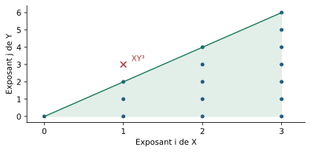
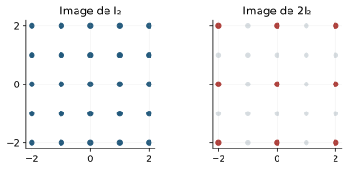
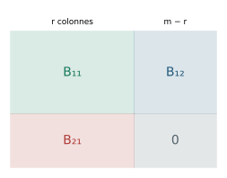

# ENS MP — Mathématiques D 2023 · Corrigé brut

*Corrigé rédigé par IA, non officiel. Signalez toute erreur.*

**Rédaction** · modèle exact non renseigné (famille GPT-6) · effort non renseigné · vitesse non renseignée

**Révision (tour 1)** · modèle exact non renseigné (famille GPT-6) · effort non renseigné · vitesse non renseignée

**Révision (tour 2)** · GPT-6.2 Astra Ultra · vitesse non renseignée

**Révision (tour 3)** · GPT-6.2 Astra Ultra · vitesse non renseignée

## Présentation du sujet

L’épreuve de mathématiques D de l’ENS Ulm comporte 37 questions et sous-questions. Elle étudie la génération finie des groupes et anneaux, les déterminants sur un anneau commutatif et les espaces de matrices de rang borné. [Sujet officiel](https://banques-ecoles.fr/cms/wp-content/uploads/2023/09/23_mp_sujet_MathD.pdf)

## I — Exemples et contre-exemples

Le groupe abélien $M$ vérifie (F) s’il a une partie génératrice finie pour l’addition. Pour un anneau commutatif unitaire $A$ et $S\subset A$, on note $\mathcal A(S)$ les valeurs de polynômes entiers en des éléments de $S$. L’anneau vérifie (TF) s’il est égal à $\mathcal A(S)$ pour une partie finie.

### Question I.1

Soit une famille additive génératrice finie $(s_1,\ldots,s_r)$, à laquelle on peut ajouter $0$ pour qu’elle soit non vide. Tout $a\in A$ s’écrit $\sum_i n_is_i$, avec $n_i\in\mathbb Z$. C’est la valeur en cette famille du polynôme $\sum_i n_iX_i$. Ainsi $A=\mathcal A(\{s_i\})$, soit (TF).

### Question I.2

Si $x\in\mathcal A(S_1)$, il s’écrit $P(s_1,\ldots,s_r)$ avec $s_i\in S_1$. Chaque $s_i$ est lui-même un polynôme entier en une famille finie de points de $S_2$. Réunissons ces familles en une seule liste $(t_1,\ldots,t_m)$ et écrivons $s_i=Q_i(t_1,\ldots,t_m)$. Le polynôme composé $P(Q_1,\ldots,Q_r)$ à coefficients entiers donne alors $x$ à partir de $S_2$. D’où l’inclusion.

### Question I.3

Un groupe abélien fini est engendré par l’ensemble fini de tous ses éléments. Le groupe additif $\mathbb Z^r$ est engendré par ses $r$ vecteurs de base puisque $(m_1,\ldots,m_r)=\sum_i m_i e_i$. Les deux groupes ont (F).

### Question I.4

Les $n$ indéterminées engendrent l’anneau $\mathbb Z[X_1,\ldots,X_n]$ comme algèbre, donc (TF) vaut. Une famille finie de polynômes est de degré en $X_1$ borné par un entier $D\ge0$ (on ignore les polynômes nuls). Toute combinaison linéaire à coefficients entiers vérifie encore cette borne, donc elle ne peut donner $X_1^{D+1}$. La propriété (F) échoue, puisque $n\ge1$.

### Question I.5

Supposons $\mathbb Q$ engendré comme anneau par une famille finie de fractions. Soit $D\ge1$ un dénominateur commun. Chacun des générateurs est dans le sous-anneau $\mathbb Z[1/D]=\{m/D^k:m\in\mathbb Z,\ k\ge0\}$. Choisissons un nombre premier $p$ divisant $D+1$, donc ne divisant pas $D$. L’égalité $1/p=m/D^k$ entraînerait $p\mid D^k$, ce qui est impossible. Ainsi $1/p$ manque à l’anneau engendré, contradiction.

## II — Comportement vis-à-vis des morphismes

Tous les morphismes d’anneaux respectent l’unité. Les morphismes entre groupes abéliens sont additifs.

### Question II.1

Un morphisme d’anneaux unitaires préserve $1$, donc $f(n1_A)=n1_B$ pour tout entier $n$, par additivité et passage à l’opposé. Il préserve les produits et les puissances, y compris l’exposant zéro. Appliquer ces règles à chaque monôme puis à la somme finie donne $f(F(a_1,\ldots,a_n))=F(f(a_1),\ldots,f(a_n))$.

### Question II.2a

L’évaluation $f(P)=P(b_1,\ldots,b_n)$ envoie $1$ sur $1$ et respecte addition et multiplication par distributivité dans l’anneau commutatif $B$. Elle envoie bien $X_i$ sur $b_i$. Réciproquement, II.1 impose cette valeur sur tout polynôme à tout morphisme possédant les images prescrites. Ainsi l’évaluation est l’unique morphisme convenable.

### Question II.2b

Si $B=\mathcal A(\{b_1,\ldots,b_n\})$, alors tout polynôme en une liste puisée dans ces éléments peut être récrit en $n$ indéterminées en identifiant les répétitions et en ignorant les absentes. L’évaluation de II.2a est donc surjective. On peut ajouter $0$ si nécessaire pour assurer $n\ge1$. Réciproquement, pour un morphisme surjectif $f$, chaque $b\in B$ est $f(P)=P(f(X_1),\ldots,f(X_n))$. Les $n$ images des indéterminées engendrent $B$ comme anneau, ce qui établit (TF).

### Question II.2c

Si $m_1,\ldots,m_r$ engendrent le groupe abélien $M$, la fonction $(z_i)\mapsto\sum z_i m_i$ est un morphisme surjectif de $\mathbb Z^r$ sur $M$. Le groupe nul peut prendre un générateur égal à zéro. Réciproquement, les images des vecteurs de base par un tel morphisme engendrent son image, donc $M$.

### Question II.2d

Composons la surjection d’un anneau de polynômes sur $A$ de II.2b avec la surjection $A\to B$. On obtient (TF) pour $B$. De même, pour tout morphisme surjectif de groupes abéliens $M\to L$, la propriété (F) de $M$ entraîne celle de $L$ par composition avec la surjection de II.2c.

### Question II.3a

Pour $n=0$ le seul sous-groupe est le groupe nul, isomorphe à $\mathbb Z^0$. Pour $n=1$, un sous-groupe de $\mathbb Z$ est $a\mathbb Z$ avec $a\ge0$. Il est nul si $a=0$ et isomorphe à $\mathbb Z$ sinon par $m\mapsto am$.

Pour l’étape de récurrence, le noyau de $p$ est $N$ et $N_1=M\cap N$. Si $p(M)=a\mathbb Z$ avec $a\ne0$, choisissons $e_1\in M$ tel que $p(e_1)=a$. L’application $(x,m)\mapsto x+me_1$ de $N_1\times\mathbb Z$ vers $M$ est additive. Si son image vaut zéro, la projection donne $ma=0$, donc $m=0$, puis $x=0$. Enfin pour $y\in M$, écrivons $p(y)=ma$ et prenons $x=y-me_1\in N_1$. Cela prouve la surjectivité et l’isomorphisme.

### Question II.3b

Par l’identification $N\simeq\mathbb Z^{n-1}$, l’hypothèse de récurrence appliquée à $N_1$ donne $N_1\simeq\mathbb Z^s$ avec $s\le n-1$, en suivant simultanément cette borne dans la récurrence. Si $a=0$, alors $M=N_1$ et $r=s$. Si $a\ne0$, II.3a donne $M\simeq\mathbb Z^{s+1}$. Dans tous les cas le rang obtenu vérifie $r\le n$.

### Question II.3c

Supposons $u:\mathbb Z^r\to\mathbb Z^s$ isomorphe. Si $r>s$, les $r$ vecteurs entiers $u(e_i)$ sont liés dans $\mathbb Q^s$. En chassant les dénominateurs, il existe des $c_i\in\mathbb Z$ non tous nuls avec $\sum_i c_i u(e_i)=0$. L’additivité et l’injectivité de $u$ donnent $\sum_i c_i e_i=0$, impossible. Ainsi $r\le s$. Le même argument pour $u^{-1}$ donne $s\le r$, d’où l’unicité.

### Question II.4

Choisissons une surjection $f:\mathbb Z^r\to M$ grâce à (F). Pour un sous-groupe $H\subset M$, son image réciproque $f^{-1}(H)$ est un sous-groupe de $\mathbb Z^r$, donc est isomorphe à $\mathbb Z^s$ pour un $s\le r$. La restriction de $f$ à cette image réciproque surjecte sur $H$. Les images d’une famille génératrice finie engendrent donc $H$, y compris dans le cas $s=0$.

Dans $A=\mathbb Z[X,Y]$, posons $U=\{XY^k:k\ge0\}$, $B=\mathcal A(U)$ et prenons $S\subset B$ fini.

### Question II.5a

Chaque élément de $S$ s’exprime comme un polynôme en un nombre fini d’éléments $XY^k$ de $U$. Comme $S$ est finie, tous les exposants intervenant dans ces expressions sont majorés par un même entier $m\ge1$. En posant $S_m=\{X,XY,\ldots,XY^m\}$, on a $S\subset\mathcal A(S_m)$. La composition de I.2 donne $\mathcal A(S)\subset\mathcal A(S_m)$.

### Question II.5b

Dans un produit $X^{i_0}(XY)^{i_1}\cdots(XY^m)^{i_m}=X^iY^j$, on a $i=\sum_{k=0}^m i_k$ et $j=\sum_{k=0}^m k i_k\le mi$. Un polynôme en les éléments de $S_m$ est une somme à coefficients entiers de tels monômes, constantes comprises. Par II.5a, on peut prendre $N=m$.

### Question II.5c

Si $B=\mathcal A(U)$ était engendré par une partie finie $S$, II.5b donnerait $N\ge1$ tel que le support de chaque élément de $B$ soit contenu dans $j\le Ni$. Or $XY^{N+1}\in U\subset B$ et son exposant $(1,N+1)$ est hors de cette région. L’unicité des coefficients d’un polynôme exclut une autre représentation avec les seuls exposants autorisés. C’est la contradiction.

## III — Déterminants sur un anneau commutatif

On note $\widetilde M$ la transposée de la comatrice de $M$ et $A^\times$ l’ensemble des éléments inversibles de $A$. Les relations usuelles sur les déterminants sont données pour les corps.

### Question III.1

Réunissons les coefficients des matrices de l’ensemble fini $E$ dans une partie finie $S\subset A$, en y ajoutant $0$ si nécessaire. Le sous-anneau $B=\mathcal A(S)$ contient chaque coefficient. Les polynômes en les éléments de $S$ évalués dans $B$ donnent exactement les mêmes éléments que dans $A$. Ainsi $S$ engendre $B$ comme anneau et $B$ a (TF).

### Question III.2a

Si $A$ est intègre, plongeons-le dans son corps des fractions $K$. Sur $K$ l’identité $M\widetilde M=\widetilde M M=(\det M)I_n$ est rappelée dans l’énoncé. Le déterminant et les cofacteurs de $M$ se calculent par sommes et produits d’éléments de $A$, donc sont dans $A$. L’injection $A\hookrightarrow K$ permet de relire coefficient par coefficient l’égalité dans $A$.

### Question III.2b

Soit $f:B\to A$ un morphisme surjectif avec $B$ intègre. Relevons les coefficients de $M$ en une matrice $M'\in M_n(B)$. Les cofacteurs et le déterminant étant des polynômes à coefficients entiers en les entrées, $f(\widetilde {M'})=\widetilde M$ et $f(\det M')=\det M$ par II.1. Appliquer $f$ coefficient par coefficient à l’identité de III.2a pour $M'$ donne le résultat pour $M$, puisque $f$ respecte les produits matriciels.

### Question III.2c

III.1 fournit un sous-anneau $C\subset A$ satisfaisant (TF) qui contient les coefficients de $M$. Par II.2b, un anneau de polynômes sur $\mathbb Z$, intègre, surjecte sur $C$. III.2b prouve l’identité dans $M_n(C)$. L’inclusion dans $M_n(A)$ la transporte à l’anneau de départ.

### Question III.2d

Dans un anneau intègre, l’injection dans le corps des fractions permet de lire dans l’anneau l’égalité $\det(MN)=\det M\det N$ connue sur ce corps. Pour un anneau quelconque, III.1 appliquée à $\{M,N\}$ fournit un même sous-anneau de type (TF) contenant leurs coefficients. Relevons les deux matrices à travers une surjection d’un anneau de polynômes entier sur ce sous-anneau. L’égalité démontrée dans l’anneau intègre descend par le morphisme, car celui-ci préserve multiplication matricielle et déterminant. Elle reste vraie dans $A$.

On suppose $A\ne\{0\}$ et $M\in M_{s,r}(A)$. Dans les questions III.3a à III.3c, on suppose que l’application $u:A^r\to A^s$, $X\mapsto MX$, est surjective.

### Question III.3a

Pour chaque vecteur canonique $e_j$ de $A^s$, la surjectivité de $X\mapsto MX$ fournit $v_j\in A^r$ tel que $Mv_j=e_j$. La matrice $N\in M_{r,s}(A)$ dont les colonnes sont les $v_j$ vérifie $MN=I_s$.

### Question III.3b

Avec $r<s$, la multiplication par blocs des matrices carrées complétées de zéros donne $M_1N_1=(M\ \ 0)\binom{N}{0}=MN=I_s$.

### Question III.3c

La matrice $M_1$ possède au moins une colonne nulle, donc $\det M_1=0$ par la formule du déterminant. Par III.2d, $1=\det I_s=\det M_1\det N_1=0$, contradiction puisque $A$ est non nul. Par conséquent toute surjection $A^r\to A^s$ de cette forme impose $r\ge s$.

### Question III.3d

Fixons maintenant $r=s$ et une matrice carrée $M$ quelconque. D’après III.3a, (i) entraîne (ii) car $MN=I_r$ donne $\det M\det N=1$. Si (ii) vaut, posons $N=(\det M)^{-1}\widetilde M$. L’identité des cofacteurs de III.2c donne $MN=NM=I_r$, donc (iii). Une telle matrice $N$ définit l’application inverse de $u$, donc (iii) entraîne la bijectivité (iv). Enfin toute bijection est surjective, ce qui referme le cycle.

## IV — Équivalence des matrices

Deux matrices du même format sont équivalentes sur $A$ si l’une s’écrit $UMV$ avec deux matrices carrées inversibles à coefficients dans $A$. Le nombre $m_k(M)$ est le pgcd positif ou nul des mineurs d’ordre $k$ d’une matrice entière.

### Question IV.1a

Le renvoi « II.3.d) » dans la définition imprimée de $GL_r(A)$, page 4, désigne III.3d. L’identité appartient à $GL_r(A)$. Les produits y restent puisque $\det(MN)=\det M\det N$ est une unité lorsque les deux facteurs le sont. L’associativité vient du produit matriciel. D’après III.3d, tout $M\in GL_r(A)$ possède un inverse bilatère $N$, lequel appartient lui-même à $GL_r(A)$ puisqu’il admet $M$ pour inverse. Cela donne une structure de groupe.

### Question IV.1b

La réflexivité s’obtient avec les deux identités. Si $N=UMV$, on a $M=U^{-1}NV^{-1}$, avec des matrices inversibles des bons formats, donc symétrie. Si en outre $L=U'NV'$, alors $L=(U'U)M(VV')$ et les produits sont inversibles. C’est la transitivité.

### Question IV.2

Pour des listes croissantes $I,J$ de $k$ indices de lignes et de colonnes, écrivons $M_{I,J}$ pour le bloc extrait. Si $N=UMV$ avec $U,V$ inversibles entières, on a
$$
\det N_{I,J}=\sum_{|H|=|L|=k}\det U_{I,H}\,\det M_{H,L}\,\det V_{L,J}.
$$
En effet, dans un produit $PQ$, chaque colonne restreinte aux lignes $I$ est une combinaison des colonnes de $P$ restreintes à $I$. Par multilinéarité du déterminant, les $k$-uplets d’indices répétés donnent zéro. Pour un même ensemble ordonné $H$ sans répétition, les $k!$ permutations apportent, avec leurs signes, exactement le coefficient $\det Q_{H,J}$ de $\det P_{I,H}$. On obtient la formule de Cauchy-Binet, ici appliquée deux fois. Par exemple pour $k=1$, la formule redonne $N_{ij}=\sum_{h,l}U_{ih}M_{hl}V_{lj}$. Pour $k$ maximal dans le cas carré, elle redonne la multiplicativité du déterminant. Ces deux cas vérifient le rôle distinct des ensembles de lignes $H$ et de colonnes $L$.

Chaque mineur de $N$ est donc combinaison linéaire entière des mineurs de $M$. L’idéal de $\mathbb Z$ qu’ils engendrent est inclus dans celui des mineurs de $M$. L’équivalence étant symétrique et $U^{-1},V^{-1}$ étant encore entières, l’inclusion inverse vaut également. Les générateurs positifs ou nuls des deux idéaux sont égaux, donc $m_k(M)=m_k(N)$, y compris lorsque tous les mineurs sont nuls.

### Question IV.3

Prenons $M=I_2$ et $N=2I_2$. Toutes deux ont rang deux sur $\mathbb C$, et sont même reliées par la multiplication par $2I_2$, inversible sur $\mathbb C$. Les pgcd de leurs mineurs d’ordre un sont toutefois $1$ et $2$. IV.2 exclut l’équivalence sur $\mathbb Z$.

## V — Sous-espaces de matrices de petit rang

Soit $V\subset M_m(\mathbb C)$ un sous-espace dont chaque élément a rang au plus $r\le m$. On cherche à majorer $\dim V$ puis à atteindre la borne en format rectangulaire.

### Question V.1

Soit $q$ le rang maximal effectivement atteint par un élément de $V$. On a $q\le r$ et une borne $\dim V\le mq$ impliquera celle cherchée. Si $q=0$, $V=\{0\}$. Sinon remplaçons $r$ par $q$. Pour une matrice $M\in V$ de rang $r$, des opérations de base sur le corps $\mathbb C$ donnent $U,P$ inversibles avec $UMP=\operatorname{diag}(I_r,0)$. L’automorphisme $B\mapsto UBP$ de l’espace des matrices préserve les rangs et envoie $V$ sur un espace de même dimension contenant la matrice demandée. Si $r=m$, la borne est immédiate par la dimension ambiante. On peut donc mener la suite avec $1\le r<m$.

### Question V.2a

Pour une ligne $u$ de $B_{21}$, une colonne $v$ de $B_{12}$ et l’entrée correspondante $b$ de $B_{22}$, le mineur d’ordre $r+1$ formé des $r$ premières lignes et colonnes et de cette paire supplémentaire vaut
$$
P(t)=\det\begin{pmatrix}tI_r+B_{11}&v\\u&b\end{pmatrix}.
$$
Il est nul pour tout $t\in\mathbb C$, car $tA+B\in V$. Le coefficient de $t^r$, obtenu en choisissant tous les termes diagonaux $t$, est $b$. Donc $b=0$. Avec $b=0$, un terme en $t^{r-1}$ choisit $r-1$ diagonales et échange l’indice restant $j$ avec le dernier. Une fois les $r-1$ diagonales choisies, le déterminant restant est celui du bloc $\left(\begin{smallmatrix}(B_{11})_{jj}&v_j\\ u_j&0\end{smallmatrix}\right)$ et vaut $-u_jv_j$. La somme sur $j$ donne le coefficient $-uv$, y compris pour $r=1$. Le polynôme étant identiquement nul sur le corps infini $\mathbb C$, on a $uv=0$. Cela vaut pour chaque ligne et chaque colonne, donc $B_{22}=0$ et $B_{21}B_{12}=0$.

### Question V.2b

Appliquons V.2a à $B+C\in V$. En développant $(B_{21}+C_{21})(B_{12}+C_{12})=0$ et en retranchant les deux termes diagonaux déjà nuls, on obtient $B_{21}C_{12}+C_{21}B_{12}=0$.

$\varphi$ garde les $r$ premières lignes. Dans $W\subset V$, seul le bloc $B_{21}$ peut être non nul. Pour $B\in W$ et $C=(C_{11}\ \ C_{12})$, on pose $\psi(B)(C)=\operatorname{Tr}(B_{21}C_{12})$.

### Question V.3a

Soit $E=M_{r,m}(\mathbb C)$ et $s=\dim W$. Si $B\in W$ est tel que $\psi(B)=0$, on a $\operatorname{Tr}(B_{21}D)=0$ pour toute matrice $D\in M_{r,m-r}(\mathbb C)$. Plus précisément, le coefficient de $D_{ji}$ dans la trace est $(B_{21})_{ij}$ car $\operatorname{Tr}(B_{21}D)=\sum_{i=1}^{m-r}\sum_{j=1}^{r}(B_{21})_{ij}D_{ji}$. Avec l’unité matricielle d’indice $(j,i)$, la nullité de cette forme donne chaque coefficient de $B_{21}$, donc $B_{21}=0$ et $B=0$. Ainsi $\psi$ est injective et $\dim\psi(W)=s$.

Pour $B\in W$ et $C\in V$, V.2b donne $B_{21}C_{12}=0$ puisque $B_{12}=0$. D’où $\psi(B)(\varphi(C))=0$. Ainsi $\varphi(V)\subset\psi(W)^\perp\subset E$. L’annulateur de $s$ formes linéaires indépendantes sur $E$ a dimension $\dim E-s=mr-s$, par prolongement en une base du dual. On obtient $\dim\varphi(V)\le mr-s$.

### Question V.3b

Comme $B_{22}=0$ dans $V$, le noyau de $\varphi$ restreinte à $V$ est exactement $W$. Le théorème du rang et V.3a donnent $\dim V=s+\dim\varphi(V)\le s+mr-s=mr$.

### Question V.4a

Pour $r\le n\le m$, envoyons $M\in E\subset M_{m,n}(\mathbb C)$ sur $\bigl(M\ \ 0\bigr)\in M_m(\mathbb C)$ en ajoutant $m-n$ colonnes nulles. L’application est linéaire et injective, et son image de chaque matrice a le même espace colonne, donc le même rang. La borne de V.3b appliquée à l’image donne $\dim E\le mr$.

### Question V.4b

Prenons les matrices dont les $n-r$ dernières colonnes sont nulles. Les $mr$ coefficients des $r$ premières colonnes se choisissent librement, donc la dimension vaut $mr$. L’espace colonne est engendré par au plus $r$ vecteurs, donc chaque matrice a rang au plus $r$. La borne est atteinte.
