# ENS Ulm — PC, Chimie B 2023 · Corrigé guidé

*Corrigé rédigé par IA, non officiel.*

**Rédaction** · GPT-6.2 Astra Ultra · vitesse non renseignée

**Couverture.** Les 84 questions sont traitées. La face de l’hydroxylation en Q29 a été vérifiée sur les données supplémentaires de la synthèse originale. Les valeurs spectrales sont des lectures graphiques. Les incohérences du volume en Q70, du binaire en Q75 et de la relation thermodynamique en Q79–84 sont explicitées.

## Ingénol. Architecture stéréochimique

### Question 1 — Configuration de la jonction hydroxylée

> [!INDICATION]
> Comparer les deux CHOH atome par atome jusqu’au substituant du carbone vinylique.

#### Solution

Le carbone qui porte OH à la jonction C/D est **R**. OH arrive premier. Des trois carbones voisins, les deux CHOH donnent chacun O,C,H au premier développement et précèdent la tête de pont (C,C,C). Du côté D, le carbone vinylique porte une branche CH₂OH, du côté C une branche CH₃. Après prise en compte des doubles liaisons par duplication, c’est l’oxygène de CH₂OH qui départage les deux trajets. Ordre final : OH, CHOH du cycle D, CHOH du cycle C, tête de pont. En regardant avec la tête de pont à l’arrière, les trois premiers tournent dans le sens horaire.

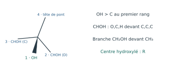

### Question 2 — Les deux têtes de pont

> [!INDICATION]
> Partir du carbone carbonylé commun et compter les chemins indépendants entre ses voisins.

#### Solution

Les cycles à sept sommets **B et D** contiennent le pont commun C–C(=O)–C. Entre leurs têtes de pont, trois chemins portent respectivement quatre, quatre et un carbone internes. Aux deux têtes, les liaisons restantes pointent, l’une vers l’intérieur de la cavité et l’autre vers son extérieur. Cette disposition trans est contrainte par le pont court.

## Construire le cyclopropane A

### Question 3 — Naissance du dichlorocarbène

> [!INDICATION]
> Suivre la paire C–H avant de faire partir le chlorure.

#### Solution

Un doublet de HO⁻ prend H de CHCl₃, celui de C–H revient sur C. L’anion CCl₃⁻ perd ensuite Cl⁻ par rupture hétérolytique d’une liaison C–Cl. Il reste :CCl₂, singulet coudé avec un doublet et une orbitale vacante sur C. Le cation ammonium à longue chaîne permet le transfert d’ions dans le milieu organique, mettant la base et le substrat en contact.

### Question 4 — Orbitales des fragments

> [!INDICATION]
> Fixer z de Cl vers Cl, x dans le plan moléculaire et y perpendiculaire à ce plan.

#### Solution

Pour Cl gauche et Cl droit, notons L et R les OA, orientées selon les mêmes axes. Les deux 3s donnent σ = sL+sR et σ* = sL−sR. Le long de z, les lobes qui se font face ont des signes opposés dans deux OA orientées à l’identique. Ainsi σz ∝ pzL−pzR et σz* ∝ pzL+pzR. Pour u = x, y, les combinaisons latérales sont πu ∝ puL+puR et πu* ∝ puL−puR. Chaque p a deux lobes de signes opposés, s est sphérique. Sur C, prendre 2s et les trois haltères 2px, 2py, 2pz. Pour Cl la couche de valence est n = 3, malgré le « 2p » du texte.

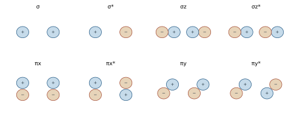

### Question 5 — Parités et blocs d’interaction

> [!INDICATION]
> La réflexion dans xOy échange les deux chlores, celle dans xOz renverse seulement la coordonnée y.

#### Solution

Les deux signes ci-dessous sont donnés dans l’ordre (xOz, xOy).

| Parités | Fragment Cl₂ | Fragment C | Dimension du bloc |
|---|---|---|---|
| S,S | σ, σz, πx | 2s, 2px | 5 |
| S,A | σ*, σz*, πx* | 2pz | 4 |
| A,S | πy | 2py | 2 |
| A,A | πy* | aucune | 1 |

Il y a donc trois interactions multiorbitalaires et une orbitale spectatrice. Les dimensions s’additionnent en douze OM. La séparation énergétique supplémentaire du bloc de cinq est une approximation du diagramme.

### Question 6 — Reconnaître quatre surfaces orbitalaires

> [!INDICATION]
> Commencer par les nœuds imposés par la symétrie, puis regarder la phase des lobes en vis-à-vis.

#### Solution

A est **OM7**, πy* pure de Cl₂, nulle sur C. C est **OM10**, combinaison antiliante de πy et 2py, avec un changement de signe entre C et Cl sur la même face du plan. B et D sont de symétrie S,S. Dans B, les lobes dirigés l’un vers l’autre entre les trois centres sont de même signe, avec prédominance de πx des chlores. Dans D, les deux lobes internes des chlores sont opposés au lobe inférieur de C, avec une forte composante σz. Dans le sous-bloc de valence (πx, σz, 2px), on attribue B au niveau liant **OM5** et D au niveau antiliant **OM11**. Le signe global dessiné pour une OM peut être inversé.

### Question 7 — Les deux frontières électroniques

> [!INDICATION]
> Placer deux électrons par orbitale avant de distinguer orbitale occupée et lacune.

#### Solution

CCl₂ a 4 + 2 × 7 = 18 électrons de valence. OM1 à OM9 sont doublement occupées. La HO est **OM9**, à caractère de doublet carboné dans le plan, et la BV **OM10**, principalement perpendiculaire au plan. Pour l’éthène, HO = π, lobes p en phase au-dessus des deux C et en phase opposée au-dessous. BV = π*, avec un nœud supplémentaire entre les deux C.

### Question 8 — Addition sur l’alcène de 1

> [!INDICATION]
> Suivre les deux transferts complémentaires de densité dans une addition syn.

#### Solution

L’approximation de Fukui retient les interactions occupée–vacante proches en énergie ayant un bon recouvrement. La HO π de 1 donne vers la BV de :CCl₂, et le doublet de la HO du carbène interagit avec π* de 1 lors d’une approche inclinée. Les deux liaisons C–C se forment du même côté. Sur le dessin de 1, OH et Me sont hachurés, donc la face avant est la moins encombrée. **2** est le cyclohexanol initial avec un pont CCl₂ en avant entre les deux anciens carbones éthyléniques, OH et Me en arrière.

### Question 9 — Déshydratation et choix de l’alcène

> [!INDICATION]
> Comparer les deux sites β du carbocation issu de l’alcool.

#### Solution

Protonation du doublet de l’alcool, départ de H₂O avec le doublet C–O, puis prélèvement d’un Hβ par l’eau ou HSO₄⁻. Les électrons de Cβ–H forment Cα=Cβ. Dans **3**, la double liaison joint l’ancien C–OH au C portant Me, le pont CCl₂ de 2 subsiste. Cet alcène trisubstitué est plus stable que son isomère disubstitué. Chauffage, caractère réversible de la protonation de l’alcène et déshydratation favorisent le produit thermodynamique.

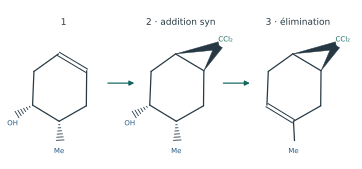

### Question 10 — Du dichlorure au gem-diméthyle

> [!INDICATION]
> Le métal change la polarité de la liaison sur le carbone du petit cycle.

#### Solution

Le magnésium s’insère dans C–Cl en éther anhydre pour engendrer un carbone organomagnésien nucléophile. Chaque remplacement net Cl → Me correspond à une métallation et à une alkylation par MeI, avec départ de I⁻. Les deux méthyles du pont de **4** sont ainsi expliqués.

## Former le cycle B

### Question 11 — Ozone polaire

> [!INDICATION]
> Compter 18 électrons et construire deux formules équivalentes.

#### Solution

⁻O–O⁺=O ↔ O=O⁺–O⁻. L’oxygène terminal simplement lié a trois doublets libres, le terminal doublement lié en a deux et le central en a un. Le squelette est coudé, AX₂E, avec deux liaisons équivalentes. La distribution électronique n’a pas de centre d’inversion et la somme vectorielle des dipôles a une composante sur la bissectrice.

### Question 12 — Ouverture oxydante de 4

> [!INDICATION]
> Identifier lequel des deux C éthyléniques porte H avant la coupure.

#### Solution

L’ozonolyse à traitement réducteur coupe C=C. Au bout qui portait H apparaît CHO, à l’autre COCH₃. **5** porte ainsi, sur deux carbones cis voisins du gem-diméthylcyclopropane, les bras –CH₂CHO et –CH₂COCH₃. L’IR montre C=O vers 1730 cm⁻¹, C–H aldéhydique vers 2740 cm⁻¹, avec disparition de la bande d’alcène. C’est un clivage oxydant contrôlé, comparable à une coupure de diol après dihydroxylation.

### Question 13 — Préserver l’aldéhyde par un acétal

> [!INDICATION]
> Comparer encombrement et réactivité des deux carbonyles de 5.

#### Solution

Le bras –CH₂CHO devient –CH₂CH(OMe)₂, la méthylcétone est conservée. CeCl₃ est un acide de Lewis qui active le carbonyle par coordination de l’oxygène. L’orthoformiate en méthanol facilite la formation de l’acétal en milieu doux et pauvre en eau. L’aldéhyde est plus réactif et moins encombré que la cétone. Une acétalisation acide prolongée à l’équilibre pourrait également masquer la cétone requise ensuite.

### Question 14 — Méthoxycarbonylation de la méthylcétone

> [!INDICATION]
> L’énolate doit attaquer le carbonate sur son carbone, puis éliminer MeO⁻.

#### Solution

MeO⁻ prend un H du CH₃ terminal de –CH₂COCH₃. La paire C–H forme C=C tandis que π(C=O) monte sur O. Dans la forme carbonée de l’énolate, C attaque (MeO)₂C=O. Le tétraèdre O⁻ se referme avec départ de MeO⁻. Après transfert de proton, **7** porte –CH₂COCH₂CO₂Me. La déprotonation du β-cétoester plus acide favorise l’acylation. MeONa évite un échange d’alkoxy avec l’ester méthylique. À −78 °C, le prélèvement accessible sur le méthyle favorise l’énolate cinétique.

### Question 15 — Former la cyclohepténone

> [!INDICATION]
> Libérer l’aldéhyde avant de faire réagir le méthylène du β-cétoester.

#### Solution

Sous APTS, protonation d’un O de l’acétal, départ de MeOH puis transfert d’acétal à l’acétone régénèrent le CHO. L’acétone en excès accepte les groupes méthoxy, ce qui déplace la déprotection. L’énol du β-cétoester attaque l’aldéhyde protoné par son carbone central. Formation du lien intramoléculaire à sept, déprotonation, protonation du nouvel OH puis perte d’eau et de Hα donnent l’alcène conjugué du cycle B de **8**. La liaison formée joint le C porteur de CO₂Me à l’ancien C de CHO.

### Question 16 — Addition conjuguée sur 8

> [!INDICATION]
> Comparer les deux carbonyles au carbone β de l’énone et regarder le côté du cyclopropane.

#### Solution

Les deux C=O, cétone et ester, sont polarisés. Par mésomérie, le Cβ de l’énone est également électrophile. Le nucléophile méthylé apporte Me sur Cβ. Les électrons π gagnent Cα puis O de la cétone, donnant un énolate. Protonation carbonée, ou énol puis tautomérisation, restitue C=O. Le réactif cuivré favorise l’addition 1,4. Dans la projection de **9**, Meβ est hachuré du côté opposé au pont gem-diméthylcyclopropane. La protonation donne le CO₂Me également hachuré, sur le même côté que Meβ.

## Installer le cycle C

### Question 17 — Réduire l’ester sans consommer la cétone

> [!INDICATION]
> Protéger d’abord la fonction la plus facile à réduire.

#### Solution

Traiter 9 par éthane-1,2-diol et APTS catalytique dans le toluène à reflux avec élimination d’eau pour protéger la cétone comme dioxolane. Réduire CO₂Me en CH₂OH par LiAlH₄ en éther ou THF anhydre, de 0 °C à température ambiante, puis hydrolyse contrôlée. Une hydrolyse acide aqueuse douce du cétal restitue la cycloheptanone de **10**. La liaison entre le cycle et le bras hydroxyméthyle est conservée.

### Question 18 — Formation d’un acétate

> [!INDICATION]
> Garder la liaison entre méthylène et oxygène de 10.

#### Solution

Dans **11**, le bras –CH₂OH hachuré est devenu –CH₂OCOCH₃ par acylation sur l’oxygène avec l’anhydride acétique. La pyridine capte l’acide et peut activer le transfert d’acyle. Une amine tertiaire encombrée telle que la diisopropyléthylamine peut assurer le rôle de base.

### Question 19 — Expulser l’acétate

> [!INDICATION]
> Comparer la délocalisation des acides conjugués possibles du DBU.

#### Solution

Le N imine, doublement lié dans l’amidine, se protone pour donner un amidinium dont la charge se répartit sur les deux N. DBU prélève le Hα de la cétone sur le CH portant CH₂OAc. Former l’énolate, puis rabattre sa paire carbonée vers la liaison Cα–CH₂, avec départ de AcO⁻. **12** est l’α-méthylènecycloheptanone (Cα=CH₂). Une écriture concertée des trois déplacements rend aussi compte de cette β-élimination si la géométrie s’y prête.

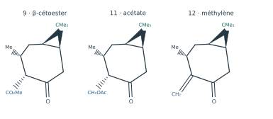

### Question 20 — Répartition des 18 protons de 12

> [!INDICATION]
> Séparer les trois méthyles, les deux CH₂ saturés, le CH–Me et les deux méthines du petit cycle.

#### Solution

Dans le cycle B, noter K le C=O. En parcourant le grand cycle on rencontre K–C(=CH₂)–CH(Me)–CH₂–CH(cyclopropane)–CH(cyclopropane)–CH₂–K. Les attributions par ensembles sont :

| δ en ppm | Protons |
|---|---|
| 6,07 et 5,06, deux d, 1 H chacun | deux H non équivalents de =CH₂, couplage geminal 2 Hz |
| 2,69, dd, 2 H | CH₂ voisin de K, protons regroupés expérimentalement |
| 2,33, m, 1 H | CH–Me, voisin de CH₂ et de trois H du Me |
| 1,63, m, 2 H | CH₂ situé entre CH–Me et la jonction du cyclopropane |
| 1,04, d, 3 H | Me du CH–Me |
| 0,97 et 0,86, deux s, 3 H chacun | méthyles du pont CMe₂, non équivalents |
| 0,66 et 0,57, deux td, 1 H chacun | deux CH de la jonction avec le cyclopropane |

À 2,33 ppm on attend un quadruplet dédoublé deux fois si les deux H du CH₂ voisin sont diastéréotopes et les trois constantes résolues (jusqu’à seize raies). Si les deux couplages au CH₂ sont indiscernables, on observe un quadruplet de triplets avant possibles recouvrements.

### Question 21 — Cycloaddition [4+2]

> [!INDICATION]
> Repérer le diène cyclique et l’alcène conjugué électrophile.

#### Solution

C’est une Diels–Alder entre le cyclopentadiène et l’α-méthylènecétone. BF₃, acide de Lewis, se coordonne au doublet de l’oxygène carbonylé. Il abaisse la BV du diénophile et accélère la cycloaddition.

### Question 22 — Les quatre orientations d’approche

> [!INDICATION]
> Croiser choix de la face du diénophile et orientation endo/exo du carbonyle.

#### Solution

Les produits ont tous le même norbornène spiro à l’ancien Cα. Avec le squelette de 12 fixé, les quatre dessins s’obtiennent en plaçant le diène (i) devant ou (ii) derrière la double liaison, puis son pont CH₂ de telle sorte que le bras C=O soit endo ou exo. Ces deux choix indépendants donnent avant/endo, avant/exo, arrière/endo et arrière/exo. Pour **13**, l’approche évite le Meβ hachuré et l’orientation endo place le système π carbonylé sous le diène, ce qui stabilise l’approche par interaction secondaire. Les deux liaisons nouvelles sont formées suprafacialement.

### Question 23 — Ouverture du norbornène par éthénolyse

> [!INDICATION]
> Couper mentalement la double liaison pontée et terminer chaque extrémité par =CH₂.

#### Solution

Dans **14**, la double liaison du norbornène de 13 est remplacée par deux groupes –CH=CH₂ fixés aux deux anciennes têtes de pont. Il reste un cyclopentane spiro, avec deux vinyles cis sur les positions correspondantes. La détente du bicycle rend ce sens favorable. L’éthylène étant consommé, augmenter sa pression augmente son potentiel chimique et déplace l’équilibre vers le produit ouvert.

### Question 24 — Différencier les deux vinyles

> [!INDICATION]
> Suivre seulement le bras dont le substituant final est dessiné en haut à gauche dans 18.

#### Solution

**15** conserve le vinyle proche du futur cycle D et porte, sur l’autre bras, –CH(OH)CH₂OH. OsO₄ effectue une dihydroxylation syn de la double liaison la plus accessible, H₂O₂ réoxyde le catalyseur réduit. NaIO₄ clive la liaison entre les deux carbones hydroxylés. **16** porte –CHO à cette position et du méthanal est libéré. Le glycol en milieu acide donne **17**, dioxolane cyclique –CH(OCH₂CH₂O)– dont les deux O sont liés au même CH. Le second vinyle et la cétone subsistent.

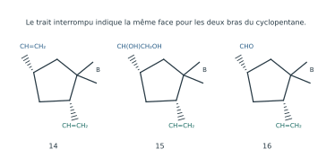

### Question 25 — Alkylation de l’énolate de 17

> [!INDICATION]
> Un seul côté de la cétone porte encore un hydrogène α.

#### Solution

KH prend un H du CH₂ en α opposé au carbone spiro. On forme H₂ et l’énolate. À partir de sa forme carbonée, attaque arrière sur le CH₂–Cl du chlorure allylique et départ simultané de Cl⁻. Le substituant entrant –CH₂C(=CH₂)CH₂OPMB de **18** est hachuré sur la figure. L’approche évite la face occupée par le pont cyclopropane et le relief du squelette. Les liaisons aux centres préexistants sont conservées.

## Fermer le cycle D

### Question 26 — Fermeture du cycle D

> [!INDICATION]
> Repérer les deux CH₂ terminaux qui repartent ensemble.

#### Solution

Dans **19**, le vinyle porté par le cyclopentane et le =CH₂ du bras que l’on vient d’introduire s’échangent par métathèse. Les deux carbones internes deviennent C=C du cycle D à sept et CH₂=CH₂ est libéré. Le carbone substitué garde CH₂OPMB et le dioxolane demeure sur C. La haute dilution diminue la rencontre de deux molécules de 18, donc l’oligomérisation concurrente de la fermeture intramoléculaire.

### Question 27 — Transformer un formyle masqué en méthylène exocyclique

> [!INDICATION]
> Le carbone du CHO peut être conservé jusque dans le =CH₂.

#### Solution

Hydrolyser le dioxolane en milieu aqueux légèrement acide à température ambiante. Réduire le CHO en CH₂OH avec NaBH₄ dans MeOH froid, la cétone de B étant supposée protégée stériquement. Activer CH₂OH en mésylate (MsCl, Et₃N, CH₂Cl₂, 0 °C). Une base encombrée, par exemple tBuOK à chaud, enlève le H sur le carbone du cycle C et expulse MsO⁻. On obtient le groupe exocyclique C=CH₂ de **20**.

## Oxygénations successives

### Question 28 — Oxydation allylique et déplacements de doublets

> [!INDICATION]
> Numéroter les trois C du système C₁=C₂–C₃H et garder ces numéros tout au long du mécanisme.

#### Solution

Lors de l’étape « ène », les trois flèches simultanées sont π(C₁=C₂) → liaison C₁–Se, π(Se=O) → liaison O–H et σ(C₃–H) → π(C₂=C₃). Après rotation autour de C₁–Se, le réarrangement [2,3] se dessine par π(C₂=C₃) → liaison C₃–O, π(Se=O) → doublet sur Se et σ(C₁–Se) → π(C₁=C₂). On retrouve l’alcène initial et un ester sélénié sur C₃. Enfin H₂O attaque Se par un doublet, Se–O(allyle) se rompt vers l’alcoolate. Cet alcoolate prend un proton du ligand aquo pour donner l’alcool allylique et Se(OH)₂. Le co-oxydant régénère le dioxyde.

### Question 29 — Emplacement de l’alcool de 21

> [!INDICATION]
> Comparer les deux méthylènes allyliques de la méthylènecyclopentane.

#### Solution

Le méthylène du cycle C **entre le =CH₂ et la jonction inférieure C/D** devient CHOH. Le =CH₂ initial demeure exocyclique et l’alcène plus encombré du cycle D demeure intact. Le CH₂ allylique supérieur est voisin de la jonction quaternaire et de la cage, ce qui pénalise l’approche du sélénium de ce côté. Le nouveau OH est en **coin plein, vers l’avant**, cis au H de la jonction inférieure C/D. L’oxydation de type ène, puis le transfert suprafacial, sélectionnent le H allylique accessible. La figure de 23 ne suffit pas à établir cette face car l’oxydation suivante efface le centre. La configuration est confirmée directement par le dessin du composé 8 de Nickel et coll., qui correspond au 21 du sujet. [Données supplémentaires, p. 6](https://doi.org/10.1021/ja044123l.s003)

### Question 30 — Iode hypervalent

> [!INDICATION]
> Distinguer géométrie des liaisons et arrangement des six domaines électroniques.

#### Solution

L’iode porte cinq ligands et un doublet. VSEPR AX₅E donne un environnement électronique octaédrique et une **pyramide à base carrée** pour les cinq liaisons. Dans le formalisme usuel du périodinane, les trois acétates, l’oxygène du carboxylate cyclique et le groupe aryle sont chacun comptés comme ligand X, formellement monoanionique. La molécule neutre porte donc un centre I(V). Cette convention organoiodée doit être explicitée lorsque les électronégativités tabulées de C et I sont très proches.

### Question 31 — Oxyder l’alcool allylique

> [!INDICATION]
> Suivre la perte des deux H de CHOH et le changement de valence de l’iode.

#### Solution

Dans **22**, le CHOH de 21 devient C=O sur le cycle à cinq. Le =CH₂ demeure exocyclique et aucun O–H libre ne subsiste, comme le confirme l’absence de bande large vers 3500 cm⁻¹. En utilisant précisément les deux structures iodées de la figure 9, le bilan est 21 + périodinane(Iᵛ) → 22 + iodinane(Iᴵᴵᴵ) + 2 CH₃CO₂H. Les deux acétates perdus par l’iode captent les deux H de l’alcool.

### Question 32 — Isomérisation du méthylène

> [!INDICATION]
> Comparer la substitution et la conjugaison pour les deux positions de C=C.

#### Solution

Le =CH₂ exocyclique devient un Me sur le carbone du cycle C. Une nouvelle double liaison endocyclique, plus substituée, se forme du côté supérieur, donnant la cyclopenténone **23** à système carbonylé conjugué. Dans 22, la cétone est déjà conjuguée au méthylène exocyclique. La sélection entre les deux énones vient surtout de la stabilité accrue de la double liaison endocyclique trisubstituée.

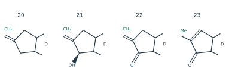

### Question 33 — Oxygéner le carbone α de la cyclopenténone

> [!INDICATION]
> Le seul Hα pertinent est celui de la jonction inférieure, dessiné en coin plein.

#### Solution

tBuO⁻ prend le H de la jonction C/D voisine du nouveau C=O. Le doublet C–H se délocalise en énolate (Cα⁻–C=O ↔ Cα=C–O⁻). Le piégeage par O₂ conduit à une liaison Cα–O–O⁻, puis tBuOH protonne le peroxyde en **23′**, de structure 24 avec –OOH en coin plein à la place de –OH. Une description tenant compte de l’état triplet de O₂ décompose le piégeage en transfert monoélectronique, paire radicalaire puis couplage. La protonation constitue une étape distincte.

### Question 34 — Réduire l’hydroperoxyde

> [!INDICATION]
> Distinguer les deux oxygènes avant de couper la liaison faible O–O.

#### Solution

Avec R = jonction carbonée, le doublet de P(OMe)₃ attaque l’oxygène terminal de R–O–OH, tandis que σ(O–O) revient vers l’oxygène lié à R. On forme RO⁻ et [HO–P⁺(OMe)₃]. Le transfert de H⁺ à RO⁻ produit **24** et ⁻O–P⁺(OMe)₃ ↔ O=P(OMe)₃. Le C–O de 23′ est conservé, donc la configuration de l’hydroxyle aussi.

### Question 35 — Ligand acétylacétonate

> [!INDICATION]
> Comparer les deux côtés du carbanion obtenu par déprotonation de CH₂.

#### Solution

Me–C(O⁻)=CH–C(=O)–Me ↔ Me–C(=O)–CH=C(O⁻)–Me. La charge est répartie sur les deux O. Ce ligand monoanionique peut se fixer par ses deux O au même métal, en chélate κ²-O,O formant un cycle à six chaînons avec V.

### Question 36 — Degré d’oxydation du vanadium

> [!INDICATION]
> Suivre les charges totales du cycle, y compris le H⁺ libéré en entrant en II.

#### Solution

Dans le cycle simplifié tel qu’il est dessiné, **II, III, IV, V et VI portent tous V(IV)**. I est neutre. Après activation de l’alcool avec perte de H⁺, II est un anion, avec oxo O²⁻, deux acac⁻ et un alcoolate. En III un acac⁻ est remplacé par tBuOO⁻. IV en modifie la coordination. En V–VI l’oxygène transféré est celui de l’époxyde, le groupe tBuO⁻ reste ligand. En VI, oxo, acac⁻, époxy-alcoolate et tBuO⁻ totalisent −5, pour un complexe de charge −1. Le transfert oxydant concerne l’alcène et le peroxyde.

### Question 37 — Époxydation dirigée

> [!INDICATION]
> Chercher la double liaison allylique voisine du OH capable de se coordonner.

#### Solution

Dans **25**, l’alcène du cycle D portant CH₂OPMB est transformé en époxyde, avec ses deux liaisons C–O vers l’avant sur le dessin de 24, syn au OH de la jonction. Les fonctions du cycle C sont conservées. La formation d’un alcoolate de vanadium arrime le catalyseur près de la double liaison de l’alcool allylique. Le transfert intracomplexe de O explique à la fois le choix du site et celui de la face. L’énone du cycle C est en outre appauvrie en électrons.

## Dernières étapes vers le tétraol

### Question 38 — Passer de l’alcool primaire au sulfure

> [!INDICATION]
> Conserver le premier O au stade mésylate, puis suivre son départ.

#### Solution

Avec R le squelette de 26, **27 = R–CH₂–O–SO₂Me**. Un doublet de l’alcool attaque le S du chlorure de mésyle, Cl⁻ part et Et₃N déprotone l’oxygène. Li₂CO₃, base, produit une fraction de PhS⁻ à partir de PhSH et neutralise l’acidité. Le doublet du thiolate attaque par l’arrière le CH₂ primaire et C–O se rompt vers MsO⁻. **28 = R–CH₂–SPh**. Les centres du squelette et l’époxyde sont conservés.

### Question 39 — Sulfure, sulfoxyde, sulfone

> [!INDICATION]
> Deux atomes d’oxygène sont incorporés successivement.

#### Solution

H₂O₂ est l’oxydant terminal. Le molybdate d’ammonium fournit les espèces peroxomolybdiques catalytiques qui transfèrent O au sulfure puis au sulfoxyde. R–CH₂SPh + 2 H₂O₂ → R–CH₂SO₂Ph + 2 H₂O.

### Question 40 — Ouverture de l’époxyde par E1cb

> [!INDICATION]
> L’un des H du CH₂SO₂Ph est activé par le sulfonyle.

#### Solution

DBU prélève Hα du sulfonyle. La base conjuguée –CH⁻SO₂Ph se stabilise par effet inductif et délocalisation vers les oxygènes du sulfonyle. Le doublet carboné forme C(externe)=C(cycle D) et la liaison du C du cycle ainsi engagé vers l’oxygène époxydique se rompt vers O. OH, après protonation de O⁻, reste porté en avant par l’autre C de l’époxyde. **30** a donc une liaison exocyclique C=CH–SO₂Ph et un OH voisin. L’acétonide et les autres cycles sont conservés.

### Question 41 — Isomérisation allylique

> [!INDICATION]
> Lire en 32 la position endocyclique de C=C et garder le groupe sulfonyle jusqu’à 31.

#### Solution

Par transferts de proton, C=CHSO₂Ph de 30 devient un bras –CH₂SO₂Ph et la double liaison migre à l’intérieur du cycle D, vers le carbone supérieur droit voisin. **31** est ainsi l’analogue de 32 ayant CH₂SO₂Ph au lieu du Me vinylique, avec le même OH en avant. Le déplacement fournit une double liaison endocyclique plus substituée.

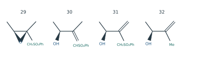

### Question 42 — Désulfonylation

> [!INDICATION]
> La perte de SO₂Ph s’accompagne du remplacement de la liaison C–S par C–H.

#### Solution

Na métallique s’oxyde facilement en Na⁺ et fournit des électrons. La réduction de la sulfone, fragmentation de la liaison C–S et protonation dans MeOH produisent le Me de **32**. Na₂HPO₄ est un additif acido-basique qui limite les variations de pH et peut participer, avec le méthanol, aux transferts de protons.

### Question 43 — De 32 au tétraol

> [!INDICATION]
> Comparer le Me sur le cycle D et le CH₂OH de la cible avant de déprotéger l’acétonide.

#### Solution

Il faut convertir le méthyle allylique du cycle D en –CH₂OH. Une oxydation allylique au SeO₂ avec co-oxydant, dans les conditions douces du document 2, sur le site primaire accessible fournit cet alcool. L’acétonide est ensuite hydrolysé en milieu aqueux modérément acide (par exemple APTS dans un mélange eau/acétone à température ambiante). Les deux oxygènes masqués redeviennent OH. On retrouve les quatre hydroxyles et les deux alcènes de **33**.

## Points quantiques. Approches de synthèse

### Question 44 — Construire ou découper une nanoparticule

> [!INDICATION]
> Identifier le sens du changement d’échelle dans chaque procédé, puis le rôle du confinement.

#### Solution

L’approche descendante part d’un matériau étendu, dont on retire ou fracture la matière jusqu’à la taille souhaitée. Dans la figure 16, la sonde focalise un faisceau d’ions sur une petite zone. La pulvérisation locale enlève des atomes et permet de graver des motifs nanométriques. Dans l’exemple carboné de la figure 15, une fragmentation suivie de passivation isole de petits domaines. Le contrôle spatial est direct, mais les surfaces peuvent porter des défauts et la distribution de taille dépend du procédé.

L’approche ascendante part de molécules ou d’ions. La nucléation puis la croissance assemblent ces précurseurs. Dans la figure 17, hydrolyse et condensation donnent d’abord une dispersion colloïdale, le sol. La poursuite de la condensation relie les agrégats en gel. Le séchage conduit à un xérogel ou, dans des conditions limitant l’effondrement des pores, à un aérogel. La formation de fragments nanométriques se situe au stade colloïdal.

Dans la figure 18, les tensioactifs délimitent de petites gouttes. Les réactifs s’y rencontrent lors des échanges entre gouttes. La nucléation s’effectue dans ces volumes confinés, qui limitent la croissance et l’agrégation. Sol-gel et microémulsion construisent donc la matière à partir de précurseurs, la sonde ionique taille localement une matière préexistante.

## Confinement et luminescence

### Question 45 — Transitions d’absorption

> [!INDICATION]
> Comparer l’échelle électronique au temps de déplacement des noyaux.

#### Solution

Un photon UV-visible excite un électron depuis un état occupé vers un état vide. Pour un nanocristal semiconducteur on crée une paire électron–trou entre états confinés associés aux bandes de valence et de conduction. Sur un axe d’énergie, l’absorption est une flèche montante de l’état fondamental vers un niveau vibrationnel de l’état électronique excité, de longueur hν. Dans la représentation en fonction d’une coordonnée nucléaire, la transition est pratiquement verticale (Franck–Condon).

### Question 46 — Décalage de Stokes

> [!INDICATION]
> Calculer une différence de fréquences, puis la convertir en nombre d’onde.

#### Solution

À 300 min, lire environ 535–540 nm sur la dernière bande d’absorption et 580–585 nm en émission. Pour 537 et 581 nm, Δν = c(1/λabs − 1/λém) ≃ 4,2 × 10¹³ Hz, soit environ 1400 cm⁻¹, ordre de grandeur d’une vibration infrarouge. Après absorption, la relaxation non radiative abaisse l’énergie de l’état excité. La recombinaison émet donc un photon moins énergétique. Une relaxation vibrationnelle sur l’état fondamental referme le cycle.

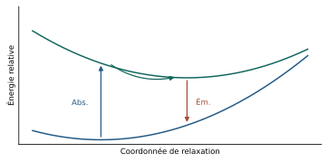

### Question 47 — Relier taille et position du premier pic

> [!INDICATION]
> Repérer le maximum local de plus grande longueur d’onde. Les épaules initiales sont peu nettes.

#### Solution

Les courbes deviennent lisibles à partir d’environ 12,5 min. Une lecture de la figure 19a donne :

| t (min) | 12,5 | 20 | 30 | 60 | 120 | 300 |
|---|---|---|---|---|---|---|
| d (nm) | 2,30 | 2,40 | 2,45 | 2,55 | 2,60 | 2,65 |
| λabs (nm), environ | 490 | 501 | 511 | 520 | 529 | 536 |

Une droite d’ajustement donne **λabs/nm ≃ 130 d/nm + 190** (les coefficients arrondis sont corrélés). Pour 2,3 et 2,65 nm, la droite donne environ 489 et 535 nm. Les courbes à 5 et 6,5 min présentent surtout des épaules et ne justifient pas une détermination précise. La relation est locale à ce matériau et à cet intervalle de tailles.

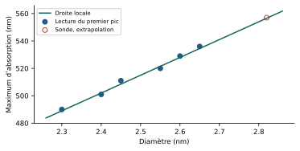

### Question 48 — Vieillissement et déplacement vers le bleu

> [!INDICATION]
> Relier λ plus courte à l’augmentation du gap optique.

#### Solution

Le décalage signifie que les particules absorbent des photons plus énergétiques. Une diminution de la taille du cœur CdTe actif, par exemple par oxydation ou dissolution superficielle lors du stockage, accentue le confinement et accroît le gap. La seule position du pic ne permet pas de distinguer ce mécanisme d’une modification de surface ou du milieu.

## Sonde multicouche de glucose

### Question 49 — Substrats transparents

> [!INDICATION]
> Comparer ordre cristallin et domaine de transparence.

#### Solution

Le quartz est SiO₂ cristallin. Un verre courant est un réseau de silice amorphe contenant notamment des oxydes de sodium et de calcium, tandis qu’un verre de silice est essentiellement SiO₂ amorphe. Ces substrats sont plans, transparents dans le visible, et portent des groupes silanol utiles à l’adsorption. Le quartz transmet plus loin dans l’UV. Le verre est pratique et moins coûteux pour une mesure visible.

### Question 50 — Organisation des trois blocs du film

> [!INDICATION]
> Lire la formule du substrat vers la solution.

#### Solution

Sur le support, les bicouches PAH/CdTe constituent le bloc interne luminescent. Les trois bicouches PAH/PSS forment l’espaceur qui sépare et stabilise les blocs actifs tout en permettant la diffusion des petites molécules. Les bicouches PAH/GOD constituent le bloc externe de reconnaissance enzymatique, accessible au glucose et à O₂. La dernière couche exposée est donc GOD.

### Question 51 — Préparer un litre de PBS

> [!INDICATION]
> Fixer explicitement la concentration totale en phosphate puisque seul le rapport est imposé.

#### Solution

Henderson donne [HPO₄²⁻]/[H₂PO₄⁻] = 10^(7,4−7,2) = 1,585. Par exemple, pour 10,0 mmol de phosphate dans 1 L, employer 6,13 mmol de Na₂HPO₄ et 3,87 mmol de NaH₂PO₄, soit respectivement 0,870 g et 0,464 g des sels anhydres. Ajouter 29,2 g de NaCl pour 0,50 mol/L comme dans le sujet. Dissoudre dans environ 800 mL d’eau, contrôler le pH, ajuster si nécessaire puis compléter à 1,000 L. Avec des sels hydratés recalculer les masses. À cette force ionique le contrôle au pH-mètre est préférable à l’hypothèse d’activités idéales.

### Question 52 — Charges des polymères

> [!INDICATION]
> Comparer pH à chacun des pKa avant d’attribuer un signe.

#### Solution

Le groupe ammonium du PAH a pKa = 8,5. À pH 7,4, [NH₃⁺]/[NH₂] ≃ 12,6, donc près de 93 % des sites sont protonés dans l’approximation de sites indépendants. Le PAH est polycationique. Pour le PSS, pKa < 0, les sulfonates –SO₃⁻ prédominent presque quantitativement. C’est un polyanion.

### Question 53 — Signe des particules et de l’enzyme

> [!INDICATION]
> La charge externe est celle des ligands de surface. Pour l’enzyme comparer pH et pI.

#### Solution

Le thiol du MPA fixe le ligand en surface du CdTe et les carboxyles exposés, pKa 4,3, sont déprotonés à pH 11,2. La particule est chargée négativement. Pour GOD, pH 7,4 > pI 4,2 : sa charge nette est négative. Les solutions dans leur ensemble sont électroneutres en comptant les contre-ions.

### Question 54 — Énergie de l’adsorption électrostatique

> [!INDICATION]
> Prendre E = 0 à grande distance et distinguer l’attraction de la répulsion à très courte portée.

#### Solution

Une surface et un polyion de signes contraires s’attirent. En solution saline, l’attraction décroît avec la distance d, approximativement comme −A exp(−κd) sous une géométrie plane simple. Très près de la surface, les répulsions de contact font remonter E. La somme présente un puits à distance finie. Le dépôt neutralise progressivement la charge, le puits devient moins profond puis la surcompensation inverse le signe de surface. Une nouvelle chaîne de même signe est alors repoussée et le polyion opposé peut être adsorbé à son tour. Le rinçage élimine l’excès libre.

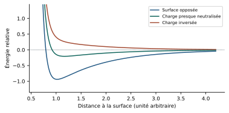

## Reconnaissance et dosage du glucose

### Question 55 — Deux anomères du glucose

> [!INDICATION]
> Repérer le carbone portant un OH et l’oxygène du cycle.

#### Solution

Le glucopyranose possède un hémiacétal cyclique en C1, des hydroxyles d’alcools secondaires et un alcool primaire en C6. Les formes α et β diffèrent exclusivement en C1, ce sont deux anomères, donc des diastéréoisomères. Intégrer en RMN ¹H les deux signaux résolus de H1, un proton par molécule, donne directement le rapport des populations. La polarimétrie est également possible si les rotations spécifiques des formes pures sont connues.

### Question 56 — Consommation sélective de β

> [!INDICATION]
> Distinguer composition instantanée et constante d’équilibre de mutarotation.

#### Solution

GOD consomme β, qui est continuellement reformé à partir de α par ouverture puis refermeture du cycle. L’équilibre de mutarotation se déplace dans le sens α → β à mesure que β est soustrait. La constante de cet équilibre à température fixée est inchangée. C’est analogue à une estérification entraînée par élimination continue de l’eau avec un montage de Dean–Stark.

### Question 57 — Oxydation en lactone

> [!INDICATION]
> Identifier le carbone anomérique comme celui qui devient carbonyle.

#### Solution

C₆H₁₂O₆ → C₆H₁₀O₆ + 2 H⁺ + 2 e⁻. La D-glucono-δ-lactone conserve le cycle à six chaînons. En C1 le groupe CH(OH) est remplacé par C=O et cet ester garde la liaison C1–O5 du cycle. Les autres centres stéréogènes sont conservés.

### Question 58 — Ouvrir la lactone

> [!INDICATION]
> Le carbone acylique reste dans l’acide et l’oxygène cyclique devient un alcool.

#### Solution

C₆H₁₀O₆ + H₂O → HOCH₂–(CHOH)₄–CO₂H. En catalyse acide aqueuse douce, protoner l’oxygène du C=O, faire attaquer H₂O en C1 avec montée de π sur O. Des échanges de protons placent H sur l’oxygène cyclique. Le tétraèdre se referme, la liaison C1–O5 se rompt vers O5 et la déprotonation finale régénère H⁺. En tampon neutre la fonction acide formée est surtout sous forme gluconate.

### Question 59 — Bilan des échanges avec le cofacteur

> [!INDICATION]
> Réécrire séparément réduction puis réoxydation du FAD.

#### Solution

β-glucose + FAD → glucono-δ-lactone + FADH₂. Puis FADH₂ + O₂ → FAD + H₂O₂. Enfin lactone + H₂O → acide gluconique. Le bilan est glucose + O₂ + H₂O → acide gluconique + H₂O₂. FAD et l’enzyme sont régénérés. En milieu tamponné, la dissociation de l’acide ajoute gluconate⁻ et H⁺ au bilan ionique.

### Question 60 — Taille du cœur de la sonde

> [!INDICATION]
> Lire l’épaulement d’absorption sur l’axe de gauche de la figure 24.

#### Solution

La première bande d’absorption se repère vers 550–565 nm, donc d ≃ (λabs/nm − 190)/130 ≃ 2,8–2,9 nm. Le pic intense vers 615–620 nm est l’émission et ne s’emploie pas dans cet étalonnage. L’épaulement peu marqué et l’extrapolation au-delà des 2,65 nm mesurés dominent l’incertitude. Le ligand, le solvant et la polydispersité changent aussi le spectre. Il s’agit d’un diamètre optique approché du cœur.

### Question 61 — Transformer une reconnaissance en signal optique

> [!INDICATION]
> Suivre H₂O₂ depuis le bloc GOD jusqu’au bloc CdTe.

#### Solution

Le glucose diffuse vers GOD et est oxydé avec consommation d’O₂. Le H₂O₂ formé traverse l’espaceur hydraté vers les CdTe immobilisés. La figure 25 montre qu’à 0,2 mmol/L de H₂O₂ l’émission décroît fortement avec le temps. Les interactions de surface du peroxyde favorisent des voies non radiatives ou altèrent la surface émissive. À temps, géométrie et excitation fixés, une calibration de la diminution de fluorescence en fonction du glucose permet sa quantification.

### Question 62 — Acteurs enzymatiques

> [!INDICATION]
> Identifier le partenaire reconnu spécifiquement lors de la première fixation.

#### Solution

E est la glucose oxydase et S le β-D-glucopyranose. Le O₂ sert à réoxyder le cofacteur lors du cycle catalytique.

### Question 63 — Loi du pré-équilibre

> [!INDICATION]
> Égaliser les deux flux rapides de fixation et dissociation.

#### Solution

k₁[E][S] ≃ k₋₁[ES], donc [ES] ≃ k₁[E][S]/k₋₁. L’étape lente produit P à la vitesse **v = k₂[ES] ≃ k₁k₂[E][S]/k₋₁**. Ici [E] est la concentration en enzyme libre.

### Question 64 — Vitesse en fonction de l’enzyme totale

> [!INDICATION]
> Écrire la conservation de l’enzyme et éliminer [E] libre.

#### Solution

Avec Kᴍ = k₋₁/k₁ dans l’hypothèse du pré-équilibre rapide, [E]₀ = [E] + [ES] = [ES](1 + Kᴍ/[S]). Donc v₀ = k₂[E]₀ [S]/(Kᴍ+[S]), avec vₘₐₓ = k₂[E]₀. [S] désigne le substrat libre initial, assimilable au substrat ajouté en large excès sur E. La formule plus générale du régime quasi stationnaire contient k₂ dans le numérateur de Kᴍ.

### Question 65 — Demi-saturation apparente

> [!INDICATION]
> Lire l’abscisse donnant la moitié du plateau mesuré et tenir compte de l’échelle en mM.

#### Solution

Sur la figure 27, le plateau vaut environ 91 %. Sa moitié, 45–46 %, se lit vers **7 à 8 mmol/L** de glucose. Avec l’assimilation demandée de la réponse optique à une loi de saturation, c’est un Kᴍ apparent exprimé en concentration totale de glucose. Il dépend du dispositif et des conditions de mesure.

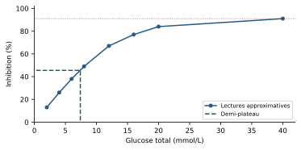

### Question 66 — Influence des nombres de couches

> [!INDICATION]
> Comparer d’abord les valeurs avant injection, puis normaliser chaque courbe à sa valeur initiale.

#### Solution

À nombre de couches GOD identique (3), passer de 12 à 15 couches de CdTe augmente le signal initial, d’environ 600 à plus de 900 unités, car davantage de centres émettent. Le signal absolu demeure plus élevé plus longtemps. À 12 couches CdTe, passer de 3 à 5 GOD augmente la quantité d’enzyme disponible et accélère ou accentue l’extinction relative, en lien avec la formation de H₂O₂. Toutes les sondes répondent après l’ajout à 4 mM. La comparaison des amplitudes doit tenir compte de leurs niveaux initiaux différents. Ce seul essai à une concentration ne fixe ni la sensibilité différentielle ni toute la plage linéaire.

## Cristaux de CdTe et CdS

### Question 67 — Contenu de la maille blende

> [!INDICATION]
> Compter séparément les sites du réseau cfc et les sites tétraédriques occupés.

#### Solution

Dans une maille cubique conventionnelle, placer Cd aux huit sommets et six centres de face, soit 8/8 + 6/2 = 4 Cd. Placer Te au centre de quatre des huit petits cubes de côté a/2, organisés en tétraèdre alterné (coordonnées en Q69). Les quatre Te sont intérieurs. La maille contient donc **4 CdTe** et chaque Cd a quatre Te voisins.

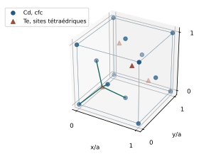

### Question 68 — Prendre le tellure comme origine

> [!INDICATION]
> Changer l’origine, puis ramener les coordonnées modulo un.

#### Solution

Translater l’origine de (¼,¼,¼), ancien emplacement d’un Te. Les Te forment maintenant le cfc des sommets et centres de face. Cd occupe la moitié complémentaire des sites tétraédriques, représentée par (¾,¾,¾) plus les translations cfc. Une inversion simultanée des trois axes permet aussi de choisir (¼,¼,¼) pour ce second motif.

### Question 69 — Positions réduites de la blende

> [!INDICATION]
> Utiliser les quatre translations du cfc pour les deux espèces.

#### Solution

En comptant chaque site une fois modulo les translations entières, Cd se trouve en (0,0,0), (0,½,½), (½,0,½), (½,½,0). Les Te sont en (¼,¼,¼), (¼,¾,¾), (¾,¼,¾), (¾,¾,¼). La base primitive est donc le couple Cd(0,0,0), Te(¼,¼,¼) sur réseau cfc. Sur un dessin fermé, compléter sommets et faces par leurs images aux coordonnées égales à 1.

### Question 70 — Que signifie ici « compact » ?

> [!INDICATION]
> Utiliser la tangence entre voisins de signes différents. Pour le prisme conventionnel, conserver c dans la formule du volume.

#### Solution

Pour CdTe, d = rCd+rTe = √3 a/4. Avec 144 et 138 pm on obtient a ≃ 651 pm et φ = 4(4π/3)(144³+138³)/a³ ≃ **0,341**. Pour CdS en wurtzite idéale, les coordonnées du sujet donnent un voisin à d = 3c/8 et trois voisins à d² = a²/3 + c²/64. Égaler les deux distances donne c/a = √(8/3), a = √(8/3) d et c = 8d/3. Avec d = 249 pm, a ≃ 407 pm et c ≃ 664 pm. La maille primitive a pour volume V = (√3/2)a²c et contient 2 CdS. Ainsi φ = 2(4π/3)(144³+105³)/V ≃ **0,365**. La formule de volume sans c de l’énoncé est erronée, comme le précise le jury.

Les sous-réseaux présentent les empilements cfc ou hexagonal dits compacts (ABC ou AB) avec occupation d’un tétraèdre sur deux. La compacité du cristal binaire dans ce modèle à rayons covalents est celle calculée ci-dessus. La valeur π/(3√2) ≃ 0,740 concerne un empilement monoatomique de sphères égales tangentes.

### Question 71 — Coordination et stabilité

> [!INDICATION]
> Décrire le voisinage immédiat de Cd indépendamment de l’empilement des plans.

#### Solution

Dans les deux structures, Cd est tétracoordonné à quatre anions en géométrie tétraédrique, et réciproquement. L’attraction électrostatique et la formation de liaisons à caractère covalent abaissent l’énergie par rapport à des ions isolés. Cd²⁺ est d¹⁰ : aucune stabilisation différentielle de champ cristallin n’est attendue au sens usuel pour une sous-couche d pleine.

### Question 72 — Nature de ces cristaux

> [!INDICATION]
> Comparer les électronégativités données à celles d’un couple très ionique.

#### Solution

Ce sont des semiconducteurs II–VI à réseau covalent polarisé, avec un caractère ionique. Les différences χ(S)−χ(Cd) = 2,58−1,69 = 0,89 et χ(Te)−χ(Cd) = 2,10−1,69 = 0,41 indiquent que CdS est plus polaire que CdTe. La liaison tétraédrique directionnelle et ces écarts modérés expliquent que la description en ions soit un modèle.

## Diffraction et diagramme binaire

### Question 73 — Changement de structure en diffraction

> [!INDICATION]
> Ignorer le pic Si du support et comparer les apparitions de raies de l’échantillon.

#### Solution

Entre x = 0,20 et 0,25, la distribution des raies change nettement tandis que le pic du support à 2θ ≃ 33° demeure. La transition blende riche en Te vers wurtzite plus riche en S se situe donc dans **0,20 à 0,25 de fraction de S** du sous-réseau chalcogène. Une notation indicative est CdS₀,₂₂Te₀,₇₈. La figure ne détermine pas un seuil plus précis ou l’absence de coexistence.

### Question 74 — Interférences entre plans atomiques

> [!INDICATION]
> Projeter l’écartement vertical sur les rayons incident puis réfléchi.

#### Solution

Pour des plans distants de d, et θ mesuré par rapport au plan, le rayon réfléchi sur le second plan parcourt d sin θ de plus à l’aller et autant au retour. Les interférences sont constructives lorsque **2d sin θ = nλ**, n entier positif. Une réflexion est géométriquement accessible si nλ ≤ 2d. Une réflexion autorisée par cette géométrie peut encore être éteinte par le facteur de structure.

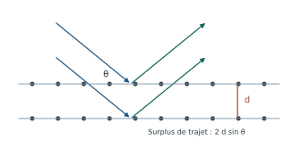

### Question 75 — Phases du binaire

> [!INDICATION]
> Comparer chaque extrémité à la structure de son composé pur, en tenant compte du rectificatif du rapport.

#### Solution

Le jury précise que la figure 32 concerne **CdTe–CdS**. Le domaine 1, au-dessus du liquidus, est un mélange liquide homogène. Dans le fuseau 2 entre liquidus et solidus coexistent un liquide et une solution solide de compositions différentes, lues aux extrémités d’une horizontale. Le domaine 3, pauvre en S, contient la solution solide de type **blende**, héritée du CdTe cubique. Le domaine 4, plus riche en S, correspond au type **wurtzite**, hérité du CdS hexagonal. Ces identifications suivent les structures limites et la diffraction, en corrigeant les désignations incohérentes de l’énoncé.

### Question 76 — Le minimum A et son titre massique

> [!INDICATION]
> Former une mole de mélange fictivement à partir des deux composés CdS et CdTe.

#### Solution

À A, xA ≃ 0,20. Le liquide et le solide ont la même composition au minimum de fusion et cette teneur est proche du changement de structure déduit de la diffraction. Le solide moyen est CdS₀,₂Te₀,₈. Avec M(CdS) = 144,5 g/mol et M(CdTe) = 240,0 g/mol, wA(CdS) = 0,20 × 144,5 / (0,20 × 144,5 + 0,80 × 240,0) ≃ **0,131**, soit 13,1 % en masse de CdS. La fraction massique de l’élément S seul vaudrait 2,9 %.

### Question 77 — Courbes de refroidissement

> [!INDICATION]
> À pression fixée, une composition globale donnée ne fixe pas la température dans un fuseau à deux phases.

#### Solution

À x = 0,7, la pente du refroidissement change à l’entrée dans le fuseau, vers 1 300 °C, puis à sa sortie, vers 1 110 °C. Entre les deux, la chaleur latente ralentit la chute de T. À x = 0,1, le tracé passe dans une zone de solidification très étroite près de 1 080 °C. Les deux ruptures sont difficilement séparables à l’échelle imprimée. À xA ≃ 0,20, le minimum de fusion congruente donne un palier vers 1 070 °C jusqu’à la disparition du liquide. Dans un binaire diphasé, F = 2−2+1 = 1 à pression fixée. Une composition spéciale identique dans les deux phases impose T au point congruent. Hors de la transition, la température descend jusqu’à 1 000 °C.

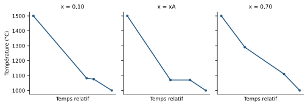

## Thermodynamique du liquidus

### Question 78 — Écrire l’équilibre du constituant Te

> [!INDICATION]
> Choisir le corps pur de chaque phase comme état de référence à la même température et pression.

#### Solution

μTe,s = μ*Te,s(T,p) + RT ln aTe,s et μTe,l = μ*Te,l(T,p) + RT ln aTe,l. À l’équilibre, μTe,s = μTe,l. Ainsi RT ln(aTe,l/aTe,s) = μ*Te,s − μ*Te,l. La dérivation demandée pour Te est une relation de corps modèle. Elle n’identifie pas Te élémentaire comme extrémité du diagramme CdTe–CdS corrigé en Q75.

### Question 79 — Intégrer Gibbs–Helmholtz

> [!INDICATION]
> Contrôler le signe en différentiant G/T à pression constante.

#### Solution

La relation exacte est ∂(μ*/T)/∂T = −H*/T². Le signe et la puissance de T doivent satisfaire cette identité, malgré la coquille signalée en annexe. En posant Tₘ = Tfus, H*(T) = Hₘ + Cp(T−Tₘ), avec Cp molaire supposé constant, l’intégration fournit

$$\frac{\mu^*(T)}T=\frac{\mu^*(T_m)}{T_m}+(H_m-C_pT_m)\left(\frac1T-\frac1{T_m}\right)-C_p\ln\frac{T}{T_m}.$$

Cette formule est valable séparément pour chaque phase. La limite T = Tₘ restitue la valeur de départ.

### Question 80 — Faire apparaître l’entropie

> [!INDICATION]
> Employer μ* = H* − TS* au point de référence.

#### Solution

En écrivant μ*(Tₘ)/Tₘ = Hₘ/Tₘ − Sₘ, la relation précédente devient

$$\mu^*(T)=H_m-TS_m+C_p\big[T-T_m-T\ln(T/T_m)\big].$$

C’est aussi le résultat de H(T)=Hₘ+Cp(T−Tₘ) et S(T)=Sₘ+Cp ln(T/Tₘ).

### Question 81 — Différence de potentiels standards

> [!INDICATION]
> Soustraire les deux expressions à T avant d’utiliser l’équilibre de fusion à Tₘ.

#### Solution

Poser ΔHₘ = Hₗ(Tₘ)−Hₛ(Tₘ) et ΔCp = Cp,l−Cp,s. À la fusion du corps pur, ΔSₘ = ΔHₘ/Tₘ. Il vient

$$\mu^*_l-\mu^*_s=\Delta H_m(1-T/T_m)+\Delta C_p\,[T-T_m-T\ln(T/T_m)].$$

Pour Te, ΔCp = 20,8−25,7 = −4,9 J mol⁻¹ K⁻¹ et ΔHₘ = 17,9 kJ mol⁻¹. Pour T inférieur à Tₘ et proche de ce point, le solide est bien la phase de plus bas potentiel.

### Question 82 — Relation de Schröder–van Laar

> [!INDICATION]
> Remplacer la différence de μ* de Q81 dans le bilan de Q78 avec son signe.

#### Solution

Pour des solutions idéales dans les deux phases, les activités deviennent les fractions molaires. On obtient

$$\ln\frac{x_{Te,l}}{x_{Te,s}}=\frac{\Delta H_m}{RT_m}\left(1-\frac{T_m}{T}\right)-\frac{\Delta C_p}{R}\left[1-\frac{T_m}{T}-\ln\frac{T}{T_m}\right].$$

Si le solide est pur, aTe,s = xTe,s = 1 et le membre gauche devient ln xTe,l pour un liquide idéal.

### Question 83 — Forme simplifiée

> [!INDICATION]
> Distinguer hypothèse sur les activités et approximation calorimétrique.

#### Solution

À pression fixée, supposer le solide pur et la solution liquide idéale (aTe,l = xTe,l). Négliger le terme en ΔCp, exactement nul si les capacités calorifiques coïncident, ou petit près de Tₘ. On a alors ln xTe = −(ΔHₘ/R)(1/T−1/Tₘ), soit T = [1/Tₘ − (R/ΔHₘ) ln xTe]⁻¹ avec T en kelvins.

### Question 84 — Tracé Python et cohérence de la branche

> [!INDICATION]
> Tester la pente et le point de fusion en x = 1 avant de confondre une courbe théorique avec C₁.

#### Solution

En prenant la formule littérale donnée pour Te, xTe = 1−xCdS. La sortie diminue vers 0 K quand xCdS tend vers 1 et reste inférieure à 449 °C. Elle ne peut donc pas être la branche **C₁ croissante vers environ 1 475 °C** de la figure 32. Le diagramme représente CdTe–CdS, avec une solution solide à composition variable. Les seules constantes fournies sont celles de Te élémentaire. Voici un code exécutable qui teste cette incohérence et représente C₁ par lecture du document. Les points de C₁ sont des lectures graphiques, avec une précision de l’ordre de quelques dizaines de degrés.

```python
import numpy as np
import matplotlib.pyplot as plt

x = np.linspace(0.20, 0.999, 400)
T_m = 449.0 + 273.15
R = 8.314
delta_H = 17_900.0
T_formel = 1 / (1 / T_m - R / delta_H * np.log(1 - x))
x_lu = np.array([0.20, 0.30, 0.40, 0.50, 0.60, 0.70, 0.80, 0.90, 1.00])
C1_lu = np.array([1070, 1080, 1110, 1160, 1220, 1280, 1350, 1420, 1475])
fig, ax = plt.subplots()
ax.plot(x, T_formel - 273.15, label="Modèle de Te pur fourni")
ax.plot(x_lu, C1_lu, "o-", label="Liquidus C1 lu sur la figure 32")
ax.set(xlabel="Fraction molaire de CdS", ylabel="Température (°C)")
ax.legend()
plt.show()
```

Un modèle quantitatif de C₁ requiert au minimum les données de fusion pertinentes pour le binaire CdS–CdTe et les activités dans les deux phases. Remplacer xTe par xCdS tout en gardant ΔHfus et Tfus de Te donnerait encore une température terminale erronée.

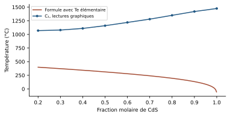
