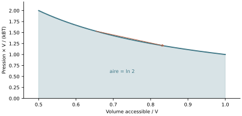
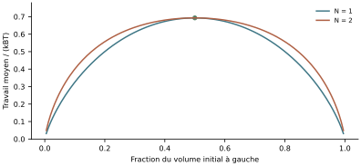
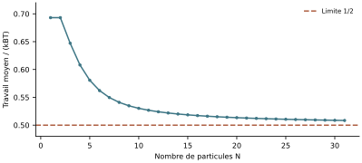
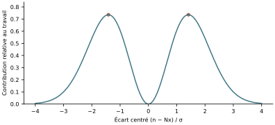
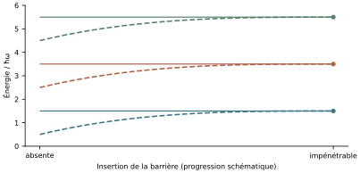
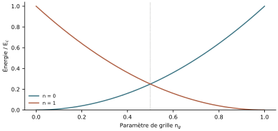

# Physique C — ENS PC 2023 · Corrigé guidé

*Corrigé rédigé par IA, non officiel.*

**Rédaction** · GPT-6.2 Astra Ultra · vitesse non renseignée

Le travail et la chaleur sont comptés positivement pour le système qui les reçoit. Une détente fournit donc du travail au mécanisme, tandis que l’effacement de sa mémoire lui en coûte. Ce choix de signe est conservé dans le traitement de l’expérience.

## 1 · Un moteur à une particule

### Question 1 — Pression d’une seule particule

> [!INDICATION]
> Appliquer l’équation d’état à une quantité de matière égale à une particule.

#### Solution

Pendant sa course, notons $v$ le volume accessible. Pour une molécule, la quantité de matière vaut $1/N_A$, donc $Pv=RT/N_A=k_BT$. Dans toute l’enceinte $P=k_BT/V$. Cette pression représente la moyenne temporelle des chocs utilisée par le sujet.

### Question 2 — Détente et travail du mécanisme

> [!INDICATION]
> Fixer d’abord le système qui reçoit le travail, puis le signe de la variation de volume.

#### Solution

Le volume accessible passe de $V/2$ à $V$. À vitesse suffisamment lente la pression extérieure compense la pression du gaz. Le travail reçu par la particule vaut $W_C=-\int_{V/2}^V(k_BT/v)\,\mathrm dv=-k_BT\ln2$. Le mécanisme reçoit le travail opposé. Les autres étapes ayant un travail négligeable, $W_m=k_BT\ln2$ par cycle.

### Question 3 — Premier principe sur le cycle

> [!INDICATION]
> L’énergie interne est une fonction d’état. Sur le cycle sa variation est nulle.

#### Solution

La particule reçoit $W=-W_m=-k_BT\ln2$. Son état final étant l’état initial, $\Delta U=0=W+Q$ et $Q=k_BT\ln2>0$. Le mécanisme a donc reçu en travail l’énergie prélevée au thermostat.

### Question 4 — Contradiction apparente avec le second principe

> [!INDICATION]
> Écrire l’inégalité de Clausius pour un cycle monotherme et y remplacer la chaleur calculée.

#### Solution

Le bilan naïf de la particule cyclique serait $0=\Delta S=Q/T+S_{\rm créée}$ avec $S_{\rm créée}\geq0$. Or $Q/T=k_B\ln2>0$. La création déduite serait négative. Cette description néglige l’acquisition de l’information nécessaire au choix du sens du mouvement du piston.

### Question 5 — Énergie interne

> [!INDICATION]
> Compter les termes quadratiques de l’énergie cinétique.

#### Solution

En trois dimensions, l’énergie cinétique moyenne d’une particule monoatomique classique est $U=\tfrac32 k_BT$, soit $k_BT/2$ pour chacune des trois composantes quadratiques de vitesse.

### Question 6 — Entropie pendant la détente

> [!INDICATION]
> Justifier la réversibilité avant de remplacer un échange de chaleur par $T\Delta S$.

#### Solution

La température imposée est la même aux deux extrémités. Comme $U$ ne dépend que de $T$, $\Delta U_C=0$ et $Q_C=-W_C=k_BT\ln2$. La détente isotherme est réversible, d’où $\Delta S_C=Q_C/T=k_B\ln2$.

### Question 7 — Insertion et localisation

> [!INDICATION]
> Le premier principe suffit même si l’entropie conditionnée par la mesure change.

#### Solution

La température demeure $T$, donc $\Delta U_{AB}=0$. Le mécanisme ne fournit pas de travail en $A$ ni en $B$. Le premier principe donne alors $Q_{AB}=0$.

### Question 8 — La mesure réduit l’incertitude

> [!INDICATION]
> Raisonner sur les entropies des états avant insertion et après localisation.

#### Solution

L’étape $D$ retire la paroi arrivée au bord et laisse l’état accessible inchangé. Le cycle impose donc $\Delta S_{AB}=-\Delta S_C=-k_B\ln2$. Avec $Q_{AB}=0$, attribuer cette variation à une création d’entropie de la seule particule donnerait une valeur négative. La position a été enregistrée et l’état décrit est désormais conditionné par ce résultat.

## 2 · Une mémoire pour refermer le cycle

### Question 9 — Réinitialisation du bit

> [!INDICATION]
> Inverser les bornes de la détente de la question 2.

#### Solution

L’opération $R1$ a un travail négligeable. Pendant $R2$, la compression quasi statique de la particule de mémoire de $v$ à $v/2$ lui fournit $W_{\rm init}=-\int_v^{v/2} k_BT\,\mathrm dv'/v'=+k_BT\ln2$. C’est le travail effectué par le mécanisme sur la mémoire.

### Question 10 — Travail net du mécanisme

> [!INDICATION]
> Additionner les échanges avec les deux particules, en gardant le même sens de comptage.

#### Solution

Le mécanisme de la machine complète reçoit $k_BT\ln2$ de la particule lors de la détente et cède $k_BT\ln2$ à la mémoire lors de la remise à zéro. Le travail net reçu est nul dans la limite réversible.

### Question 11 — Chaleur reçue par la mémoire

> [!INDICATION]
> Pour la particule de mémoire, utiliser sa variation d’énergie et le travail fourni en compression.

#### Solution

Entre début et fin de la réinitialisation, la particule de mémoire retrouve la même température et donc la même énergie interne. Ainsi $Q_R=-W_{\rm init}=-k_BT\ln2$. Le thermostat reçoit cette quantité en valeur absolue.

### Question 12 — Second principe pour le système étendu

> [!INDICATION]
> Choisir comme système les deux enceintes et la mémoire réinitialisée.

#### Solution

La chaleur reçue sur un cycle par la machine complète est $Q_C+Q_R=0$. La mémoire revient à l’état 0 et le gaz à son état initial. Cette fois $\Delta S_{\rm machine}=0$ et $\Delta S_{\rm thermostat}=-Q_{\rm total}/T=0$. Le fonctionnement idéal respecte le second principe à la limite réversible.

### Question 13 — Effacement à vitesse finie

> [!INDICATION]
> Distinguer la variation d’une fonction d’état du chemin effectivement suivi.

#### Solution

L’entropie d’état de la mémoire lors de $R2$ diminue de $k_B\ln2$ entre les états d’équilibre à la même température. Même pour une compression rapide on peut calculer cette variation par un chemin réversible fictif. Pour la transformation réelle $\Delta S=Q_R/T+S_{\rm créée}$ et $S_{\rm créée}>0$ en présence de dissipation. Après retour à $T$, $W_{\rm init}=-Q_R=k_BT\ln2+TS_{\rm créée}>k_BT\ln2$.

### Question 14 — Effacement d’un gigaoctet

> [!INDICATION]
> Convertir les octets en bits et choisir une durée pour comparer énergie et puissance.

#### Solution

Pour $8\times10^9$ bits indépendants à $T=300\ \mathrm K$, la borne de Landauer est $E_{\min}=8\times10^9 k_BT\ln2\simeq2{,}3\times10^{-11}\ \mathrm J$. Un ordinateur de puissance typique $100\ \mathrm W$ consomme $100\ \mathrm J$ en une seconde. La borne correspond à environ $2{,}3\times10^{-13}\ \mathrm s$ de ce fonctionnement. Les pertes de l’électronique usuelle dépassent largement cette limite fondamentale.

### Question 15 — Transférer un état connu

> [!INDICATION]
> Une deuxième paroi permet de déplacer tout le compartiment occupé à volume constant.

#### Solution

La particule étant certainement dans la moitié droite, introduire une deuxième paroi mobile à la paroi extérieure droite. Déplacer ensemble les deux parois d’une demi-longueur vers la gauche, en gardant constante la distance entre elles et en opérant lentement. Les travaux de la compression d’un côté et de la détente de l’autre se compensent à pression égale. Retirer la paroi arrivée au bord gauche. Le compartiment occupé est maintenant à gauche, pour un travail net nul. Cette translation suppose connue la valeur initiale. Une remise à zéro universelle doit opérer sur 0 comme sur 1. Mesurer à nouveau le bit pour choisir le protocole crée un nouvel enregistrement à effacer.

## 3 · Une cloison dans un gaz de N particules

### Question 16 — Équilibre de la paroi

> [!INDICATION]
> Utiliser à la fois l’égalité des pressions et la conservation du volume total.

#### Solution

Avec $n=N_G$ et $N_D=N-n$, l’équilibre impose $nk_BT/V_{G,e}=(N-n)k_BT/V_{D,e}$ et $V_{G,e}+V_{D,e}=V$. Ainsi $V_{G,e}=nV/N$ et $V_{D,e}=(N-n)V/N$. Si un côté est vide, le piston atteint le bord et le côté occupé prend tout le volume.

### Question 17 — Travail pour une répartition donnée

> [!INDICATION]
> Intégrer chaque pression sur la variation de son propre volume et additionner les travaux du mécanisme.

#### Solution

Le mécanisme reçoit la somme des travaux fournis par les gaz. Sur chaque côté la contribution réversible vaut $N_i k_BT\ln(V_{i,e}/V_{i,0})$. Donc, pour $0<n<N$,
$$W_m(n)=k_BT\left[n\ln\frac n{Nx}+(N-n)\ln\frac{N-n}{N(1-x)}\right].$$
Pour $n=0$ seul le gaz de droite se détend et $W_m=Nk_BT\ln[1/(1-x)]$. Pour $n=N$ on obtient $Nk_BT\ln(1/x)$. La convention $0\ln0=0$ réunit ces cas. L’équilibre initial $n=Nx$ donne zéro.

### Question 18 — Position d’une particule au moment de l’insertion

> [!INDICATION]
> Avant la cloison, deux sous-volumes égaux ont la même probabilité d’être occupés.

#### Solution

La densité d’équilibre est uniforme dans le volume initial. Le rapport du volume de gauche au volume total vaut $x$, donc $p_G=x$, $p_D=1-x$.

### Question 19 — Deux particules

> [!INDICATION]
> Distinguer les deux configurations microscopiques donnant une particule à gauche.

#### Solution

Par indépendance, $P(0)=(1-x)^2$, $P(1)=2x(1-x)$ et $P(2)=x^2$. Le facteur deux distingue les deux façons de disposer une particule de chaque côté. La somme est $[(1-x)+x]^2=1$.

### Question 20 — Loi du nombre de particules à gauche

> [!INDICATION]
> Choisir les particules passées à gauche, puis multiplier les probabilités individuelles.

#### Solution

Chaque particule suit une épreuve de Bernoulli de paramètre $x$. Les $\binom Nn$ choix des particules de gauche ont tous la probabilité $x^n(1-x)^{N-n}$. Par conséquent $P(n)=\binom Nn x^n(1-x)^{N-n}$ pour $0\le n\le N$.

### Question 21 — Travail moyen

> [!INDICATION]
> Il s’agit d’une espérance, les états macroscopiques ne sont pas équiprobables.

#### Solution

La variable $W_m$ prend la valeur $W_m(n)$ avec la probabilité précédente. Ainsi $\overline W_m=\sum_{n=0}^N\binom Nn x^n(1-x)^{N-n}W_m(n)$. La loi binomiale est déjà normalisée.

### Question 22 — Choisir la position de la cloison

> [!INDICATION]
> Réunir les termes en $\ln x$ et en $\ln(1-x)$ avant de dériver pour deux particules.

#### Solution

Notons $H(x)=-x\ln x-(1-x)\ln(1-x)$. Pour une particule $\overline W_m/(k_BT)=H(x)$ et $H'=\ln[(1-x)/x]$ s’annule au maximum $x=1/2$.
Pour deux particules, la somme des trois cas se simplifie en $F_2(x)=2H(x)-4x(1-x)\ln2$. La symétrie assure $F'_2(1/2)=0$. Or $F''_2(x)=-2/[x(1-x)]+8\ln2\le -8+8\ln2<0$. Le point $1/2$ est l’unique maximum, là encore.

### Question 23 — Lecture du graphe pour la cloison médiane

> [!INDICATION]
> Considérer à la fois la fluctuation du nombre de particules et sa taille relative au nombre total.

#### Solution

La figure 2 commence vers $\overline W_m/(k_BT)=0{,}69=\ln2$ pour $N=1$. On retrouve la partie 1. Pour de plus grands $N$, le déséquilibre relatif entre les deux côtés diminue en ordre de grandeur comme $1/\sqrt N$, ce qui réduit la course relative du piston. Ce raisonnement suggère la tendance mais ne démontre pas une décroissance stricte d’un entier au suivant. Les deux premières valeurs sont égales.

### Question 24 — Comparer une et deux particules

> [!INDICATION]
> Un état équilibré sur deux compense le doublement du travail des états déséquilibrés.

#### Solution

À $x=1/2$, une particule fournit toujours $k_BT\ln2$. Avec deux particules, elles sont du même côté une fois sur deux et fournissent alors $2k_BT\ln2$. Dans l’autre moitié des cas la paroi est équilibrée et ne fournit rien. La moyenne reste $k_BT\ln2$.

### Question 25 — Centre et variance de la gaussienne

> [!INDICATION]
> Les variances des indicatrices indépendantes s’ajoutent.

#### Solution

Écrire $N_G=\sum_{i=1}^N X_i$ avec $X_i=0$ ou 1, $\langle X_i\rangle=x$ et $\operatorname{var}X_i=x(1-x)$. L’indépendance donne $\overline N_G=Nx$ et $\sigma=\sqrt{Nx(1-x)}$.

### Question 26 — Développement autour du point d’équilibre

> [!INDICATION]
> C’est le premier terme non nul du travail qui compte. Le terme linéaire s’annule à l’équilibre mécanique.

#### Solution

Le petit écart absolu à comparer à $Nx$ et $N(1-x)$ est $d=n-Nx$, comme le précise le jury à propos de la dernière phrase de l’énoncé. À $n=Nx$, $W_m=0$ et $W'_m/(k_BT)=\ln[n(1-x)/(x(N-n))]=0$. La dérivée seconde réduite vaut $1/n+1/(N-n)$, soit $1/\sigma^2$ au centre. Ainsi $W_m\simeq k_BT d^2/(2\sigma^2)$. En multipliant par la densité gaussienne,
$$f(n)\simeq C d^2\,e^{-d^2/(2\sigma^2)},\qquad C=\frac{k_BT}{2\sqrt{2\pi}\,\sigma^3}.$$

### Question 27 — Les deux maximums de la contribution au travail

> [!INDICATION]
> Dériver le produit de la gaussienne et de $d^2$ puis interpréter leurs rôles opposés.

#### Solution

Pour $x=1/2$, le centre est $N/2$. La courbe est paire en $d$, nulle au centre et dans les queues. Sa dérivée est proportionnelle à $d(2-d^2/\sigma^2)e^{-d^2/(2\sigma^2)}$. Les deux sommets se situent en $d=\pm\sqrt2\,\sigma$. Près du centre, les états sont probables mais fournissent peu de travail. Très loin, le travail est grand mais les états sont rares.

### Question 28 — Limite pour un grand nombre de particules

> [!INDICATION]
> Utiliser le moment quadratique de la loi normale plutôt que réintégrer toute la distribution.

#### Solution

Pour $x$ fixé dans $(0,1)$, les extrémités sont loin du centre par rapport à $\sigma$. La somme devient une intégrale. Le moment d’ordre deux de la gaussienne centrée est $\sigma^2$, d’où $\overline W_m\to k_BT\,\langle d^2\rangle/(2\sigma^2)=k_BT/2$. La valeur finie est inférieure à $k_BT\ln2$ et s’accorde avec la tendance de la figure 2.

### Question 29 — Pourquoi la limite ne dépend pas de la position initiale

> [!INDICATION]
> Examiner séparément le poids statistique des écarts et le travail qu’ils permettent de tirer du gaz.

#### Solution

Le rapprochement d’une extrémité réduit la variance des fluctuations du nombre à gauche, $\langle d^2\rangle=Nx(1-x)$. Mais la même fluctuation absolue y produit un déséquilibre mécanique plus important, et le coût quadratique vaut $k_BT/[2Nx(1-x)]$ par unité de $d^2$. Le produit d’une variance réduite et d’une réponse plus forte est indépendant de $x$. Cette compensation suppose les deux populations moyennes grandes.

## 4 · Une particule dans un piège quantique

### Question 30 — Fonction de partition de l’oscillateur

> [!INDICATION]
> Sortir le facteur du fondamental puis sommer les probabilités non normalisées.

#### Solution

Notons $\varepsilon=\hbar\omega$ et $X=\beta\varepsilon$. La normalisation donne une série géométrique, $Z=\sum_{n\ge0}\exp[-X(n+1/2)]=e^{-X/2}/(1-e^{-X})=[2\sinh(X/2)]^{-1}$.

### Question 31 — Énergie moyenne

> [!INDICATION]
> Dériver le logarithme de la somme de Boltzmann par rapport à l’inverse de la température.

#### Solution

Comme $\partial_\beta Z=-\sum_n E_n e^{-\beta E_n}$, on a $U=-\partial_\beta\ln Z$. La question 30 donne $U=(\varepsilon/2)\coth(X/2)$.

### Question 32 — Limite de basse température

> [!INDICATION]
> À basse température le premier niveau excité est très peu peuplé.

#### Solution

Pour $T\to0$, $X\to+\infty$ et $\coth(X/2)\to1$. L’énergie tend vers $\hbar\omega/2$, énergie du fondamental quantique. La particule conserve l’énergie de point zéro.

### Question 33 — Limite classique

> [!INDICATION]
> Il est demandé un équivalent de l’énergie. Utiliser le premier terme du développement de la cotangente hyperbolique.

#### Solution

Pour $T\to\infty$, $X\to0$ et $\coth(X/2)\sim2/X$, donc $U\sim k_BT$. L’espacement $\hbar\omega$ devient petit devant $k_BT$. Les deux termes quadratiques classiques, cinétique et potentiel harmonique, fournissent chacun $k_BT/2$.

### Question 34 — Entropie en fonction de X

> [!INDICATION]
> Faire apparaître la moyenne de l’énergie et la normalisation de la probabilité.

#### Solution

Comme $\ln P_n=-\beta E_n-\ln Z$, on obtient $S=k_B(\beta U+\ln Z)$. En remplaçant les deux quantités,
$$S=k_B\left[\frac X2\coth(X/2)-\ln(2\sinh(X/2))\right].$$
L’entropie tend vers zéro pour un fondamental non dégénéré à température nulle.

### Question 35 — Spectre lorsque la barrière devient impénétrable

> [!INDICATION]
> Compter aussi les branches horizontales, qui représentent chacune un état propre.

#### Solution

Sur la figure 3, les branches horizontales restent aux énergies $3\varepsilon/2,7\varepsilon/2,11\varepsilon/2,\ldots$ des états impairs. Chacune reçoit d’en dessous une branche montante. La limite est doublement dégénérée,
$$E_{2j}^{(b)}=E_{2j+1}^{(b)}=(2j+3/2)\varepsilon,\qquad j=0,1,\ldots.$$

### Question 36 — États impairs et nœud en zéro

> [!INDICATION]
> La parité du polynôme préexponentiel fixe la valeur au centre.

#### Solution

Quand $m$ est impair, $\phi_m$ est impaire et $\phi_m(0)=0$. Elle satisfait sur les deux demi-axes l’équation de l’oscillateur et satisfait déjà la condition imposée par la barrière. Son énergie $E_m=(m+1/2)\varepsilon$ figure bien dans les doublets de la question 35 pour $m=2j+1$.

### Question 37 — Oscillateur équivalent et dégénérescence

> [!INDICATION]
> Comparer l’espacement puis l’ordonnée du niveau fondamental.

#### Solution

Un oscillateur de pulsation $2\omega$ a les niveaux $(j+1/2)2\hbar\omega=(2j+1)\varepsilon$. Ajouter $\varepsilon/2$ donne exactement $(2j+3/2)\varepsilon$. Chaque valeur de la machine avec barrière est présente deux fois, car le mouvement peut se situer dans l’un ou l’autre demi-puits.

### Question 38 — Énergie après insertion

> [!INDICATION]
> Utiliser le spectre de l’oscillateur équivalent puis ajouter le décalage d’énergie.

#### Solution

La somme de partition est $Z_b=2e^{-3X/2}/(1-e^{-2X})$. Ou encore $Z_b=2e^{-X/2}/[2\sinh X]$. L’énergie est donc $U_b=-\partial_\beta\ln Z_b=\varepsilon/2+\varepsilon\coth X$. La dégénérescence constante disparaît de cette dérivée.

### Question 39 — Entropie après insertion

> [!INDICATION]
> Le facteur deux de la fonction de partition n’affecte pas l’énergie moyenne, mais affecte la normalisation de l’entropie.

#### Solution

À chaque énergie, les deux demi-puits sont équiprobables. On a $S_b=k_B(\beta U_b+\ln Z_b)=k_B[X\coth X-\ln(2\sinh X)+\ln2]$. Le décalage commun d’énergie s’élimine tandis que la dégénérescence apporte $k_B\ln2$.

### Question 40 — Travail et chaleur d’insertion

> [!INDICATION]
> Pour une transformation réversible isotherme le travail reçu est la variation de l’énergie libre.

#### Solution

L’insertion isotherme réversible donne $W_{\rm ins}=\Delta F=-k_BT\ln(Z_b/Z)$ et $Q_{\rm ins}=T(S_b-S)$. Or $Z_b/Z=2/(1+e^X)$, donc
$$W_{\rm ins}=k_BT\ln\frac{1+e^X}{2},\qquad U_b-U=-\partial_\beta\ln(Z_b/Z)=\varepsilon\frac{e^X}{1+e^X}.$$
Puis $Q_{\rm ins}=\varepsilon e^X/(1+e^X)-k_BT\ln[(1+e^X)/2]$. Le travail à fournir est positif. La barrière pousse les niveaux pairs vers le haut.

### Question 41 — Spectre du côté gauche

> [!INDICATION]
> Restreindre une fonction qui possède déjà un nœud à l’emplacement de la barrière.

#### Solution

La restriction de chaque fonction propre impaire $\phi_{2j+1}$ au demi-axe négatif satisfait l’équation sur $x<0$, s’annule en zéro et reste normalisable. Après renormalisation elle est un état admissible d’énergie $(2j+3/2)\varepsilon$. L’énoncé admet que cette liste est exhaustive.

### Question 42 — Énergie après détection

> [!INDICATION]
> Diviser la partition par deux puis prendre la dérivée logarithmique.

#### Solution

La mesure conditionne l’état au côté gauche. Les niveaux distincts restent les mêmes, mais leur dégénérescence par choix du côté disparaît. $Z_d=Z_b/2$. Ainsi $U_d=-\partial_\beta\ln Z_d=U_b=\varepsilon/2+\varepsilon\coth X$.

### Question 43 — Entropie de l’état conditionné

> [!INDICATION]
> Une mesure localise la particule sans changer les proportions relatives entre les niveaux du demi-puits.

#### Solution

$S_d=k_B[X\coth X-\ln(2\sinh X)]$, donc $S_d-S_b=-k_B\ln2$. L’information « à gauche » supprime une alternative binaire équiprobable en conservant la distribution des énergies à l’intérieur de ce côté.

### Question 44 — Détente finale et retrait de la barrière

> [!INDICATION]
> Utiliser les partitions correspondant aux états immédiatement avant et après la course de la barrière.

#### Solution

Le déplacement réversible isotherme va du demi-puits détecté à l’oscillateur initial. Le travail reçu par la particule vaut $W_{\rm dep}=F-F_d=k_BT\ln(Z_d/Z)$. Or $Z_d/Z=1/(1+e^X)$, donc $W_{\rm dep}=-k_BT\ln(1+e^X)$.

### Question 45 — Travail sur le cycle quantique

> [!INDICATION]
> Isoler les deux logarithmes et simplifier leur quotient.

#### Solution

Avec $W_{\rm det}=0$, la somme des questions 40 et 44 donne $W=W_{\rm ins}+W_{\rm dep}=-k_BT\ln2$. C’est le même travail reçu par la particule que dans la version classique. Les coûts des deux mouvements diffèrent, mais le cycle exploite une même information binaire équiprobable. La réinitialisation de la mémoire reste à inclure pour un cycle du dispositif complet.

## 5 · Une réalisation avec un électron

### Question 46 — Courant télégraphique et rétroaction

> [!INDICATION]
> Repérer l’état du courant juste avant chaque pointillé et le sens de l’échelon de commande juste après.

#### Solution

Les plateaux d’environ $8$ et $18\ \mathrm{pA}$ correspondent aux deux puits. Selon la légende du détecteur, le courant fort signale un électron proche, donc à gauche. Les transitions rapides entre les plateaux sont des sauts de l’électron, sur lesquels se superpose un bruit de mesure. Au début de chaque cycle on abaisse rapidement l’énergie du puits occupé. Sur les cycles de la figure 5, le courant faible est suivi d’un échelon de $n_g$ vers $0{,}32$, le fort d’un échelon vers $0{,}66$. Le retour progressif à $n_g=1/2$ rétablit la symétrie et favorise les sauts en fin de séquence.
Il existe une discordance de notation dans l’original. La figure et le paragraphe de la question 46 associent le puits gauche à la valeur haute de $n_g$. La définition imprimée de $n$ à la question 47 lui associe au contraire un minimum pour la valeur basse. Nous donnons le bilan algébrique de 47–48 dans sa convention imprimée et la lecture expérimentale dans celle de la figure. Le changement $n_g\mapsto1-n_g$ réconcilie les deux.

### Question 47 — Énergies du condensateur dans la convention imprimée

> [!INDICATION]
> Remplacer $n$ successivement par 0 et 1 avant toute interprétation des étiquettes.

#### Solution

L’énergie d’un condensateur de charge $q$ vaut $q^2/(2C_0)$. Ici $E(n)=E_c(n-n_g)^2$, $E_c=q_e^2/(2C_0)$. Avec $n=0$ à gauche et $n=1$ à droite tels qu’ils sont imprimés dans cette question,
$$E_G=E_c n_g^2,\qquad E_D=E_c(1-n_g)^2.$$
Les courbes se croisent à $n_g=1/2$. Le simple échange des étiquettes des deux puits retrouve la convention descriptive de la figure 5.

### Question 48 — Énergie d’un saut

> [!INDICATION]
> Soustraire l’énergie initiale de l’énergie finale au même instant.

#### Solution

Le changement gauche vers droite vaut $E_D-E_G=E_c(1-2n_g)$ avec les conventions de 47. Le saut inverse donne $E_c(2n_g-1)$. Leur somme à commande inchangée est nulle. Ces sauts fournissent la chaleur reçue par l’électron. Le travail de commande intervient entre les sauts.

### Question 49 — Signe moyen de la chaleur et du travail

> [!INDICATION]
> Regrouper les sauts par excursions dans le puits le plus haut et suivre l’écart entre les puits.

#### Solution

Juste après la rétroaction, le puits occupé est le plus bas. Pendant le retour lent l’écart positif $\Delta(t)$ entre puits décroît. Un saut de ce puits vers le haut absorbe $\Delta(t_a)$, puis un retour ultérieur restitue au plus $\Delta(t_b)<\Delta(t_a)$. S’il n’y a pas de retour, l’absorption du premier saut reste entière. Sans saut le bilan est nul. Les séquences ordinaires ont donc une chaleur moyenne positive. Comme les deux puits ont la même énergie commune aux extrémités, $\Delta E=0$ sur le cycle et $\overline W=-\overline Q<0$.

### Question 50 — Chaleur à l’échelle de la figure expérimentale

> [!INDICATION]
> Lire le paramètre au moment des changements de plateau, puis comparer au produit $k_BT$ en unités d’énergie.

#### Solution

Près du retour à la symétrie, par exemple pour $n_g\simeq0{,}45$ ou $0{,}55$, un saut transfère en module $E_c|1-2n_g|\simeq10\ \mu\mathrm{eV}$. Deux sauts rapprochés de sens contraires se compensent largement. Les derniers sauts ainsi que la différence des écarts au cours des excursions donnent une chaleur de cycle de l’ordre de quelques à une dizaine de $\mu\mathrm{eV}$ sur les séquences visibles. La lecture bruitée ne permet pas de sommer exactement tous les sauts.
À $T=0{,}10\ \mathrm K$, $k_BT\simeq8{,}6\ \mu\mathrm{eV}$ et $k_BT\ln2\simeq6{,}0\ \mu\mathrm{eV}$. Les ordres de grandeur sont compatibles.

### Question 51 — Pic principal de travail

> [!INDICATION]
> Lire la position horizontale du sommet et vérifier l’unité portée sur l’axe.

#### Solution

L’histogramme de la figure 6 place le maximum principal près de $W/(k_BT)\sim-0{,}6$ à $-0{,}7$. La prédiction idéale est $-\ln2\simeq-0{,}69$. Les dispositifs diffèrent, mais une information d’un bit commande la rétroaction dans chacun. Cette proximité est plausible. La position d’un maximum et la moyenne ne sont toutefois pas identiques pour une distribution asymétrique.

### Question 52 — Événements rares à travail positif

> [!INDICATION]
> Examiner séparément une erreur de lecture et une lecture juste devenue périmée au moment de l’action.

#### Solution

Un bruit du détecteur peut faire choisir le mauvais puits. Même avec une lecture correcte, l’électron peut changer de côté entre lecture et action, ou pendant la commutation rapide. Dans les deux situations le système relève l’énergie du puits réellement occupé. La commande fournit alors du travail positif, ce qui alimente la petite bosse vers $W/(k_BT)\sim2$ à $3$.

### Question 53 — Probabilités à l’équilibre

> [!INDICATION]
> Normaliser les deux facteurs avant de les employer dans une moyenne.

#### Solution

Avec $\beta=1/(k_BT)$ et $Z(t)=e^{-\beta E_G(t)}+e^{-\beta E_D(t)}$, les probabilités instantanées d’équilibre sont $p_G=e^{-\beta E_G}/Z$ et $p_D=e^{-\beta E_D}/Z=1-p_G$. L’état juste après la sélection à gauche est un état conditionné et n’est pas, en général, cet équilibre instantané.

### Question 54 — Durée de relaxation et évolution lente

> [!INDICATION]
> Distinguer la perte de mémoire de l’état initial et le suivi d’un équilibre qui se déplace.

#### Solution

L’électron échange de la chaleur avec le thermostat à température $T$, par les transitions entre les puits. Après un temps grand devant le temps de relaxation $\tau$ (temps d’oubli de la localisation initiale), la distribution rejoint l’équilibre. En outre la commande doit varier sur un temps grand devant $\tau$ pour que la distribution puisse suivre l’équilibre de chaque profil. Le signe de la différence des taux indique le sens favorisé mais ne donnerait pas à lui seul la formule canonique exacte.

### Question 55 — Travail du basculement rapide

> [!INDICATION]
> Pendant cette étape la position occupée est connue, même si les deux niveaux d’énergie changent.

#### Solution

Le cycle sélectionné part à gauche, $E_G(0)=E_0$. Si la rampe initiale est rapide devant les sauts, l’électron y demeure et $W(0,t_1)=E_G(t_1)-E_0=E_{\min}-E_0<0$. Le minimum est atteint à la fin de la rampe, en $t_1$, comme le précise la description du retour lent dans l’énoncé.

### Question 56 — Travail moyen de la rampe lente

> [!INDICATION]
> Différencier la somme des facteurs de Boltzmann à température fixée.

#### Solution

À l’ordre un en $\mathrm dt$, le travail moyen reçu est $\mathrm d\overline W=p_G\,\mathrm dE_G+p_D\,\mathrm dE_D$. Un saut n’ajoute pas de travail et sa coïncidence avec une variation infinitésimale du niveau n’affecte que l’ordre deux. À l’équilibre canonique, $\mathrm d\ln Z=-\beta(p_G\,\mathrm dE_G+p_D\,\mathrm dE_D)$. Pour la partie quasi statique,
$$\overline W(t,t')=-k_BT\ln\frac{Z(t')}{Z(t)}=F(t')-F(t).$$

### Question 57 — Travail moyen du cycle réalisé

> [!INDICATION]
> Additionner la rampe rapide et la différence des énergies libres, puis seulement prendre la limite de basse température.

#### Solution

À la fin $Z_f=2e^{-\beta E_0}$. Après la rampe initiale $Z_1=e^{-\beta E_{\min}}(1+e^{-\beta(E_{\max}-E_{\min})})$. L’éventuelle relaxation initiale échange une chaleur à commande quasi fixe. La somme du travail rapide et du travail quasi statique donne
$$\overline W=k_BT\ln\frac{1+e^{-\beta(E_{\max}-E_{\min})}}2.$$
Lorsque $E_{\max}-E_{\min}\gg k_BT$, cette valeur tend vers $-k_BT\ln2$. La rétroaction a extrait le travail attendu pour une information binaire fiable. Les erreurs rares et la vitesse finie peuvent en réduire le rendement.

### Question 58 — Vérifier les deux principes avec les probabilités

> [!INDICATION]
> Décomposer la variation de l’énergie moyenne suivant ce qui varie, niveaux ou populations, puis employer la distribution canonique pour le bilan d’entropie.

#### Solution

L’énergie moyenne est $\overline E=p_GE_G+p_DE_D$. Sa différentielle exacte est
$$\mathrm d\overline E=\underbrace{p_G\,\mathrm dE_G+p_D\,\mathrm dE_D}_{\delta\overline W}+\underbrace{E_G\,\mathrm dp_G+E_D\,\mathrm dp_D}_{\delta\overline Q}.$$
En effet $\mathrm dp_D=(p_G\Gamma_+-p_D\Gamma_-)\mathrm dt=-\mathrm dp_G$, et le second terme est l’énergie moyenne des sauts $(E_D-E_G)(p_G\Gamma_+-p_D\Gamma_-)\mathrm dt$. L’intégration donne (16) y compris hors équilibre.
Pour la seconde relation, il faut une évolution réversible à température constante et des probabilités canoniques instantanées. De $\sum_i\mathrm dp_i=0$ et $\ln p_i=-\beta E_i-\ln Z$, on déduit $\mathrm dS=-k_B\sum_i\ln p_i\,\mathrm dp_i=\delta\overline Q/T$. Le résultat intégré est $\overline Q(t,t')=T[S(t')-S(t)]$. Comme le confirme le jury, la formule (17) imprimée divise par $T$ par erreur. Le facteur multiplicatif rétablit aussi les unités du joule.

[Sujet officiel](https://banques-ecoles.fr/cms/wp-content/uploads/2023/09/23_pc_sujet_PhyC.pdf) · [Rapport du jury](https://banques-ecoles.fr/cms/wp-content/uploads/2023/11/23_pc_rap_ePhyC.pdf)
