# ENS de Lyon — PC, Physique-chimie 2023 · Corrigé guidé

*Corrigé rédigé par IA, non officiel.*

**Rédaction** · GPT-6.2 Astra Ultra · vitesse non renseignée

**Couverture partielle.** Les 33 questions de physique et les 34 de chimie sont représentées. Parmi elles, 66 sont intégralement traitées. P17 est limitée au principe de la dépendance du flux à la masse et à l’exemple hélium–néon. L’optimisation de l’enrichissement et ses applications isotopiques restent hors couverture. La donnée manquante de P12 est conservée comme paramètre.

## Physique. Échange entre deux enceintes

### Question P1 — Libre parcours moyen

> [!INDICATION]
> Préciser entre quels événements on mesure une distance.

#### Solution

Le libre parcours moyen $\ell$ est la moyenne des distances parcourues par une particule entre deux collisions successives avec d’autres particules du gaz, pour des conditions de densité et de température données.

### Question P2 — Condition d’effusion

> [!INDICATION]
> Comparer deux longueurs.

#### Solution

La dimension transverse du trou est de l’ordre de $\sqrt{s}$. Il faut $\sqrt{s}\ll\ell$, soit $s\ll\ell^2$, et une paroi assez mince pour que la traversée ressemble à celle d’un orifice. Les collisions dans le voisinage immédiat du passage sont alors rares.

### Question P3 — Évolution dans le système fermé

> [!INDICATION]
> Utiliser ensemble conservation des atomes et symétrie des deux enceintes.

#### Solution

$N_1$ part de $N$ et décroît, $N_2$ part de 0 et croît. En tout temps $N_1+N_2=N$. À température et volumes égaux, l’équilibre correspond à $N_1=N_2=N/2$. À mesure que l’écart se réduit, le flux net ralentit et les deux tangentes deviennent horizontales.

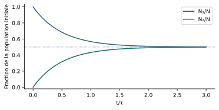

### Question P4 — Ce que permet l’analyse dimensionnelle

> [!INDICATION]
> Identifier le rapport d’aires sans dimension propre à la géométrie.

#### Solution

À gaz dilué, la vitesse caractéristique est $u_0=\sqrt{k_BT_0/m}$. Les paramètres dimensionnés géométriques indépendants sont $V$ et $s$. Sans loi de flux, on peut écrire $\tau=(V^{1/3}/u_0)F(s/V^{2/3})$ avec une fonction inconnue. Une dimension de temps ne fixe donc pas à elle seule la dépendance complète. La proportionnalité du débit à la section apportera $\tau\propto V/(s u_0)$.

### Question P5 — Irréversibilité de la redistribution

> [!INDICATION]
> Suivre le système formé des deux enceintes et de tout le gaz.

#### Solution

Le gaz passe spontanément du volume disponible $V$ à $2V$, avec une différence finie de pression entre enceintes. À température constante, $\Delta U=0$ pour le gaz parfait et il n’y a pas de travail des parois rigides. L’entropie finale augmente de $Nk_B\ln 2$. Le retour macroscopique spontané vers une seule enceinte vide de l’autre côté n’a pas lieu. Le quasi-équilibre interne de chaque compartiment est compatible avec cette irréversibilité.

## Distribution des vitesses et flux

### Question P6 — Normalisation de Maxwell

> [!INDICATION]
> Normaliser une composante sur toute la droite réelle.

#### Solution

$1=\int_{-\infty}^{\infty} A e^{-a u_x^2}\,du_x=A\sqrt{\pi/a}$, d’où $A=\sqrt{a/\pi}=\sqrt{m/(2\pi k_BT_0)}$. Le produit des trois densités indépendantes se normalise donc aussi à un sur $\mathbb R^3$.

### Question P7 — Deux températures

> [!INDICATION]
> Comparer largeur, hauteur centrale et aire des gaussiennes.

#### Solution

$p_x$ est paire, maximale en zéro avec tangente horizontale. Lorsque $T$ augmente, son écart-type $\sqrt{k_BT/m}$ augmente et son maximum $\sqrt{m/(2\pi k_BT)}$ diminue. Les queues de la distribution chaude s’étendent plus loin. L’aire de chacune reste un.

### Question P8 — Intégrande du second moment

> [!INDICATION]
> Ne pas tracer la densité de probabilité à la place de l’intégrande.

#### Solution

$f(u_x)=A u_x^2e^{-au_x^2}$. La fonction paire, positive, s’annule en zéro et tend vers zéro à l’infini. $f'=2Au_x(1-au_x^2)e^{-au_x^2}$ donne deux maxima à $u_x=\pm1/\sqrt a$. Son intégrale vaut $\langle u_x^2\rangle=1/(2a)=k_BT_0/m$.

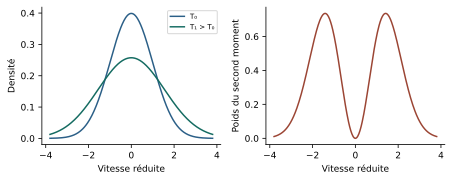

### Question P9 — Vitesse moyenne et agitation

> [!INDICATION]
> Quelle moyenne est un vecteur et quelle moyenne est une énergie ?

#### Solution

La parité de chaque composante impose $\langle\vec u\rangle=\vec0$, absence de courant d’ensemble. En sommant les trois variances, $\langle u^2\rangle=3k_BT_0/m$ et $\langle E_c\rangle=3k_BT_0/2$, résultat d’équipartition. Pour l’hélium et les constantes arrondies du sujet, $u_{rms}\simeq1{,}1\,10^3$ m·s⁻¹. Une moyenne vectorielle nulle coexiste avec une agitation importante.

### Question P10 — Volume des trajectoires qui touchent le trou

> [!INDICATION]
> Projeter le déplacement suivant la normale au trou.

#### Solution

Pour une classe de vitesse $\vec u$ telle que $u_x>0$, remonter chaque trajectoire depuis la surface $s$ pendant $dt$. Le tube oblique résultant a pour hauteur normale $u_xdt$, donc $dD=s u_xdt$. Il contient en moyenne $dN_a=(N_1/V)s u_xdt$ atomes toutes vitesses confondues. Le nombre appartenant effectivement à la classe sélectionnée est $dN_a\,p(\vec u)d^3u$. Pour $u_x<0$ il n’y a pas de flux sortant de 1 par cette face.

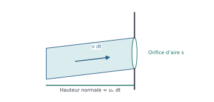

### Question P11 — Flux sortant dans un sens

> [!INDICATION]
> Intégrer en y et z sur toute la droite, en x sur les vitesses positives.

#### Solution

$\dot N_{1/2}=(N_1/V)s\int_0^\infty u_xAe^{-au_x^2}du_x=(N_1/V)s\sqrt{k_BT_0/(2\pi m)}$. En l’écrivant $N_1/\tau$, on obtient $\tau=(V/s)\sqrt{2\pi m/(k_BT_0)}$. Il s’agit du flux brut 1 → 2. Le flux opposé intervient séparément.

### Question P12 — Ordre de grandeur avec le volume manquant

> [!INDICATION]
> Conserver les dimensions de V en insérant les données réellement présentes.

#### Solution

Avec $s=10^{-12}$ m², $m=7\,10^{-27}$ kg et $k_BT_0=3\,10^{-21}$ J, $\tau\simeq3{,}8\,10^9(V/\mathrm{m^3})$ s. La valeur numérique de $V$ manque, comme le précise le fascicule. À titre d’échelle uniquement, pour $V=1$ cm³ on aurait environ $4\,10^3$ s, soit une heure.

### Question P13 — Comparaison des échelles de temps

> [!INDICATION]
> Comparer le temps de traversée d’une enceinte au temps de variation globale.

#### Solution

Pour une enceinte de côté $L$, $t_{tr}\sim L/u_0$, tandis que $\tau\sim (L/u_0)(L^2/s)$. Le rapport est très grand pour un petit trou : le gaz a le temps de s’homogénéiser et d’échanger avec les parois avant que la population ne change sensiblement. L’hypothèse de quasi-équilibre local reste à distinguer de la condition microscopique $\sqrt{s}\ll\ell$.

### Question P14 — Pression admissible

> [!INDICATION]
> Utiliser la pression pour remplacer la densité numérique.

#### Solution

Avec $\ell\simeq1/(n\sigma)$ et $n=P/(k_BT_0)$, le critère $\ell>10\sqrt{s}$ donne $P<P_{max}=k_BT_0/(10\sigma\sqrt{s})$. Pour un diamètre atomique de quelques $10^{-10}$ m, une section de collision d’ordre $10^{-19}$ m² est raisonnable. Avec $\sqrt{s}=10^{-6}$ m, $P_{max}$ est de l’ordre de quelques $10^3$ Pa, à un facteur géométrique près.

## Enceintes fermées puis ouvertes

### Question P15 — Deux enceintes identiques fermées

> [!INDICATION]
> Faire la différence des deux flux bruts.

#### Solution

$\dot N_1=(-N_1+N_2)/\tau$ et $\dot N_2=(N_1-N_2)/\tau$. La somme est constante et l’écart $D=N_1-N_2$ vérifie $\dot D=-2D/\tau$.

### Question P16 — Solution du problème fermé

> [!INDICATION]
> Utiliser la population totale et l’écart initial.

#### Solution

Avec $N_1(0)=N$, $N_2(0)=0$, $D(t)=Ne^{-2t/\tau}$. Donc $N_1=N(1+e^{-2t/\tau})/2$ et $N_2=N(1-e^{-2t/\tau})/2$. Les conditions initiales, la somme et la limite $N/2$ sont respectées.

### Question P17 — Dépendance de l’effusion à la masse (portée partielle)

> [!INDICATION]
> À température commune, comparer les vitesses thermiques de deux gaz ordinaires.

#### Solution

Pour deux gaz ordinaires de même densité numérique, le flux unidirectionnel est proportionnel à $m^{-1/2}$. Dans un mélange hélium–néon, par exemple, les atomes He franchissent initialement l’orifice plus vite que les atomes Ne. Dans deux enceintes fermées, cet écart se manifeste pendant le transitoire puis les compositions rejoignent l’équilibre. La couverture de cette question se limite à la loi physique et à cet exemple de gaz inertes.

### Question P18 — Bilan avec fuite vers le vide

> [!INDICATION]
> Le débit sortant supplémentaire est proportionnel à l’aire du second trou.

#### Solution

$\tau_2=\tau_1/k$. Les bilans s’écrivent $\tau_1\dot N_1=-N_1+N_2$ et $\tau_1\dot N_2=N_1-(1+k)N_2$. Leur somme donne $d(N_1+N_2)/dt=-kN_2/\tau_1$.

### Question P19 — Éliminer la première population

> [!INDICATION]
> Exprimer N₁ avec la seconde équation, puis dériver.

#### Solution

$N_1=\tau_1\dot N_2+(1+k)N_2$. Après substitution dans la première équation : $\tau_1^2\ddot N_2+(2+k)\tau_1\dot N_2+kN_2=0$. Tous les termes ont la dimension d’un nombre d’atomes.

### Question P20 — Facteur de qualité

> [!INDICATION]
> Comparer à la forme normalisée d’un système du second ordre.

#### Solution

$\omega_0=\sqrt{k}/\tau_1$ et $\omega_0/Q=(2+k)/\tau_1$, donc $Q=\sqrt{k}/(2+k)$. Il est maximal à $k=2$, avec $Q_{max}=1/(2\sqrt2)<1/2$. Les deux modes sont apériodiques pour $k>0$.

### Question P21 — Nature physique des deux modes

> [!INDICATION]
> Identifier le mécanisme qui permettrait à une population de dépasser l’équilibre puis d’y revenir périodiquement.

#### Solution

Le flux est instantanément orienté par la différence des populations et il n’y a aucune inertie du courant ni échange périodique entre deux formes d’énergie stockée. Il s’agit de relaxations, donc sans oscillation. La fuite irréversible vers le vide conduit toutes les populations à zéro : aucun mode de croissance ni mode constant ne subsiste pour $k>0$. Les exposants sont donc réels négatifs, comme le confirme le discriminant $k^2+4>0$.

### Question P22 — Solution pour la population intermédiaire

> [!INDICATION]
> Évaluer la pente initiale directement par le bilan.

#### Solution

Avec $p_1,p_2$ les deux exposants distincts, $N_2=Ae^{p_1t}+Be^{p_2t}$. $N_2(0)=0$ donne $B=-A$ et $\dot N_2(0)=N/\tau_1$. Donc $N_2(t)=N(e^{p_1t}-e^{p_2t})/[\tau_1(p_1-p_2)]$.

### Question P23 — Identifier les trois courbes

> [!INDICATION]
> Quand le second orifice est grand, de quelle enceinte les atomes disparaissent-ils le plus vite ?

#### Solution

La courbe (a), la plus basse, correspond à $k=10$, (b) à $k=1$, (c), la plus haute, à $k=0{,}1$. Une forte fuite empêche le remplissage de 2. Pour $T=t/\tau_1\ll1$, $N_2/N=T-(2+k)T^2/2+O(T^3)$. La même pente initiale traduit le débit incident de 1 alors que le compartiment 2 est encore vide.

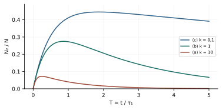

### Question P24 — Deux échelles pour une petite fuite

> [!INDICATION]
> Tracer les deux populations sur les mêmes axes jusque bien après le premier maximum.

#### Solution

Pour $k=0{,}1$, 1 se dépeuple au début tandis que 2 se remplit jusqu’à près de $N/2$. Les deux enceintes deviennent presque équilibrées sur un temps de l’ordre de $\tau_1/2$. Ensuite elles se vident ensemble sur un temps long de l’ordre de $2\tau_1/k$. $N_1$ reste légèrement supérieur à $N_2$, assurant le flux qui compense la fuite de 2. Les deux courbes tendent vers zéro.

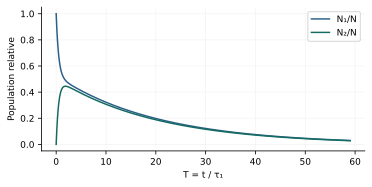

### Question P25 — Mesure non destructive de la population

> [!INDICATION]
> Utiliser la grandeur intensive d’état accessible dans chaque enceinte.

#### Solution

Mesurer la pression partielle ou totale adaptée au gaz, à l’aide d’un capteur de vide étalonné dont le volume mort est négligeable ou connu, puis utiliser $N_i=P_iV/(k_BT_0)$. L’enregistrement de $P_i(t)$ donne la population avec la même résolution temporelle.

## Diffusion continue et analogie électrique

### Question P26 — Chaîne discrète d’enceintes

> [!INDICATION]
> Compter les arrivées et les deux sorties d’une cellule intérieure.

#### Solution

$\tau\,\dot N_i=N_{i-1}-2N_i+N_{i+1}$ pour $1<i<K$. Aux extrémités fermées, un seul échange demeure. La somme des flux internes se compense.

### Question P27 — Limite continue

> [!INDICATION]
> Développer de part et d’autre de l’enceinte i.

#### Solution

$f(x-L)-2f(x)+f(x+L)=L^2\partial_x^2 f+O(L^4)$. Ainsi $\partial_t f=D\partial_x^2 f$ avec $D=L^2/\tau$. Cette équation de diffusion conserve le nombre total avec conditions de bord sans flux. Sa longueur caractéristique croît comme $\sqrt{Dt}$.

### Question P28 — Critère de validité du continuum

> [!INDICATION]
> Comparer le pas spatial à la distance caractéristique de variation.

#### Solution

La population doit varier lentement sur un intervalle $L$ : $L/L_c\ll1$ et, lorsque $N_i$ est appréciable, $|N_{i+1}-N_i|\ll N_i$. Pour la troncature, il faut aussi que $|L^4\partial_x^4f/12|\ll|L^2\partial_x^2f|$ sur les régions considérées. Un dépôt initial dans une seule cellule ne satisfait pas cette hypothèse au temps zéro.

### Question P29 — Arrivée au centre d’une chaîne fermée

> [!INDICATION]
> Séparer le temps de diffusion jusqu’à d de la limite d’équilibre dans tout le volume.

#### Solution

Près du milieu, $N(d,0)=0$, la première montée est lente puis l’arrivée devient sensible sur $t_d\sim d^2/D\sim K^2\tau/4$. Avant l’influence du bord opposé, l’enveloppe d’un dépôt local suit $t^{-1/2}\exp[-d^2/(4Dt)]$, dont le maximum est à $d^2/(2D)$. À temps long les bords réfléchissants imposent $N_i\to N/K$, non zéro. Un point légèrement en amont du milieu peut dépasser ce plateau avant d’y revenir ; au milieu exact de la chaîne continue symétrique la montée peut être monotone. L’échelle d’arrivée reste la même.

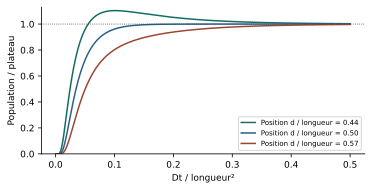

### Question P30 — Construire l’analogie électrique

> [!INDICATION]
> Choisir un potentiel qui entraîne le flux et une quantité stockée qui se conserve.

#### Solution

Associons charge $Q\leftrightarrow N$, courant $I\leftrightarrow\dot N_{1\to2,net}$ et potentiel $U\leftrightarrow P$. Le gaz parfait donne $N=VP/(k_BT_0)$, de la forme électrique $Q=C U$, donc $C_{eff}=V_{enceinte}/(k_BT_0)$. Le flux donne $I=(P_1-P_2)/R_{eff}$, avec $R_{eff}=\sqrt{2\pi m k_BT_0}/s$. Le produit $R_{eff}C_{eff}=\tau$ vérifie l’analogie.

### Question P31 — Circuit fermé

> [!INDICATION]
> Où est stockée la charge de chaque nœud ?

#### Solution

Deux condensateurs de même capacité $C_{eff}$ relient les nœuds 1 et 2 à une masse commune. Un seul résistor $R_{eff}$ relie les deux nœuds. La charge totale des deux armatures actives se conserve tout en transitant de l’une à l’autre.

### Question P32 — Circuit ouvert vers l’extérieur

> [!INDICATION]
> À quel potentiel électrique faut-il mettre le vide ?

#### Solution

Reprendre le montage précédent et ajouter de 2 à la masse un résistor $R_{fuite}=R_{eff}/k$ pour l’orifice $s'=ks$. La pression nulle du vide correspond au potentiel nul de la masse. La charge totale des deux capacités décroît.

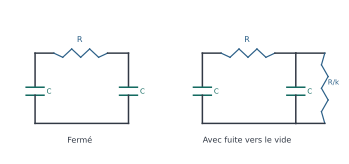

### Question P33 — Limite énergétique de l’analogie

> [!INDICATION]
> Comparer l’énergie interne du gaz et l’énergie des condensateurs.

#### Solution

Pour le système gazeux fermé isotherme, $U=3Nk_BT_0/2$ reste constante pendant la redistribution irréversible : davantage de microétats deviennent accessibles. Dans le circuit, l’énergie électrostatique $\sum CU_i^2/2$ diminue et se dissipe en chaleur par effet Joule dans les résistances. L’analogie décrit les bilans de population et de flux, sans identifier les bilans d’énergie.

## Chimie. Fluorures du groupe 13

### Question C1 — Degrés d’oxydation du groupe 13

> [!INDICATION]
> Attribuer les électrons des liaisons à l’élément le plus électronégatif.

#### Solution

Chaque F est à −I. Les deux fluorures sont neutres et ont trois F : B dans BF₃ et Al dans AlF₃ sont tous deux à +III.

### Question C2 — La lacune électronique

> [!INDICATION]
> Écrire la formule du monomère à trois liaisons.

#### Solution

Dans une représentation moléculaire $\mathrm{XF_3}$, l’atome du groupe 13 possède trois électrons de valence, engagés dans trois liaisons. Il compte six électrons autour de lui, avec une orbitale vacante qui peut accepter un doublet. Ce caractère accepteur définit l’acidité de Lewis. Le solide étendu AlF₃ a une coordinence locale différente.

### Question C3 — Comparer deux acides de Lewis

> [!INDICATION]
> La comparaison porte-t-elle sur des fragments moléculaires ou sur une réaction de complexation définie ?

#### Solution

Plusieurs arguments jouent en sens différents. La forte polarisation Al–F appauvrit Al et l’interaction π d’un doublet F(2p) avec la lacune B(2p) peut atténuer l’acidité de BF₃ ; ces arguments favorisent AlF₃ comme accepteur dans une comparaison moléculaire. Le bore, plus électronégatif, peut inversement présenter une orbitale acceptrice énergétiquement accessible. Pour classer expérimentalement les deux, il faut préciser la base, le milieu et la grandeur d’affinité choisie. Le jury a accepté des raisonnements qualitatifs opposés.

### Question C4 — Coordinences dans β-AlF₃

> [!INDICATION]
> Prolonger la maille à travers ses six faces.

#### Solution

Chaque Al au sommet possède six F proches, aux demi-arêtes dans les directions ±x, ±y, ±z : coordinence 6, environnement octaédrique de F. Chaque F au centre d’une arête a deux Al alignés, coordinence 2. Les F sont des ponts entre sommets du réseau cubique simple des Al. Ce ne sont pas des sites tétraédriques ou octaédriques d’un réseau compact d’Al.

### Question C5 — Masse volumique et modèle ionique

> [!INDICATION]
> Combien de motifs compte le cube entier ?

#### Solution

Les huit sommets contribuent un Al et les douze milieux d’arête $12/4=3$ F, donc un motif de 84,0 g·mol⁻¹. Au contact ionique, $a=2(r_{Al^{3+}}+r_{F^-})=368$ pm. D’où $\rho=84/(N_Aa^3)\simeq2{,}80$ g·cm⁻³, proche des 2,84 mesurés. Avec les rayons atomiques, $a=386$ pm et $\rho\simeq2{,}43$ g·cm⁻³, écart d’environ 14 %. L’accord du premier modèle soutient un fort caractère ionique, sans exclure toute covalence.

### Question C6 — Charge partielle et longueur B–F

> [!INDICATION]
> Quelle serait la charge du bore pour trois F⁻ entièrement ioniques ?

#### Solution

Le pourcentage d’ionicité estimé est $2{,}58/3=86\,\%$. B–F est fortement polaire. La longueur mesurée 130,7 pm est proche de la somme des rayons atomiques $85+50=135$ pm et plus courte que $27+133=160$ pm pour les rayons ioniques tabulés en cristal. Une liaison moléculaire polarisée garde donc une composante de partage électronique. Ces rayons sont des paramètres de modèles distincts.

### Question C7 — Distance entre fluors et géométrie

> [!INDICATION]
> Comparer les distances F···F attendues pour des angles de 90° et 120°.

#### Solution

Pour $d_{BF}=130{,}7$ pm, deux F voisins d’un octaèdre centré sur B seraient à $\sqrt2d_{BF}\simeq185$ pm, nettement moins que 226 pm. Dans une molécule trigonale plane à 120°, la distance vaut $\sqrt3d_{BF}=226{,}4$ pm. Les mesures concordent avec des entités isolées trigonales et écartent l’environnement octaédrique d’un réseau β analogue.

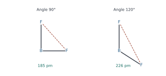

### Question C8 — Sens de « gaz ionique »

> [!INDICATION]
> Distinguer charges partielles intramoléculaires et charge totale d’une entité.

#### Solution

Chaque BF₃ possède des liaisons de caractère ionique élevé, mais l’entité trigonale demeure globalement neutre et sa symétrie annule le dipôle permanent. Les attractions entre molécules sont plus faibles que les interactions d’un réseau ionique étendu, ce qui rend compte du caractère gazeux à l’ambiante. L’expression décrit cette combinaison de propriétés.

## Orbitales et formation des adduits de Lewis

### Question C9 — Géométrie de BH₃ libre

> [!INDICATION]
> Compter les directions de liaisons et les doublets non liants sur B.

#### Solution

Trois liaisons B–H et aucun doublet libre sur B donnent AX₃. L’espèce est trigonale plane, d’angles 120° et de symétrie $D_{3h}$. On prend le plan moléculaire xy et l’axe z normal au plan.

### Question C10 — Trois combinaisons du fragment H₃

> [!INDICATION]
> Combiner d’abord deux 1s, puis classer selon les phases sur le triangle.

#### Solution

En numérotant les trois H autour du triangle et en notant $h_i$ leurs 1s, une base normalisée est $\phi_1=(h_1+h_2+h_3)/\sqrt3$, $\phi_2=(2h_1-h_2-h_3)/\sqrt6$, $\phi_3=(h_2-h_3)/\sqrt2$. La première est totalement symétrique et basse. Les deux dernières, orthogonales, forment le doublet dégénéré $e'$. Avec $h_2\pm h_3$ comme sous-fragments, la combinaison antisymétrique n’a pas de recouvrement avec $h_1$, la symétrique s’y combine dans les deux premières.

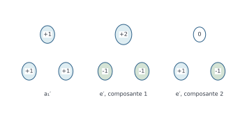

### Question C11 — Correspondance avec les orbitales de B

> [!INDICATION]
> Chercher la même symétrie vis-à-vis du plan et des rotations.

#### Solution

La 2s de B est totalement symétrique $a_1'$ et interagit avec $\phi_1$. Les 2p dans le plan ($p_x,p_y$) appartiennent à $e'$ et interagissent avec les deux combinaisons dégénérées de H₃, avec un choix d’axes adapté. La 2p normale $p_z$, de symétrie $a_2''$, change de signe par réflexion dans le plan : aucune combinaison des 1s coplanaires ne peut la recouvrir.

### Question C12 — Orbitales de BH₃ trigonal

> [!INDICATION]
> Placer les lobes de mêmes signes en regard pour les combinaisons liantes.

#### Solution

$1a_1'$ est la somme liante de 2s(B) et des trois 1s(H) de même phase. Le doublet $1e'$ combine les deux p dans le plan avec les combinaisons de $e'$ de H₃, en phase de chaque côté du nœud. $1a_2''$ est $p_z$ sur B, avec deux lobes opposés perpendiculaires au triangle et coefficients nuls sur les H dans ce modèle.

### Question C13 — Occupation et orbitales frontières

> [!INDICATION]
> Distribuer les six électrons de valence dans les niveaux.

#### Solution

BH₃ apporte $3+3=6$ électrons : $(1a_1')^2(1e')^4$. La HO est le doublet $1e'$ liant B–H. La BV est $1a_2''$, non liante et essentiellement centrée sur B. C’est la lacune du bore dans cette géométrie.

### Question C14 — Orbitales en géométrie pyramidale

> [!INDICATION]
> Suivre les symétries dans le passage de D₃h à C₃v.

#### Solution

Dans la pyramide, $1a_1$ prolonge la combinaison totalement liante, avec un mélange s–p dirigé vers le triangle H₃. $2a_1$ dérive du p perpendiculaire : le grand lobe opposé aux H accueille le doublet lors de la coordination, avec une petite composante de l’autre côté. Les deux $1e_x,1e_y$ restent des combinaisons latérales liantes p–H₃, de phases opposées de part et d’autre d’un plan nodal vertical et liées par rotation. La pyramidalisation permet aux fonctions $a_1$ de mêler $s$ et $p_z$.

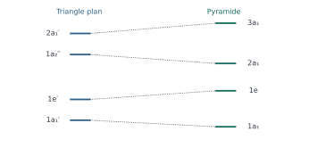

### Question C15 — Stabilisation de 1a₁

> [!INDICATION]
> Que devient l’interdiction de mélange entre s et pz ?

#### Solution

Dans la forme plane, le p normal et le 2s n’ont pas la même parité. Dans la pyramide ils ont tous deux la symétrie $a_1$. Leur mélange permet une combinaison dirigée vers les trois H avec un meilleur recouvrement liant et abaisse le niveau $1a_1$. Le diagramme de Walsh donne bien une pente descendante pour ce niveau.

### Question C16 — Passer du bore à l’azote

> [!INDICATION]
> Comparer les électrons disponibles et les énergies des orbitales atomiques.

#### Solution

Les symétries orbitalaires sont les mêmes à géométrie comparable. N étant plus électronégatif, ses orbitales atomiques sont plus basses, ce qui modifie les énergies absolues et le mélange. NH₃ possède huit électrons de valence : les deux de plus occupent $2a_1$ en géométrie pyramidale, formant le doublet libre. Sa stabilisation favorise la pyramidalisation, alors que BH₃ libre est plan.

### Question C17 — Orbitale donneuse et orbitale accepteuse

> [!INDICATION]
> Aligner le doublet de NH₃ avec la direction de la lacune du bore.

#### Solution

La HO $2a_1$ occupée de NH₃, portée surtout par N, donne vers la BV de BH₃ : $1a_2''$ à l’état plan corrélée à $2a_1$ de BH₃ pyramidal. Les lobes orientés suivant B–N se recouvrent axialement avec la même symétrie et forment une σ liante occupée. La combinaison antiliante reste vide.

### Question C18 — Liaison de coordination

> [!INDICATION]
> Suivre l’origine et la destination des deux électrons.

#### Solution

Les deux électrons de la nouvelle liaison proviennent du doublet de N, B apportant l’orbitale vacante : $\mathrm{H_3N\to BH_3}$. Une fois la liaison formée, ce doublet est partagé entre les deux noyaux, comme dans toute liaison covalente.

## Paires de Lewis frustrées et spectres RMN

### Question C19 — Trimésitylphosphine

> [!INDICATION]
> Compter les électrons restants sur P après trois liaisons.

#### Solution

$\mathrm{:P(Mes)_3}$ a trois liaisons P–C vers le C1 de trois groupes 2,4,6-triméthylphényle et un doublet non liant sur P. La géométrie moléculaire est pyramidale. Le doublet est disponible pour une donation, d’où le caractère de base de Lewis malgré l’encombrement des groupes ortho.

### Question C20 — Tris(pentafluorophényl)borane

> [!INDICATION]
> Distinguer l’effet électronique du noyau fluoré et son encombrement.

#### Solution

$\mathrm{B(C_6F_5)_3}$ est constitué de trois cycles pentafluorophényle liés par leur carbone ipso à un bore tricoordonné approximativement plan. B possède une lacune p, chaque F trois doublets libres. Les fluorures fortement inductifs attracteurs appauvrissent le centre et stabilisent l’orbitale acceptrice, ce qui renforce l’acidité de Lewis.

### Question C21 — Paire frustrée et adduit

> [!INDICATION]
> Que deviennent les deux orbitales frontières quand leur recouvrement est empêché ?

#### Solution

Dans l’adduit classique, la HO donneuse et la BV acceptrice se combinent en une orbitale liante occupée plus basse et une antiliante vide plus haute. La formation de la liaison consomme le doublet disponible. Dans la paire encombrée, le recouvrement direct est faible. Le donneur conserve une HO haute, l’accepteur une BV basse : les deux sites peuvent agir ensemble sur un troisième substrat.

### Question C22 — Solvant deutéré et référence bore

> [!INDICATION]
> Ne pas confondre le noyau observé et le noyau fournissant la référence.

#### Solution

Le solvant deutéré limite le grand signal protonique du solvant et fournit un signal de deutérium de verrouillage du champ. $\mathrm{BF_3\cdot OEt_2}$ est la référence de déplacement chimique de la RMN du bore 11, fixée ici à 0 ppm.

### Question C23 — Spectre avant introduction du dihydrogène

> [!INDICATION]
> Comparer le pic de l’échantillon au domaine du bore triarylé.

#### Solution

Le signal vers +59,6 ppm se trouve dans le domaine d’un bore triarylé tricoordonné. Celui proche de zéro appartient à la référence. L’absence de signal tétracoordonné caractéristique du mélange étudié est compatible avec l’absence d’adduit P–B stable et la présence d’une paire frustrée.

### Question C24 — Produits ioniques de la coupure H–H

> [!INDICATION]
> Retrouver les couplages de H dans les deux spectres hétéronucléaires.

#### Solution

La coupure hétérolytique fournit $\mathrm{[HP(Mes)_3]^+}$ et $\mathrm{[HB(C_6F_5)_3]^-}$. Le doublet de $^{31}$P avec $J=480$ Hz établit P–H ; le nouveau $^{11}$B à −25,47 ppm est compatible avec un hydridoborate tétracoordonné. Dans les numéros du cycle tel qu’imprimé, 3 désigne le phosphonium, 4 le borate afin que l’étape B régénère 2.

### Question C25 — Attribution des signaux du sel

> [!INDICATION]
> Reconnaître les deux intégrales de 1 H et les partenaires de spin.

#### Solution

7,91 ppm (d, 1 H, 480 Hz) est P–H, avec le même couplage que pour $^{31}$P. 6,58 ppm (d, 6 H) regroupe les H aromatiques des trois mésityles, couplés à P à travers les liaisons. 4,10 ppm (q, 1 H, 112 Hz) est B–H : un $^{11}$B de spin $I=3/2$ donne $2I+1=4$ composantes. Les singulets 1,95, 1,87, 1,62 ppm (9 H chacun) couvrent les neuf Me des trois mésityles. La distinction précise entre les deux familles ortho encombrées et les para requiert davantage de données.

### Question C26 — Formation de l’alcène par Wittig

> [!INDICATION]
> Faire le bilan des deux fragments de la future double liaison.

#### Solution

5 est le 1,1-diphényléthène, $\mathrm{Ph_2C=CH_2}$. La réaction de Wittig est $\mathrm{Ph_2C=O+Ph_3P=CH_2\to Ph_2C=CH_2+Ph_3P=O}$. La formation de la liaison phosphoryle très forte (535 kJ·mol⁻¹ d’après l’annexe) est une force motrice.

### Question C27 — Fermer le cycle catalytique tel que dessiné

> [!INDICATION]
> À l’issue de B, le schéma fait réapparaître le borane neutre 2.

#### Solution

A est la coupure hétérolytique de H₂ par la paire 1+2, donnant 3 phosphonium et 4 hydridoborate. Pour obtenir **2+3+6** à l’étape B imprimée, 4 transfère son hydrure au CH₂ terminal de 5. L’intermédiaire 6 est $\mathrm{Ph_2C^-\!-CH_3}$, stabilisé par les deux phényles. À l’étape C le phosphonium protone 6 pour donner 7, $\mathrm{Ph_2CH-CH_3}$ (1,1-diphényléthane), et régénère la phosphine 1. Les charges et le bilan H₂ sont ainsi conservés à chaque étape du schéma.

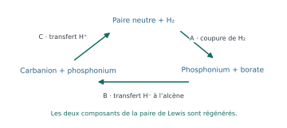

### Question C28 — Avantages de la catalyse par paire de Lewis

> [!INDICATION]
> Comparer la composition du catalyseur et les conditions réellement indiquées.

#### Solution

Le procédé utilise un catalyseur sans métal de transition et évite les résidus de tels métaux dans le produit. L’hydrogénation se déroule à température ambiante et sous pression atmosphérique, avec une faible charge catalytique et une conversion complète rapportée en quinze minutes pour cet exemple.

## Catalyse asymétrique par le CBS

### Question C29 — Nature de la proline

> [!INDICATION]
> Repérer la relation entre l’azote et le carboxyle.

#### Solution

La proline est un acide α-aminé protéinogène dont la chaîne latérale se referme sur l’azote en un cycle pyrrolidine. L’amine libre est secondaire.

### Question C30 — Alcool tertiaire de 10

> [!INDICATION]
> Combien de groupes Ph apparaissent sur le carbone initialement ester ?

#### Solution

Faire agir deux équivalents au moins de $\mathrm{PhMgBr}$ sur l’ester méthylique 9 protégé, en éther anhydre. Une première addition–élimination du méthanolate donne la cétone, immédiatement attaquée par un deuxième équivalent. Après hydrolyse protonante, l’ancienne fonction $\mathrm{-CO_2Me}$ devient $\mathrm{-C(OH)Ph_2}$, les liaisons du carbone asymétrique de la proline étant conservées.

### Question C31 — Déplacement de l’équilibre par Dean–Stark

> [!INDICATION]
> Distinguer le trajet des vapeurs et celui du toluène recyclé.

#### Solution

Le ballon chauffé contient le milieu avec toluène et surmonte une dérivation menant à un tube collecteur gradué coiffé d’un réfrigérant vertical à eau. Les vapeurs condensent, l’eau plus dense décante au fond du tube et le toluène surnageant retourne au ballon par le trop-plein. Retirer l’eau produite par condensation favorise la fermeture du cycle B–N–O de 8 par déplacement de l’équilibre.

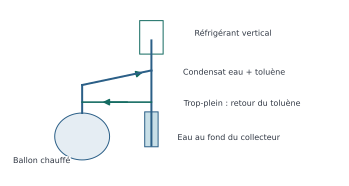

### Question C32 — Deux produits endo en l’absence de catalyseur chiral

> [!INDICATION]
> Approcher le diénophile des deux faces d’un même diène s-cis.

#### Solution

Le cyclohexa-1,3-diène subit une cycloaddition [4+2] suprafaciale avec $\mathrm{CH_2=C(Me)CHO}$. La construction donne le squelette bicyclo[2.2.2]octène, avec Me et CHO portés par le même C du pont nouvellement formé. L’approche endo place le groupe carbonyle sous le système π du diène et permet les interactions secondaires. CHO est endo, Me exo dans les produits majoritaires. Les deux faces énantiotopiques donnent les deux énantiomères endo en proportions égales dans un milieu achiral.

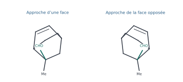

### Question C33 — Adduit du catalyseur CBS protoné

> [!INDICATION]
> Quel site de la méthacroléine fournit le doublet et quel atome le reçoit ?

#### Solution

Le doublet de l’oxygène carbonylé de $\mathrm{CH_2=C(Me)-CH=O}$ se coordonne au bore tricoordonné de 12. Le lien est $\mathrm{C=O\to B(CBS)}$, le centre B devient tétracoordonné et la double liaison du diénophile reste disponible. En écriture à liaisons ordinaires, O devient formellement positif, B négatif et N protoné reste positif : la charge globale de l’adduit est +1.

### Question C34 — Attribuer la face du produit majoritaire

> [!INDICATION]
> Les deux faces du diénophile deviennent diastéréotopiques quand le catalyseur s’y lie.

#### Solution

Le catalyseur chiral masque différemment les deux faces de l’aldéhyde coordonné et leur donne des états de transition diastéréoisomères de barrières distinctes. On retient l’adduit endo dont le C portant CHO et Me a la configuration **S**, indiquée par le sujet. Les priorités sur ce C sont CHO (O,O,H), C de tête de pont (C,C,H), CH₂ du nouveau pont (C,H,H) puis Me (H,H,H). Me à l’arrière, CHO → tête de pont → CH₂ tourne dans le sens antihoraire. La configuration relative endo du CHO fixe le reste du dessin de ce bicyclique.

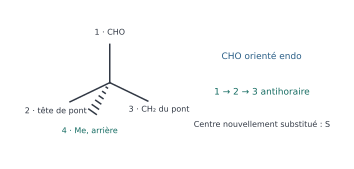
