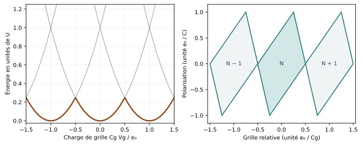
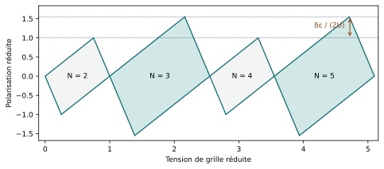
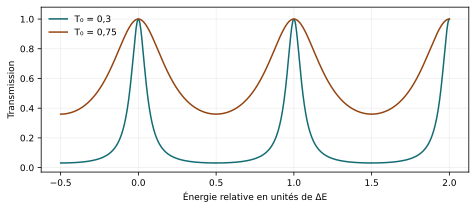
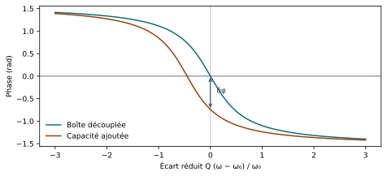

# ENS PSI 2023 — Physique U (U) · Corrigé brut

*Corrigé rédigé par IA, non officiel. Signalez toute erreur.*

**Lecture du rapport du jury** · GPT-6.2 Astra Ultra · vitesse non renseignée

**Rédaction** · GPT-6.2 Astra Ultra · vitesse non renseignée

## Boîte à photons et boîte à électrons

## 1.1 · Un îlot chargé électron par électron

### Question 1 — Énergie du circuit à tensions fixées

Posons $e_0=|e|>0$. Du côté source, $q_i=C_i(V_i-V)$. En retranchant le travail des générateurs à l’énergie des trois condensateurs, on trouve $E=\sum_i[C_i(V_i-V)^2/2-V_iC_i(V_i-V)]=CV^2/2-\sum_i C_iV_i^2/2$, avec $C=C_1+C_2+C_g$. L’origine d’énergie est arbitraire.

### Question 2 — Énergie de charge

$Q=CV-\sum_iC_iV_i=-Ne_0$ impose $V=(\sum_iC_iV_i-Ne_0)/C$. Avec $n_g=\sum_iC_iV_i/e_0$, on obtient $E_{\rm el}(N)=U(N-n_g)^2-\sum_i C_i V_i^2/2$, où $U=e_0^2/(2C)$ est une énergie.

### Question 3 — Comparaison de deux états de charge

La variation $E(N')-E(N)$ élimine le terme $-\sum_iC_iV_i^2/2$, identique pour tous les entiers $N$. À tensions imposées, la minimisation se ramène donc à celle de $U(N-n_g)^2$.

### Question 4 — Escalier de charge

Ici $n_g=C_g V_g/e_0$. L’entier d’équilibre est le plus proche de $n_g$. Ainsi $N$ demeure stable pour $N-1/2<n_g<N+1/2$ et augmente de un à chaque demi-entier. À la frontière deux états ont la même énergie. La partie gauche de la figure montre les croisements qui produisent cet escalier.

### Question 5 — Travail lors d’un transfert tunnel

Un électron peut passer du contact 1 ou 2 vers l’îlot, ou faire chacun des trajets inverses. Quand le contact $j$ cède un électron, sa charge augmente de $e_0$ et sa variation d’énergie vaut $+e_0V_j$. Quand il reçoit un électron, elle vaut $-e_0V_j$. La grille capacitive ne transfère aucun électron.

### Question 6 — Coût total des quatre événements

Pour le transfert $j\to$ îlot, $\Delta E_j^+=U[(N+1-n_g)^2-(N-n_g)^2]+e_0V_j=2U(N+1/2-n_g)+e_0V_j$. Pour l’îlot $\to j$, $\Delta E_j^-=2U(-N+1/2+n_g)-e_0V_j$. Prendre successivement $j=1,2$ donne les quatre coûts.

### Question 7 — Inégalités de blocage

La masse impose $V_2=0$. Posons $x=e_0V_g$, $y=e_0V_1$, $a=C_1/C$, $b=C_g/C$ et $A_\pm=2U(N\pm1/2)$. Pour le contact 2 les coûts imposent $A_-\le ay+bx\le A_+$. Pour le contact 1 ils imposent $A_-\le(a-1)y+bx\le A_+$. Les quatre bornes équivalent à $(A_--bx)/a\le y\le(A_+-bx)/a$ et $(bx-A_+)/(1-a)\le y\le(bx-A_-)/(1-a)$.

### Question 8 — Dimensions du diamant

Les pointes sur l’axe vérifient $bx=A_\pm$, d’où $\Delta V_g=2U/(e_0b)=e_0/C_g$. Au sommet, $ay+bx=A_+$ et $(a-1)y+bx=A_-$, donc $y=2U$. La demi-hauteur vaut $H=2U/e_0=e_0/C$. On retrouve le bras de levier $\alpha_g=b=H/\Delta V_g$.

### Question 9 — Trois secteurs successifs

Pour l’état $N$, les pointes horizontales sont $(V_{g,-},0)$ et $(V_{g,+},0)$ avec $V_{g,\pm}=(N\pm1/2)e_0/C_g$. Les pointes haute et basse sont respectivement $(V_{g,-}+(1-a)\Delta V_g,H)$ et $(V_{g,-}+a\Delta V_g,-H)$. La translation de $\pm\Delta V_g$ donne les deux états voisins. Les côtés ont pour pentes $-C_g/C_1$ et $C_g/(C-C_1)$.

### Question 10 — Spectre discret de l’îlot

Son énergie devient $F_N=U(N-n_g)^2+\sum_{k=1}^N\epsilon_k$, à une constante près. Les coûts de la question 6 deviennent $\Delta E_{j,\mathrm{sp}}^+=\Delta E_j^++\epsilon_{N+1}$ pour l’arrivée et $\Delta E_{j,\mathrm{sp}}^-=\Delta E_j^--\epsilon_N$ pour le départ. Les bornes de la question 7 deviennent $A_-=2U(N-1/2)+\epsilon_N$ et $A_+=2U(N+1/2)+\epsilon_{N+1}$.

### Question 11 — Diamants pour des niveaux doubles

L’écart de potentiel chimique est $D_N=2U+\epsilon_{N+1}-\epsilon_N$. Pour $N=2k$ cet écart vaut $2U$, pour $N=2k+1$ il vaut $2U+\delta\epsilon$. Les diamants alternent donc leurs demi-hauteurs $D_N/e_0$ et leurs largeurs $D_N/(e_0\alpha_g)$, avec les mêmes pentes. L’écart vertical entre les sommets hauts mesure $\delta\epsilon/e_0$.

### Question 12 — Courant bloqué

À l’intérieur strict du diamant et au zéro thermique du modèle, aucun des quatre événements ne peut démarrer. Le courant continu est donc nul.

### Question 13 — Lignes de conductance différentielle

À grille fixée, le courant du modèle saute lorsqu’un coût de transfert s’annule. Sa dérivée $G=\partial I/\partial V_1$ est nulle entre les seuils et présente un pic à chaque frontière. À température et résolution finies, ces frontières deviennent des lignes de largeur mesurable.

### Question 14 — Capacités lues sur le nanotube

Sur la figure 1.2, trois petits intervalles voisins valent environ $0{,}0105\ \mathrm V$, le grand environ $0{,}0165\ \mathrm V$. Les pentes d’un trait montant et d’un trait descendant valent approximativement $+0{,}44$ et $-1{,}8$ en volt par volt. On en tire $C_g=e_0/\Delta V_{g,p}\simeq15\ \mathrm{aF}$, $C_1=C_g/|p_-|\simeq8{,}5\ \mathrm{aF}$, $C=C_1+C_g/p_+\simeq43\ \mathrm{aF}$, puis $C_2=C-C_1-C_g\simeq19\ \mathrm{aF}$. Cela donne $U=e_0^2/(2C)\simeq1{,}9\ \mathrm{meV}$ et $\delta\epsilon=e_0(C_g/C)(\Delta V_{g,G}-\Delta V_{g,p})\simeq2{,}1\ \mathrm{meV}$. L’épaisseur des lignes limite la précision de ces lectures. Trois petits diamants entre les grands sont caractéristiques de groupes d’environ quatre niveaux de même énergie, séparés par un saut $\delta\epsilon$.

### Question 15 — Champ près de la grille

Le rayon $r\simeq1{,}5\ \mathrm{nm}$ et l’épaisseur $h\simeq3\ \mathrm{nm}$ sont petits devant le recouvrement $l\simeq100\ \mathrm{nm}$ et la longueur micrométrique du nanotube. Hors des bords, le champ est donc proche de celui d’un cylindre infiniment long devant un plan infini. La longueur active de la capacité est le recouvrement $l$.

### Question 16 — Image du conducteur

Pour les fils de charges opposées, la réflexion dans le plan médian suivie d’un changement de signe laisse les sources inchangées. Le potentiel, solution de $\nabla^2V=-\rho/(\epsilon_0\epsilon_r)$, est donc antisymétrique et vaut zéro dans ce plan. Dans le demi-espace du fil positif, la solution a la même charge sur le conducteur équipotentiel, le même potentiel nul sur le plan et la même condition à l’infini que le problème fil–plan. L’unicité impose le même potentiel.

### Question 17 — Capacité fil–plan

Pour une même charge $q$, la paire présente une tension $2V$ là où le fil réel est à $V$ par rapport au plan. Donc $C_{\rm fil-plan}(h)=2C_{2\rm fils}(2h)$. Avec l’équation (1.2) imprimée, $C_g\simeq2\epsilon_0\epsilon_r l/\operatorname{arccosh}(h/r)\simeq1{,}2\times10^{-17}\ \mathrm F$, soit environ $12\ \mathrm{aF}$ pour $h/r=2$. Le modèle et la lecture du graphe donnent le même ordre, $10^{-17}\ \mathrm F$.

## 1.2 · Ondes électroniques et modes de l’îlot

### Question 18 — Courant à gauche et à droite

Avec les exponentielles de (1.4), le calcul donne $J_1=(e_0\hbar k/m_e)(|A_1|^2-|B_1|^2)$ et $J_2=(e_0\hbar k/m_e)(|B_2|^2-|A_2|^2)$. Les deux courants sont comptés selon le même axe $+x$ et le signe électronique est inclus dans la formule (1.6).

### Question 19 — Conservation locale

$\partial_t\rho+\partial_xJ=0$. En régime stationnaire sans accumulation sur le diffuseur, $J_1=J_2$, d’où $|A_1|^2+|A_2|^2=|B_1|^2+|B_2|^2$.

### Question 20 — Unitarité de la diffusion

Avec $B=SA$, la relation précédente est $A^\dagger(S^\dagger S-I)A=0$ pour tout vecteur complexe $A$. La matrice hermitienne entre parenthèses est nulle (tester les vecteurs de base puis leurs sommes avec phases 0 et $\pi/2$). Donc $S^\dagger S=I$ et, pour cette matrice carrée, $SS^\dagger=I$.

### Question 21 — Coefficient de réflexion et de transmission

Les normes donnent $|r|^2+|\tau|^2=|r'|^2+|\tau'|^2=|r|^2+|\tau'|^2=1$. Ainsi $|r|=|r'|$, $|\tau|=|\tau'|$, et l’orthogonalité ajoute $r^*\tau'+\tau^*r'=0$. Les deux côtés possèdent le même $|k|/m_e$, donc les rapports de modules des flux réfléchi et transmis au flux incident sont $R=|r|^2$ et $T=|\tau|^2$ avec $R+T=1$.

### Question 22 — Renversement du mouvement électrostatique

Pour $\mathbf r_R(t)=\mathbf r(-t)$, $\mathbf v_R=-\mathbf v(-t)$ mais $\mathbf a_R=\mathbf a(-t)$. La loi $m\mathbf a=q\mathbf E(\mathbf r)$ dans un champ statique est alors encore vérifiée. La trajectoire inversée est un mouvement possible.

### Question 23 — Champ magnétique et solénoïde

À $\mathbf B$ extérieur fixé, $q\mathbf v\times\mathbf B$ change de signe et l’accélération ne change pas. En général le mouvement renversé n’est plus solution. Si l’on renverse aussi le solénoïde source, son courant et son champ s’inversent. Les deux signes se compensent dans la force et le mouvement du système renversé complet satisfait à nouveau l’équation.

### Question 24 — Renversement de l’onde

Pour le potentiel réel donné, $H^*=H$. Conjuguer $i\hbar\partial_t\psi=H\psi$ donne $-i\hbar\partial_t\psi^*=H\psi^*$. Évaluer en $-t$ puis utiliser la règle de chaîne donne $i\hbar\partial_t[\psi^*(x,-t)]=H\psi^*(x,-t)$. Le renversement pour cette particule sans spin est donc antilinéaire.

### Question 25 — Symétrie de la matrice

Si $B=SA$, l’expérience renversée a pour entrée $B^*$ et pour sortie $A^*$. Ainsi $A^*=SB^*=SS^*A^*$ pour tout $A$, soit $S^*=S^{-1}=S^\dagger$. En conjuguant on obtient $S=S^{\mathsf T}$, donc $\tau=\tau'$.

### Question 26 — Deux phases libres

Choisissons $\tau=i\sqrt{T}e^{i\eta}$ et $r=\sqrt{1-T}e^{i(\eta+\theta)}$. Alors $r^*\tau+\tau^*r'=0$ impose $r'=\sqrt{1-T}e^{i(\eta-\theta)}$. Les quatre coefficients sont donc les entrées de $S=e^{i\eta}\begin{pmatrix}\sqrt{1-T}e^{i\theta}&i\sqrt T\\i\sqrt T&\sqrt{1-T}e^{-i\theta}\end{pmatrix}$. Les cas $T=0$ et $T=1$ se déduisent par continuité.

### Question 27 — Phase de propagation

Pour le sens choisi dans (1.4), $\phi(x)=\phi(0)-kx$, donc $d\phi/dx=-k$ et $\varphi=\Delta\phi=-kL$ pour un aller. L’adoption de l’autre convention conjugue toutes les amplitudes sans changer les probabilités.

### Question 28 — Somme des chemins

Notons $r_j=\sqrt{1-T_j}$ et $t_j=i\sqrt{T_j}$. La traversée directe a l’amplitude $t_1t_2e^{i\varphi}$. Chaque tour supplémentaire accumule deux réflexions et deux trajets, donc $\tau_{\rm tot}=t_1t_2e^{i\varphi}\sum_{m\ge0}(r_1r_2e^{2i\varphi})^m$. Les amplitudes s’ajoutent avant la prise du carré.

### Question 29 — Transmission de Fabry–Pérot

Posons $p=\sqrt{(1-T_1)(1-T_2)}$. La somme donne $\tau_{\rm tot}=-\sqrt{T_1T_2}e^{i\varphi}/(1-pe^{2i\varphi})$, puis $T(k)=T_1T_2/[(1-p)^2+4p\sin^2(kL)]$. On retrouve les interférences d’une cavité de Fabry–Pérot à deux miroirs partiellement réfléchissants.

### Question 30 — Condition de résonance

La résonance exige $2kL=2m\pi$, soit $k_m=m\pi/L$ et $L=m\lambda/2$. Les réflexions internes réelles positives n’ajoutent aucune phase dans la matrice particulière (1.8).

### Question 31 — Espacement entre modes

Comme $dE/dk=\hbar d\omega/dk=\hbar v_g$ et $\Delta k=\pi/L$, on a $\Delta E=\pi\hbar |v_g|/L=h|v_g|/(2L)$ pour la branche de vitesse de groupe supposée constante.

### Question 32 — Décalage par la grille

Pour un potentiel intérieur $\alpha_G V_G$, l’énergie cinétique augmente de $e_0\alpha_G V_G$ à énergie totale $E$ fixée. Si $E_*$ est un maximum à grille nulle, la condition est $E+e_0\alpha_G V_G=E_*+m\Delta E$. Les résonances se déplacent vers les petites énergies totales lorsque la grille devient plus positive.

### Question 33 — Deux barrières identiques

Pour $s=(E+e_0\alpha_G V_G-E_*)/\Delta E$, $T=[1+4(1-T_0)\sin^2(\pi s)/T_0^2]^{-1}$. Les maxima valent un à $s=m$ quelle que soit l’ouverture non nulle des barrières. Les minima à $s=m+1/2$ valent $[T_0/(2-T_0)]^2$. La diminution de $T_0$ amincit les pics et abaisse les minima.

### Question 34 — Résistances classiques en série

Avec $G_0=2e_0^2/h$, $G_j=G_0T_j$. L’addition $1/G_{\rm cl}=1/G_1+1/G_2$ donne $G_{\rm cl}=G_0T_1T_2/(T_1+T_2)$, indépendant de la phase. En cohérent $G=G_0T(k)$ oscille et peut atteindre $G_0$ même pour deux faibles transmissions identiques.

### Question 35 — Somme incohérente

On obtient $T_{\rm inc}=T_1T_2\sum_{m\ge0}[(1-T_1)(1-T_2)]^m=T_1T_2/(T_1+T_2-T_1T_2)$. Si les deux transmissions sont petites, le terme produit est négligeable et $G_0T_{\rm inc}\simeq G_{\rm cl}$. Allonger la cavité au-delà de la longueur de cohérence, ou élargir la distribution énergétique jusqu’à moyenner plusieurs franges, efface les interférences.

### Question 36 — Carte de conductance cohérente

Les crêtes vérifient $e_0\alpha_GV_G\pm e_0V/2=E_*+m\Delta E$ (à une origine d’énergie près). Les pentes sont opposées, $dV/dV_G=\mp2\alpha_G$, et la carte est paire en $V$. Une intersection de deux crêtes renforce la conductance jusqu’à l’échelle $4e_0^2/h$ de la figure. Les zones sombres entre maxima gardent une transmission possible. La modulation périodique en grille, et le motif oblique également présent hors polarisation nulle, correspondent au régime cohérent.

### Question 37 — Longueur du nanotube

La séparation verticale entre deux crêtes de même famille vérifie $e_0\Delta V=2\Delta E=h v_F/L$. Les pointillés sont séparés d’environ $7$ à $8\ \mathrm{mV}$, soit $\Delta E\simeq4\ \mathrm{meV}$ et $L=h(8\times10^5)/(e_0\Delta V)\simeq4\times10^{-7}\ \mathrm m$. Ici $e_0\Delta V$ est une énergie en joules si $h$ est en SI. $\Delta E/k_B\simeq40\ \mathrm K$ fixe l’échelle de température : des franges bien résolues demandent $k_BT\ll\Delta E$, condition qui n’est pas satisfaite à température ambiante.

## 2.1 · Modes TEM d’une ligne coaxiale

### Question 38 — Ondes en milieu diélectrique

Dans le milieu homogène sans sources libres, $\nabla\cdot\mathbf E=\nabla\cdot\mathbf H=0$. Les équations $\nabla\times\mathbf E=-j\omega\mu\mathbf H$ et $\nabla\times\mathbf H=j\omega\epsilon\mathbf E$ donnent $\nabla^2\mathbf E+\omega^2\mu\epsilon\mathbf E=0$ et la même équation pour $\mathbf H$. À permittivité réelle constante dans le temps, c’est la forme harmonique de $\nabla^2\mathbf F-\mu\epsilon\partial_t^2\mathbf F=0$. Une permittivité complexe représente les pertes en régime harmonique.

### Question 39 — Deux sens de propagation

Avec la convention $e^{j\omega t}$, tout champ TEM a la forme $\mathbf F_+(\rho,\phi)e^{-\gamma z}+\mathbf F_-(\rho,\phi)e^{\gamma z}$ avec $F_z=0$. Les équations de Maxwell couplant les composantes transverses donnent $\gamma^2=-\omega^2\mu\epsilon$. Dans un diélectrique sans pertes $\gamma=j\beta$, $\beta^2=\omega^2\mu\epsilon$.

### Question 40 — Rotationnels en coordonnées cylindriques

Faraday donne $-\partial_zE_\phi=-j\omega\mu H_\rho$, $\partial_zE_\rho=-j\omega\mu H_\phi$, et $\partial_\rho(\rho E_\phi)=0$. Ampère–Maxwell donne $-\partial_zH_\phi=j\omega\epsilon E_\rho$, $\partial_zH_\rho=j\omega\epsilon E_\phi$, et $\partial_\rho(\rho H_\phi)=0$. Les deux dernières équations axiales résultent de l’absence de champ longitudinal.

### Question 41 — Composantes azimutales

Pour $a<\rho<b$, l’intégration des composantes axiales impose $E_\phi=f(z)/\rho$ et $H_\phi=g(z)/\rho$. La constante d’intégration radiale peut dépendre de $z$.

### Question 42 — Parois conductrices

À $\rho=a,b$, $E_\phi=0$. Donc $f=0$ dans tout l’isolant, puis $H_\rho=0$ d’après Faraday à fréquence non nulle. Les deux relations restantes se réduisent à $\partial_z E_\rho=-j\omega\mu H_\phi$ et $\partial_z H_\phi=-j\omega\epsilon E_\rho$.

### Question 43 — Fonctions radiales et amplitudes axiales

Il vient $E_\rho=-g'(z)/(j\omega\epsilon\rho)=h(z)/\rho$. Les amplitudes obéissent donc à $h'=-j\omega\mu g$ et $g'=-j\omega\epsilon h$. En dérivant encore, $h''=-\omega^2\mu\epsilon h$ et de même pour $g$.

### Question 44 — Tension et courant du câble

Posons $d=\ln(b/a)$. La tension de l’âme par rapport au conducteur extérieur est $V=\int_a^b E_\rho d\rho=h d$. Le contour d’Ampère transverse au câble donne $I=2\pi\rho H_\phi=2\pi g$ (le déplacement axial est nul). Donc $V'=-j\omega\mu d\,I/(2\pi)$ et $I'=-j\omega(2\pi\epsilon/d)V$.

### Question 45 — Champs de l’onde aller

Pour l’onde allant vers $+z$, $\mathbf E=V_0 e^{-\gamma z}\mathbf e_\rho/(\rho d)$, $\mathbf H=I_0e^{-\gamma z}\mathbf e_\phi/(2\pi\rho)$. Elles satisfont $\gamma V_0=j\omega\mu d I_0/(2\pi)$, ce qui fixe le rapport des amplitudes.

### Question 46 — Énergies et pertes moyennes

La densité d’énergie instantanée d’un diélectrique linéaire non dispersif contient déjà le facteur $1/2$. Ainsi $W_e=\epsilon'\int_S|E|^2dS/4$ et $W_m=\mu\int_S|H|^2dS/4$. La partie en phase du courant de polarisation vaut $\omega\epsilon''E$, d’où $P_d=\omega\epsilon''\int_S|E|^2dS/2$. Les dipôles donnent $W_e=C_l|V|^2/4$, $W_m=L_l|I|^2/4$, $P_d=G_l|V|^2/2$. On identifie $C_l=\epsilon'\int_S|E|^2dS/|V|^2$, $L_l=\mu\int_S|H|^2dS/|I|^2$, $G_l=\omega\epsilon''\int_S|E|^2dS/|V|^2$.

### Question 47 — Constantes de la ligne

Le champ électrique donne $\int_S|E|^2dS=2\pi |V|^2/d$ et le champ magnétique $\int_S|H|^2dS=d|I|^2/(2\pi)$. D’où $C_l=2\pi\epsilon'/d$, $L_l=\mu d/(2\pi)$ et $G_l=2\pi\omega\epsilon''/d$. Avec $\epsilon=\epsilon'-j\epsilon''$ les deux équations de la question 44 sont $V'=-j\omega L_l I$ et $I'=-(G_l+j\omega C_l)V$. Ce sont les équations des télégraphistes.

### Question 48 — Propagation avec pertes

Posons $Z'=R_l+j\omega L_l$, $Y'=G_l+j\omega C_l$. Il vient $V''=Z'Y' V$ et $I''=Z'Y'I$. En prenant $\gamma=\sqrt{Z'Y'}=\alpha+j\beta$ dans la branche passive, $V=V_0^+e^{-\gamma z}+V_0^-e^{\gamma z}$ et $I=I_0^+e^{-\gamma z}+I_0^-e^{\gamma z}$ avec $I_0^+=\gamma V_0^+/Z'$ et $I_0^-=-\gamma V_0^-/Z'$.

### Question 49 — Faible atténuation

La racine vaut $j\omega\sqrt{L_lC_l}[1+R_l/(2j\omega L_l)+G_l/(2j\omega C_l)]$. Ainsi $\alpha\simeq(R_l\sqrt{C_l/L_l}+G_l\sqrt{L_l/C_l})/2$, $\beta\simeq\omega\sqrt{L_lC_l}$. La vitesse de phase vaut $v=\omega/\beta\simeq1/\sqrt{L_lC_l}=1/\sqrt{\mu\epsilon'}$.

### Question 50 — Impédance caractéristique

$Z_0=Z'/\gamma=\sqrt{(R_l+j\omega L_l)/(G_l+j\omega C_l)}$. La superposition donne $I=(V_0^+e^{-\gamma z}-V_0^-e^{\gamma z})/Z_0$. Dans le cas sans pertes $Z_0=\sqrt{L_l/C_l}=\ln(b/a)\sqrt{\mu/\epsilon'}/(2\pi)$ en ohms.

### Question 51 — Réflexion sur une impédance terminale

En $z=0$, $Z_L=V(0)/I(0)=Z_0(V_0^++V_0^-)/(V_0^+-V_0^-)$. En isolant l’inconnue, $\Gamma=V_0^-/V_0^+=(Z_L-Z_0)/(Z_L+Z_0)$. On reconnaît la structure d’un coefficient de réflexion de Fresnel en impédances. L’adaptation $Z_L=Z_0$ annule l’onde réfléchie.

### Question 52 — Impédance en amont de la charge

À $z=-l$, $V=V(0)\cosh(\gamma l)+Z_0I(0)\sinh(\gamma l)$ et $I=I(0)\cosh(\gamma l)+[V(0)/Z_0]\sinh(\gamma l)$. Diviser puis utiliser $V(0)=Z_LI(0)$ donne $Z_e=Z_0[Z_L+Z_0\tanh(\gamma l)]/[Z_0+Z_L\tanh(\gamma l)]$. Pour $l=0$, on retrouve bien la charge.

## 2.2 · Résonance micro-onde

### Question 53 — Passage à une géométrie coplanaire

Une ligne coplanaire à mode TEM, ou quasi-TEM lorsque ses dimensions transverses sont petites devant la longueur d’onde, obéit aux mêmes équations de ligne. La nouvelle géométrie et ses interfaces imposent d’autres profils transverses et d’autres valeurs de $C_l,L_l,G_l,R_l$, donc de $Z_0$ et $v$. On ne peut plus utiliser directement les intégrales du coaxial cylindrique.

### Question 54 — Impédance du résonateur ouvert

À partir de la question 52 on a $Z_e=Z_0/\tanh[(\alpha+j\beta)L_0]$. Or $\tanh(jx)=j\tan x$, d’où $Z_e=Z_0[1+j\tan(\beta L_0)\tanh(\alpha L_0)]/[\tanh(\alpha L_0)+j\tan(\beta L_0)]$, ce qui donne (2.8).

### Question 55 — Modes d’une ligne ouverte aux deux bouts

On impose $I(0)=I(L_0)=0$ et, d’après les télégraphistes, $V'(0)=V'(L_0)=0$. Les profils sans pertes y satisfaisant sont $V\propto\cos(n\pi z/L_0)$ et $I\propto\sin(n\pi z/L_0)$. Ainsi $\lambda_n=2L_0/n$, $\omega_n=n\pi v/L_0$, $n\ge1$. On note $\omega_0=\pi v/L_0$ le fondamental oscillant.

### Question 56 — Impédance proche du fondamental

Comme $\beta L_0=\pi+\pi\Delta\omega/\omega_0$, $\tan(\beta L_0)\simeq\pi\Delta\omega/\omega_0$ et $\tanh(\alpha L_0)\simeq\alpha L_0$. Le produit des deux petits termes est du second ordre au numérateur. Ainsi $Z_e\simeq Z_0/[\alpha L_0+j\pi\Delta\omega/\omega_0]$.

### Question 57 — Impédance du circuit parallèle

$Y=1/R+j(\omega C-1/(\omega L))$. Pour $\omega_0=1/\sqrt{LC}$ on écrit $Z=R/[1+jR C\omega_0(\omega/\omega_0-\omega_0/\omega)]$. Dans (2.9), $A=R$ et $B=RC\omega_0=R\sqrt{C/L}$.

### Question 58 — Dipôles équivalents du mode

Près du mode, $Y_{\rm RLC}\simeq1/R+2j C\Delta\omega$ et $Y_{\rm ligne}\simeq\alpha L_0/Z_0+j\pi\Delta\omega/(Z_0\omega_0)$. Donc $R=Z_0/(\alpha L_0)$, $C=\pi/(2Z_0\omega_0)=C_lL_0/2$ et $L=1/(C\omega_0^2)=2L_lL_0/\pi^2$. On a utilisé $Z_0\simeq\sqrt{L_l/C_l}$ pour la portion résonante.

### Question 59 — Facteur de qualité interne

Pour la tension crête $V_m$, l’énergie stockée moyenne vaut $2C|V_m|^2/4$ et la perte moyenne vaut $|V_m|^2/(2R)$. Le rapport de (2.10) donne $Q_i=\omega_0 RC=\pi/(2\alpha L_0)=\beta_0/(2\alpha)$.

### Question 60 — Tension des fluctuations du vide

Avec $E_n=\hbar\omega_0(n+1/2)$ et $C V_{\rm rms}^2/2=E_n/2$, on obtient $V_{\rm rms}(n)=\sqrt{\hbar\omega_0(n+1/2)/C}=\sqrt{2n+1}\,V_{\rm rms}^0$. Pour zéro photon, $V_{\rm rms}^0=\sqrt{\hbar\omega_0/(2C)}$ demeure non nul.

### Question 61 — Nature du port

Le champ électrique traverse l’entrefer alors que les deux électrodes n’ont aucun contact galvanique. Le couplage électrostatique est une capacité $C_K$ d’impédance $Z_K=1/(j\omega C_K)$.

### Question 62 — Équivalent parallèle du port série

L’admittance de la branche série est $(Z_0+jX)/(Z_0^2+X^2)$. L’équivalent parallèle possède donc $\widetilde Z_0=(Z_0^2+X^2)/Z_0$ et $\widetilde Z_K=-j(Z_0^2+X^2)/X$, soit une capacité $\widetilde C_K=C_K/[1+(\omega C_KZ_0)^2]$. L’équivalence est évaluée à la fréquence considérée.

### Question 63 — Déplacement dû au couplage

Avec $X\simeq8\ \mathrm{k\Omega}\gg Z_0=50\ \mathrm\Omega$, $\widetilde C_K\simeq C_K$ et $\widetilde Z_0\simeq1{,}3\ \mathrm{M\Omega}$. Un port ajoute donc pratiquement $C_K$ en parallèle. Pour le modèle à un seul port de la figure, la nouvelle pulsation est $\omega_r\simeq1/\sqrt{L(C+C_K)}$ et $f_r=\omega_r/(2\pi)$ diminue. Pour deux ports identiques il faut additionner les deux capacités.

### Question 64 — Énergie qui sort par les ports

À résonance, les ports ajoutent une conductance positive en parallèle et un canal de fuite pour le mode. Pour un faible couplage, les puissances perdues s’ajoutent, d’où $Q_{\rm chargé}^{-1}=Q_i^{-1}+Q_{\rm entrée}^{-1}+Q_{\rm sortie}^{-1}$. Le pic s’élargit et le facteur de qualité chargé décroît.

## 2.3 · Électrométrie par mesure de phase

### Question 65 — Capacité quantique et équilibre

Avec $V_1=V_2=0$ les réservoirs ont le même potentiel chimique. Comme $\Gamma\gg\omega_0$, l’occupation se rééquilibre durant le cycle et $\chi=\partial\langle n\rangle/\partial\mu$ est une susceptibilité d’équilibre. Sa dimension est $\mathrm J^{-1}$, donc $C_q=e_0^2\chi$ a la dimension $\mathrm{C^2/J}=\mathrm F$.

### Question 66 — Déplacement par la boîte électronique

Posons $x=\alpha_r^2 C_q/C$. Le nouveau mode est $\omega_r=\omega_0(1+x)^{-1/2}$. Donc $\Delta\omega_0=\omega_r-\omega_0\simeq-\omega_0\alpha_r^2 C_q/(2C)$, soit le même déplacement relatif en fréquence.

### Question 67 — Phase à fréquence d’interrogation fixe

Pour le RLC parallèle, $\phi(\omega)=-\arctan[Q(\omega/\omega_r-\omega_r/\omega)]$. À $\omega=\omega_0$, la phase initiale est $\phi_0=0$. En présence de l’îlot, $\delta\phi=-\arctan[Qx/\sqrt{1+x}]\simeq-Q\alpha_r^2 C_q/C$ en radians si $Q|x|\ll1$. Un grand $Q$ augmente la pente de la phase et permet de résoudre une capacité plus petite.

### Question 68 — Décalage des courbes de phase

La phase décroît à travers zéro en $\omega_0$ pour la cavité vide, en $\omega_r<\omega_0$ pour $C_q>0$. À $\omega_0$ le second tracé est déjà négatif. La flèche verticale de la figure montre $\delta\phi$, tandis que l’écart horizontal des zéros mesure le changement de fréquence.

### Question 69 — Variation d’occupation

En amplitude, $\delta n=\chi\, e_0\delta V_{\rm îlot}=C_q\delta V_{\rm îlot}/e_0$. La tension locale vaut $\alpha_r V_{\rm rms}$ lorsque $V_{\rm rms}$ est mesurée au résonateur. L’amplitude efficace de la modulation vaut donc $n_{\rm rms}=\alpha_r C_q V_{\rm rms}/e_0$. Si la tension est donnée directement sur l’îlot, elle remplace le produit $\alpha_r V_{\rm rms}$.

### Question 70 — Résolution sur la capacité et sur la charge

$\Delta\phi=0{,}01\pi/180\simeq1{,}75\times10^{-4}\ \mathrm{rad}$, d’où $\Delta C_q=C\Delta\phi/(Q\alpha_r^2)\simeq1{,}0\times10^{-17}\ \mathrm F$ pour $C=75\ \mathrm{pF}$. Avec $V_{\rm rms}=2\sqrt{401}\ \mathrm{\mu V}\simeq40\ \mathrm{\mu V}$ et $\alpha_r=\sqrt{0{,}1}$, la modulation résolue sur l’îlot vaut $\Delta n\simeq8\times10^{-4}$ électron. Le chiffre rapporté à la tension entière du résonateur, avant le bras de levier, serait $\Delta C_q V_{\rm rms}/e_0\simeq2{,}5\times10^{-3}$.

### Question 71 — Sens d’une résolution subélectronique

La charge instantanée change par multiples entiers de $e_0$. Pendant un grand nombre de transferts, la moyenne temporelle de l’occupation est par exemple $N+p$ lorsque l’état $N+1$ est occupé une fraction $p$ du temps. Le résonateur mesure à sa fréquence une petite modulation de cette moyenne. Résoudre $\Delta n\ll1$ signifie distinguer une petite variation du temps relatif d’occupation.
