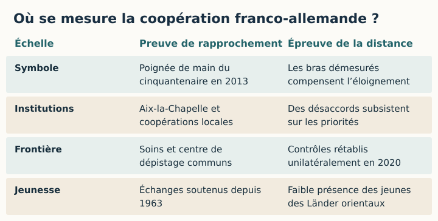

# X-ENS · MP-MPI-PC-PSI · Allemand 2023 — Corrigé brut

*Corrigé rédigé par IA, non officiel. Signalez toute erreur.*

**Rédaction** · GPT-6.2 Astra Ultra · vitesse non renseignée

**Révision (tour 1)** · GPT-6.2 Astra Ultra · vitesse non renseignée

[Sujet commun](https://www.polytechnique.edu/admission-cycle-ingenieur/sites/admission/files/content/2023%20MP-MPI-PC%20SUJET%20D'ALLEMAND%20(XEULSR).pdf) · [Rapport du jury](https://www.polytechnique.edu/admission-cycle-ingenieur/sites/admission/files/content/2023%20MP-MPI-PC%20RAPPORT%20ECRIT%20ALLEMAND%20(XEULSR)_0.pdf)

## A · Synthèse des documents 1 à 4

### Zusammenhalt auf Armeslänge

Unter dem Schild zum fünfzigsten Jahrestag des Élysée-Vertrags reichen sich François Hollande und Angela Merkel die Hand. In Martin Erls Zeichnung von 2013 stehen sie dabei so weit auseinander, dass sich ihre Arme grotesk verlängern müssen. Die Bildunterschrift versichert, man halte zusammen. Wie viel Abstand verträgt eine solche Verbindung? Drei Pressebeiträge über Verträge, Grenzschließungen und Jugendbegegnungen untersuchen auf unterschiedlichen Ebenen, welche Arbeit zwischen zwei feierlich begangenen Jahrestagen zu leisten ist.

Wie Birgit Holzer in der Augsburger Allgemeinen erinnert, war es 1963 keineswegs selbstverständlich, dass aus früheren Kriegsgegnern politische Partner würden. Mit dem Élysée-Vertrag schufen Charles de Gaulle und Konrad Adenauer Bedingungen dafür, dass die Annäherung ihren persönlichen Kontakt überdauerte. Aus dem Abkommen ging das Deutsch-Französische Jugendwerk hervor. Millionen junger Menschen konnten das Nachbarland durch einen Austausch kennenlernen. Auch die regelmäßigen Kontakte zwischen Parlamenten, Ministerien und Regionen machen den besonderen Charakter der Beziehung aus. Der Händedruck der Zeichnung erinnert insofern an eine tatsächliche historische Leistung. Zugleich stellt der Abstand zwischen den beiden Personen die Vorstellung infrage, gemeinsame Institutionen garantierten von selbst politische Nähe.

Der von der Deutschen Welle im Januar 2019 vorgestellte Aachener Vertrag ergänzt das ältere Abkommen und verbindet sehr unterschiedliche Maßstäbe politischen Handelns. In den Grenzregionen geht es um Arbeitsvermittlung, gemeinsame Einrichtungen für Kinder oder Patienten sowie bessere Verkehrsverbindungen. Auf internationaler Ebene unterstützen beide Regierungen einen ständigen deutschen Sitz im Sicherheitsrat der Vereinten Nationen und streben größere europäische Handlungsfähigkeit in der Außenpolitik an. Ein gemeinsamer Rat soll die Zusammenarbeit in Sicherheitsfragen fördern. Über die Prioritäten besteht allerdings selbst innerhalb Deutschlands keine Einigkeit. Der im Beitrag zitierte Linkenpolitiker Stefan Liebich hätte gemeinsamen sozialen Mindeststandards den Vorzug vor militärischer Zusammenarbeit und der Bekämpfung irregulärer Migration gegeben.

Was die neuen Möglichkeiten wert sind, zeigte sich gerade dort, wo die Grenze für viele Menschen zuvor fast unsichtbar geworden war. Als Deutschland im März 2020 ohne vorherige gemeinsame Abstimmung Grenzkontrollen einführte, erlebten Anwohner beiderseits der Grenze dies laut Holzer als Rückschlag. Die enge Verbindung, die Besuche in Paris oder gemeinsame parlamentarische Arbeit öffentlich bezeugten, griff im ersten Augenblick der Krise nicht. Ein gemeinsames Testzentrum und die Behandlung französischer Patienten in deutschen Kliniken zeigen jedoch, dass sich praktische Zusammenarbeit wiederherstellen ließ. Entscheidend war die konkrete Versorgung von Menschen, die sich im Alltag auf offene Übergänge verlassen hatten.

Wer Gelegenheit bekommt, solche Beziehungen überhaupt aufzubauen, hängt zudem stark vom Wohnort ab. Die Süddeutsche Zeitung berichtet über den Befund des Jugendwerks, dass 2019 weniger als vier Prozent der rund 191.000 teilnehmenden Jugendlichen aus dem Osten Deutschlands kamen. Von etwa 2.200 Städtepartnerschaften lagen nur ungefähr 230 im Osten. Dort sind auch französische Unternehmen und französische Einwohner vergleichsweise selten vertreten. Das erschwert Begegnungen, während weniger Schüler die Nachbarsprache lernen. Dabei sind Französischkenntnisse keineswegs Voraussetzung für die Teilnahme. Die pandemiebedingten Reisebeschränkungen verschärften die Schwierigkeiten und ließen die Beteiligung insgesamt einbrechen.

Das Jugendwerk verlangt deshalb mehr Angebote und eine abgestimmte Frankreichstrategie der östlichen Länder. Es versteht die Begegnungen vor dem Hintergrund des Krieges in der Ukraine als Beitrag zum europäischen Frieden. Damit berühren sich die beiden Ebenen des Aachener Vertrags erneut. Die Fähigkeit, in Europa gemeinsam zu handeln, braucht neben politischen Absprachen auch Bürger, die Erfahrungen mit dem Nachbarland machen können. Ein Austausch, den Jugendliche erst nach langen Anfahrten und ohne Unterstützung ihrer Umgebung erreichen, bietet andere Möglichkeiten als eine Partnerschaft, die zum Alltag ihrer Schule gehört. Gerade der Erfolg früherer Begegnungen macht sichtbar, welche Regionen bisher kaum von ihnen profitiert haben.

Die Texte ergeben so ein differenziertes Bild des von Erl überzeichneten Handschlags. Die Staaten haben Verfahren geschaffen, die weit über einzelne Staatsbesuche hinausreichen. Ob die Freundschaft auch unter Belastung trägt, entscheidet sich aber an erreichbaren Angeboten, an rechtzeitiger Verständigung und an der Bereitschaft, unterschiedliche politische Ziele offen auszuhandeln.

*609 mots hors titre, par unités séparées par des espaces.*

## B · Texte d’opinion

Ein verschobener Ministerrat ist ärgerlich. Ein pünktlicher Ministerrat, an dessen Ende beide Regierungen Einigkeit verkünden und anschließend gegeneinander handeln, wäre allerdings schlimmer. In diesem Punkt überzeugt mich Rudolf Balmer. Solange Paris und Berlin ihre Beziehung wie ein Paar behandeln, das sich vor den Gästen keinen Streit erlauben darf, erfahren die Bürger weder, worum gestritten wird, noch, wofür ihre Regierung verantwortlich ist. Die Schwierigkeit beginnt für mich nach dem offenen Wort. Aus zwei ehrlich ausgesprochenen Interessen folgt noch kein gemeinsamer Beschluss.

Das zeigt Balmers Beispiel der Energiepolitik. Ein französischer Präsident, der neue Kernkraftwerke plant, und eine deutsche Regierung, die aus der Kernenergie aussteigen will, können einander vollkommen verstehen und dennoch an unterschiedlichen Entscheidungen festhalten. Wer daraus gleich das Scheitern der Freundschaft ableitet, verlangt politische Gleichförmigkeit von Ländern mit verschiedenen demokratischen Erfahrungen. Ich würde die Frage enger stellen. Welche Folgen hat eine nationale Entscheidung für den Nachbarn, welche Informationen braucht er rechtzeitig und wie verteilen die Länder gemeinsame Kosten? Über diese Punkte ließe sich verhandeln, ohne dass eine Seite ihre gesamte Energiepolitik als Irrtum widerrufen müsste.

Dabei kann ein eingespieltes Verfahren mehr leisten, als die Kritik an diplomatischer Routine vermuten lässt. Ein fester Termin zwingt Ministerien, Unterlagen auszutauschen, offene Punkte zu benennen und jemandem die Verantwortung für den nächsten Schritt zu übertragen. Würden Treffen nur stattfinden, wenn sich die Regierungen schon einig sind, entfielen sie gerade dann, wenn sie am nötigsten wären. Wäre ich für die Vorbereitung eines solchen Rates zuständig, würde ich für jedes strittige Vorhaben vorab zwei kurze Darstellungen veröffentlichen lassen. Die Bevölkerung sollte erkennen können, welche Frage schon geklärt ist und welche Entscheidung aus welchen Gründen noch aussteht.

Die übrigen Mitgliedstaaten haben ebenfalls ein berechtigtes Interesse an dieser Offenheit. Wer in Warschau oder Madrid lebt, hat Paris und Berlin kein Mandat erteilt, europäische Prioritäten allein festzulegen. Eine Verständigung zwischen den beiden Ländern kann Alternativen auf den Tisch bringen und festgefahrene Verhandlungen erleichtern. Sie verliert diesen Vorzug, wenn das fertige Ergebnis den anderen nur noch zur Zustimmung vorgelegt wird. Ein glaubwürdiger Neubeginn hieße für mich deshalb auch, betroffene Nachbarn in die Entwicklung eines Vorschlags einzubeziehen, bevor dessen Ablehnung als Angriff auf die europäische Einheit erscheinen kann.

Balmers Unterscheidung zwischen tatsächlicher Zusammenarbeit und beschönigender Erinnerung würde ich schließlich um die Erfahrung der Grenzregionen ergänzen. Wer im Nachbarland arbeitet oder dort ein krankes Kind behandeln lässt, beurteilt die Partnerschaft an etwas anderem als an der Wärme eines Empfangs. Solche Bürger sollten in einer Krise früh erfahren, was sich für sie ändert, und eine Stelle kennen, die ein Problem auf beiden Seiten verfolgen kann. Schon ein gemeinsam erreichbarer Ansprechpartner würde Vertrauen schaffen, das durch keine historische Geste ersetzt werden kann.

Gerade unter Zeitdruck zählt daher die Frage, wer vor Ort erreichbar ist und wer den Nachbarn anruft, bevor eine überraschende Entscheidung öffentlich wird.

Ich möchte die Gesten trotzdem behalten. An frühere Feindschaft zu erinnern ist mehr als eine freundliche Dekoration, wenn die Erinnerung dazu verpflichtet, dem heutigen Gegenüber auch im Streit zuzuhören. Den Erfolg eines Treffens würde ich daran messen, ob beide Seiten anschließend genauer sagen können, was sie gemeinsam tun werden, worüber sie weiter streiten und wann sie sich dafür wieder an einen Tisch setzen.

*523 mots, selon le même décompte.*

