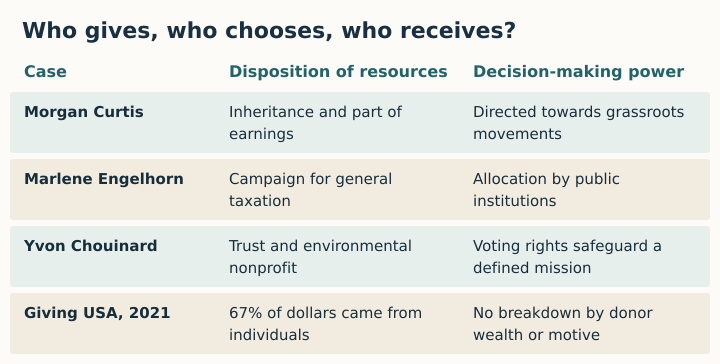

# X-ENS · MP-MPI-PC-PSI · Anglais 2023 — Corrigé brut

*Corrigé rédigé par IA, non officiel. Signalez toute erreur.*

**Rédaction** · GPT-6.2 Astra Ultra · vitesse non renseignée

**Révision (tour 1)** · GPT-6.2 Astra Ultra · vitesse non renseignée

[Sujet commun](https://www.polytechnique.edu/admission-cycle-ingenieur/sites/admission/files/content/2023%20MP-MPI-PC%20SUJET%20D'ANGLAIS%20(XEULSR).pdf) · [Rapport du jury](https://www.polytechnique.edu/admission-cycle-ingenieur/sites/admission/files/content/2023%20MP-MPI-PC-PSI%20RAPPORT%20ECRIT%20ANGLAIS%20(XEULSR).pdf)

## A · Synthèse des documents 1 à 4

### Giving up a fortune, keeping a say?

An heir who asks to be taxed and an entrepreneur who redirects the profits of his company towards the environment might both be described as people giving up fortunes. Yet Emma Bubola's account of Marlene Engelhorn in The New York Times, Erin McCormick's reporting on Patagonia in The Guardian and Amelia Tait's interviews in The Observer reveal substantial differences in what the wealthy are prepared to surrender. The American figures published by Giving USA indicate the scale of the practice against which these choices must be understood.

The reasons for parting with money depend partly on how it was made. Morgan Curtis traces her family fortune back to a cotton business connected with plantation labour and to an ancestor's sugar plantation in Cuba. Directing her inheritance and half her earned income to grassroots causes, including Black and Indigenous organisations, amounts in her eyes to returning resources to communities deprived of land and labour. Leonie Taylor similarly links her inherited advantages to her father's earnings in oil. Yvon Chouinard, by contrast, founded the outdoor clothing business whose profits he now dedicates to environmental protection. His decision extends an existing policy of donating a share of sales and ties the future of the business to the natural world on which he considers it dependent.

Passing on money does not automatically mean passing on authority. The Chouinard family transferred the shares that carry voting rights, representing two per cent of the total, to a trust responsible for protecting Patagonia's mission. The remaining shares went to an environmental nonprofit which is to receive the profits left after reinvestment. This arrangement allows the company to continue trading without the risk that a sale or stock market flotation might displace its priorities. The causes that can benefit are nevertheless determined by the purpose set when the assets were transferred.

For Engelhorn, such discretion is precisely the difficulty. Generous members of her family have supported science, archaeology and music. She questions why the interests of a particular household should determine how exceptional fortunes are distributed. Austria abolished inheritance tax in 2008, and family wealth is an especially important source of European billionaires' fortunes. The heir is campaigning for a general tax that would both fund public decisions and diminish the political influence attached to inherited property. She declines to name the appropriate rate herself. Nor would a personal gift to the state establish an obligation for other wealthy families.

The Giving USA chart puts these conspicuous cases in perspective. Of nearly 485 billion dollars donated to American charities in 2021, about two thirds came from individuals, against nineteen per cent from foundations, nine per cent from bequests and four per cent from corporations. These are shares of the total received, not measures of the proportion of their resources that different donors give away. Nor can the chart identify how much of the individual category came from the very wealthy. The network Resource Generation's expanding membership and commitments to social justice therefore point to a particular form of mobilisation within a much larger practice.

Even among heirs, discomfort need not lead to redistribution. One interviewee in The Observer found that his inheritance deprived him of a sense of purpose. Teaching and therapy helped him determine what he wanted to do with his time, without persuading him to give the money away. Others have found in organised giving a way to act on similar feelings. Across the documents, transfers that look alike on a balance sheet thus answer different questions. One person may seek to repair a historical wrong, another to preserve a company's purpose and another to submit wealth to a decision in which every citizen has a voice. The size of the gift alone cannot settle who gets to decide what it is for.

*627 mots hors titre, par unités séparées par des espaces.*

## B · Texte d’opinion

Carl Rhodes is right to ask who gets to decide what Patagonia's environmental money will buy. A town threatened by rising water has no vote in the trust that protects the company's mission. Its position should not depend on whether a billionaire likes its proposal. Yet the same town may have good reason to welcome an offer to restore a wetland while public authorities argue about their budgets. The distinction I would draw is between accepting help and handing over the job of government.

Rhodes acknowledges that the founder has transferred assets now, a more substantial act than promising to write a cheque at some unspecified point in the future. The arrangement also solves a genuine problem for a founder who wants an enterprise to outlive him. Another owner might drop environmental commitments as soon as they reduced returns. Preserving them through voting rights can make a promise to workers and suppliers credible. That is a legitimate use of control over a company. It gives its trustees no special title to decide whether taxpayers should protect a particular coastline or which communities ought to move.

Consider two neighbouring towns, one with an energetic team able to write a persuasive funding application and one whose planning office has just lost its last engineer. A foundation might quite reasonably choose the first project because it is ready. If public protection followed the same rule, the second town's lack of resources would become the reason it could never acquire any. Government has an obligation to establish the risks, hear those affected and explain how it has allocated money even to people whose request it rejects. A disappointed resident can contest a public decision or vote against the people who made it. Admiration for a founder provides no equivalent remedy.

I would therefore ask three things of a large environmental fund. It should publish how it chooses projects, disclose interests that could affect its decisions and give the people who live with the results a role in assessing them. A fund that finances an experiment should also publish disappointing results. An unsuccessful project may still teach a neighbouring community what to avoid. These conditions would make voluntary money more valuable without pretending that the ability to give it confers a democratic mandate.

The harder test is what the donor is prepared to accept as a citizen. A company can finance conservation and still owe the taxes set by elected representatives. It can fund research and still be bound by an environmental rule it opposed. If the gift earns the giver a private hearing whenever those rules are written, the public may have bought generosity at a very high price. Conversely, if governments use every gift as a reason to cut their own budgets, they encourage precisely the dependence Rhodes fears.

I would accept the help for the wetland. I would also want the town to know who will maintain it in ten years and where the residents of the next town can take their claim. An entrepreneur can put money and imagination into a particular solution. Only public institutions can undertake to listen to people whose needs may never attract an entrepreneur's attention.

*529 mots, selon le même décompte.*

