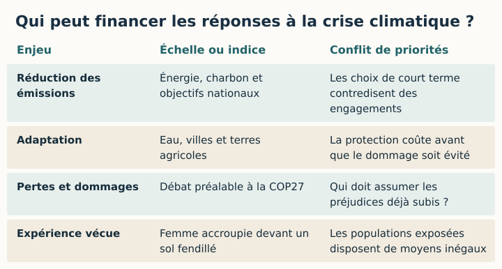

# X-ENS · MP-MPI-PC-PSI · Arabe 2023 — Corrigé guidé

*Corrigé rédigé par IA, non officiel. Signalez toute erreur.*

**Rédaction** · GPT-6.2 Astra Ultra · vitesse non renseignée

**Révision (tour 1)** · GPT-6.2 Astra Ultra · vitesse non renseignée

[Sujet commun](https://www.polytechnique.edu/admission-cycle-ingenieur/sites/admission/files/content/2023%20MP-MPI-PC%20SUJET%20D'ARABE%20(XEULSR).pdf) · [Rapport du jury](https://www.polytechnique.edu/admission-cycle-ingenieur/sites/admission/files/content/2023%20MP-MPI-PC%20RAPPORT%20ECRIT%20ARABE%20(XEULSR).pdf)

## Préparer la composition

Le texte sur la COP27 est daté du 31 octobre 2022, avant les négociations de Charm el-Cheikh. Distinguer ce que demandent les pays, ce qu’ils ont déjà promis et ce qui reste à décider. Une dépense d’adaptation prépare un territoire à des effets attendus. Le financement des pertes et dommages concerne des atteintes déjà subies. Distinguer aussi le réchauffement global, la pollution du milieu de vie et la protection de la couche d’ozone dans la discussion des propositions des enfants.

Dans la photographie, la femme est accroupie au premier plan devant un sol fendillé. Des personnes et un réservoir surélevé se détachent à l’arrière-plan. La légende évoque la lourdeur de la tâche. Décrire la distance produite par la composition sans prétendre connaître les intentions des personnes photographiées. L’opinion peut rapprocher le cahier mouillé d’Assad du droit à l’éducation et les idées de Ghassan et Jana des responsabilités de la municipalité et des industriels.

## A · Synthèse des documents 1 à 4

### أزمة واحدة وأعباء متفاوتة أمام قمة شرم الشيخ

في صورة نشرها موقع العرب تجلس امرأة القرفصاء وتخفض رأسها نحو تربة تشققت أمامها. تبدو على مسافة منها منشآت وأشخاص لا يحتلون من الصورة إلا حيزا صغيرا. يضع عنوان المقال أزمة المناخ في آخر سلم الاهتمامات العربية، أما الصورة فتجعل أثرها في حياة فرد واحد أول ما يراه القارئ. وهذه المسافة بين مركز الاهتمام وموقع الضرر موضوع تتناوله أيضا مواد إندبندنت عربية والميادين والعربي الجديد حين تقارن بين انتشار الخطر على نطاق عالمي وتفاوت القدرة على اتقائه أو تحمل كلفته.

تتناول إندبندنت عربية عمل الخبراء الذين يقدرون آثار الاحترار وإمكانات التكيف معه. فموجات الحر والحرائق والسيول المتعاقبة في أكثر من قارة تخرج الموضوع من باب التوقعات البعيدة. ومع ذلك لا تسير الاستجابة بالسرعة نفسها التي تزداد بها الآثار. فالإقرار بنتائج التقارير لا يخفض الانبعاثات في حد ذاته، بينما تتطلب حماية الناس اليوم تدابير تسبق الخطر المتوقع ولا تنتظر اكتمال الانتقال إلى مصادر طاقة أنظف. ومن هنا تتصل مسألتان كثيرا ما تتنافسان على التمويل، وهما منع مزيد من التغير وتهيئة المجتمعات للتعامل مع القدر الذي صار واقعا أو يصعب تفاديه.

وتتجلى عواقب التأخر بوجه خاص في الشرق الأوسط وشمال أفريقيا. يعرض علي فواز في الميادين أبحاثا عن حرارة قد تجعل الحياة في بعض مدن الخليج أشد مشقة، وعن احتمال انتقال أعداد من سكان دلتا النيل والمناطق الساحلية إلى الداخل تحت ضغط ارتفاع مستوى البحر. وفي الوقت الذي تظل فيه هذه التوقعات مشروطة بمسار الانبعاثات، بدأت ندرة المياه والتصحر يزيدان الضغط على مصادر العيش. فحين تتراجع الموارد يمكن أن يتفاقم النزوح وأن تزداد احتمالات النزاع. ولا يقدم الكاتب المناخ تفسيرا وحيدا لكل صراع، بل يدرسه عاملا يزيد هشاشة وضع اقتصادي وأمني قائم. ويمنح التراب المتشقق في الصورة هذا النقاش الجغرافي الواسع بعدا محسوسا على مستوى الأسرة.

لكن المصالح التي تحدد سياسات الطاقة ليست واحدة. يشير العربي الجديد، قبيل انعقاد المؤتمر في مصر، إلى عودة بعض البلدان الأوروبية إلى الفحم أو إطالة عمل محطاته بعد اضطراب إمدادات الطاقة بسبب الحرب. وتستمر بلدان آسيوية بدورها في تطوير مناجمها. وفي هذه الظروف يصعب على قادة بعض الدول الأفريقية قبول مطالبتهم بترك مواردهم الأحفورية دون استغلال في الوقت الذي تعود فيه الاقتصادات الكبرى إلى ما تعهدت بتقليصه. وهذا يعيد إلى الواجهة التوتر الذي يصفه فواز بين أهداف التنمية الداخلية والاعتبارات البيئية، كما يفسر لماذا لا تتحول الأدلة العلمية المتاحة لجميع الحكومات إلى القرارات نفسها في كل بلد.

ويتخذ الخلاف صورة أدق عند السؤال عمن يدفع. فهناك أموال لازمة لتحويل نظم الطاقة وخفض الانبعاثات، وأخرى لتقوية قدرة المدن والمزارعين على التكيف، ومسألة ثالثة هي تعويض ما وقع فعلا من خسائر وأضرار. وضعت مصر هذه المسألة الأخيرة في صدارة اهتماماتها، وطالبت البلدان النامية بصندوق مخصص لها. أما دول غنية فخشيت أن يفضي إقرار آلية جديدة إلى التزام مالي عن أضرار تعود أسبابها إلى تاريخ التصنيع. وفي حين أبدى الأوروبيون والأميركيون انفتاحا على النقاش، ظل الاتفاق على الصندوق نفسه غير حاصل وقت كتابة المقال. وتزيد الوعود المالية السابقة التي لم تنفذ كاملة من صعوبة طلب الثقة في تعهد جديد.

وتشمل القضايا المطروحة أيضا طريقة عمل المصارف الإنمائية وكلفة الاقتراض، ومقدار الأموال التي تصل إلى مشروعات التكيف، ومدى تحديث الحكومات خططها الوطنية لخفض الانبعاثات. فالدولة المعرضة للجفاف تحتاج إلى مشروع يحمي مياهها، لكن شروط التمويل قد تبعده عن متناولها حتى حين يتفق الجميع على فائدته. وبالمثل لا يكفي إعلان هدف عالمي إن بقي عدد كبير من الخطط الوطنية على حاله. ويربط ذلك بين الرسالة التي حملها الخبراء في بداية العام والأسئلة السياسية التي تسبق القمة في نهايته.

تلتقي المواد بذلك عند تفاوت مزدوج. يمكن أن يعيش من ساهم بقسط صغير من الانبعاثات في منطقة تهددها الحرارة أو قلة المياه قبل غيرها، وأن يجد نفسه أقل قدرة على تمويل الاستعداد لها. وتضع صورة المرأة في المقدمة ما يوشك أن يختفي وراء الجداول والخلافات الدبلوماسية، وهو أن التأخر في القرار العام يتحول في أماكن بعينها إلى عبء يومي على أشخاص محددين.

*609 mots hors titre, par unités séparées par des espaces.*

## B · Texte d’opinion

أكثر ما استوقفني في مقال هند سعيد عن الأطفال والمناخ هو الكراسة المبتلة التي حملها أسعد حين اضطر إلى مغادرة بيته بعد السيول في السودان. يمكن لمؤتمر أن يحصي البيوت المتضررة وأن يحسب كلفة ترميم مدرسة. أما ذلك الدفتر فيذكرني بأن طفلا كان يتعلم شيئا بالأمس ويريد أن يكمل تعلمه اليوم. لذلك أوافق الكاتبة على ضرورة الاستماع إلى الصغار حين نقدر آثار تغير المناخ، وأرى أن علينا أن نوضح ما الذي سيفعله الكبار بما سمعوه بعد أن تنتهي ورشة العمل وتغلق قاعة المؤتمر.

حين يتكلم طفل عن الخوف أو فقدان مكان مألوف فهو يقدم معرفة لا يقدمها بالضرورة جدول للخسائر. وقد يكون أول من ينتبه إلى أن الطريق البديل إلى المدرسة يعرضه للخطر أو أن الماء المتاح فيها لم يعد صالحا للشرب. لكن الشهادة تفقد قيمتها إن اكتفينا بوصف صاحبها بأنه صامد. لا يملك أسعد أن يعيد فتح الطريق أو أن يضمن وجود معلم في المكان الذي نزح إليه. وأفضل رد على قصته في تقديري أن تعين الجهات المسؤولة شخصا يستطيع إخبار الأسرة أين يتابع الطفل دروسه غدا، وأن توفر ما يحتاجه المعلم هناك لاستقباله. الاعتراف بقدرته على التعبير يوجب الاستجابة ولا يبرر انتظار أن يتكيف بمفرده.

تعجبني أيضا مقترحات غسان عن منع رمي النفايات وجمعها، وما تقوله جنى عن تنقية المياه وإعادة استعمال المواد. ففيها ملاحظة للمحيط القريب وفهم لأن فعل الواحد يمكن أن يضر بمن لا يراه. ويمكن لمدرسة أن تبدأ بتتبع مصير المواد التي يفرزها تلاميذها. هل تأتي البلدية لجمعها على نحو منفصل، أم تخلطها الشاحنة من جديد؟ إن وجد الأطفال أن الجهود ذهبت سدى، فالدرس المفيد أن يسألوا المسؤول عن الخدمة كيف ستصلح. ولا أرى عدلا في أن يحمل طفل مسؤولية نفايات مصنع أو أن يطلب منه إصلاح المناخ بقنينة أعاد استعمالها.

ومن احترام هذه الأصوات أيضا أن نناقش التفسير العلمي حين يحتاج إلى تصحيح. فحماية الأسماك من الأكياس البلاستيكية هدف مفهوم، وحماية طبقة الأوزون والحد من انبعاثات الغازات المسببة للاحترار مسألتان تختلفان في أسبابهما وفي وسائل التعامل معهما. يستطيع المعلم أن يبني على سؤال غسان تجربة أو بحثا يميز فيه التلاميذ بين هذه المشكلات. بذلك يصبح الطفل شريكا يتعلم ويختبر أفكاره، بعد أن كان يمكن أن يكتفي الكبار بالتصفيق لعبارة مؤثرة تحجب الفروق بين الأخطار.

ويشدد المقال على تفاوت الضرر بين الأطفال أنفسهم. فعندما تفسد مياه الشرب بعد فيضان، تستطيع أسرة أن تشتري ماء مأمونا وتنتقل إلى مكان آخر، وقد تعجز أسرة قريبة عنها عن دفع ثمن النقل. لا تكفي هنا حملة توعية مشتركة للجميع. ينبغي تأمين المياه والخدمات الصحية أولا لمن حرم منها، وإتاحة مكان مستقر للدراسة لمن فقد بيته، وإشراك الأهالي في تحديد الحاجة التي لا تحتمل الانتظار. ويمكن للأطفال أن يبينوا ما تغير بالفعل بعد تنفيذ التدبير، بما في ذلك ما بقي عسيرا وكان غائبا عن حساب المصممين.

ولو خصصت المدرسة وقتا يسمع فيه مجلس البلدية أسئلة التلاميذ ويرد عليها كتابة، لاستطاعوا متابعة الوعد بعد سنة ومقارنة النتيجة بما طلبوه من قبل.

أتصور أن أجدى نهاية لورشة القاهرة ستكون موعدا آخر تجلس فيه الجهة التي سمعت الشهادات أمام أصحابها لتشرح ما فعلت وما عجزت عنه ولماذا. عندئذ سيكون للكراسة المبتلة أثر يتجاوز لحظة التعاطف. وسيعرف الأطفال أن الكلام في الشأن العام حق لهم، وأن المسؤولية عن حماية هذا الحق تقع على من يملك الميزانية والقرار.

*513 mots, selon le même décompte.*
