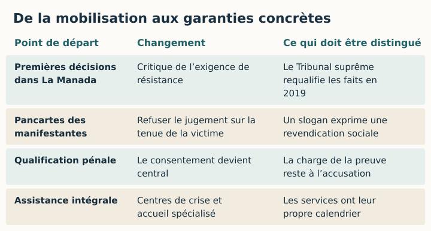

# X-ENS · MP-MPI-PC-PSI · Espagnol 2023 — Corrigé brut

*Corrigé rédigé par IA, non officiel. Signalez toute erreur.*

**Rédaction** · GPT-6.2 Astra Ultra · vitesse non renseignée

**Révision (tour 1)** · GPT-6.2 Astra Ultra · vitesse non renseignée

[Sujet commun](https://www.polytechnique.edu/admission-cycle-ingenieur/sites/admission/files/content/2023%20MP-MPI-PC%20SUJET%20D'ESPAGNOL%20(XEULSR).pdf) · [Rapport du jury](https://www.polytechnique.edu/admission-cycle-ingenieur/sites/admission/files/content/2023%20MP-PC%20RAPPORT%20ECRIT%20ESPAGNOL%20(XEULSR).pdf)

## A · Synthèse des documents 1 à 4

### Del lema en la pancarta a la libertad protegida por ley

Cuando cinco hombres agredieron sexualmente a una joven en los sanfermines de 2016, la reacción de la víctima durante los hechos acabaría ocupando un lugar central en el proceso. Las protestas que siguieron a las primeras sentencias llevaron a las calles españolas una pregunta que reapareció en el Congreso en 2022. ¿Qué debe acreditar la justicia para proteger la libertad sexual? Un editorial de El País, dos artículos de El Periódico de España y una fotografía de una manifestación muestran cómo una demanda social se tradujo en una reforma cuyo alcance rebasa el Código Penal.

El caso de La Manada puso de manifiesto las consecuencias de distinguir entre abuso y agresión en función de la violencia o la intimidación. El bloqueo de la joven, que no ofreció resistencia, influyó en la calificación inicial de los hechos como abusos. El Tribunal Supremo corrigió esa calificación en 2019, pero la discusión sobre las categorías legales ya trascendía una sentencia concreta. En la fotografía publicada por El Periódico, una manifestante lleva un cartel que enfrenta la longitud de su falda a las carencias educativas de quien la juzga. Otros lemas en castellano y catalán rechazan que sea la mujer quien tenga que justificar su aspecto o probar su respetabilidad para ser escuchada.

La movilización encontró traducción institucional, aunque distó de haber unanimidad. El País recuerda la ausencia inicial de mujeres en la comisión encargada de revisar la legislación penal y el cambio posterior en su composición. Violeta Molina Gallardo recoge la satisfacción de la ministra de Igualdad por una norma nacida de una larga negociación, vinculada a las demandas feministas, al Pacto de Estado contra la violencia de género y al Convenio de Estambul. La mayoría parlamentaria que la aprobó dejó fuera al PP y a la extrema derecha. Tampoco prosperó el intento de abordar en el mismo texto determinados aspectos del proxenetismo, que dividían a los propios apoyos del Gobierno.

El cambio principal consiste en calificar como agresión un acto que atente contra la libertad sexual y no cuente con consentimiento. Las circunstancias han de permitir apreciar actos que expresen libre y claramente la voluntad de participar. Frente a las dudas de un padre que teme por la defensa de su hijo adolescente, las juristas consultadas por Patricia Martín precisan que no se exige firmar un acuerdo ni corresponde al acusado demostrar su inocencia. La acusación sigue teniendo que probar los hechos. Si el encuentro tuvo lugar en la intimidad, valorar el testimonio y buscar otros indicios seguirá planteando dificultades. Una duda subsistente se resuelve a favor del acusado. Lo que cambia es la relevancia que se atribuía a la resistencia física de la víctima.

La amplitud de la protección también modifica el sentido práctico del debate. La ley contempla prevención, detección, acompañamiento y reparación, además del castigo. Incorpora la difusión no consentida de material íntimo y agrava la respuesta ante la sumisión química. Molina Gallardo distingue la entrada en vigor de gran parte de la norma, en octubre, del plazo más largo previsto para garantizar la asistencia especializada y gratuita. Entre los servicios figuran centros de crisis abiertos a cualquier hora y atención adaptada a menores. Una persona puede necesitar esa asistencia aunque demostrar lo ocurrido ante un tribunal siga siendo difícil.

La relación entre la protesta y la ley se entiende así en dos direcciones. Los carteles impugnaban una forma de mirar a las víctimas que había tenido efectos en sus vidas y en los juzgados. El nuevo criterio penal y los recursos de atención dan respuesta a esa demanda en ámbitos distintos. Las explicaciones de las juristas señalan, al mismo tiempo, la distancia entre el contenido de la reforma y los temores que suscita su formulación como consigna.

*619 mots hors titre, par unités séparées par des espaces.*

## B · Texte d’opinion

Al leer el editorial de El Periódico me llamó la atención la distancia entre dos imágenes. En una, las instituciones responden a una movilización y reconocen mejor la libertad de las personas. En la otra, unos jóvenes creen poder dirigirse como grupo a las alumnas de un edificio vecino de una manera que difícilmente aceptarían para sí mismos. La segunda escena no invalida la primera. Sí obliga a preguntar qué tendría que cambiar al día siguiente de publicarse la ley para que alguien notara la diferencia en su propia vida.

El editorial acierta al atender al carácter coordinado de los insultos. Aunque quienes gritaban pretendieran hacer una broma, una estudiante que escucha desde su ventana no tiene por qué averiguar cuál de ellos hablaba en serio antes de sentirse segura en su habitación. Su libertad incluye poder seguir allí sin tener que cerrar la ventana, mudarse o conceder una entrevista para explicar por qué le molestó. Una residencia responsable debería ofrecer un interlocutor a quien acudir y explicar qué medidas se adoptarán y en qué plazo. Las afectadas deberían poder decidir si quieren participar en una actividad de reparación. Obligarles a escuchar otra vez los insultos ante un público bienintencionado sería imponerles un esfuerzo más.

Me parece igualmente importante distinguir una decisión educativa de un proceso penal. Si se infringen unas reglas de convivencia, el centro puede intervenir conforme a ellas, escuchar a todas las partes y exigir responsabilidades individuales. Para imponer una pena, en cambio, un tribunal debe establecer los hechos y su encaje en un delito. Confundir ambos planos alimenta la idea de que sólo hay dos respuestas posibles, considerar el incidente una gracia o pedir para todos la sanción más grave. Entre ambas existen actuaciones que pueden modificar las condiciones en que se repite una conducta.

El artículo tiene también razón al rechazar la caricatura del contrato firmado. En una conversación sobre consentimiento con adolescentes, empezaría por un acuerdo que puede cambiar. Una persona puede haber querido una cosa al principio de la noche y dejar de quererla después. Reconocerlo exige escuchar incluso cuando uno preferiría otra respuesta. El papel de la escuela es dar ocasión de aprender esa responsabilidad antes de que surja un conflicto. No se trata de convertir a los jóvenes en abogados que acumulen pruebas para defenderse de sus parejas.

Del mismo modo, el respeto en un juzgado se mide por prácticas concretas. Es posible examinar con rigor una declaración sin repetir preguntas irrelevantes sobre la ropa o la vida anterior de quien denuncia. También es posible ofrecerle atención psicológica mientras se investiga, sin que la prestación de esa ayuda determine de antemano la culpabilidad de nadie. Un servicio gratuito que sólo resulte accesible con largas listas de espera cumpliría mal la promesa formulada en el boletín oficial.

Yo mediría el cambio en esos lugares corrientes. Una estudiante sabe a quién dirigirse, una persona puede retirar su consentimiento sin temor y quien denuncia obtiene información comprensible sobre lo que ocurrirá después. Son avances menos fotogénicos que una votación o un escándalo viral. Precisamente por eso necesitan presupuestos, responsables identificables y una atención que dure más que el ciclo de una noticia.

*528 mots, selon le même décompte.*

