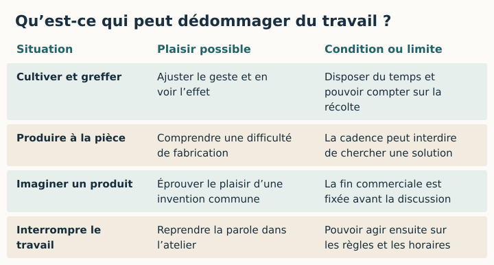

# X-ENS · MP-MPI-PC-PSI · Français 2023 — Corrigé brut

*Corrigé rédigé par IA, non officiel. Signalez toute erreur.*

**Rédaction** · GPT-6.2 Astra Ultra · vitesse non renseignée

**Révision (tour 1)** · GPT-6.2 Astra Ultra · vitesse non renseignée

[Sujet commun](https://www.polytechnique.edu/admission-cycle-ingenieur/sites/admission/files/content/2023%20MP-MPI-PC%20SUJET%20DE%20FRANCAIS%20(XEULSR).pdf) · [Rapport du jury](https://www.polytechnique.edu/admission-cycle-ingenieur/sites/admission/files/content/2023%20MP-MPI-PC-PSI%20RAPPORT%20ECRIT%20FRANCAIS.pdf)

## Dissertation

Le paysan qui greffe un arbre ne saurait laisser ses doigts travailler tout seuls. Il lui faut apprécier une écorce, ménager une ouverture et prévoir une croissance que personne ne voit encore. Le lecteur des *Géorgiques* peut prendre plaisir à suivre cette opération dans le poème de Virgile. A-t-il pour autant éprouvé le plaisir du cultivateur qui engage dans cette greffe une partie de sa récolte future ? L’écart entre ces deux expériences permet d’entendre la prudence d’un conseil que Condorcet donne à sa fille en 1794. Il souhaite qu’elle puisse choisir une activité où son esprit accompagne sa main, sans s’y épuiser, et qui porte en elle de quoi compenser son coût. La main a sa place dans ce souhait. La peine également. La difficulté tient à cette promesse d’une satisfaction qui naîtrait de l’activité même, alors que tant de gens ont d’abord à gagner leur vie dans des conditions qu’ils ne choisissent pas. Avec Virgile, Simone Weil et la version hyper-brève de *Par-dessus bord* de Michel Vinaver, nous chercherons où cette satisfaction peut se trouver. Nous examinerons ensuite ce qui la dérobe jusque dans les métiers les plus inventifs, avant de nous demander quelle portée collective peut prendre un conseil adressé à une personne.

### Le plaisir de comprendre son geste

L’une des délicatesses de Condorcet consiste à ne pas ranger les métiers suivant une hiérarchie qui dispense de regarder ce qu’on y fait. Sa fille pourrait exercer une activité manuelle. Tout dépend de ce qui occupera son esprit pendant que ses doigts travailleront. Virgile permet de saisir cette nuance dans la différenciation patiente des tâches qui incombent au cultivateur. Au premier livre des *Géorgiques*, l’homme qui va labourer doit connaître les vents, les habitudes du ciel et les aptitudes du lieu. Le meilleur usage d’un sol s’apprend en observant ce qu’il a déjà porté et ce qu’il peut supporter. De telles décisions ne sont pas un examen théorique que le paysan passerait avant de se mettre enfin au travail. Il faut bien que celui qui tient l’outil puisse reconnaître dans la résistance de la terre une information qui confirme ou rectifie sa décision. Voilà un plaisir très précis, celui d’avoir perçu une différence que l’on ignorait auparavant et de lui avoir apporté une réponse appropriée.

Dans « Condition première d’un travail non servile », Simone Weil s’arrête devant une poulie. Le travailleur peut en suivre le mouvement de son corps et en saisir la raison par la géométrie. Weil y lit aussi une image de la limite qui s’impose aux créatures. Sa proposition suppose que le rythme du travail laisse place à cette attention et que l’éducation en ait donné les moyens. Voilà qui précise « où l’esprit s’exerce ». L’esprit peut se tourner, au cœur du même geste, vers une vérité que la consigne de production n’exigeait pas. Weil lui donne un horizon spirituel. Condorcet, plus réservé sur l’objet de la pensée de sa fille, se demande si celle qui travaille y trouve une satisfaction à elle.

Ce plaisir peut tenir au résultat et s’étendre sur un temps plus long qu’une journée de labeur. Au quatrième livre des *Géorgiques*, le vieillard de Corycos tire d’un petit terrain délaissé une abondance que de plus riches pourraient lui envier. Il sait obtenir les premiers fruits et profiter de récoltes successives. Le poète imagine l’homme qui rentre le soir et garnit sa table de biens venus de chez lui. Cette joie a ses conditions matérielles, une parcelle, des outils, des saisons assez favorables. Mais elle tient aussi à une continuité entre le choix de planter, le soin donné à telle plante et le moment où l’on peut manger le fruit. Dans un tel cas le plaisir ne vient pas seulement après la peine. L’anticipation du résultat peut déjà habiter le geste pénible. Ce que conseille Condorcet n’est donc nullement de choisir toujours le métier qui coûtera le moins. Une activité exigeante peut procurer davantage à celui qui voit comment sa propre décision y a compté.

### Qui a le pouvoir de choisir son travail ?

Mais qui dispose du temps et du droit de faire cette expérience ? On peut comprendre le fonctionnement d’une machine et n’avoir pas le droit de s’arrêter pour remédier à ce que l’on a compris. Pour Simone Weil à l’usine, la cadence impose à la conscience un régime singulier. Il faut maintenir une attention suffisante pour ne pas manquer un geste et en même temps chasser de son esprit les pensées qui feraient perdre du temps. Le soir, l’épuisement atteint jusqu’à la faculté d’imaginer une autre façon de vivre. La fille de Condorcet peut réfléchir au genre de travail qu’elle aimerait exercer. L’ouvrière payée aux pièces se demande d’abord ce que lui coûteront quelques minutes perdues. Lui conseiller de prendre davantage de plaisir à mettre de l’intelligence dans son geste serait cruel si les conditions de sa rémunération font de toute initiative un risque. Ce sont ici la distribution du temps et l’autorité sur la machine qui séparent l’esprit de la main.

Le travail auquel on convie expressément l’esprit peut tout aussi bien décevoir la promesse de Condorcet. Dans l’entreprise de papier hygiénique de *Par-dessus bord*, la concurrence fait du renouvellement du produit et de son image une question de survie commerciale. Lors d’une séance de recherche d’idées, chacun est invité à laisser jouer ses associations. Les mots circulent, les inhibitions ordinaires se relâchent, des adultes se prennent au jeu d’inventer ensemble. Une lecture qui verrait seulement de la contrainte dans cette scène manquerait son ressort comique et la part de plaisir que les participants peuvent effectivement éprouver. Toutefois la finalité de leur liberté est décidée avant la première proposition. Le groupe n’a reçu aucun mandat pour choisir ce qu’il va produire ni pour demander à quel besoin répondrait un produit nouveau. Il peut tout imaginer dans les limites d’une opération de vente. Le plaisir de participer peut dès lors faciliter l’adhésion des salariés à des décisions qui leur échappent. L’esprit occupé avec agrément n’est pas encore l’esprit qui dispose de son travail.

Le modèle agricole lui-même fait apparaître une limite au calcul du dédommagement. La fin du troisième livre des *Géorgiques* déploie les ravages d’une épizootie. L’animal que le laboureur a nourri et dont il a partagé l’effort tombe au milieu du travail. La compétence, le temps accumulé, le soin apporté la veille à une bête peuvent se perdre en un instant. Le poète fait percevoir la disproportion entre la durée de l’effort et la soudaineté de la perte. Une vie active ne peut donc être appréciée comme un marché dont on saurait d’avance que le résultat compensera la mise. Il importe ici d’écouter à nouveau celui qui dit « choisis ». Il donne un conseil à sa fille dans l’incertitude de son propre avenir et du sien. Il ne prétend pas pouvoir lui garantir une récolte heureuse. Sa parole vaut plutôt comme l’autorisation de compter pour quelque chose, au moment d’un choix, l’expérience de celle à qui incombera la peine.

### Les conditions collectives d’un choix individuel

Si cette autorisation doit avoir un sens pour d’autres que les privilégiés, il faut élargir la question. Qui peut aménager le travail pour que l’exercice de l’esprit y demeure possible sans devenir lui-même exténuant ? Simone Weil décrit dans « La vie et la grève des ouvrières métallos » le changement qui se produit lorsque les ouvriers occupent l’usine en 1936. Le lieu de l’obéissance devient un endroit où l’on a le temps de regarder les autres, de leur parler et d’éprouver la joie d’être ensemble. Les machines à l’arrêt ne produisent rien. Ce paradoxe est instructif pour notre sujet. Ce qui réjouit tient en grande partie à la suspension de règles qui passaient auparavant pour nécessaires au fonctionnement de toute usine. La joie de la grève ne prouve pas que l’on pourrait fabriquer indéfiniment sans règles. Elle prouve que la possibilité de redresser la tête et de prendre la parole entre dans le coût humain d’un mode de production. Dès lors l’organisation de l’atelier peut faire elle aussi l’objet d’une décision.

L’art de Vinaver met au jour une autre condition. Le spectateur entend, dans la même pièce, la parole de ceux qui dirigent l’entreprise, celle de ceux qui cherchent à vendre, l’histoire d’une famille et les secousses que provoque la concurrence américaine. Il peut rapprocher ce que les personnages vivent séparément. Une décision qu’un dirigeant trouve exaltante prend un tout autre visage lorsqu’elle atteint un salarié dont elle menace la place. Par conséquent, même si les participants à la séance d’invention disent sincèrement s’être amusés, l’entreprise ne saurait porter ce plaisir au crédit de tous comme si les efforts et les gains se partageaient d’eux-mêmes. Il faudrait que chacun puisse faire entendre le coût qu’il supporte et intervenir sur les transformations de son activité. L’intelligence du travail que Condorcet souhaite à une personne comporte aussi cette faculté de mettre son expérience en rapport avec celle des autres.

Il demeure enfin quelque chose de précieux dans la modestie du « sans trop ». Rechercher à toute force le travail passionnant peut conduire à justifier qu’il envahisse toute la vie. Le vieillard de Virgile retourne à sa table. Dans ce moment que le poème prend soin de représenter, il peut jouir de ce qu’il a fait, et il cesse de faire. L’ouvrière qui rentre si épuisée que rien, même au-dehors, ne paraît plus mériter d’être entrepris subit une dépossession qui déborde le temps de travail. La mesure de l’effort se juge aussi aux possibilités qu’il laisse subsister. Un métier digne d’être choisi peut avoir des moments ennuyeux et une utilité que personne ne songerait à célébrer. Il répondra déjà à une part profonde du conseil de Condorcet s’il laisse à celui qui l’exerce assez de force pour décider de reprendre demain, d’apprendre autre chose ou de goûter aujourd’hui un plaisir qu’il ne doit à aucun employeur.

Le conseil d’un père à sa fille s’avère ainsi plus exigeant qu’une invitation à suivre ses goûts. Il fait du plaisir éprouvé par la personne qui travaille un élément légitime d’appréciation de son activité. Les œuvres permettent d’en préciser l’objet, la justesse d’un geste, la compréhension de son effet, le partage d’une invention, le retour vers le fruit du travail accompli. Elles en font aussi ressortir la fragilité lorsque la cadence, la division du pouvoir ou la violence d’un événement séparent l’effort de ce qui aurait pu le justifier. Aucune occupation ne garantit un solde heureux. Une exigence demeure à la portée de la décision commune, celle de donner à la personne qui fournit l’effort une prise sur sa forme et la possibilité de dire ce qu’il lui coûte. C’est à cette condition que le verbe « choisir » pourra décrire autre chose que la chance déjà acquise de quelques-uns.

[Programme officiel](https://www.education.gouv.fr/bo/22/Hebdo20/ESRS2213517A.htm) · [Weil, Condition première d’un travail non servile](https://fr.wikisource.org/wiki/La_Condition_ouvri%C3%A8re/17)
