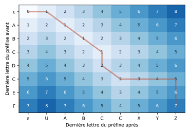
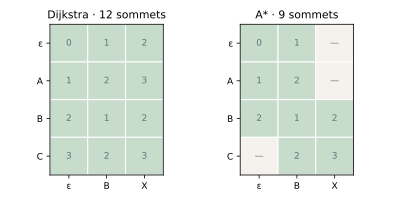

# X-ENS MP–PC–PSI · Informatique B 2023 · Corrigé brut

*Corrigé rédigé par IA, non officiel. Signalez toute erreur.*

**Rédaction** · GPT-6.2 Astra Ultra · vitesse non renseignée · 24 novembre 2026

## I · Différentiels à positions fixes

### Question 1 · Tester l’égalité caractère par caractère

Comparer les longueurs puis les caractères de même indice. En cas de longueurs égales $n$, le pire cas prend $\Theta(n+1)$ et l’espace auxiliaire est constant. Une longueur différente est détectée en temps constant. Deux textes vides sont égaux.

```python
def textes_égaux(texte1, texte2):
    if len(texte1) != len(texte2):
        return False
    for i in range(len(texte1)):
        if texte1[i] != texte2[i]:
            return False
    return True
```

### Question 2 · Distance à positions fixes

Incrémenter le compteur à chaque paire de caractères différents. Pour deux textes de longueur $n$, la fonction coûte $\Theta(n+1)$ en temps et $O(1)$ en espace. Pour « visa » et « vais », trois positions diffèrent.

```python
def distance(texte1, texte2):
    total = 0
    for i in range(len(texte1)):
        if texte1[i] != texte2[i]:
            total += 1
    return total
```

### Question 3 · Alphabet commun ou disjoint

Le dictionnaire mémorise l’existence d’un caractère, indépendamment de ses répétitions. Sous l’hypothèse de coût constant du sujet pour les opérations de dictionnaire, le temps est $O(1+n+m)$ pour des longueurs $n,m$. L’espace est proportionnel au nombre de caractères différents du premier texte. Un texte vide n’a de caractère commun avec aucun texte.

```python
def aucun_caractère_commun(texte1, texte2):
    présents = {}
    for c in texte1:
        présents[c] = True
    for c in texte2:
        if c in présents:
            return False
    return True
```

### Question 4 · Tranches maximales de différences

Ici `tranche` est le constructeur à **trois** arguments de la partie I. Une tranche est produite pour chaque intervalle maximal de désaccords. Deux tranches sont donc séparées par au moins une position d’accord, et l’ordre du parcours donne l’ordre exigé. L’indice avance au plus $n$ fois ; les deux copies de sous-listes de chaque tranche ne copient ensemble qu’au plus $2n$ caractères. Le temps total est $O(n+1)$.

```python
def différentiel(texte1, texte2):
    résultat = []
    i = 0
    while i < len(texte1):
        if texte1[i] == texte2[i]:
            i += 1
        else:
            début_bloc = i
            while i < len(texte1) and texte1[i] != texte2[i]:
                i += 1
            résultat.append(tranche(début_bloc, texte1[début_bloc:i],
                                   texte2[début_bloc:i]))
    return résultat
```

### Question 5 · Appliquer un différentiel fixe

Copier le texte, puis remplacer les positions des tranches par leurs caractères « après ». Les intervalles sont disjoints, de longueur totale au plus $n$. La copie requiert $\Theta(n+1)$ et les modifications $O(n)$ : temps et espace de résultat sont linéaires.

```python
def applique(texte1, diff):
    résultat = texte1[:len(texte1)]
    for tr in diff:
        d = début(tr)
        nouveau = après(tr)
        for k in range(len(nouveau)):
            résultat[d+k] = nouveau[k]
    return résultat
```

### Question 6 · Inverser les tranches

Échanger « avant » et « après » en conservant le début de chaque tranche. Les textes de tranche sont supposés immuables : le nouveau dictionnaire peut partager leurs références. L’application inverse remplace alors exactement les nouveaux caractères par les anciens. Inverser deux fois redonne des tranches égales champ par champ. Pour $k$ tranches, le temps et la taille de la nouvelle liste sont $O(k+1)$.

```python
def inverse(diff):
    résultat = []
    for tr in diff:
        résultat.append(tranche(début(tr), après(tr), avant(tr)))
    return résultat
```

### Question 7 · Modifier puis annuler une version

Pour modifier, empiler le différentiel **avant** de remplacer le texte courant. Enregistrer une copie du texte reçu évite qu’une modification extérieure ultérieure n’altère la version. Pour annuler, dépiler un seul différentiel, l’inverser, l’appliquer au texte courant et retourner le nouveau contenu courant. Les deux opérations prennent $O(n+1)$ sur des textes de longueur $n$. Même une modification identique empile un différentiel vide : elle crée bien une version de plus.

```python
def modifie(texte_versionné, texte):
    ancien = courant(texte_versionné)
    historique(texte_versionné).append(différentiel(ancien, texte))
    remplace_courant(texte_versionné, texte[:len(texte)])

def annule(texte_versionné):
    dernier = historique(texte_versionné).pop()
    ancien = applique(courant(texte_versionné), inverse(dernier))
    remplace_courant(texte_versionné, ancien)
    return ancien
```

## II · Positions variables et fusion

### Question 8 · Poids d’un différentiel variable

Additionner les deux longueurs de chaque tranche. Pour $k$ tranches, le temps est $\Theta(k+1)$ et le surcroît d’espace est constant, car la longueur d’une liste déjà construite s’obtient en $O(1)$. Une substitution de caractère compte ici comme une suppression et une insertion, soit 2.

```python
def poids(diff):
    total = 0
    for tr in diff:
        total += len(avant(tr)) + len(après(tr))
    return total
```

### Question 9 · Récurrence de distance d’édition

Les bords valent $M[i][0]=i$ et $M[0][j]=j$. Si $s_i=t_j$, on peut garder ce caractère commun et $M[i+1][j+1]=M[i][j]$. Par exemple, via une plus longue sous-suite commune, il existe un alignement optimal qui apparie les deux dernières lettres égales. Sinon,

$$
M[i+1][j+1]=1+\min(M[i][j+1],M[i+1][j]).
$$

En effet les derniers caractères distincts ne peuvent être appariés ensemble. Il faut supprimer celui du premier texte ou insérer celui du second ; une transformation optimale du préfixe complète chacune des deux possibilités. Une substitution directe de coût 1 ne fait pas partie des opérations du sujet.

### Question 10 · Construire toute la matrice

Initialiser les deux bords puis parcourir l’intérieur par lignes et par colonnes croissantes. Les trois prédécesseurs de Q9 sont alors prêts. Le temps et l’espace valent $\Theta((n+1)(m+1))$. La case terminale de la figure 3 vaut 7.

```python
def levenshtein(texte1, texte2):
    n, m = len(texte1), len(texte2)
    M = [[0 for j in range(m+1)] for i in range(n+1)]
    for i in range(n+1):
        M[i][0] = i
    for j in range(m+1):
        M[0][j] = j
    for i in range(n):
        for j in range(m):
            if texte1[i] == texte2[j]:
                M[i+1][j+1] = M[i][j]
            else:
                M[i+1][j+1] = 1 + min(M[i][j+1], M[i+1][j])
    return M
```

### Question 11 · Reconstruire un différentiel optimal

Cette fonction remplace la fonction homonyme de Q4 et utilise le constructeur à **quatre** arguments de la partie II. Remonter depuis $(n,m)$ en choisissant un prédécesseur qui réalise la récurrence. Enregistrer chaque appariement gratuit. Les extrémités des textes et les appariements consécutifs délimitent les tranches ; deux tranches produites sont toujours séparées par au moins un caractère conservé.

Les indices avant et après progressent chacun dans leur propre texte. Le poids total est le nombre d’arêtes unitaires de la remontée et vaut donc $M[n][m]$. Si les deux sous-textes d’une même tranche avaient un caractère commun, l’apparier entre ses deux ancres économiserait une suppression et une insertion sans affecter le reste du chemin. Cela contredirait l’optimalité. La remontée prend au plus $n+m$ pas ; la relecture des ancres et les découpes de sous-listes disjointes coûtent en tout $O(n+m+1)$.

```python
def différentiel(texte1, texte2, M):
    n, m = len(texte1), len(texte2)
    i, j = n, m
    ancres = []
    while i > 0 or j > 0:
        if i > 0 and j > 0 and texte1[i-1] == texte2[j-1]:
            i -= 1
            j -= 1
            ancres.append((i, j))
        elif i > 0 and M[i][j] == M[i-1][j] + 1:
            i -= 1
        else:
            j -= 1

    résultat = []
    i, j = 0, 0
    while len(ancres) > 0:
        u, v = ancres.pop()
        if i < u or j < v:
            résultat.append(tranche(i, texte1[i:u], j, texte2[j:v]))
        i, j = u + 1, v + 1
    if i < n or j < m:
        résultat.append(tranche(i, texte1[i:n], j, texte2[j:m]))
    return résultat
```



### Question 12 · Détecter une zone de conflit

Parcourir simultanément les deux listes ordonnées dans le texte d’origine. Une tranche dont la fin est **strictement** avant le début de l’autre ne peut plus rencontrer aucune tranche restante de cette seconde liste. Sinon, si aucune tranche ne précède strictement l’autre, leurs intervalles fermés se rencontrent : un contact en une seule borne compte comme conflit. Chaque passage avance un indice ou termine, donc le coût est $O(1+k_1+k_2)$.

```python
def conflit(diff1, diff2):
    i, j = 0, 0
    while i < len(diff1) and j < len(diff2):
        a, b = diff1[i], diff2[j]
        if fin_avant(a) < début_avant(b):
            i += 1
        elif fin_avant(b) < début_avant(a):
            j += 1
        else:
            return True
    return False
```

### Question 13 · Transposer les modifications du second auteur

L’absence de conflit fait de chaque tranche de `diff1` une tranche entièrement avant ou entièrement après celle de `diff2` considérée. Chaque tranche antérieure déplace la position de la seconde de $|\mathrm{après}|-|\mathrm{avant}|$. Ce même décalage s’applique à ses deux indices : l’indice « après » de `diff2` incluait déjà les effets des tranches précédentes du second auteur. Les contenus sont réutilisés sans copie et restent intacts ; le poids est préservé. Le pointeur dans `diff1` ne recule jamais, d’où $O(1+k_1+k_2)$.

```python
def fusionne(diff1, diff2):
    résultat = []
    i, décalage = 0, 0
    for b in diff2:
        while i < len(diff1) and fin_avant(diff1[i]) < début_avant(b):
            a = diff1[i]
            décalage += len(après(a)) - len(avant(a))
            i += 1
        résultat.append(tranche(début_avant(b)+décalage, avant(b),
                               début_après(b)+décalage, après(b)))
    return résultat
```

## III · Distance par plus court chemin

### Question 14 · Graphe dont les distances sont celles de la matrice

Ajouter un arc unitaire qui augmente $i$ pour supprimer, un arc unitaire qui augmente $j$ pour insérer, et, seulement si les caractères sont égaux, un arc diagonal gratuit pour les conserver. À $(2,4)$ pour « bien » et « bonne », on obtient $((3,4),1),((2,5),1),((3,5),0)$ puisque les deux lettres suivantes sont des « e ».

Preuve par récurrence sur $i+j$. Le sommet $(0,0)$ a distance zéro ; sur les axes il n’existe que des arêtes unitaires vers l’indice suivant. Pour un autre sommet, un chemin optimal se décompose suivant sa dernière arête. Les distances des prédécesseurs sont par hypothèse les valeurs de M. S’il n’y a pas de diagonale, minimiser les deux prolongements unitaires donne exactement Q9. S’il y en a une, le coût de sa source est $M[i-1][j-1]$ et les autres possibilités ne donnent pas mieux par Q9. La propriété suit sur toute la grille.

```python
def successeurs(texte1, texte2, sommet):
    i, j = sommet
    n, m = len(texte1), len(texte2)
    arcs = []
    if i < n:
        arcs.append(((i+1, j), 1))
    if j < m:
        arcs.append(((i, j+1), 1))
    if i < n and j < m and texte1[i] == texte2[j]:
        arcs.append(((i+1, j+1), 0))
    return arcs
```

### Question 15 · Contenu exact du dictionnaire final

Les poids sont positifs ou nuls ; à sa première extraction, la distance d’un sommet est définitive par l’invariant de Dijkstra. Le dictionnaire stocke ces vraies distances. Posons $D=M[n][m]$. Toutes les cases de distance strictement inférieure à $D$ sont traitées avant la sortie, et aucune case de distance supérieure ne l’est. **Toutes les cases de distance égale à $D$ sont aussi présentes** : la sortie est lexicographiquement la dernière de la grille, et toute arête de coût zéro avance strictement dans l’ordre lexicographique. Si une case de distance $D$ n’avait pas encore été découverte au moment supposé de l’extraction finale, le premier sommet de son chemin optimal restant à traiter serait déjà dans la file, de priorité au plus $D$ et d’indice lexicographique inférieur à la sortie. Contradiction. Ainsi les clés sont exactement $\{(i,j):M[i][j]\leq D\}$. La valeur en $(n,m)$ est la distance d’édition.

### Question 16 · Complexité et comparaison

Soit $V=(n+1)(m+1)$ et $K$ le nombre de sommets définitivement traités. Il y a $O(1+K)$ insertions ou extractions, anciennes entrées comprises, puisque les améliorations proviennent des $O(K)$ arcs examinés. Les opérations de priorité coûtent $O(\log(2+K))$ et les dictionnaires ont le coût du sujet. Temps $O((1+K)\log(2+K))$, au pire $O(V\log(2+V))$, espace $O(1+K)$. Le calcul dynamique visite les $V$ cases en $O(V)$ et rend toute la matrice. Quand peu de cases ont une distance inférieure au seuil final, la recherche depuis l’entrée peut économiser de nombreux traitements ; dans le pire cas la file ajoute son facteur logarithmique.

### Question 17 · Heuristique du déséquilibre de longueurs

Une insertion ou une suppression réduit le déséquilibre de longueur des suffixes d’au plus un ; un appariement ne le modifie pas. Il faut donc au moins $|(n-i)-(m-j)|$ opérations. Cette borne, admissible et calculable en temps constant, sert de priorité additionnelle dans A*. Pour « ABC » et « BX », voici les valeurs des deux dictionnaires : une case absente dans A* est marquée par un tiret. Les colonnes sont $j=0,1,2$.

| $i$ | Dijkstra, colonnes 0 à 2 | A*, colonnes 0 à 2 |
|---:|---|---|
| 0 | 0, 1, 2 | 0, 1, — |
| 1 | 1, 2, 3 | 1, 2, — |
| 2 | 2, 1, 2 | 2, 1, 2 |
| 3 | 3, 2, 3 | —, 2, 3 |

Dijkstra extrait les douze sommets ; A* en extrait neuf, sortie comprise. Tous deux trouvent 3. Une réalisation consiste à supprimer A, conserver B, supprimer C puis insérer X.

```python
def h(texte1, texte2, sommet):
    i, j = sommet
    return abs((len(texte1) - i) - (len(texte2) - j))
```


