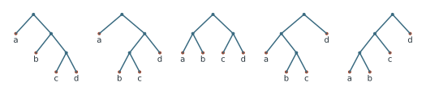
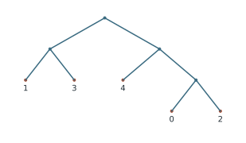
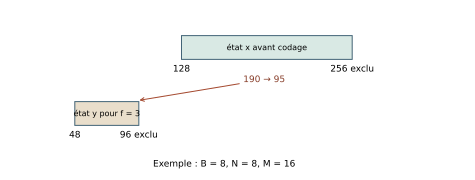

# X-ENS MP-MPI — Informatique A 2023 · Corrigé brut

*Corrigé rédigé par IA, non officiel. Signalez toute erreur.*

**Rédaction** · GPT-6.2 Astra Ultra · vitesse non renseignée · 24 novembre 2026

## Partie I · Occurrences des lettres

### Question I.1 · Compter une liste de caractères

```ocaml
let occurrences mot =
  let q = Array.make 256 0 in
  List.iter (fun x -> q.(x) <- q.(x) + 1) mot;
  q
```
À tout instant, chaque case compte les occurrences dans le préfixe lu. Pour le mot vide, le tableau reste nul. Les lettres de l’entrée appartiennent par hypothèse à $[0,255]$. Le temps vaut $O(256+|mot|)$.

### Question I.2 · Retirer les effectifs nuls

```ocaml
let nonzero_occurrences q =
  let paires = ref [] in
  for i = Array.length q - 1 downto 0 do
    if q.(i) <> 0 then paires := (i, q.(i)) :: !paires
  done;
  Array.of_list !paires
```
L’ajout en tête renverse l’ordre du parcours décroissant. Le résultat contient donc les indices strictement croissants. Le parcours et la conversion prennent ensemble $O(|S|)$ opérations.

## Partie II · Arbres binaires

### Question II.1 · Dénombrer les arbres

Les tailles des deux sous-arbres en nombre de feuilles peuvent être $(1,3)$, $(2,2)$ ou $(3,1)$. Une forme à trois feuilles offre deux possibilités et une forme à deux feuilles une seule. On compte $2+1+2=5$ formes planes. Chacune accepte $4!=24$ permutations des étiquettes distinctes, donc $5\times24=120$ arbres.



### Question II.2 · Coût pondéré des profondeurs

Dans la suite, le type est celui du sujet.
```ocaml
type tree = F of int | N of tree * tree

let cq t q =
  let rec cout profondeur = function
    | F x -> q.(x) * profondeur
    | N (g, d) -> cout (profondeur+1) g + cout (profondeur+1) d
  in
  cout 0 t
```
Chaque feuille est atteinte une fois à sa profondeur exacte. Un arbre plein à $n$ feuilles a $2n-1$ sommets, d’où un temps $\Theta(n)$ et une pile $O(h+1)$ si $h$ est sa hauteur.

### Question II.3 · Retrouver un chemin

```ocaml
let get_path x t =
  let rec chemin = function
    | F y -> if x = y then Some [] else None
    | N (g, d) ->
        match chemin g with
        | Some bits -> Some (0 :: bits)
        | None -> Option.map (fun bits -> 1 :: bits) (chemin d)
  in
  match chemin t with
  | Some bits -> bits
  | None -> invalid_arg "lettre absente"
```
Le premier bit rendu correspond à la racine. Au pire on visite $2n-1$ sommets et on construit les $h$ bits du chemin trouvé, soit $O(n)$ opérations. Les autres branches retournent simplement une absence.

### Question II.4 · Arbre des entiers

```ocaml
let integers limite =
  if limite < 0 then invalid_arg "limite";
  let suivant = ref 0 in
  let feuille () =
    let x = !suivant in
    incr suivant;
    F x
  in
  let rec complet k =
    if k = 0 then feuille ()
    else
      let g = complet (k-1) in
      let d = complet (k-1) in
      N (g, d)
  in
  let rec chaine k =
    if k > limite then feuille ()
    else
      let g = complet k in
      let d = chaine (k+1) in
      N (g, d)
  in
  chaine 0
```
L’évaluation explicite du fils gauche avant le droit est nécessaire car le compteur est partagé. Les blocs contiennent $1,2,\ldots,2^\ell$ feuilles, puis la feuille ultime porte le mot $1^{\ell+1}$. Au total il y a $2^{\ell+1}$ feuilles et un temps proportionnel à la taille produite.

## Partie III · Codes préfixes

### Question III.1 · Unicité du découpage

Aucun chemin de feuille n’est préfixe strict d’un autre, puisqu’une feuille n’a pas de descendant. Supposons que deux mots ont la même suite de bits. Si celle-ci est vide, seuls les mots vides conviennent, car $|S|\ge2$ rend tout code de lettre non vide. Sinon les deux premiers codes sont préfixes de la même suite. L’un est préfixe de l’autre, donc ils sont égaux et désignent la même lettre. Les retirer laisse une suite strictement plus courte. La récurrence sur la longueur binaire établit l’unicité, même si certaines suites n’admettent aucune décomposition.

### Question III.2 · Décompresser un code préfixe

```ocaml
let decomp1 bits t =
  let rec depuis_racine reste acc =
    match reste with
    | [] -> List.rev acc
    | _ -> descend t reste acc
  and descend arbre reste acc =
    match arbre, reste with
    | F x, _ -> depuis_racine reste (x :: acc)
    | N (g, _), 0 :: suite -> descend g suite acc
    | N (_, d), 1 :: suite -> descend d suite acc
    | N _, _ -> invalid_arg "flux binaire invalide ou tronque"
  in
  match t with
  | F _ -> invalid_arg "alphabet de moins de deux lettres"
  | N _ -> depuis_racine bits []
```
Sur un arbre du sujet, la liste vide renvoie le mot vide. Un appel en feuille ne consomme pas de bit, mais chaque lettre produite consomme au moins un bit depuis la racine. Il y a donc $O(b+1)$ opérations pour $b$ bits, inversion finale comprise, et une pile constante grâce aux appels terminaux.

## Partie IV · Arbres optimaux

### Question IV.1 · Optimalité d’un sous-arbre

Si un arbre $g'$ sur $S_g$ avait un coût strictement plus faible que $g$, remplaçons $g$ par $g'$ dans $t$. Le décalage d’un niveau ajoute dans les deux cas $\sum_{x\in S_g}q(x)$. Le coût du côté droit ne change pas, donc le nouvel arbre a un coût strictement plus faible que $t$, contradiction.

### Question IV.2 · Lettre majoritaire

Supposons cette feuille à une profondeur $d>1$ et, sans perte de généralité, dans la branche gauche. Le sous-arbre droit a une masse $Q_D\le\sum_{\sigma\ne\sigma_0}q(\sigma)<q(\sigma_0)$. Échangeons ce sous-arbre et la feuille. Tous ses symboles descendent de $d-1$ niveaux et $\sigma_0$ remonte d’autant. La variation de coût est $(d-1)(Q_D-q(\sigma_0))<0$. La profondeur zéro est impossible car $|S|\ge2$, donc elle vaut 1 dans tout optimum.

### Question IV.3 · Fusion de deux poids minimaux

Dans un optimum, une feuille de profondeur maximale a pour sœur une feuille à la même profondeur ; un sous-arbre intérieur à sa place donnerait des feuilles plus profondes. Amener les deux lettres de poids minimaux sur ces deux positions par échanges. Lorsqu’on échange une lettre de poids $a$ et une de poids $b\ge a$, en plaçant $a$ à la profondeur la plus grande, le coût augmente de $(a-b)(d_{\max}-d)\le0$. On peut d’abord échanger les positions choisies entre elles si nécessaire. L’arbre obtenu reste optimal, et l’ordre gauche-droite de ces deux lettres peut être fixé librement.

Contracter leur parent en une feuille de poids $q_1+q_2$ diminue le coût de $q_1+q_2$, quelle que soit la profondeur du parent. Tout optimum du problème contracté s’étend en un arbre de coût $\min c_{q'}+q_1+q_2$. L’optimum à feuilles sœurs construit ci-dessus fournit la borne inverse par contraction. L’extension est donc optimale.

### Question IV.4 · Construire l’arbre de Huffman

```ocaml
let rec insert ((p, _) as nouveau) = function
  | [] -> [nouveau]
  | ((q, _) as h) :: suite as l ->
      if p <= q then nouveau :: l else h :: insert nouveau suite

let optimal paires =
  let rec fusion = function
    | [] -> invalid_arg "alphabet vide"
    | [(_, t)] -> t
    | (p, g) :: (q, d) :: suite ->
        fusion (insert (p+q, N (g, d)) suite)
  in
  fusion (List.map (fun (x, poids) -> (poids, F x)) paires)
```
Les paires d’entrée sont déjà triées par poids. Q IV.3 justifie chaque fusion, y compris en cas d’égalité. Il y en a $n-1$. Une insertion linéaire peut parcourir la liste restante, donc le temps est $O(n^2)$. Avec de nombreux poids unitaires, les premiers nœuds de poids 2 passent derrière toutes les feuilles restantes, donnant un pire cas quadratique.

### Question IV.5 · Ordre des nouveaux poids

On retire $a\le b$, les deux plus petits poids. Tous les poids restants valent au moins $b$ et $a+b\ge b$. À la fusion suivante, les deux poids retirés sont donc au moins $b$. Leur somme est au moins $2b\ge a+b$. On obtient l’ordre croissant au sens large, y compris avec des poids nuls.

### Question IV.6 · Deux files ordonnées

Conserver d’une part les feuilles initiales dans un tableau trié avec un indice de tête, d’autre part une file des nœuds créés, elle aussi triée d’après Q IV.5. Une extraction de minimum compare les deux têtes présentes et avance celle qui a été choisie. Effectuer deux extractions successives, former le parent et le placer en queue de la seconde file. Un tableau préalloué de $n-1$ cases suffit pour cette file. Après $n-1$ fusions, on obtient le même principe optimal que Q IV.4, en $\Theta(n)$ temps et $O(n)$ espace.

## Partie V · Arbres canoniques

### Question V.1 · Reconstruire l’arbre canonique

Vérifions les nombres de positions et les étiquettes avant de construire l’arbre. La procédure récursive visite le fils gauche en premier et place une feuille dès qu’il reste un quota à sa profondeur. L’effet est de remplir les positions admissibles de chaque niveau de gauche à droite.
```ocaml
module Etiquettes = Set.Make (Int)

let canonical nombres lettres =
  let n = Array.length lettres in
  let places = ref 1 and lus = ref 0 and vus = ref Etiquettes.empty in
  let erreur () = invalid_arg "description canonique invalide" in
  Array.iter (fun c ->
    if c < 0 || c > !places || c > n - !lus then erreur ();
    for j = !lus to !lus+c-1 do
      let x = lettres.(j) in
      if Etiquettes.mem x !vus || (j > !lus && lettres.(j-1) >= x)
      then erreur ();
      vus := Etiquettes.add x !vus
    done;
    lus := !lus+c;
    let internes = !places-c in
    if internes > (n - !lus) / 2 then erreur ();
    places := 2*internes) nombres;
  if !places <> 0 || !lus <> n then erreur ();
  let restants = Array.copy nombres and i = ref 0 in
  let rec construire h =
    if restants.(h) > 0 then begin
      restants.(h) <- restants.(h)-1;
      let x = lettres.(!i) in incr i; F x
    end else begin
      let gauche = construire (h+1) in
      let droite = construire (h+1) in
      N (gauche, droite)
    end
  in
  construire 0
```
Une position interne requiert au moins deux feuilles descendantes, d’où le contrôle précédant le doublement. La validité des quotas assure que la construction termine au plus profond niveau utile. L’ordre global des étiquettes peut recommencer à chaque profondeur, et les doublons entre profondeurs restent interdits. Avec $D$ cases dans le premier tableau et $n$ lettres, le contrôle déterministe des doublons par ensemble ordonné coûte $O(D+n\log(n+1))$. La construction, ou le traitement d’une entrée déjà certifiée, coûte $O(D+n)$. Une table de hachage donne aussi un contrôle en temps linéaire en moyenne.



## Partie VI · Arbres alphabétiques

### Question VI.1 · Arbre alphabétique optimal

Pour un singleton $m_{i,i}=0$. Pour $i<j$, décaler les deux sous-arbres d’un niveau ajoute le poids de tout l’intervalle. D’où

$$
m_{i,j}=\sum_{v=i}^j q(v)+\min_{i\le k<j}(m_{i,k}+m_{k+1,j}).
$$

```ocaml
let alpha_optimal q =
  let n = Array.length q in
  if n = 0 then invalid_arg "alphabet vide";
  let somme = Array.make (n+1) 0 in
  Array.iteri (fun i v -> somme.(i+1) <- somme.(i)+v) q;
  let m = Array.make_matrix n n 0 in
  let coupe = Array.make_matrix n n 0 in
  for largeur = 2 to n do
    for i = 0 to n-largeur do
      let j = i+largeur-1 in
      let mieux = ref (m.(i).(i)+m.(i+1).(j)) and k0 = ref i in
      for k = i+1 to j-1 do
        let essai = m.(i).(k)+m.(k+1).(j) in
        if essai < !mieux then (mieux := essai; k0 := k)
      done;
      m.(i).(j) <- somme.(j+1)-somme.(i)+ !mieux;
      coupe.(i).(j) <- !k0
    done
  done;
  let rec arbre i j =
    if i = j then F i
    else let k = coupe.(i).(j) in N (arbre i k, arbre (k+1) j)
  in
  arbre 0 (n-1)
```
Les sous-problèmes sont déjà calculés lorsqu’on parcourt les largeurs par ordre croissant. La somme de poids coûte $O(1)$ par préfixes. Les $O(n^2)$ intervalles examinent $O(n)$ coupures chacun et la reconstruction crée $2n-1$ sommets. Le total est $O(n^3)$ en temps et $O(n^2)$ en espace.

### Question VI.2 · Décoder la forme préfixe

```ocaml
let alpha bits =
  let i = ref 0 and prochain = ref 0 in
  let rec lire () =
    if !i = Array.length bits then invalid_arg "forme tronquee";
    let bit = bits.(!i) in incr i;
    match bit with
    | 1 -> let x = !prochain in incr prochain; F x
    | 0 ->
        let gauche = lire () in
        let droite = lire () in
        N (gauche, droite)
    | _ -> invalid_arg "bit invalide"
  in
  let t = lire () in
  if !i <> Array.length bits then invalid_arg "bits en trop";
  t
```
Chaque bit déclenche un appel et une seule lecture. Le parcours gauche-droite numérote les feuilles dans l’ordre alphabétique, et la vérification finale exclut la concaténation de deux descriptions. Le temps est $O(n)$ pour $n$ bits.

## Partie VII · Codes arithmétiques

### Question VII.1 · Comparer code préfixe et rang

Huffman fusionne les poids 1 et 4, puis 5 et 15. La lettre A prend un bit, chacune des deux autres deux. Il faut donc $15+2(4+1)=25$ bits. Le nombre de mots différents est $\binom{20}{5}\binom51=77\,520=2^4\cdot3\cdot5\cdot17\cdot19$. Comme $2^{16}<77\,520<2^{17}$, les rangs de 0 à 77 519 se représentent sur 17 bits et parfois exigent bien 17 bits.

### Question VII.2 · Inverser un symbole rANS

Soit $F_s=\sum_{v<s}q(v)$ et $r=y\bmod N$. La lettre $s$ vérifie $F_s\le r<F_{s+1}$. Alors $x=q(s)\lfloor y/N\rfloor+r-F_s$. Une lettre de poids nul correspond à un intervalle vide. On applique cette inversion $k$ fois.
```ocaml
let decomp2 q y k =
  if y < 0 || k < 0 then invalid_arg "etat ou longueur";
  let n = Array.length q in
  let f = Array.make (n+1) 0 in
  Array.iteri (fun j v ->
    if v < 0 || v > max_int - f.(j) then invalid_arg "effectifs";
    f.(j+1) <- f.(j)+v) q;
  let total = f.(n) in
  if k > 0 && total = 0 then invalid_arg "alphabet de poids nul";
  let etat = ref y and mot = Array.make k 0 in
  for j = k-1 downto 0 do
    let r = !etat mod total in
    let rec lettre a b =
      if a = b then a else
      let m = a+(b-a)/2 in
      if r < f.(m+1) then lettre a m else lettre (m+1) b
    in
    let s = lettre 0 (n-1) in
    mot.(j) <- s;
    etat := (!etat / total) * q.(s) + (r-f.(s))
  done;
  (!etat, mot)
```
La complexité est $O(n+k\log(n+1))$ pour $n$ lettres, avec $O(n+k)$ cases. Pour $q=(5,1,1)$, $y=151$ et $k=7$, l’inversion redonne $x=0$ et le mot $0120000$. Si $k=0$, l’état reste celui de l’entrée.

### Question VII.3 · Renormaliser l’état

Posons $H=2^{B-1}$, $N=2^K$, $M=H/N$ et supposons $B>K$. Choisir $x_0\in[H,2H[$, par exemple $H$. Pour une lettre d’effectif $f>0$ et de cumul $F$, l’écriture $y=fj+r$ donne $E_q(y,s)=jN+F+r$ avec $0\le F+r<N$. Par conséquent

$$
H\le E_q(y,s)<2H\quad\Longleftrightarrow\quad fM\le y<2fM.
$$

Tant que l’état courant $x$ est au moins $2fM$, émettre son bit faible et le diviser par deux avec quotient entier. Le nombre de divisions est $k_i$. Initialement $x_i\ge H\ge fM$. À la dernière division éventuelle, le dividende était au moins $2fM$, donc le résultat reste au moins $fM$. On atteint bien la fenêtre requise et l’état suivant vérifie l’invariant. S’arrêter au premier passage donne le $k_i$ minimal compatible avec la borne haute.

À la décompression, inverser $E_q$ pour obtenir $y_i$ et la lettre. Tant que la valeur reconstruite est strictement inférieure à $H$, lire le bit suivant et effectuer $z\leftarrow2z+b$. Les bits du bloc se lisent du plus significatif au moins significatif, et les blocs du dernier symbole vers le premier. Si la compression n’avait rien retiré, $y_i=x_i\ge H$ et aucun bit n’est lu. Sinon, toutes les valeurs intermédiaires précédant la dernière réinsertion étaient des quotients de $x_i<2H$ par au moins deux, donc strictement inférieures à $H$. Le premier franchissement de $H$ retrouve exactement $x_i$ et consomme exactement $k_i$ bits. Le décodeur connaît ainsi les longueurs sans les transmettre.


