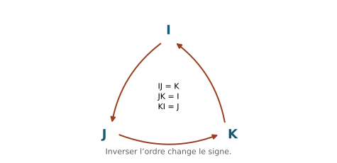
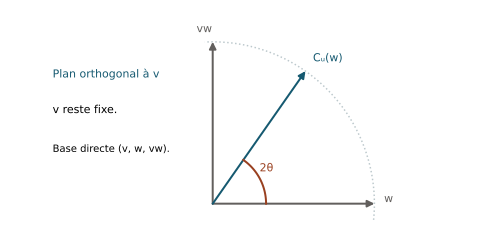
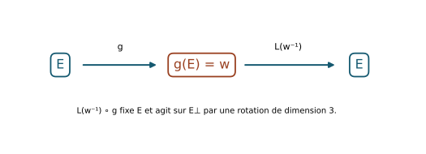
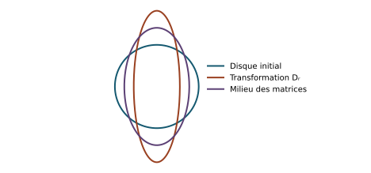
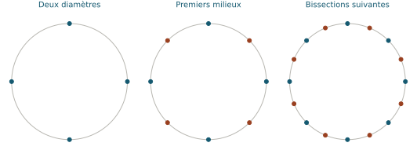
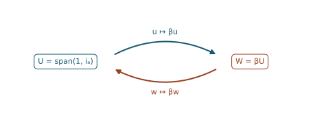
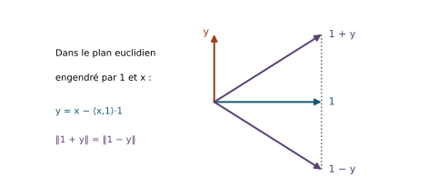

# X-ENS MP-MPI — Mathématiques A 2023 · Corrigé guidé

*Corrigé rédigé par IA, non officiel. Signalez toute erreur.*

**Rédaction** · modèle exact non renseigné (famille GPT-6) · effort non renseigné · vitesse non renseignée

**Révision (tour 1)** · modèle exact non renseigné (famille GPT-6) · effort non renseigné · vitesse non renseignée

**Révision (tour 2)** · GPT-6.2 Astra Ultra · vitesse non renseignée

**Révision (tour 3)** · GPT-6.2 Astra Ultra · vitesse non renseignée · 26 novembre 2026

## Présentation du sujet

L’épreuve du 17 avril 2023 dure quatre heures. Les 27 numéros comprennent 41 questions et sous-questions. Le sujet relie les rotations de l’espace à la classification des algèbres réelles admettant une norme multiplicative. On peut aborder la géométrie des normes du plan dès Q14, indépendamment des calculs de rotations. [Sujet officiel](https://www.polytechnique.edu/admission-cycle-ingenieur/sites/admission/files/content/2023%20MP-MPI%20SUJET%20DE%20MATHEMATIQUES%20A%20%28XLSR%29.pdf)

> [!JURY]
> Le rapport souligne l’importance de préciser les topologies utilisées en dimension finie, de distinguer les différents déterminants et de démontrer toutes les assertions d’une question. Les questions 16 à 19 et la dernière partie ont été peu traitées. [Rapport officiel](https://www.polytechnique.edu/admission-cycle-ingenieur/sites/admission/files/content/2023%20MP-MPI%20RAPPORT%20ECRIT%20MATHEMATIQUES%20A%20%28XLSR%29.pdf)

## Notations

On note $E$ l’unité de l’algèbre réelle $H$ des quaternions, $I,J,K$ ses trois vecteurs de base imaginaires, $H_{\rm im}=\mathrm{Vect}_{\mathbb R}(I,J,K)$ et $S=\{u\in H:N(u)=1\}$. Dans la représentation du sujet,
$$Z(z_1,z_2)=\begin{pmatrix}z_1&-\overline{z_2}\\z_2&\overline{z_1}\end{pmatrix},\qquad N(Z)=|z_1|^2+|z_2|^2.$$
Les parties III et IV utilisent leurs propres espaces et notations. Dans la dernière, les réels désignent leurs multiples de l’unité.

## I — Préliminaires sur les quaternions

La représentation matricielle permet de passer de la multiplication non commutative à la géométrie ordinaire en quatre dimensions.

### Question 1a

> [!INDICATION]
> On connaît déjà une base réelle du sous-espace. Quelles vérifications de stabilité peut-on ramener à ses quatre vecteurs ?

> [!INDICATION]
> Calculer l’adjoint d’un vecteur de base imaginaire.

#### Solution

L’énoncé donne une base de $H$ comme espace vectoriel réel. La table de produits de $I,J,K$, jointe au fait que $E$ est l’unité de $M_2(\mathbb C)$, assure par bilinéarité que $H$ est stable par produit et contient l’unité. De plus $E^*=E$ et la lecture des trois matrices donne $I^*=-I$, $J^*=-J$, $K^*=-K$. L’adjonction est réelle-linéaire, donc elle préserve $H$. Dans les coordonnées complexes du sujet, le calcul donne directement
$$Z(z_1,z_2)^*=Z(\overline{z_1},-z_2).$$
Le signe porte sur la seconde coordonnée entière. La conjugaison complexe porte sur la première. On peut aussi lire le produit sur la première colonne. Pour $a,b,c,d\in\mathbb C$,
$$Z(a,b)Z(c,d)=Z(ac-\overline b d,\,bc+\overline a d).$$
La seconde colonne est obtenue à partir de la première par la règle qui définit $Z$.

### Question 1b

> [!INDICATION]
> Calculer le produit ligne par colonne, puis recommencer dans l’ordre inverse.

> [!INDICATION]
> L’adjoint appartient-il à l’algèbre où l’on cherche l’inverse ?

#### Solution

Pour $Z=Z(z_1,z_2)$, les lignes de $Z$ sont orthogonales pour le produit hermitien et ont toutes deux pour norme carrée $|z_1|^2+|z_2|^2$. Les colonnes aussi. Ainsi
$$ZZ^*=Z^*Z=N(Z)E.$$
Si $Z\ne0$, $N(Z)>0$ et $Z^{-1}=Z^*/N(Z)$ appartient à $H$ par Q1a. L’existence d’un inverse dans l’algèbre ambiante seule n’aurait pas suffi.

### Question 1c

> [!INDICATION]
> Un élément central doit en particulier commuter avec I et J.

> [!INDICATION]
> Écrire ces deux commutateurs dans la base réelle.

#### Solution

Un multiple réel de l’identité commute avec tout élément. Réciproquement, si $Z=aE+bI+cJ+dK$ commute avec $I$, la différence $IZ-ZI=2cK-2dJ$ est nulle. La liberté de la base impose $c=d=0$. La commutation de $aE+bI$ avec $J$ donne alors $2bK=0$, donc $b=0$. Le centre de $H$ est $\mathbb R E$.

### Question 2a

> [!INDICATION]
> Calculer le produit d’une matrice et de son adjointe pour la matrice ZZ′.

> [!INDICATION]
> L’adjonction change l’ordre des facteurs.

#### Solution

Par Q1b et l’ordre renversé dans l’adjoint d’un produit,
$$N(ZZ')E=(ZZ')(ZZ')^*=Z(Z'Z'^*)Z^*=N(Z')ZZ^*=N(Z')N(Z)E.$$
Comparer les coefficients de $E$ donne la multiplicativité attendue. On peut aussi la contrôler directement par le déterminant. La forme matricielle donne $\det Z(z_1,z_2)=z_1\overline{z_1}+z_2\overline{z_2}=N(Z)$, et le déterminant est multiplicatif même lorsque les deux matrices ne commutent pas.

### Question 2b

> [!INDICATION]
> Examiner l’unité puis appliquer la formule du produit à un élément et son inverse.

> [!INDICATION]
> Revenir à la définition pour le facteur de normalisation réel.

#### Solution

On a $N(E)=1$. La multiplicativité donne $N(UV)=1$ et $N(U^{-1})=1/N(U)=1$ lorsque $U,V\in S$ ; Q1b donne leur inversibilité. Enfin pour $Z\ne0$, la définition rend $N$ homogène de degré deux sous multiplication réelle. Donc $N(Z/\sqrt{N(Z)})=1$.

### Question 3a

> [!INDICATION]
> Comparer la première colonne de la combinaison linéaire avec celle de Z.

> [!INDICATION]
> Séparer les parties réelle et imaginaire des deux coordonnées complexes.

#### Solution

Si $Z=xE+yI+zJ+tK$, sa première colonne est $(x+iy,-z+it)^{\mathsf T}$. La définition de $N$ donne immédiatement $N(Z)=x^2+y^2+z^2+t^2$. Ainsi $\sqrt{N}$ est la norme euclidienne qui rend cette base orthonormée.

### Question 3b

> [!INDICATION]
> Regrouper chaque produit croisé avec le produit d’ordre inverse.

> [!INDICATION]
> Dans le sens réciproque, isoler le coefficient de E avant de regarder le signe du carré.

#### Solution

Pour $U=yI+zJ+tK$, les termes croisés s’annulent deux à deux puisque $IJ+JI=JK+KJ=KI+IK=0$. D’où $U^2=-(y^2+z^2+t^2)E=-N(U)E$. Pour le retour, écrivons $Z=xE+U$. Alors $Z^2=(x^2-N(U))E+2xU$. Si ce carré est réel et négatif ou nul, sa partie imaginaire impose $xU=0$. Si $U\ne0$, alors $x=0$. Si $U=0$, $x^2\leq0$ donne aussi $x=0$. L’ensemble des éléments dont le carré est réel non positif est donc exactement $H_{\rm im}$.

### Question 4

> [!INDICATION]
> Pour deux points non opposés, normaliser le segment qui les joint.

> [!INDICATION]
> Si le segment passe par l’origine, choisir un troisième point et deux segments.

#### Solution

$S$ est le niveau $N^{-1}(\{1\})$ d’un polynôme continu en quatre coordonnées réelles, donc il est fermé. Deux points $u,v$ non antipodaux s’unissent dans $S$ par $t\mapsto[(1-t)u+tv]/\sqrt{N((1-t)u+tv)}$ : le numérateur ne peut s’annuler sur $[0,1]$. Si $v=-u$, on choisit un vecteur unitaire $w$ orthogonal à $u$ et on concatène les chemins de $u$ à $w$ puis de $w$ à $-u$. Cela établit la connexité par arcs.

### Question 5a

> [!INDICATION]
> Séparer la composante réelle des trois composantes imaginaires dans le produit.

> [!INDICATION]
> Les coordonnées imaginaires rappellent un produit vectoriel ordinaire.

#### Solution

Identifier $U=u_1I+u_2J+u_3K$ au vecteur $u\in\mathbb R^3$, et de même pour $V$. La table de multiplication donne
$$UV=-(u\cdot v)E+(u\times v)_1I+(u\times v)_2J+(u\times v)_3K.$$
En échangeant $u,v$, le produit vectoriel change de signe. Donc $UV+VU=-2\langle U,V\rangle E$. Lorsque le produit scalaire est nul, $UV\in H_{\rm im}$ a pour coordonnées $u\times v$. Alors le déterminant des trois colonnes est $(u\times v)\cdot(u\times v)=\|u\times v\|_2^2\geq0$, y compris si l’un des vecteurs est nul.

### Question 5b

> [!INDICATION]
> Quelle norme a le produit vectoriel de deux vecteurs unitaires perpendiculaires ?

> [!INDICATION]
> Contrôler aussi le signe du déterminant.

#### Solution

Pour $u,v$ orthonormaux, $u\times v$ est orthogonal aux deux premiers, de norme $1$ et le déterminant de Q5a vaut $1$. La base $(U,V,UV)$ est donc orthonormée directe.

## II — Automorphismes et rotations

La multiplication à gauche et à droite produit des isométries de dimension quatre. Quand les deux multiplicateurs coïncident, elle donne une rotation de l’espace imaginaire.

### Question 6

> [!INDICATION]
> Conserver l’ordre des deux facteurs du côté droit de l’action.

> [!INDICATION]
> Pour le noyau, commencer par l’image de E.

#### Solution

L’inverse du produit $vv'$ est $v'^{-1}v^{-1}$. Pour tout $Z$,
$$\alpha(u,v)(\alpha(u',v')(Z))=uu'Zv'^{-1}v^{-1}=\alpha(uu',vv')(Z).$$
Si $\alpha(u,v)$ est l’identité, appliquer cette égalité de transformations à $E$ donne $u=v$. La condition restante est que $u$ commute avec chaque $Z$. Par Q1c et $N(u)=1$, $u=E$ ou $-E$. Les deux couples obtenus agissent bien trivialement : le noyau est $\{(E,E),(-E,-E)\}$.

### Question 7

> [!INDICATION]
> Sur la sphère, remplacer l’inversion par l’adjonction.

> [!INDICATION]
> Une application continue à valeurs dans deux points peut-elle changer de valeur sur un chemin ?

#### Solution

Sur $S$, $v^{-1}=v^*$ par Q1b, opération continue (réelle-linéaire). Dans la base $(E,I,J,K)$, les coordonnées de $\alpha(u,v)$ sont donc des polynômes réels des coordonnées de $u,v$, d’où la continuité pour les topologies de dimension finie. Par Q2a, $N(uZv^{-1})=N(Z)$ ; la transformation est une isométrie linéaire. Son déterminant, qui appartient à $\{-1,1\}$, dépend continûment de $(u,v)$ sur le produit connexe par arcs $S\times S$. Il vaut $1$ en $(E,E)$, donc partout. L’image est incluse dans $SO(H)$.

### Question 8a

> [!INDICATION]
> Utiliser la décomposition orthogonale entre scalaires et imaginaires.

> [!INDICATION]
> Vérifier le produit avec le candidat inverse dans les deux ordres.

#### Solution

Posons $c=\cos\theta$ et $s=\sin\theta$. Orthogonalité de $v$ et $E$, et $N(v)=1$, donnent $N(cE+sv)=c^2+s^2=1$. Comme $v^2=-E$, $(cE+sv)(cE-sv)=(c^2+s^2)E=E$, dans les deux ordres.

### Question 8b

> [!INDICATION]
> Calculer les images de v puis w en utilisant l’anticommutation.

> [!INDICATION]
> Obtenir la troisième colonne en appliquant la conjugaison au produit vw.

#### Solution

$C_u(v)=v$ car $u$ et $v$ commutent. Les relations $wv=-vw$ et $v w v=w$ donnent
$$C_u(w)=(cE+sv)w(cE-sv)=(c^2-s^2)w+2cs\,vw.$$
Par multiplicativité, $C_u(vw)=vC_u(w)=-2cs\,w+(c^2-s^2)vw$. Dans la base directe demandée, les colonnes des images donnent
$$\begin{pmatrix}1&0&0\\0&\cos(2\theta)&-\sin(2\theta)\\0&\sin(2\theta)&\cos(2\theta)\end{pmatrix}.$$

### Question 9

> [!INDICATION]
> Décrire une rotation de l’espace de dimension trois par un axe et un angle.

> [!INDICATION]
> L’angle de la conjugaison est le double du paramètre de Q8.

#### Solution

Les conjugaisons vérifient $C_{uv}=C_uC_v$. Par Q7, $\alpha(u,u)\in SO(H)$ ; elle fixe $E$ et préserve $E^\perp=H_{\rm im}$, donc sa restriction a déterminant $1$. Toute rotation d’un espace euclidien orienté de dimension trois a un axe orienté unitaire $v$ et un angle $\gamma$ ; l’identité peut être traitée avec $\gamma=0$. Avec $\theta=\gamma/2$, Q8b représente cette rotation par $u=\cos\theta E+\sin\theta v$. Si $C_u$ est l’identité, $u$ commute avec $H_{\rm im}$ et avec $\mathbb R E$, donc avec $H$. Par Q1c, son appartenance à $S$ impose $u=\pm E$. Réciproquement ces deux éléments conviennent.

### Question 10a

> [!INDICATION]
> Une rotation de l’espace de dimension quatre ne fixe pas nécessairement E. La composer avec une multiplication à gauche bien choisie.

> [!INDICATION]
> Dans l’orthogonal de E, la question précédente s’applique.

#### Solution

Soit $g\in SO(H)$. Le vecteur $w=g(E)$ a norme un. Posons $h=\alpha(w^{-1},E)\circ g$. Par Q7, $h\in SO(H)$ et $h(E)=E$. Sa restriction à $E^\perp$ est donc une rotation. Par Q9 elle y coïncide avec une conjugaison $C_v$. Comme les deux transformations fixent $E$, $h=\alpha(v,v)$ sur tout $H$. Il suit que $g=\alpha(w,E)\alpha(v,v)=\alpha(wv,v)$. Avec Q7, cela donne l’égalité des groupes.

### Question 10b

> [!INDICATION]
> Représenter g par une paire, puis conjuguer une multiplication à gauche.

> [!INDICATION]
> Pour prouver l’inclusion stricte finale, chercher une isométrie non triviale fixant E.

#### Solution

Le sous-groupe $S\times\{E\}$ a pour image $N$, groupe des multiplications à gauche $L_u$. Pour $g=\alpha(a,b)$ et $n=L_u$, la conjugaison $gng^{-1}=L_{aua^{-1}}$ reste dans $N$. La forme de tout $g$ est garantie par Q10a. De plus $L_{\pm E}=\pm\mathrm{id}$ et $L_I(E)=I$ montre que cette première inclusion est stricte. La conjugaison $\alpha(I,I)$ appartient à $SO(H)$ et fixe $E$, mais envoie $J$ sur $-J$. Or la seule multiplication à gauche fixant $E$ est $L_E=\mathrm{id}$. La seconde inclusion est donc stricte également.

### Question 11

> [!INDICATION]
> Vérifier l’inverse en appliquant f à un produit d’antécédents.

> [!INDICATION]
> Dans une conjugaison, les deux facteurs intérieurs se simplifient lorsque l’on multiplie.

#### Solution

L’identité est un automorphisme d’algèbre, la composition conserve les produits et la droite des scalaires point par point. Si $f$ est un automorphisme, appliquer $f$ au produit $f^{-1}(x)f^{-1}(y)$ en donne $xy$. Ainsi $f^{-1}$ est encore multiplicative et fixe les scalaires. Les automorphismes forment un sous-groupe de $GL(H)$. Chaque $\alpha(u,u)$ est une bijection réelle-linéaire, fixe $E$ et satisfait $(uxu^{-1})(uyu^{-1})=u(xy)u^{-1}$. Elle est dans $\operatorname{Aut}(H)$.

### Question 12

> [!INDICATION]
> Calculer les carrés et les sommes de produits symétriques des images.

> [!INDICATION]
> Quelle relation entre f(I)f(J) et f(K) fixe l’orientation ?

#### Solution

Pour $X\in\{I,J,K\}$, $f(X)^2=f(-E)=-E$. Par Q3b, $f(X)$ est donc imaginaire et de norme un. L’anticommutation des paires s’y transporte par linéarité et multiplicativité de $f$ ; Q5a donne l’orthogonalité. Enfin $f(I)f(J)=f(K)$, de sorte que Q5b donne une base **directe**.

### Question 13a

> [!INDICATION]
> Tout automorphisme fixe les multiples de E ; que reste-t-il à connaître pour le déterminer ?

> [!INDICATION]
> Employer Q9 pour produire un antécédent de chaque rotation.

#### Solution

Par Q12, $f(H_{\rm im})=H_{\rm im}$ et sa restriction appartient à $SO(H_{\rm im})$. La restriction est un morphisme. Son noyau se réduit à l’identité puisque tout automorphisme fixe déjà $E$ et que $(E,I,J,K)$ est une base. Il est surjectif : Q9 réalise chaque rotation par $C_u$, restriction de $\alpha(u,u)\in\operatorname{Aut}(H)$ par Q11. D’où l’isomorphisme.

### Question 13b

> [!INDICATION]
> Choisir une conjugaison qui coïncide avec l’automorphisme sur les imaginaires.

> [!INDICATION]
> Faire intervenir l’injectivité de la restriction.

#### Solution

Pour tout $f\in\operatorname{Aut}(H)$, prendre $u$ tel que $f$ et $\alpha(u,u)$ aient même restriction à $H_{\rm im}$. Ces deux transformations coïncident sur $E$ puis sur tout $H$. L’inclusion réciproque est Q11. Ainsi tous les automorphismes sont intérieurs et chaque conjugaison est représentée par deux quaternions unitaires opposés.

## III — Caractérisation des normes euclidiennes du plan

Une ellipse maximale dans la boule unité possède des points de contact. L’inégalité de l’énoncé permet de fabriquer de nouveaux contacts jusqu’à remplir le cercle.

### Question 14a

> [!INDICATION]
> Pour la fermeture, fixer un vecteur z et ne faire varier que la matrice.

> [!INDICATION]
> Pour la bornitude, appliquer la définition aux vecteurs de la base canonique.

#### Solution

Pour $z$ fixé, $B\mapsto\|Bz\|$ est continue sur $M_2(\mathbb R)$ (toutes les normes en dimension finie sont équivalentes). L’intersection, pour tous les $z$, des fermés $\{B:\|Bz\|\leq\|z\|_2\}$ est donc fermée. Pour $B\in K$, chacune des deux colonnes $Bf_j$ dans la base canonique a une norme $\leq1$. L’équivalence des normes borne leurs quatre coordonnées. Ainsi $K$ est compact. Pour $A_1,A_2\in K$ et $0\leq t\leq1$, l’inégalité triangulaire donne $\|(tA_1+(1-t)A_2)z\|\leq t\|z\|_2+(1-t)\|z\|_2$. Elle prouve la convexité.

### Question 14b

> [!INDICATION]
> Le compact contient-il au moins une matrice ?

> [!INDICATION]
> Le déterminant dépend continûment de ses quatre coefficients.

#### Solution

La matrice nulle appartient à $K$. Le déterminant est une fonction polynomiale continue. Il atteint son maximum sur le compact non vide $K$. On note $A$ l’un de ses points de maximum.

### Question 15

> [!INDICATION]
> Une petite homothétie de rapport positif envoie le disque dans la boule de la norme donnée.

> [!INDICATION]
> Si la meilleure ellipse ne touchait jamais le bord, comment l’agrandir ?

#### Solution

Soit $M=\max_{z\in C}\|z\|>0$, qui existe par compacité du cercle euclidien. L’homogénéité donne $M^{-1}\mathrm{id}\in K$. Son déterminant $M^{-2}$ est strictement positif, donc $\det A>0$. En outre $m=\max_{z\in C}\|Az\|$ appartient à $]0,1]$, car $A$ est inversible et dans $K$. Si $m<1$, $A/m$ serait encore dans $K$ et aurait un déterminant $\det A/m^2>\det A$. Ainsi $m=1$ et il existe un point de contact $x$ sur le cercle.

### Question 16a

> [!INDICATION]
> Le déterminant de Dᵣ vaut un. Cela ne suffit pas à contredire la maximalité.

> [!INDICATION]
> Essayer le milieu de AB et ABDᵣ, puis calculer son déterminant.

#### Solution

Posons $D_r=\operatorname{diag}(r,1/r)$. Comme $B$ est une rotation pour la norme euclidienne **de départ**, $AB\in K$ et $\det(AB)=\det A$. Si $ABD_r$ appartenait aussi à $K$, la convexité y placerait le milieu $M_r=AB(\mathrm{id}+D_r)/2$. Or
$$\det M_r=\det A\,\frac{(1+r)(1+1/r)}4>\det A,$$
car le gain relatif de déterminant est strictement positif,
$$\frac{\det M_r-\det A}{\det A}=\frac{(1-r)^2}{4r}>0\qquad(0<r<1).$$ Donc $ABD_r\notin K$. Il existe un vecteur non nul violant l’inégalité qui définit $K$ ; en le divisant par sa norme euclidienne, on obtient $x_r\in C$ tel que $\|ABD_rx_r\|>1$.

### Question 16b

> [!INDICATION]
> La norme qui figure au départ est la norme euclidienne dans la définition de K.

> [!INDICATION]
> Employer la relation yᵣ² + zᵣ² = 1 et isoler zᵣ².

#### Solution

Écrivons $x_r=(y_r,z_r)$. Comme $AB\in K$, on a $1<\|ABD_rx_r\|\leq\|D_rx_r\|_2$. Élever au carré et utiliser $y_r^2=1-z_r^2$ donne $1<r^2+(r^{-2}-r^2)z_r^2$. Le coefficient de $z_r^2$ est positif et
$$z_r^2>\frac{1-r^2}{r^{-2}-r^2}=\frac{r^2}{1+r^2}.$$

### Question 17

> [!INDICATION]
> Faire tendre le paramètre vers un et extraire un point d’accumulation sur le cercle.

> [!INDICATION]
> Qu’est-ce qui empêche le nouveau contact d’être parallèle au premier ?

#### Solution

Choisissons $r_n\uparrow1$ et extrayons de $(x_{r_n})$ une sous-suite convergeant sur le cercle compact vers $u=(y,z)$. La question 16b donne $z^2\geq1/2$. Comme $D_{r_n}\to\mathrm{id}$, l’inégalité stricte de 16a donne à la limite $\|ABu\|\geq1$. La condition $AB\in K$ donne l’autre sens, donc $\|ABu\|=1$. Les vecteurs $e_1=x=B(1,0)$ et $e_2=Bu$ ont ainsi une norme euclidienne égale à $1$ et $\|Ae_1\|=\|Ae_2\|=1$. Ils sont indépendants puisque $z\ne0$ et $B$ est inversible.

### Question 18

> [!INDICATION]
> Le milieu du petit arc se construit avec la somme normalisée de ses extrémités.

> [!INDICATION]
> Avant de bissecter tout le cercle, utiliser les différences ordonnées pour obtenir des points dans chacun des quatre quadrants.

#### Solution

Pour deux points unitaires $a,b$ non colinéaires dans $T$, $s=(a+b)/\|a+b\|_2$ et $d=(b-a)/\|b-a\|_2$ sont deux points de $T$ perpendiculaires. Échanger $a,b$ donne aussi $-d$. On peut en déduire $-s$ sans supposer $T$ stable par symétrie. En prenant les différences ordonnées de $s$ et $d$, on obtient $\pm(s-d)/\sqrt2$. Avec $s$ et $-d$, on obtient $\pm(s+d)/\sqrt2$. La somme normalisée de $-(s-d)/\sqrt2$ et $-(s+d)/\sqrt2$ donne $-s$. Les quatre extrémités de deux diamètres orthogonaux sont donc acquises.

Sur tout arc de longueur angulaire inférieure à $\pi$, la somme normalisée de ses extrémités est son milieu. On bissecte maintenant les quatre quarts de cercle, puis chaque sous-arc obtenu. À l’étape $n$ on a des points de $T$ espacés de $\pi/2^{n+1}$. L’union de ces grilles est dense dans $C$. Comme $T$ est fermé dans $C$, il contient tout le cercle.

### Question 19

> [!INDICATION]
> Prendre pour T l’ensemble des points du cercle où l’inégalité qui définit K est une égalité.

> [!INDICATION]
> Appliquer l’hypothèse à deux points de contact après transformation par A, puis comparer avec une identité euclidienne.

#### Solution

Supposons l’hypothèse du théorème et posons $T=\{z\in C:\|Az\|=1\}$. Cet ensemble est fermé par continuité et contient les deux points indépendants de Q17. Si $a,b\in T$ ne sont pas colinéaires, appliquer l’hypothèse à $Aa,Ab$ fournit
$$4\leq\|A(a+b)\|^2+\|A(b-a)\|^2\leq\|a+b\|_2^2+\|b-a\|_2^2=4.$$
La dernière égalité est l’identité euclidienne du parallélogramme. Les deux termes de la somme intermédiaire étant séparément majorés, chacun atteint sa borne. Après normalisation, les deux points demandés en Q18 appartiennent à $T$. Donc $T=C$. Par homogénéité $\|Az\|=\|z\|_2$ pour tout $z$. Puisque $A$ est inversible, $\|w\|^2=\|A^{-1}w\|_2^2$, carré de la norme issue du produit scalaire $(w,w')\mapsto(A^{-1}w)\cdot(A^{-1}w')$.

## IV — Classification des algèbres réelles

La première classification utilise des polynômes annulateurs. Pour la seconde, on déduit leur existence de la norme multiplicative en étudiant des plans commutatifs.

### Question 20a

> [!INDICATION]
> Factoriser un polynôme annulateur en facteurs irréductibles réels.

> [!INDICATION]
> Pourquoi au moins un de ces facteurs doit-il s’annuler en x ?

#### Solution

Factorisons un polynôme annulateur réel non constant de $x$ en facteurs irréductibles sur $\mathbb R$. Les polynômes en $x$ commutent entre eux, même si l’algèbre ambiante ne commute pas. L’absence de diviseurs de zéro implique qu’un des facteurs s’annule en $x$. Les irréductibles réels sont de degré un ou deux. Dans le premier cas $x\in\mathbb R$ ; dans le second, une relation unitaire de degré deux exprime $x^2$ dans $\mathbb R+\mathbb Rx$.

### Question 20b

> [!INDICATION]
> Compléter le carré du facteur quadratique irréductible.

> [!INDICATION]
> Construire une nouvelle base du plan dans laquelle le second vecteur a pour carré −1.

#### Solution

Pour $x$ non réel, le facteur précédent est un trinôme irréductible réel, que l’on peut écrire $(X-a)^2+b^2$ avec $b>0$. Ainsi $j=(x-a)/b$ vérifie $j^2=-1$. Les vecteurs $1,j$ sont indépendants sur $\mathbb R$ et engendrent le même plan que $1,x$. L’application $s+it\mapsto s+tj$ est une bijection réelle-linéaire sur ce plan et respecte les produits puisque $j^2=-1$. Cela montre à la fois la stabilité du plan et l’isomorphisme.

### Question 21

> [!INDICATION]
> Trouver un élément non scalaire.

> [!INDICATION]
> Utiliser l’isomorphisme construit à la question précédente.

#### Solution

Puisque $A$ n’est pas isomorphe à $\mathbb R$, un élément $x\notin\mathbb R$ existe. Par Q20b, l’image de $i$ dans $\mathbb R+\mathbb Rx$ est un élément $i_A$ dont le carré vaut $-1$.

### Question 22a

> [!INDICATION]
> Développer le produit T(x)T(y).

> [!INDICATION]
> Repérer les deux facteurs iₐ consécutifs.

#### Solution

Par associativité et $i_A^2=-1$,
$$T(x)T(y)=i_Axi_A^2yi_A=-i_Axyi_A=-T(xy).$$

### Question 22b

> [!INDICATION]
> Calculer T² puis former la demi-somme et la demi-différence de x et T(x).

> [!INDICATION]
> La preuve doit rester vraie en dimension éventuellement infinie.

#### Solution

On a $T^2(x)=i_A^2xi_A^2=x$. L’application est réelle-linéaire. Tout $x$ est la somme $(x+T(x))/2+(x-T(x))/2$, dont les termes sont respectivement fixés et opposés par $T$. L’intersection de ces deux sous-espaces est nulle, d’où la somme directe annoncée, sans aucune hypothèse de dimension finie.

### Question 23

> [!INDICATION]
> Traduire l’équation T(x)=−x en une condition de commutation.

> [!INDICATION]
> Dans quelle copie du corps complexe peut-on factoriser le polynôme annulateur de x ?

#### Solution

Notons $U=\mathbb R+\mathbb Ri_A$. La condition $T(x)=-x$ équivaut à $i_Ax=xi_A$ (multiplier à droite par $-i_A$). Elle est satisfaite dans $U$. Réciproquement, si $x$ commute avec $i_A$, il commute avec tout élément de $U$. Un polynôme réel non nul qui annule $x$ se factorise en facteurs linéaires sur $U\simeq\mathbb C$. On peut évaluer cette factorisation en $x$ car toutes les quantités concernées commutent. Le produit des facteurs $x-u_j$ est nul ; l’un d’eux est nul, donc $x\in U$. Enfin $A$ n’étant pas isomorphe à $\mathbb C$, $A\ne U$ et Q22b entraîne que $\ker(T-\mathrm{id})$ contient un élément non nul.

### Question 24a

> [!INDICATION]
> Suivre les signes de T sur un produit de deux éléments du sous-espace propre positif.

> [!INDICATION]
> Pour diviser par β, construire son inverse à partir de l’inverse de β² dans U.

#### Solution

Posons $W=\ker(T-\mathrm{id})$. Pour $x\in W$, $T(\beta x)=-\beta x$ par Q22a. Ainsi $\beta W\subset U$ et $\beta^2\in U\setminus\{0\}$. Cet élément a un inverse dans le corps $U$. Comme $\beta$ commute avec $\beta^2$, il commute avec son inverse. Ainsi $\beta$ admet l’inverse $\beta(\beta^2)^{-1}$. Pour $x\in W$, $\beta^{-1}x=(\beta^2)^{-1}(\beta x)\in U$. Ceci donne $W\subset\beta U$. Réciproquement, pour $u\in U$, $T(\beta u)=-T(\beta)T(u)=\beta u$, d’où $W=\beta U$.

### Question 24b

> [!INDICATION]
> Écrire β² comme combinaison de 1 et de iₐ et utiliser le fait que β commute avec son carré.

> [!INDICATION]
> Factoriser si ce carré était un réel positif ou nul.

#### Solution

Écrivons $\beta^2=a+bi_A$. Comme $\beta\in W$, $\beta i_A=-i_A\beta$. Comme $\beta$ commute aussi avec $\beta^2$, on obtient $2b\beta i_A=0$ et donc $b=0$. Si $a\geq0$, $(\beta-\sqrt a)(\beta+\sqrt a)=0$ donnerait $\beta\in\mathbb R\subset U$. Or $U\cap W=\{0\}$ et $\beta\ne0$. Ainsi $\beta^2=a<0$.

### Question 24c

> [!INDICATION]
> Normaliser β pour obtenir un second élément de carré −1.

> [!INDICATION]
> Exhiber une base et comparer sa table de multiplication avec celle des quaternions.

#### Solution

Posons $j_A=\beta/\sqrt{-\beta^2}$ et $k_A=i_Aj_A$. Alors $i_A^2=j_A^2=-1$ et $j_Ai_A=-i_Aj_A$, d’où $k_A^2=-1$, $j_Ak_A=i_A$ et $k_Ai_A=j_A$. Par Q22b et Q24a, $A=U\oplus j_AU$. Comme $j_A$ est inversible, $(1,i_A,j_A,k_A)$ en est une base. Les produits des vecteurs de cette base coïncident avec ceux de $(E,I,J,K)$. La bijection réelle-linéaire qui envoie ces derniers sur les premiers est donc multiplicative par bilinéarité. Les possibilités $\mathbb R$ et $\mathbb C$ ayant déjà été séparées, le théorème B est établi.

### Question 25

> [!INDICATION]
> Développer la différence des carrés de u+v et u−v.

> [!INDICATION]
> Expliquer pourquoi les éléments du plan considéré commutent.

#### Solution

Tous les éléments de $V$ commutent entre eux par bilinéarité. Ainsi $(u+v)^2-(u-v)^2=4uv$. Par inégalité triangulaire et multiplicativité,
$$4\|u\|\|v\|=4\|uv\|\leq\|(u+v)^2\|+\|(u-v)^2\|=\|u+v\|^2+\|u-v\|^2.$$
Pour les vecteurs unitaires de $V$ on retrouve l’hypothèse du théorème A. En transportant la norme de ce plan sur $\mathbb R^2$ par une base, on conclut que sa restriction est euclidienne.

### Question 26

> [!INDICATION]
> Dans le plan engendré par 1 et x, soustraire la projection de x sur 1.

> [!INDICATION]
> Étudier la norme du produit (1+y)(1−y), puis le cas d’égalité triangulaire dans le plan engendré par 1 et y².

#### Solution

Par multiplicativité et $\|1\|>0$, $\|1\|=1$. Pour $x$ non réel, la norme sur $V=\mathbb R+\mathbb Rx$ est euclidienne par Q25. Écrivons $x=a+y$ avec $a=\langle x,1\rangle$ et $y\perp1$ dans ce plan. On a $\|1+y\|=\|1-y\|=\sqrt{1+\|y\|^2}$. La multiplicativité entraîne
$$\|1-y^2\|=\|1+y\|\|1-y\|=1+\|y\|^2=\|1\|+\|-y^2\|.$$
Si $y^2$ n’était pas réel, le plan engendré par $1$ et $y^2$ serait lui aussi euclidien, toujours par Q25. L’égalité triangulaire affichée y imposerait que $1$ et $-y^2$ soient positivement colinéaires, contradiction. Donc $y^2$ est réel. Dans la droite des scalaires, $|1-y^2|=1+|y^2|$ impose $y^2\le0$. Comme $\|y^2\|=\|y\|^2$, on obtient même $y^2=-\|y\|^2$. Il vient $x^2=2ax-(a^2+\|y\|^2)\in\mathbb R+\mathbb Rx$. Pour $x\in\mathbb R$ l’appartenance est immédiate.

### Question 27

> [!INDICATION]
> Quelles étaient les deux hypothèses du théorème B ?

> [!INDICATION]
> Justifier chacune à partir de la norme et de Q26, même si la dimension de l’algèbre est inconnue.

#### Solution

La multiplicativité empêche tout produit nul entre deux éléments non nuls. D’autre part Q26 donne, pour chaque $x$, une relation $x^2-bx-c=0$ à coefficients réels. L’algèbre est donc algébrique et sans diviseurs de zéro. Le théorème B la classe parmi $\mathbb R,\mathbb C,\mathbb H$. Ces trois possibilités existent, avec le module usuel dans les deux premiers cas et $\sqrt N$ dans le troisième, par Q2a.

## Bilan

Trois idées permettent de refaire le sujet. Pour les rotations, commencer par fixer l’unité afin de travailler sur son orthogonal. Pour les normes, exploiter l’égalité dans deux bornes entre lesquelles se trouve une somme. Pour les algèbres, ramener les calculs à des plans commutatifs avant d’y appliquer un résultat euclidien.
