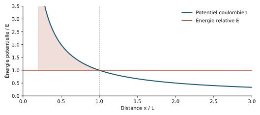
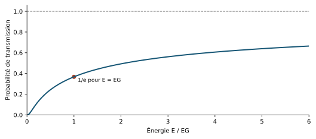
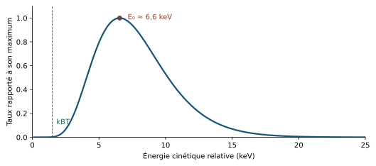
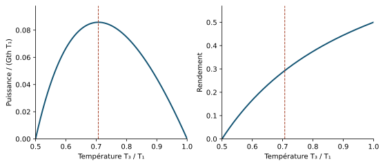
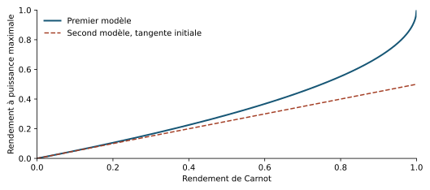

# X-ENS MP 2023 — Physique · Corrigé guidé

*Corrigé rédigé par IA, non officiel. Signalez toute erreur.*

**Lecture du rapport du jury** · GPT-6.2 Astra Ultra · vitesse non renseignée

**Rédaction** · GPT-6.2 Astra Ultra · vitesse non renseignée

## Réactions au cœur du Soleil et rendement d’une machine thermique à puissance maximale

## I — Origine de l’énergie solaire

### Question 1 — État de la matière solaire

**Indication.** Identifier les porteurs de charge qui demeurent après l'ionisation.

La matière ionisée au centre du Soleil est un **plasma**. Elle contient des noyaux et des électrons libres, tout en restant macroscopiquement presque neutre.

### Question 2 — Franchissement quantique

**Indication.** Comparer la condition de passage en mécanique classique à la propagation de la fonction d'onde.

Il s'agit de l'effet tunnel. Une onde de matière possède une amplitude dans une région où l'énergie potentielle excède l'énergie totale ; une barrière de largeur finie peut donc transmettre une partie du courant incident.

### Question 3 — Onde évanescente

**Indication.** Éliminer la solution qui diverge à grande distance à l'intérieur de la marche.

Dans la région $x>0$, Schrödinger donne $\psi''=\kappa^2\psi$ avec $\kappa=\sqrt{2m(V-E)}/\hbar$. La solution croissante est exclue pour une marche s'étendant à l'infini. Il reste $t(x)=\psi(x)/\psi(0)=\exp(-\kappa x)$.

### Question 4 — Transmission d'une barrière épaisse

**Indication.** Écrire une condition sans dimension. La barrière de largeur finie a deux interfaces à raccorder.

Le coefficient est le rapport du courant de probabilité transmis au courant incident, pris dans le même sens. L'estimation proposée, $\Theta(E)\simeq e^{-2\kappa L}$, est petite pour $2L\sqrt{2m(V-E)}/\hbar\gg1$. Pour une barrière limitée par deux interfaces, les raccordements à l'entrée et à la sortie déterminent les amplitudes et un préfacteur ; à l'intérieur, les deux exponentielles sont en général présentes. Le résultat conserve l'atténuation exponentielle dominante.

### Question 5 — Répulsion de deux protons

**Indication.** Vérifier le signe de la force déduite de $-dV/dx$.

Avec l'origine des énergies potentielles à distance infinie et $A=e^2/(4\pi\epsilon_0)>0$, on a $V(x)=A/x$ pour $x>0$. La courbe est positive, strictement décroissante et convexe, tend vers l'infini à l'origine et vers zéro à l'infini. La force relative est répulsive.

### Question 6 — Point de retournement

**Indication.** Chercher où l'énergie cinétique classique s'annule.

Le mouvement classique s'arrêterait à la distance $L$ telle que $V(L)=E$, soit $L=A/E=e^2/(4\pi\epsilon_0E)$. La zone $0<x<L$ est interdite au mouvement classique dans le modèle ponctuel du sujet.

### Question 7 — Énergie de Gamow

**Indication.** Remplacer la distance par la distance réduite $x/L$ avant d'utiliser la valeur de l'intégrale fournie.

La prescription (1) donne
$$\ln\Theta\simeq-\frac{2\sqrt{2m}}{\hbar}\int_0^{A/E}\sqrt{A/x-E}\,dx.$$
Avec $u=xE/A$, l'intégrale devient $(A/\sqrt E)\int_0^1\sqrt{1/u-1}\,du=\pi A/(2\sqrt E)$. Ainsi $\Theta(E)\simeq\exp[-\sqrt{E_G/E}]$, où
$$E_G=\frac{2m\pi^2 A^2}{\hbar^2}=\frac{m e^4}{8\epsilon_0^2\hbar^2}.$$
La singularité de l'intégrande en $x=0$ est en $x^{-1/2}$ et reste intégrable.

### Question 8 — Variation de la transmission

**Indication.** Placer le point d'abscisse $E_G$, en plus des limites de la fonction.

La fonction $\Theta=e^{-\sqrt{E_G/E}}$ croît de zéro vers un lorsque $E$ va de $0^+$ à l'infini. Sa tangente à l'origine est horizontale. À $E=E_G$, $\Theta=e^{-1}$. L'asymptote supérieure concerne l'expression tracée ; la justification précédente de l'approximation portait sur la faible transmission.

## I — Statistique des vitesses relatives

### Question 9 — Séparation du mouvement relatif

**Indication.** Exprimer les deux vitesses dans les nouvelles variables : les termes croisés s'annulent.

Les vitesses des deux protons sont $v_1=v_G+v/2$ et $v_2=v_G-v/2$. En développant leurs carrés,
$$\tfrac12m_p(v_1^2+v_2^2)=\tfrac12(2m_p)v_G^2+\tfrac12(m_p/2)v^2.$$
Le premier terme entraîne le centre de masse. L'énergie relative est $E=\mu v^2/2$ avec $\mu=m_p/2$. C'est cette masse qu'il faut employer en Q7.

### Question 10 — Distribution à une dimension

**Indication.** Appliquer le facteur de Boltzmann à la somme des deux énergies cinétiques.

Pour un gaz parfait à l'équilibre à $T$, les vitesses de deux protons indépendants suivent chacune une gaussienne de Maxwell à une dimension. Leur densité jointe est
$$P(v_1,v_2)\propto\exp[-m_p(v_1^2+v_2^2)/(2k_BT)].$$
Le préfacteur de normalisation est indépendant des deux vitesses.

### Question 11 — Factorisation et mesure des probabilités

**Indication.** Transformer la mesure d'intégration aussi bien que l'exposant.

Le jacobien du passage inverse est $\det\begin{pmatrix}1&1/2\\1&-1/2\end{pmatrix}=-1$, donc $dv_1\,dv_2=dv_G\,dv$ en valeur absolue. En utilisant Q9, la densité est le produit
$$P_G(v_G)\propto e^{-(2m_p)v_G^2/(2k_BT)},\qquad P^*(v)\propto e^{-\mu v^2/(2k_BT)}.$$
Centre de masse et vitesse relative sont indépendants. La seconde loi est celle d'une particule fictive de masse $\mu$ à la température du gaz ; sa variance vaut $k_BT/\mu$.

### Question 12 — Densité de l'énergie relative

**Indication.** Ne pas confondre une densité en vitesse et une densité en énergie. À une énergie positive correspondent deux vitesses signées.

Les deux valeurs $v=\pm\sqrt{2E/\mu}$ ont la même probabilité. Pour $E>0$, $|dv/dE|=1/\sqrt{2\mu E}$ ; la somme des deux contributions donne
$$p(E)\propto E^{-1/2}\exp[-E/(k_BT)].$$
Le préfacteur dépend de $E$ et sa divergence à l'origine est intégrable. Le résultat est celui du modèle unidimensionnel.

### Question 13 — Trois facteurs d'un taux

**Indication.** Identifier la population disponible, son rythme de rencontre et la probabilité conditionnelle de franchissement.

La densité $p(E)dE$ donne la fraction des paires dans l'intervalle d'énergie. La fréquence des rencontres est pondérée par leur vitesse relative en norme, $|v|$. Enfin $\Theta(E)$ représente la probabilité de franchissement à la rencontre. Le produit compte ainsi les rencontres pertinentes qui aboutissent dans le modèle ; l'écriture $v$ du sujet s'entend ici comme une vitesse positive.

### Question 14 — Exposant résultant

**Indication.** Regrouper d'abord tous les facteurs qui ne sont pas exponentiels.

Comme $|v|=\sqrt{2E/\mu}$, son facteur $\sqrt E$ compense exactement le $E^{-1/2}$ de Q12. Ainsi
$$\Gamma(E)=K e^{-\phi(E)},\qquad\phi(E)=\frac{E}{k_BT}+\sqrt{\frac{E_G}{E}}.$$
$K$ est indépendant de $E$. Aux grandes énergies le premier terme pénalise les particules rares ; aux faibles énergies le second pénalise la pénétration de la barrière.

### Question 15 — Position du pic

**Indication.** La maximisation d'une exponentielle décroissante de $\phi$ ramène à une minimisation.

$\phi'(E)=1/(k_BT)-\sqrt{E_G}/(2E^{3/2})$ et $\phi''(E)=3\sqrt{E_G}/(4E^{5/2})>0$. La fonction diverge aux deux extrémités et a un unique minimum. La densité de réactions a donc un unique maximum en
$$E_0=\left[\frac{E_G(k_BT)^2}{4}\right]^{1/3}.$$

### Question 16 — Échelle des énergies dans le Soleil

**Indication.** Comparer deux rapports sans dimension avant d'insérer les valeurs en keV.

On a $E_0/(k_BT)=[E_G/(4k_BT)]^{1/3}$ et $E_0/E_G=[k_BT/(2E_G)]^{2/3}$. Dans la limite demandée, $k_BT\ll E_0\ll E_G$. Avec les données solaires, $E_0=[500(1{,}5)^2/4]^{1/3}\ {\rm keV}\simeq6{,}6$ keV. C'est plusieurs fois l'énergie thermique et une faible fraction de l'énergie de Gamow.

### Question 17 — Valeur de l'exposant au pic

**Indication.** Réutiliser $\phi'(E_0)=0$ pour éviter d'évaluer séparément les deux termes.

La condition de stationnarité implique $\sqrt{E_G/E_0}=2E_0/(k_BT)$. Ainsi
$$\phi(E_0)=\frac{3E_0}{k_BT}=3\left(\frac{E_G}{4k_BT}\right)^{1/3}\simeq13.$$
C'est une grandeur sans dimension. Les deux mécanismes diminuent encore fortement le taux même à son maximum.

### Question 18 — Fenêtre d'énergie solaire

**Indication.** Raisonner sur la largeur par rapport à la position du maximum. Une courbe normalisée rend visible sa forme.

La courbe part de zéro, monte jusqu'à $K e^{-\phi(E_0)}$ puis décroît vers zéro. Les protons lents sont nombreux mais franchissent rarement la barrière ; les rapides la franchissent plus facilement mais sont peu nombreux. Près du maximum, $\phi''(E_0)=3/(2E_0k_BT)$, donc $\Gamma(E)/\Gamma(E_0)\simeq\exp[-(E-E_0)^2/(2\sigma_E^2)]$ avec $\sigma_E^2=2E_0k_BT/3$. Lorsque $E_G\gg k_BT$, $\sigma_E/E_0$ devient petit : l'essentiel des réactions provient d'une fenêtre étroite en énergie relative.

### Question 19 — Généralisation aux noyaux du plasma

**Indication.** Les masses fixent la cinématique relative, les numéros atomiques le produit des charges.

Pour deux masses quelconques, $\mu=m_1m_2/(m_1+m_2)$ ; le potentiel coulombien a pour coefficient $A_{12}=Z_1Z_2 e^2/(4\pi\epsilon_0)$. Il suit que
$$E_{G,12}=\frac{2\pi^2\mu}{\hbar^2}\left(\frac{Z_1Z_2e^2}{4\pi\epsilon_0}\right)^2.$$
Les expressions de $\Theta$, de $E_0$ et de $\phi(E_0)$ gardent leur forme avec ce nouveau $E_G$. Pour deux protons identiques on retrouve $m_p/2$ et le résultat antérieur.

### Question 20 — Comparaison au tableau de la chaîne solaire

**Indication.** Comparer des rapports : le coefficient commun et la conversion en milliards de kelvins s'éliminent.

Autour du maximum, la dépendance exponentielle en $T$ vient de $\phi(E_0)=[27E_G/(4k_BT)]^{1/3}$. Le modèle prédit donc $b_i\propto E_{G,i}\propto\mu_i(Z_1Z_2)^2$, les mêmes unités de température étant utilisées pour les trois lignes. Il ne fixe pas les préfacteurs $a_i$ du modèle tridimensionnel.
Pour $p+p$, $p+D$ et $^{3}{\rm He}+{}^{3}{\rm He}$, les masses réduites valent environ $m_p/2$, $2m_p/3$ et $3m_p/2$ ; les produits de charges valent respectivement 1, 1 et 4. Ainsi $b_2/b_1\simeq4/3$ et $b_3/b_1\simeq48$. Le tableau donne $51{,}52/38{,}65\simeq1{,}333$ et $1828/38{,}65\simeq47{,}3$. Le premier accord est excellent et le second est à environ 1,5 % de la loi d'échelle ; les données ne vérifient pas exactement le rapport entier 48.

## II — Machine thermique ditherme

### Question 21 — Convention énergétique

**Indication.** Fixer le sens de chaque quantité d'énergie échangée avant d'écrire le premier principe.

On prend $Q>0$ pour la chaleur reçue de la source chaude et $W>0$ pour le travail fourni par la machine au milieu extérieur. Son rendement est $\eta=W/Q$. Notons $Q_f>0$ la chaleur rejetée à la source froide dans le fonctionnement moteur.

### Question 22 — Travail maximal et Carnot

**Indication.** Associer le signe d'une chaleur à la source dont on écrit la variation d'entropie.

Sur un cycle, l'énergie interne revient à sa valeur initiale, donc $W=Q-Q_f$. L'entropie totale créée vaut $S_c=-Q/T_1+Q_f/T_2\ge0$ car la machine retrouve son état. Ainsi $Q_f\ge QT_2/T_1$ et
$$W\le W_{\max}=Q\left(1-\frac{T_2}{T_1}\right),\qquad\eta_0=1-\frac{T_2}{T_1}.$$
L'égalité exige la réversibilité de l'ensemble des échanges. Les températures sont absolues.

## II.1 — Transfert thermique à conductance finie

### Question 23 — Chaleur transmise au caloporteur

**Indication.** Distinguer la puissance de transfert de son intégrale sur un cycle.

À températures uniformes et constantes, la conductance $G_{\rm th}$ en watts par kelvin donne le débit thermique $G_{\rm th}(T_1-T_3)$. L'énergie transférée pendant le cycle vaut $Q=G_{\rm th}\tau(T_1-T_3)$.

### Question 24 — Travail avec un échangeur fini

**Indication.** Choisir la température de la source chaude effectivement en contact avec la machine réversible.

La machine entre $T_3$ et $T_2$ est supposée réversible et reçoit du fluide la chaleur $Q$. Elle produit
$$W=Q(1-T_2/T_3)=G_{\rm th}\tau(T_1-T_3)(1-T_2/T_3).$$
L'ensemble source solide–machine reste irréversible lorsque le transfert traverse une différence de température finie.

### Question 25 — Puissance en fonction de la température intermédiaire

**Indication.** Garder la forme factorisée pour identifier les zéros et la forme développée pour la courbure.

La puissance fournie est $\mathcal P=W/\tau=G_{\rm th}(T_1-T_3)(1-T_2/T_3)$ pour $T_2\le T_3\le T_1$. Elle est positive à l'intérieur et nulle aux deux extrémités. En développant, $\mathcal P/G_{\rm th}=T_1+T_2-T_3-T_1T_2/T_3$, de dérivée seconde $-2T_1T_2/T_3^3<0$. Le graphe, strictement concave, passe par un unique maximum.

### Question 26 — Rendement en fonction de la température intermédiaire

**Indication.** Le rendement peut avoir une limite quand son numérateur et son dénominateur s'annulent.

Pour $T_3<T_1$, $\eta=1-T_2/T_3$ croît de zéro à la valeur limite $\eta_0$ lorsque $T_3$ tend vers $T_1$. La courbe est concave car $\eta''=-2T_2/T_3^3$. À la limite de meilleur rendement, l'écart de température de l'échangeur disparaît ; la puissance tend vers zéro. À $T_3=T_1$ exactement, $Q=W=0$ et le rapport $W/Q$ s'entend par continuité.

### Question 27 — Température à puissance maximale

**Indication.** Chercher un point stationnaire à l'intérieur du domaine physique.

La dérivée est $\mathcal P'=G_{\rm th}(-1+T_1T_2/T_3^2)$. L'unique maximum se situe donc à $T_3=\sqrt{T_1T_2}$, moyenne géométrique comprise entre les deux températures. La concavité a été établie en Q25.

### Question 28 — Rendement au maximum du premier modèle

**Indication.** Simplifier le quotient de températures avant de comparer à Carnot.

En substituant $T_3=\sqrt{T_1T_2}$ dans la formule du rendement,
$$\eta_1=1-\sqrt{T_2/T_1}.$$
Pour $0<T_2<T_1$, ce rendement est positif et inférieur à celui de Carnot.

### Question 29 — Relation avec le rendement réversible

**Indication.** Le coefficient du premier terme se lit aussi sur la tangente à l'origine.

Puisque $T_2/T_1=1-\eta_0$, $\eta_1=1-\sqrt{1-\eta_0}$. Sa courbe, croissante et convexe, va de $(0,0)$ à la limite $(1,1)$ ; la pente initiale vaut $1/2$. Pour $\eta_0\ll1$, $\eta_1=\eta_0/2+\eta_0^2/8+O(\eta_0^3)$.

## II.2 — Création d’entropie

### Question 30 — Modèle de production d'entropie

**Indication.** Comparer des cycles qui échangent la même chaleur en des durées différentes.

L'entropie produite par cycle est $S_c=\Sigma/\tau$ et le second principe impose $\Sigma\ge0$ ($\rm J\,s\,K^{-1}$). Une transformation lente tend vers la réversibilité ; des transferts plus rapides produisent davantage d'entropie par cycle. La divergence formelle quand $\tau$ tend vers zéro marque une limite de cette loi phénoménologique. Un maximum à durée finie suppose $\Sigma>0$.

### Question 31 — Valeur du travail à durée finie

**Indication.** Écrire ensemble les bilans d'énergie et d'entropie pour éliminer la chaleur rejetée.

Le système machine plus sources donne $-Q/T_1+Q_f/T_2=\Sigma/\tau$. On a donc $Q_f=QT_2/T_1+T_2\Sigma/\tau$. Le premier principe fournit
$$W=Q\eta_0-\frac{T_2\Sigma}{\tau}.$$
La perte de travail associée à l'irréversibilité est $T_2S_c$.

### Question 32 — Durée du cycle à puissance maximale

**Indication.** Le travail par cycle et la puissance n'ont pas nécessairement le même optimum.

À $Q$ fixé, $\mathcal P(\tau)=Q\eta_0/\tau-T_2\Sigma/\tau^2$. Le régime moteur exige $\tau>T_2\Sigma/(Q\eta_0)$. La dérivée a le signe de $2T_2\Sigma-Q\eta_0\tau$, d'où l'unique maximum
$$\tau_2=\frac{2T_2\Sigma}{Q\eta_0}.$$
Pour $\tau\to\infty$ le travail approche sa valeur réversible par cycle, mais la puissance décroît vers zéro.

### Question 33 — Rendement du second modèle

**Indication.** Réutiliser directement l'égalité obtenue à l'optimum.

À $\tau_2$, $T_2\Sigma/\tau_2=Q\eta_0/2$. Il reste $W=Q\eta_0/2$, d'où $\eta_2=\eta_0/2$. La moitié du travail réversible possible par cycle est perdue dans ce modèle au point de puissance maximale.

## II.3 — Comparaison des modèles

### Question 34 — Comparer les deux optima

**Indication.** Simplifier la différence en introduisant la racine du rapport de températures.

Avec $u=\sqrt{T_2/T_1}$, $\eta_1-\eta_2=1-u-(1-u^2)/2=(1-u)^2/2>0$ lorsque les sources sont distinctes. Les deux prédictions coïncident au premier ordre $\eta_0/2$ si $\eta_0\ll1$, c'est-à-dire lorsque les températures sont proches. Les gradients et la production absolue d'entropie par unité de chaleur sont alors faibles à l'optimum. Le faible rendement absolu provient déjà de la faible borne de Carnot.

### Question 35 — Production d'entropie du premier échangeur

**Indication.** Choisir un système sur tout le cycle pour localiser la production d'entropie, puis éliminer $T_3$ à l'aide de Q23.

Sur un cycle, le fluide revient à son état et la machine entre $T_3$ et $T_2$ fonctionne réversiblement. Toute l'entropie créée provient du transfert $Q$ du solide à $T_1$ vers le fluide à $T_3$. Elle vaut
$$S_c=Q(1/T_3-1/T_1)
=\frac{Q^2}{G_{\rm th}\tau T_1^2}\left(1-\frac{Q}{G_{\rm th}\tau T_1}\right)^{-1},$$
où l'on a utilisé $T_3=T_1-Q/(G_{\rm th}\tau)$. Pour $Q$ fixé et $Q/(G_{\rm th}\tau T_1)\ll1$, $S_c\simeq[Q^2/(G_{\rm th}T_1^2)]/\tau$. Cette limite de faible écart thermique donne un fondement au second modèle et identifie son coefficient dans ce cas.

### Question 36 — Choix économique

**Indication.** Comparer le coût variable de la chaleur consommée et le coût fixe supporté pendant une durée d'utilisation donnée.

Si le combustible représente l'essentiel du coût pour une production d'électricité donnée, augmenter le rendement réduit la chaleur à acheter par kilowattheure livré. Si les coûts de construction et de fonctionnement fixes dominent, augmenter la puissance utile pour la même installation et la même durée d'exploitation répartit ces coûts sur davantage de kilowattheures. Entre ces deux limites, le critère pertinent est le coût de l'énergie utile produite, compte tenu de la demande et des contraintes d'exploitation.

### Question 37 — Comparaison à la centrale de Sizewell B

**Indication.** Calculer séparément la borne théorique et les deux prédictions de modèles, puis situer le rendement mesuré.

Avec $T_2/T_1=288/581\simeq0{,}496$, le rendement de Carnot vaut $\eta_0\simeq0{,}504$. Les deux modèles à puissance maximale prédisent $\eta_1\simeq0{,}296$ et $\eta_2\simeq0{,}252$. Le rendement annoncé, $0{,}36$, est inférieur à Carnot et supérieur aux deux estimations de puissance maximale. Cela satisfait le second principe. Les optima des modèles simplifiés ne sont pas des bornes universelles ; les températures de fonctionnement, la conception du cycle et son objectif économique influent sur la valeur réelle, sans que ce seul chiffre établisse le point de puissance maximale de l'installation.
