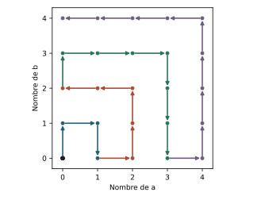
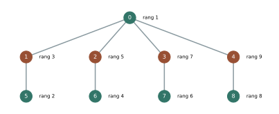
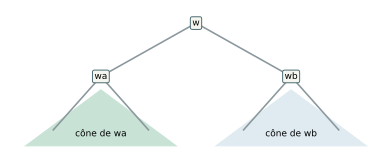

# X-ENS MPI · Informatique C 2023 · Corrigé brut

*Corrigé rédigé par IA, non officiel. Signalez toute erreur.*

**Rédaction** · GPT-6.2 Astra Ultra · vitesse non renseignée · 24 novembre 2026

## I · Préliminaires

### Question I.1 · Ordonner un espace fini

Si $X$ est vide ou réduit à un point, son unique énumération convient pour $d=1$. Sinon, prendre $d=\max_{x,y\in X}\delta(x,y)$ et énumérer tous les points dans un ordre quelconque. Toute paire consécutive satisfait la borne.

### Question I.2 · Distance avec opérations à droite

Soit $p$ le plus long préfixe commun de $u,v$. Toute suite d’opérations à droite doit retirer les $|u|-|p|$ lettres après ce préfixe et ajouter les $|v|-|p|$ lettres du second suffixe. Retirer puis ajouter exactement ces lettres atteint la borne. La fonction retire les têtes communes des listes OCaml, puis additionne les longueurs des queues. Elle prend $O(1+|u|+|v|)$ opérations.

```ocaml
let rec delta_ppr l1 l2 =
  match l1, l2 with
  | x :: xs, y :: ys when x = y -> delta_ppr xs ys
  | _ -> List.length l1 + List.length l2
```

### Question I.3 · Longueurs carrées

La première sortie est $a$, puis les longueurs sont $4,9,16,\ldots$. Avant la sortie de rang $i$, ajouter $i^2-(i-1)^2=2i-1$ lettres. Le mot reste en place entre deux émissions. Comme dans les programmes infinis de l’énoncé, les compteurs sont compris comme des entiers de capacité suffisante pour le préfixe calculé.

```c
void carres(void) {
    for (int impair = 1; ; impair += 2) {
        for (int j = 0; j < impair; ++j) pushR('a');
        output();
    }
}
```

### Question I.4 · Deux distances d’édition

Pour chacune des deux familles d’opérations, effacer le premier mot par la droite puis construire le second par la droite fournit une transformation. Les longueurs possibles forment donc un ensemble non vide d’entiers naturels, qui a un minimum. La suite vide transforme un mot en lui-même, et seule une suite vide peut réaliser une distance nulle. À toute transformation de $u$ en $v$ correspond, en renversant l’ordre et en inversant chaque opération à la même extrémité, une transformation de $v$ en $u$ de même longueur. Enfin, concaténer des transformations minimales de $u$ en $v$ puis de $v$ en $w$ donne une transformation de longueur $\delta(u,v)+\delta(v,w)$ de $u$ en $w$. Les mots finis sur un alphabet fini forment un ensemble dénombrable. Les trois axiomes et la condition de dénombrabilité sont vérifiés.

### Question I.5 · Deux ordres de blocs

Émettre d’abord le mot vide. À la longueur $k\ge1$, commencer en $b^k$. Émettre ensuite $a^i b^{k-i}$ pour $1\le i\le k$, puis $b^j a^{k-j}$ pour $1\le j<k$. Les deux mots monochromes sont déjà dans la première partie du tour. Chaque jonction change par une suppression à droite et une insertion à gauche. Du dernier mot $b^{k-1}a$, passer à $b^{k+1}$ en trois opérations. Pour $k=1$ le même raccord va de $a$ à $bb$. Chaque mot du langage appartient à un unique tour et y est émis une fois. On obtient un 3-ordre.

```c
void deux_blocs(void) {
    output();
    pushR('b');
    for (int k = 1; ; ++k) {
        output();
        for (int i = 1; i <= k; ++i) {
            popR(); pushL('a'); output();
        }
        for (int j = 1; j < k; ++j) {
            popR(); pushL('b'); output();
        }
        popR(); pushR('b'); pushR('b');
    }
}
```

### Question I.6 · Balayer les bords des carrés

Identifier $a^ib^j$ au point $(i,j)$. La couche $k=\max(i,j)$ a $2k+1$ points. Pour $k$ impair, la parcourir de $(0,k)$ à $(k,k)$ puis à $(k,0)$. Pour $k$ pair, aller de $(k,0)$ à $(k,k)$ puis à $(0,k)$. Deux couches consécutives se raccordent en un pas sur l’un des axes. Chacun des quatre déplacements modifie une lettre à une extrémité appropriée. Le chemin part de $(0,0)$, visite chaque point une fois et ses pas ont longueur un.

```c
void grille(void) {
    output();
    for (int k = 1; ; ++k) {
        if (k % 2 == 1) {
            pushR('b'); output();
            for (int i = 0; i < k; ++i) { pushL('a'); output(); }
            for (int j = 0; j < k; ++j) { popR(); output(); }
        } else {
            pushL('a'); output();
            for (int j = 0; j < k; ++j) { pushR('b'); output(); }
            for (int i = 0; i < k; ++i) { popL(); output(); }
        }
    }
}
```



### Question I.7 · Deux colonnes infinies

**a.** À chaque hauteur $j$, les deux mots sont $b^j$ et $ab^j$. Alterner l’ordre dans lequel on les émet. Le changement de colonne ajoute ou retire le premier $a$, le changement de hauteur ajoute un $b$ à droite. Le programme produit exactement un 1-ordre.

**b.** Un mot de $b^*$ et un mot de $ab^*$ ont un préfixe commun vide. Leur distance droite est donc la somme des longueurs. Fixons une borne $d$. Dans un passage d’une colonne à l’autre de longueur au plus $d$, les deux mots ont longueur au plus $d$. Ils sont en nombre fini et chacun peut intervenir dans au plus deux passages d’une énumération sans répétition. Après le dernier passage, une seule colonne fournirait donc toutes les sorties restantes, alors que les deux sont infinies. Aucun $d$ ne convient.

```c
void deux_colonnes(void) {
    output();
    while (true) {
        pushL('a'); output();
        pushR('b'); output();
        popL(); output();
        pushR('b'); output();
    }
}
```

### Question I.8 · NP-complétude pour tout seuil fixé

Pour $t\ge1$ fixé, un certificat de réponse positive donne la permutation des mots et, pour chaque paire consécutive, au plus $t$ opérations qui transforment le premier en le second. On vérifie la permutation et les transformations en temps polynomial. Ainsi $P_t$ appartient à NP.

Réduisons HamGrille à $P_t$. Pour le sommet $(i,j)$, créer $w_{i,j}=a^{ti}b^{tj}$. Une opération change d’une unité au plus l’un des deux effectifs de lettres. Par conséquent $\delta_{pp}(w_{i,j},w_{p,q})\ge t(|i-p|+|j-q|)$. Ajouter ou supprimer les $a$ à gauche, puis les $b$ à droite, atteint exactement cette borne. Deux mots distincts sont donc à distance au plus $t$ si et seulement si leurs sommets sont voisins dans la grille induite. Par injectivité, un chemin hamiltonien fournit un $t$-ordre et réciproquement.

Si les coordonnées sont codées en binaire, tester d’abord la connexité. Une instance non connexe avec plusieurs sommets donne l’instance négative fixe $\{\varepsilon,a^{t+1}\}$. Dans le cas connexe, translater chaque minimum de coordonnée à zéro. Chaque écart de coordonnées vaut au plus $|V|-1$, comme le montre un chemin simple entre les sommets extrêmes. La construction explicite des mots coûte alors $O(t|V|^2)$ caractères. Les cas vides ou unitaires se traitent directement selon la convention sur le chemin vide. La réduction est polynomiale et $P_t$ est NP-complet.

## II · Liste doublement chaînée

### Question II.1 · Liste globale vide

On utilise le type doublement chaîné du sujet. Les deux pointeurs sont nuls simultanément sur la liste vide. Pour une liste non vide, le précédent du premier et le suivant du dernier sont nuls.

```c
liste lg = { .premier = NULL, .dernier = NULL };
```

### Question II.2 · Tester le vide

Lire le premier pointeur permet de tester le vide en temps constant.

```c
bool est_vide(void) {
    return lg.premier == NULL;
}
```

### Question II.3 · Insérer aux extrémités

Allouer et initialiser un maillon, raccorder le voisin existant le cas échéant, puis mettre à jour l’extrémité. Sur liste vide, affecter aussi le pointeur opposé. Il y a un nombre constant d’opérations par appel, soit $O(1)$ avec le modèle d’allocation du sujet.

```c
void pushL(int val) {
    chainon *p = malloc(sizeof *p);
    assert(p != NULL);
    *p = (chainon){ .val = val, .prec = NULL, .suiv = lg.premier };
    if (lg.premier != NULL) lg.premier->prec = p;
    else lg.dernier = p;
    lg.premier = p;
}

void pushR(int val) {
    chainon *p = malloc(sizeof *p);
    assert(p != NULL);
    *p = (chainon){ .val = val, .prec = lg.dernier, .suiv = NULL };
    if (lg.dernier != NULL) lg.dernier->suiv = p;
    else lg.premier = p;
    lg.dernier = p;
}
```

### Question II.4 · Retirer aux extrémités

L’assertion assure que le maillon existe. Si l’extraction laisse la liste vide, l’autre extrémité devient nulle. Sinon, on rompt le lien du nouveau voisin vers l’ancienne extrémité. On libère ensuite le maillon et on renvoie la valeur sauvegardée. Chaque appel prend $O(1)$.

```c
int popL(void) {
    assert(!est_vide());
    chainon *p = lg.premier;
    int val = p->val;
    lg.premier = p->suiv;
    if (lg.premier != NULL) lg.premier->prec = NULL;
    else lg.dernier = NULL;
    free(p);
    return val;
}

int popR(void) {
    assert(!est_vide());
    chainon *p = lg.dernier;
    int val = p->val;
    lg.dernier = p->prec;
    if (lg.dernier != NULL) lg.dernier->suiv = NULL;
    else lg.premier = NULL;
    free(p);
    return val;
}
```

### Question II.5 · Afficher et vider

Pour $n$ maillons, les deux fonctions prennent $\Theta(n+1)$ avec un espace auxiliaire constant. Sur une liste vide, la première affiche une ligne vide, la seconde laisse les deux extrémités nulles.

```c
void output(void) {
    for (chainon *p = lg.premier; p != NULL; p = p->suiv)
        putchar(p->val);
    putchar('\n');
}

void vide_liste(void) {
    while (!est_vide()) popL();
}
```

## III · Graphes connexes

### Question III.1 · Distance dans un graphe

Dans ce cadre fini, l’ensemble des sommets est dénombrable. Pour deux sommets, la connexité donne au moins une marche, donc une plus petite longueur entière. La marche vide réalise la distance zéro, possible seulement entre un sommet et lui-même. Renverser une marche préserve sa longueur car le graphe est non orienté. Concaténer deux plus courtes marches fournit l’inégalité triangulaire. On peut effacer les cycles d’une marche sans augmenter sa longueur, donc la distance est aussi celle du plus court chemin.

### Question III.2 · Deux ordres sur les figures

**a.** Pour $G_1$, un 3-ordre est $0,6,1,7,2,8,3,9,4,10,5$.

**b.** Pour $G_2$, un 2-ordre est $5,1,2,6,0,7,3,4,8$. La racine entre les feuilles 6 et 7 permet deux sauts de longueur deux.

### Question III.3 · Construire un arbre couvrant orienté

Initialiser la matrice d’arbre à faux. En parcourant le graphe en largeur depuis 0, donner pour père à chaque nouveau sommet le sommet qui le découvre. Le marquage à l’insertion assure l’unicité du père. Les arcs suivent l’ordre strict des découvertes, ce qui exclut tout cycle. La connexité assure que chaque sommet est découvert. Le code sauvegarde les deux pointeurs de la liste globale, utilise une file temporairement vide, puis restaure les pointeurs initiaux. Les maillons sauvegardés ne sont jamais modifiés.

```c
void calcule_arbre_couvrant(bool graphe[N][N], bool arbre[N][N]) {
    bool vu[N];
    for (int u = 0; u < N; ++u) {
        vu[u] = false;
        for (int v = 0; v < N; ++v) arbre[u][v] = false;
    }
    liste initiale = lg;
    lg = (liste){ NULL, NULL };
    vu[0] = true;
    pushR(0);
    while (!est_vide()) {
        int u = popL();
        for (int v = 0; v < N; ++v) {
            if (graphe[u][v] && !vu[v]) {
                vu[v] = true;
                arbre[u][v] = true;
                pushR(v);
            }
        }
    }
    lg = initiale;
}
```

### Question III.4 · Position de l’émission en profondeur

**a.** À profondeur paire le paramètre est faux et le sommet est émis avant ses enfants. À profondeur impaire il est vrai et le sommet est émis après eux. C’est une récurrence sur la profondeur à partir de la racine 0.

**b.** Dans $G_2$ les enfants de 0 sont 1, 2, 3, 4 et leurs enfants respectifs sont 5, 6, 7, 8. La liste obtenue est $[0,5,1,6,2,7,3,8,4]$. Le 2-ordre choisi à III.2b était libre ; le programme impose ici l’ordre croissant des fils.



### Question III.5 · Borner les sauts entre sorties

Pour un nœud $x$ de profondeur paire, la séquence de son sous-arbre commence par $x$ et se termine à distance au plus un de $x$. Pour un nœud de profondeur impaire, elle commence à distance au plus un de $x$ et se termine en $x$. Montrons simultanément ces propriétés, l’absence de doublons, l’exhaustivité et la borne trois sur les sauts. Une feuille ne produit qu’elle-même.

Au nœud pair, émettre $x$ puis les sous-arbres des fils impairs. Le premier terme du premier fils est à distance au plus deux de $x$. Entre deux frères, le premier sous-arbre finit sur sa racine, on traverse deux arêtes via $x$ jusqu’à la racine suivante, puis au plus une arête jusqu’à son premier terme. Le dernier fils termine sur sa racine, voisine de $x$. Au nœud impair, chaque fils pair commence sur sa racine et finit à distance au plus un de celle-ci. Un raccord entre frères prend donc au plus $1+2$ arêtes, et le retour terminal vers $x$ au plus deux. Le premier fils commence sur sa racine, voisine de $x$.

Les sous-arbres sont disjoints et $x$ est émis exactement une fois. Cela conclut la récurrence, y compris le cas d’un fils unique. À la racine, l’ordre couvre tout l’arbre. Chaque chemin de l’arbre est un chemin du graphe, donc la distance dans le graphe satisfait la même borne.

### Question III.6 · Coût de la visite

Il y a $N$ appels et chacun examine une ligne entière de $N$ cases, soit $\Theta(N^2)$ en temps. Si les enfants de chaque sommet sont directement donnés en liste, un parcours par sommet et par arc coûte $\Theta(N+(N-1))=\Theta(N)$. Convertir préalablement une matrice dense en listes coûte néanmoins $\Theta(N^2)$.

### Question III.7 · Remplacer la pile d’appels

**a.** Une chaîne d’arbre peut avoir hauteur $N-1$ ; la profondeur d’appels peut alors épuiser la pile d’exécution.

**b.** Allouer une pile explicite de cadres contenant un nœud, sa parité de profondeur et l’indice du prochain fils à tester. À l’entrée d’un cadre pair émettre le nœud ; à l’entrée d’un cadre impair différer l’émission. Au sommet de pile, avancer jusqu’au prochain fils présent, sauvegarder l’indice suivant puis empiler le fils avec l’autre parité et l’indice 0. À l’épuisement des fils, émettre le nœud si le cadre est impair et dépiler. La pile vide termine le calcul. Les cadres reproduisent les retours, y compris ceux des feuilles, avec $O(N)$ places dans le pire cas.

## IV · Langages réguliers et opérations à droite

### Question IV.1 · Reconnaître un automate poêle

Calculer les composantes fortement connexes, par exemple par Kosaraju (ordre de fin d’une exploration en profondeur puis exploration du transposé dans l’ordre de fin décroissant). Une composante est cyclique si elle contient au moins deux états ou si son unique état a une boucle. Exiger exactement une composante cyclique $C$. Pour chaque état de $C$, compter ses transitions **étiquetées** qui restent dans $C$ et en exiger exactement une. Une composante fortement connexe avec un unique successeur interne par état est un unique cycle passant par tous ses états. Inversement, deux transitions internes distinctes d’un même état ouvrent deux cycles simples distincts, car chacune peut se prolonger par un plus court chemin de retour à cet état. Cela compte notamment deux boucles de lettres différentes vers le même état.

Reste à compter les chemins stricts vers $C$. Rendre tous les sommets de $C$ absorbants au sens du parcours en supprimant toutes leurs transitions sortantes. Le graphe ainsi obtenu est acyclique. Placer le compteur 1 sur l’état initial, 0 ailleurs ; dans un ordre topologique, ajouter le compteur du sommet à chacun de ses successeurs, une fois par transition, en saturant toute somme à 2. Additionner de même les compteurs des sommets de $C$. Accepter si et seulement si cette somme vaut 1. Chaque chemin compté s’arrête à sa première entrée dans $C$ ; si l’état initial y est, le seul chemin compté est le chemin vide. Les calculs coûtent $O(|Q|+|E|)$.

### Question IV.2 · Décomposer les mots acceptés

Notons $e$ l’état d’entrée, $u$ le mot de l’unique chemin strict et $v\ne\varepsilon$ l’étiquette du tour complet du cycle depuis $e$. Soit $F$ l’ensemble des mots acceptés dont le chemin évite $e$. Il est fini, car ces chemins évitent tout le cycle et ne peuvent répéter un état. Soit $F'$ l’ensemble des étiquettes de chemins de $e$ à un état final qui ne reviennent pas à $e$ après leur départ. On inclut le mot vide si $e$ est final. De tels chemins ne peuvent répéter un autre état : toute répétition contiendrait un cycle complet et donc $e$. Ainsi $F'$ est fini.

Après une première visite à $e$, chaque segment entre deux visites successives de $e$ est un tour complet du cycle. Un détour quittant la composante ne pourrait y revenir. Tout mot accepté visitant $e$ s’écrit donc $uv^kx$ avec $k\ge0$ et $x\in F'$. Inversement, suivre le chemin d’entrée, puis $k$ tours, puis le chemin acceptant de $x$, accepte ce mot. D’où $L(A)=F\cup uv^*F'$. Avec cette construction, l’union est disjointe et la décomposition est unique : le chemin déterministe impose le nombre de retours à $e$ et le suffixe après le dernier.

### Question IV.3 · Énumérer les mots d’un automate poêle

Les listes $f,f'$ représentent, sans répétition, les ensembles construits à IV.2. La fonction locale ajoute les lettres de son argument, émet le mot total et retire autant de lettres qu’elle en a ajoutées. Émettre d’abord $F$ sur la base vide. Ensuite, conserver $u$ et traiter successivement toutes les bases $uv^k$, en commençant à $k=0$. L’unicité de IV.2 garantit qu’aucun mot n’est répété. La coaccessibilité de $e$ assure $F'\ne\varnothing$.

Soient $m$ et $m'$ les longueurs maximales dans $F$ et $F'$ (prendre 0 pour un ensemble vide). Deux sorties de la phase finie se relient en au plus $2m$ opérations. Au changement de phase il en suffit d’au plus $m+|u|+m'$. Dans la phase infinie, le coût est au plus $2m'+|v|$ lorsque l’on passe au tour suivant, et au plus $2m'$ à l’intérieur d’un même tour. Une borne uniforme existe donc.

```ocaml
let enumere u v f f' =
  let sortie_suffixe mot =
    List.iter pushR mot;
    output ();
    List.iter (fun _ -> popR ()) mot
  in
  List.iter sortie_suffixe f;
  List.iter pushR u;
  while true do
    List.iter sortie_suffixe f';
    List.iter pushR v
  done
```

### Question IV.4 · Existence d’une branche lourde

La racine du trie contient tous les mots du langage dans son sous-arbre. À un nœud $w$ dont le sous-arbre contient une infinité de mots de $L$, le nœud lui-même ne compte que pour un seul mot. Au moins l’un des sous-arbres $T_{wa},T_{wb}$ contient donc une infinité de mots de $L$. Choisir à chaque étape un tel fils (le premier dans l’ordre $a,b$ en cas d’égalité) construit une branche infinie dont chaque nœud a la propriété requise.

### Question IV.5 · Deux branches lourdes empêchent un ordre borné

Supposons deux branches lourdes et soit $w$ leur dernier préfixe commun. Quitte à échanger leurs noms, l’une entre dans $T_{wa}$ et l’autre dans $T_{wb}$. Le cône $T_{wa}$ et son complément contiennent donc chacun une infinité de mots de $L$. Pour $x\in T_{wa}$ et $y\notin T_{wa}$, leur préfixe commun a longueur au plus $|w|$. Par I.2, $\delta_{ppr}(x,y)\ge |x|-|w|$. Un franchissement de la coupure en au plus $d$ pas utilise donc, du côté du cône, un mot de longueur au plus $|w|+d$. Il y en a un nombre fini, et chaque mot est incident à au plus deux franchissements dans une suite sans répétitions. Après le dernier franchissement, tous les mots suivants sont du même côté. L’autre côté ne pourrait pas être couvert, d’où la contradiction.



### Question IV.6 · Deux accès stricts

**a.** Si $u$ était un préfixe propre de $u'$, le déterminisme ferait suivre d’abord au second chemin tout le premier. Le dernier état du premier, cyclique, serait intérieur au second, contraire à sa stricte définition. L’égalité des étiquettes impliquerait l’identité des chemins. Par symétrie les étiquettes sont donc incomparables pour l’ordre préfixe.

**b.** Prolonger chacun des deux chemins en tournant indéfiniment sur un cycle atteint. À tout préfixe du mot infini ainsi lu, on peut poursuivre jusqu’au cycle, y effectuer autant de tours supplémentaires que souhaité, puis gagner un état final par coaccessibilité. Cela donne une infinité de prolongements acceptés de longueurs distinctes pour chaque préfixe. Les deux suites de préfixes sont des branches lourdes et elles divergent puisque $u$ et $u'$ sont incomparables.

### Question IV.7 · Deux cycles et caractérisation finale

Choisir deux cycles distincts à rotation près. Comme l’automate est émondé, on peut atteindre un état de chacun d’eux depuis l’état initial, puis répéter ce cycle pour toujours. Les deux lectures infinies ainsi obtenues ont chacune une branche lourde : à partir de tout préfixe de la lecture, continuer jusqu’au cycle, ajouter un nombre arbitraire de tours puis rejoindre un état final. Le raisonnement vaut même si le second cycle ne passe pas par l’état d’entrée du premier.

Si les deux lectures avaient le même mot infini, le déterminisme depuis l’unique état initial leur imposerait la même suite d’états **et** de transitions étiquetées. Assez loin dans cette suite, chaque lecture tourne exclusivement sur son cycle simple. À partir d’une occurrence d’un état commun, le segment jusqu’à sa prochaine occurrence décrit alors le même cycle simple étiqueté pour les deux lectures. C’est une contradiction. Il existe donc deux branches lourdes distinctes.

Pour un langage régulier infini, tout automate émondé qui l’accepte possède un cycle accessible (des chemins acceptants de longueurs non bornées répètent un état), donc au moins un chemin strict vers un cycle. Si le langage est ordonnable, IV.5 exclut deux branches lourdes. IV.6 exclut alors deux chemins stricts et le résultat précédent exclut deux cycles. Tout tel automate est donc poêle. Dans l’autre sens, la décomposition et le programme de IV.2–3 construisent un ordre borné à partir de n’importe quel automate poêle acceptant le langage.
