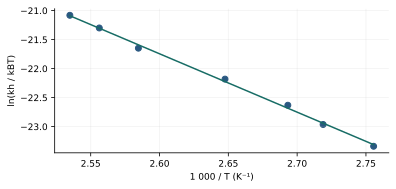
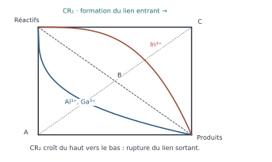
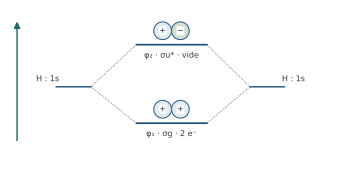
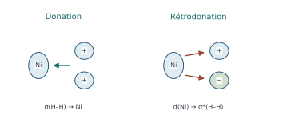
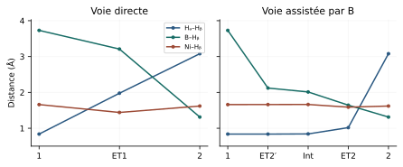
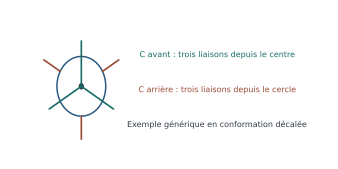
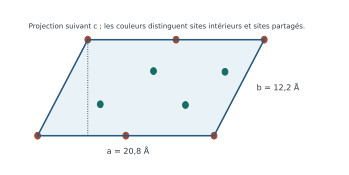
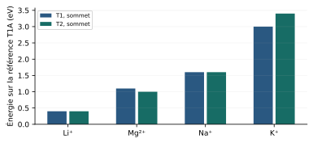
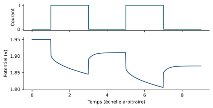

# X-ENS — PC, Chimie A 2023 · Corrigé brut

*Corrigé rédigé par IA, non officiel.*

**Rédaction** · GPT-6.2 Astra Ultra · vitesse non renseignée

**Couverture partielle.** Sur 65 questions, 45 sont intégralement traitées : Q1–27, Q42, Q47 et Q50–65. La Q37 présente la convention de projection de Newman, sans application à l’intermédiaire. Les Q28–36, Q38–41, Q43–46 et Q48–49, consacrées aux voies de synthèse et de sélection de l’immucilline H, restent hors couverture.

## Échange de molécules d’eau. Grandeurs d’activation

### Question 1 — Arrhénius et Eyring

La loi d’Arrhénius s’écrit $k=Ae^{-E_a/(RT)}$, où $E_a$ est l’énergie d’activation molaire, $A$ le facteur préexponentiel, $T$ la température absolue et $R$ la constante des gaz. La formule d’Eyring relie la barrière aux grandeurs thermodynamiques $\Delta H^\ddagger$ et $\Delta S^\ddagger$ du complexe activé. Elle permet ainsi de discuter le coût énergétique et l’organisation nécessaire à l’acte élémentaire.

### Question 2 — Linéarisation

En unités standard cohérentes, $y=\ln[kh/(k_BT(c^\circ)^{\Delta n})]=-\Delta H^\ddagger/(RT)+\Delta S^\ddagger/R$. Pour la cinétique apparente du premier ordre de l’expérience, $\Delta n=0$. Dans l’approximation d’Ellingham la pente en $1/T$ est $-\Delta H^\ddagger/R$ et l’ordonnée à l’origine $\Delta S^\ddagger/R$.

### Question 3 — Compléter la régression Python

La ligne 15 est `y = np.log(k*h/(k_B*T))`. La ligne 18 est `a, b = np.polyfit(x, y, 1)`. Le degré un impose le modèle affine et les coefficients sortent dans l’ordre pente puis origine.

### Question 4 — Grandeurs d’activation

Ligne 22 : `DeltaHactivation = -a*R/1000`. Ligne 23 : `DeltaSactivation = b*R`. Les sept couples donnent $a\simeq-10065$ K, $b\simeq4{,}425$, donc $\Delta H^\ddagger\simeq83{,}7$ kJ·mol⁻¹ et $\Delta S^\ddagger\simeq36{,}8$ J·mol⁻¹·K⁻¹.

### Question 5 — Voies en compétition

Les événements A, D et I consomment le même complexe en parallèle. Ainsi $v=v_A+v_D+v_I=\{k_D+(k_A+k_I)[\mathrm{H_2O^*}]\}[M]$. La concentration en ligand entrant est tenue constante pendant la mesure : le terme entre accolades est $k_{app}$.

### Question 6 — Signes de l’entropie d’activation

L’association immobilise et oriente un ligand supplémentaire : $\Delta S^\ddagger$ fortement négative (α). La dissociation libère un ligand et augmente la liberté de mouvement : valeur fortement positive (β). Un échange concerté équilibré compense une contrainte par une libération, donnant une valeur faible (γ). Ce sont des tendances à confronter aux données en solution.

### Question 7 — Effet de la pression

Comme $(\partial\Delta G^\ddagger/\partial P)_T=\Delta V^\ddagger$, on obtient $\Delta V^\ddagger=-RT(\partial\ln k/\partial P)_T$. Si ce volume est constant, $\ln[k(P_2)/k(P_1)]=-\Delta V^\ddagger(P_2-P_1)/(RT)$. P en pascals donne un volume en m³·mol⁻¹.

### Question 8 — Diagramme de More-O’Ferrall

A est le coin dissociatif (volume positif), B l’échange concerté (volume nul), C le coin associatif (volume négatif). Le chemin associatif avance d’abord vers la droite, donc $CR_1$ mesure la création de la nouvelle liaison $\ell_2$. Le déplacement vers le bas selon $CR_2$ traduit la rupture de l’ancienne $\ell_1$.

### Question 9 — Échelle du volume d’activation

Pour l’eau liquide, $V_m=M/\rho\simeq18\ \mathrm{g\,mol^{-1}}/(1\ \mathrm{g\,mL^{-1}})=18$ mL·mol⁻¹. Ajouter ou libérer une molécule d’eau par complexe donne un changement d’encombrement du même ordre que 13,5 mL·mol⁻¹. L’hydratation et une rupture/création partielle expliquent que l’on ne retrouve pas exactement 18.

### Question 10 — Mécanismes pour les trois ions

Al³⁺ et Ga³⁺ se situent du côté A : échange à caractère dissociatif dominant. In³⁺ se situe du côté C : caractère associatif dominant. Les tracés réels passent à l’intérieur du carré, ce qui admet un caractère d’interchange plutôt que les coins limites stricts.

### Question 11 — Contrôle entropique pour Al³⁺

La valeur mesurée +37 J·mol⁻¹·K⁻¹ est positive et appréciable devant $R$. La libération partielle du ligand sortant au complexe activé est cohérente avec la signature volumique dissociative de Al³⁺.

### Question 12 — Rôle du rayon ionique

Al³⁺ (68 pm) et Ga³⁺ (76 pm) portent six eaux relativement rapprochées. L’arrivée d’une septième accroît fortement les répulsions ligand–ligand et le départ préalable d’une eau libère de la place. In³⁺ (94 pm) permet à la sphère de coordination de s’élargir plus facilement pour accepter le ligand entrant. Le changement de taille à charge identique rend plausible l’inversion observée.

## Fragments du complexe de nickel

### Question 13 — Diagramme moléculaire de H₂

Deux 1s de même énergie donnent $\phi_1\propto1s_a+1s_b$ (σg liante, densité entre noyaux) et $\phi_2\propto1s_a-1s_b$ (σu* antiliante, nœud au milieu). Les deux électrons de H₂ sont appariés dans $\phi_1$. $\phi_2$ reste vacante, l’indice de liaison vaut un.

### Question 14 — Réflexion du fragment dihydrogène

La réflexion dans xOz envoie $y$ sur $-y$ et échange $1s_a$ et $1s_b$. Ainsi la somme $\phi_1$ est symétrique (S) et la différence $\phi_2$ antisymétrique (A).

### Question 15 — Parité des orbitales d

$d_{x^2-y^2}$, $d_{xz}$ et $d_{z^2}$ sont S. $d_{yz}$ et $d_{xy}$ sont A, car leur facteur angulaire comporte une seule puissance de $y$.

### Question 16 — Parité des orbitales de ligand

Les lobes donneurs des deux phosphores ont même signe pour $\phi_3$ (S) et signes opposés pour $\phi_4$ (A). L’orbitale vacante de B est dirigée dans le plan xOz et se reproduit par réflexion : $\phi_5$ est S.

### Question 17 — Table des recouvrements permis

Le tableau applique le critère demandé du plan xOz. Un signe ✓ indique que ce seul plan n’interdit pas l’interaction. Des orientations nodales particulières peuvent rendre un terme permis très petit, voire nul dans un fragment idéal.

| Fragment | $d_{x^2-y^2}$ | $d_{yz}$ | $d_{xy}$ | $d_{xz}$ | $d_{z^2}$ |
|---|---|---|---|---|---|
| $\phi_1$ | ✓ | 0 | 0 | ✓ | ✓ |
| $\phi_2$ | 0 | ✓ | ✓ | 0 | 0 |
| $\phi_3$ | ✓ | 0 | 0 | ✓ | ✓ |
| $\phi_4$ | 0 | ✓ | ✓ | 0 | 0 |
| $\phi_5$ | ✓ | 0 | 0 | ✓ | ✓ |

### Question 18 — Donation et rétrodonation

La σ occupée $\phi_1$ donne un doublet vers le métal selon l’axe Ni–centre de H₂ : recouvrement axial, H₂ nucléophile. Une d métallique occupée peut rétrodonner dans $\sigma^*(\mathrm{H-H})=\phi_2$, par recouvrement latéral des deux lobes de signes opposés : H₂ joue alors l’électrophile.

### Question 19 — Lecture de Ψ₁ et Ψ₃

Dans $\Psi_1$, les lobes en regard de Hₐ et Hᵦ ont des signes opposés et se prolongent sur les deux sites : le motif caractéristique est la combinaison liante métal–$\phi_2$, principalement $d_{yz}$ dans les axes du modèle. L’interaction est donc liante pour Ni–H₂ et antiliante pour H–H. Dans la vue de profil de $\Psi_3$, le grand lobe se prolonge entre Ni et B : il s’agit surtout de $d_{xz}$–$\phi_5$. Le fragment H₂ est sur une direction nodale ou de très faible amplitude ; Ni–H₂ est essentiellement non liant pour cette orbitale.

### Question 20 — Allongement de H–H

La donation délocalise une partie de la densité de σ(H–H) vers Ni et la rétrodonation occupe partiellement σ*(H–H), notamment dans $\Psi_1$ occupée. Ces deux effets diminuent l’ordre de liaison H–H, qui s’allonge de 0,740 à 0,837 Å avant toute dissociation complète.

### Question 21 — État d’oxydation du nickel

Ni neutre ($Z=28$) a pour configuration $[\mathrm{Ar}]\,3d^8 4s^2$. Les cinq doublets représentés comptent pour dix électrons de valence attribués au Ni dans la convention demandée. Pour un métal du groupe 10, le décompte $d^{10}$ correspond à **Ni(0)**, inhabituel dans cette géométrie.

## Deux voies de rupture de H–H

### Question 22 — À quel moment H–H se rompt-elle ?

Voie 1 : H–H passe de 0,837 à 1,977 Å en ET1 puis à 3,079 Å en 2. La rupture est déjà avancée en ET1. Ni–Hᵦ se raccourcit de 1,660 à 1,440 Å avant de revenir à 1,619 Å. Voie 2 : H–H reste à 0,836–0,841 Å jusqu’à Int et Ni–Hᵦ près de 1,66 Å. C’est le deuxième acte, via ET2 (H–H 1,017 Å, Ni–Hᵦ 1,588 Å), qui conduit à la rupture et au produit.

### Question 23 — Chemin direct ou assisté par B

Voie 1 : H₂ se clive sur Ni, le raccourcissement de Ni–Hᵦ traduit la formation d’un lien hydrure. B–Hᵦ est encore long en ET1 (3,209 Å), puis se ferme à 1,312 Å dans le produit. Voie 2 : le ligand H₂ tourne vers B sans rupture H–H lors de ET2′, et B–Hᵦ diminue de 3,730 à 2,121 puis 2,012 Å dans Int. Ensuite ce contact se renforce (1,643 Å en ET2) et H–H se rompt. Dans 2, Hₐ est lié à Ni, Hᵦ est retenu vers B avec un contact Ni–Hᵦ.

### Question 24 — Catégorie de la transformation directe

Le motif principal de la voie 1 est une addition oxydante de H–H au nickel : la liaison σ du substrat est rompue, deux interactions de type métal–hydrure se développent, avec augmentation formelle de deux unités du degré d’oxydation au stade dihydrure. La capture ultérieure de Hᵦ par B est visible sur le chemin vers 2.

## Lecture des figures de structure et des spectres

### Question 25 — Trois chaînes latérales au contact de l’inosine

Le résidu 86 est une histidine (His, –CH₂–imidazole), le résidu 200 une phénylalanine (Phe, –CH₂–Ph) et le résidu 201 un glutamate/acide glutamique (Glu, –CH₂–CH₂–COOH dans la forme acide). La numérotation se lit sur le squelette peptidique.

### Question 26 — Protonation à pH 7

His, dont l’imidazolium a un $pK_a$ voisin de 6, est majoritairement sous forme imidazole neutre, avec une fraction protonée. La chaîne benzyle de Phe est neutre. Le carboxyle de Glu ($pK_a$ voisin de 4) est très majoritairement $\mathrm{COO^-}$. Les groupes α engagés dans les liaisons peptidiques ne sont pas des chaînes latérales libres.

### Question 27 — Interactions non covalentes avec le substrat

L’imidazole neutre de His86 peut accepter ou donner une liaison hydrogène selon l’azote et le tautomère considérés, notamment au voisinage des OH du ribose. Phe200 offre une surface de dispersion et d’empilement avec la base aromatique. Le carboxylate Glu201 est un accepteur de liaison H et peut attirer un site positivement chargé de la forme schématisée. Une interaction ionique stricte exige que la protonation locale du substrat en fournisse la charge.

### Question 37 — Lire une projection de Newman (portée partielle)

Lecture géométrique uniquement. Placer l’œil du côté de C3 en regardant C4. Le carbone avant est le point central, celui de l’arrière le cercle. Projeter sans les permuter les trois liaisons partant de chaque extrémité dans le plan perpendiculaire à C3–C4. Une rotation de la feuille entière ne change pas la conformation, une rotation relative de l’un des deux tripodes la change. Cette indication explique la construction de la projection ; l’application à l’intermédiaire de synthèse reste hors couverture.

### Question 42 — Signatures spectrales du composé numéroté

En RMN, A (7,00 ppm, s, 1 H) est H porté par C9, seul proton du cycle hétéroaromatique. B (5,54 ppm, s large, 2 H) est NH₂ en position 10. E (4,19 ppm, q, 2 H) et I (1,22 ppm, t, 3 H) appartiennent à OCH₂CH₃ de l’ester et partagent $J=7{,}1$ Hz. H (1,42 ppm, s, 6 H) regroupe les méthyles C11/C12 de l’acétal, dont les deux signaux peuvent se confondre. En IR, 3 422 et 3 374 cm⁻¹ correspondent aux deux élongations N–H d’une amine primaire. Les C–H insaturés et aliphatiques couvrent 3 086–2 867, et C=O de l’ester absorbe à 1 722 cm⁻¹. Les vibrations du cycle et les déformations CH peuvent contribuer à 1 478, les liaisons C–O de l’ester et de l’acétal aux bandes 1 190 et 1 022 cm⁻¹.

### Question 47 — Adduit de Lewis BH₃·SMe₂

Le soufre du sulfure de diméthyle donne un doublet à la lacune de BH₃ : $\mathrm{Me_2S\to BH_3}$. Avec quatre liaisons le bore porte la charge formelle −1 et a une géométrie tétraédrique AX₄. Le soufre porte +1 avec trois liaisons et un doublet libre : répartition électronique tétraédrique, géométrie moléculaire pyramidale trigonale AX₃E. La molécule est globalement neutre.

## Structure et transport dans le titanoniobate

### Question 50 — Population de la maille

Dans la projection selon $z$, les Ti des plans $z=0,c$ se superposent et comptent ensemble pour une couche, en tenant compte des partages latéraux. Quatre sommets donnent 1 Ti, deux positions de bord partagées en donnent 1, et les quatre positions internes des différentes couches en donnent 4. Total : **6 Ti**, donc $Z=6$ motifs $\mathrm{TiNb_2O_7}$ (12 Nb et 42 O).

### Question 51 — Masse volumique

$V=abc\sin\gamma=(20{,}8)(12{,}2)(3{,}8)\sin120°\simeq835$ ų, soit $8{,}35\,10^{-22}$ cm³. $M=47{,}9+2(92{,}9)+7(16{,}0)=345{,}7$ g·mol⁻¹. Ainsi $\rho=6M/(N_AV)\simeq4{,}1$ g·cm⁻³.

### Question 52 — Mobilité du lithium selon le canal

Le site T1A, à 0 eV par définition, est plus stable que T2C (environ 0,1 eV) et T2B (environ 0,3 eV). T1 est donc favorisé thermodynamiquement. Le sommet T1 se situe vers 0,4 eV au-dessus de son minimum. Le maximum T2 est également vers 0,4 eV sur l’échelle commune, mais la barrière locale est d’environ 0,1 eV depuis B et 0,3 eV depuis C. À préfacteurs égaux les sauts locaux de Li sont plus rapides dans T2, avec une asymétrie des sens.

### Question 53 — Comparer les ions mobiles

T1 montre des barrières d’environ 0,4 eV pour Li⁺, 1,1 pour Mg²⁺, 1,6 pour Na⁺ et 3 pour K⁺. Dans T2, Li conserve le profil le plus plat, Mg a un profil asymétrique avec maxima proches de 1 eV, Na culmine vers 1,6 et K vers 3,4 eV. Le facteur activé pénalise fortement les ions autres que Li⁺ à température ambiante. Mg²⁺ est le candidat alternatif le moins défavorable sur ce seul critère ; ces courbes ne démontrent pas qu’une batterie au Mg serait exploitable.

### Question 54 — Géométrie des étranglements

Les fenêtres d’oxygènes sont déformées : T1 a deux dimensions opposées de 4,53 et 3,58 Å, T2 de 3,85 et 4,17 Å. Dans une image à sphères fixes, le demi-passage limitant moins $r_{O^{2-}}=1,40$ Å donne environ 0,39 Å pour T1 et 0,53 Å pour T2. Même Li⁺ (0,76 Å) sollicite donc la relaxation de l’environnement. Na⁺ (1,02 Å) et K⁺ (1,40 Å) exigent davantage de déformation. Mg²⁺ (0,72 Å) reste plus lent que Li⁺ malgré sa petite taille, car la charge double modifie la liaison aux oxygènes et le coût de migration.

## Titrage galvanostatique et capacité utile

### Question 55 — Sauts ohmiques en GITT

Le saut immédiat vaut en module $|\Delta U|\simeq R_\Omega|\Delta I|$, avec une contribution de résistance $R=\rho L/S$. À l’arrêt de l’impulsion la chute ohmique disparaît presque instantanément ; le reste du retour est plus lent. Réduire l’intensité, rapprocher la référence de la surface, diminuer les longueurs de conduction, améliorer contacts, conductivité et section efficace réduit l’artefact sans le confondre avec $\Delta E_t$ diffusif.

### Question 56 — Demi-équation d’insertion

$\mathrm{TiNb_2O_7+x\,Li^++x\,e^-\longrightarrow Li_xTiNb_2O_7}$. L’oxyde hôte reçoit simultanément les ions et les électrons, ce qui maintient la neutralité globale.

### Question 57 — Fonction de l’électrode pendant l’insertion

L’oxyde consomme des électrons et se réduit : l’électrode de travail est la **cathode pendant l’insertion**. Le nom change quand on impose l’extraction qui est l’oxydation inverse.

### Question 58 — Impulsion et relaxation

Sous impulsion, un générateur pilote le courant et la composition de l’électrode : fonctionnement galvanostatique forcé, de type électrolyse dans le sens de charge imposé. En relaxation, le courant extérieur est nul, la cellule évolue vers une pile à circuit ouvert et l’on mesure une différence de potentiel de repos.

### Question 59 — Choix de la borne en fonctionnement pile

L’oxyde travaille autour de 1,2 à 2 V par rapport à Li⁺/Li. Dans un accumulateur Li-ion usuel associé à un oxyde de potentiel supérieur (3–4 V), le titanoniobate lithié convient à la **borne négative** : il s’oxyde et libère Li⁺ à la décharge. Face à une contre-électrode de lithium métal seule, les polarités relatives s’inversent : l’oxyde a le potentiel supérieur. La figure donne une échelle de potentiel, le choix pratique dépend du partenaire.

### Question 60 — Chute du coefficient de diffusion

Quand $x$ augmente, les sites vacants se raréfient. Les sauts sont plus souvent bloqués par un voisin Li⁺ et les répulsions ou l’ordre local peuvent accroître la barrière d’un saut disponible. Le transport effectif ralentit. La baisse globale au fort remplissage et l’accident vers 1,65 V ne permettent pas à eux seuls d’identifier une phase précise.

### Question 61 — Pente thermique du potentiel

Pour une réaction de cellule rapportée à un électron, $\Delta_rG=-FE$. À pression et composition fixées, $(\partial\Delta_rG/\partial T)_P=-\Delta_rS$. D’où $\Delta_rS=F(\partial E/\partial T)_P$. Si le bilan est écrit pour $x$ électrons, le facteur devient $xF$. Avec une entropie sensiblement constante, la pente peut être estimée par une différence finie.

### Question 62 — Signe de l’entropie

Les points sont négatifs sur le domaine mesuré, typiquement −10 à −28 J·mol⁻¹·K⁻¹. Si la contre-électrode contribue peu, cela traduit pour l’insertion une réduction nette des degrés de liberté et une organisation des ions dans les sites du solide. Les variations avec $x$ indiquent que les configurations accessibles changent avec le remplissage.

### Question 63 — Charge 1C

$I=Q/t=10\,000/3\,600\simeq2{,}8$ A. La capacité vaut donc 2,78 Ah. C’est un courant de quelques ampères, du même ordre que celui d’une recharge de téléphone, exigeant des contacts et une gestion thermique adaptés.

### Question 64 — Masse et volume d’oxyde actif

$n_e=Q/F\simeq0{,}104$ mol. À $x=3$, $n_{\rm oxyde}=Q/(3F)=3{,}45\,10^{-2}$ mol, donc $m\simeq11{,}9$ g et $V=m/\rho\simeq2{,}9$ cm³. La borne théorique à cinq ions donnerait 7,2 g et 1,7 cm³ mais sort de la limite d’usage indiquée.

### Question 65 — Pertinence dans un téléphone

Une douzaine de grammes et environ 3 cm³ d’oxyde pour 2,8 Ah restent compatibles avec les dimensions d’un téléphone. Il faut encore la seconde électrode, l’électrolyte, les collecteurs, le séparateur et l’enveloppe. Comme le potentiel du titanoniobate est relativement élevé pour une borne négative, la tension et donc l’énergie de la cellule sont plus faibles qu’avec une anode proche de 0 V à cathode identique. La capacité et le volume actifs rendent l’option envisageable ; ils ne suffisent pas à fixer l’autonomie du dispositif.
