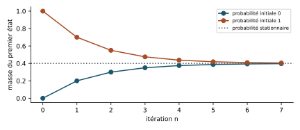
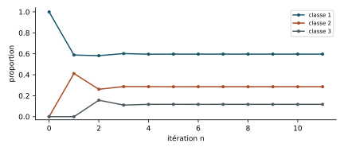

# X-ENS PC — Mathématiques 2023 · Corrigé brut

*Corrigé rédigé par IA, non officiel. Signalez toute erreur.*

**Rédaction** · GPT-6.2 Astra Ultra · vitesse non renseignée

**Révision** · GPT-6.2 Astra Ultra · vitesse non renseignée

Les lois sont des vecteurs lignes. Les vecteurs propres à droite et les vecteurs utilisés pour tester les moments sont des colonnes.

## I. Contraction des lois de probabilité

### Question 1

Pour tout $i$, $1=\sum_jP_{ij}\ge c\sum_j\nu_j=c$. Ainsi $0<c\le1$.

### Question 2

Chaque $(uP)_j=\sum_i u_iP_{ij}$ est positif ou nul et $\sum_j(uP)_j=\sum_i u_i\sum_jP_{ij}=1$. On a donc $uP\in\mathcal P$.

### Question 3

Posons $N_{ij}=\nu_j$ et $R=P-cN$. La matrice $R$ est positive au sens large et chaque ligne a pour somme $1-c$. Comme $uN=vN=\nu$, on a
$$\|(u-v)P\|_1\le\sum_j\sum_i |u_i-v_i|R_{ij}=(1-c)\|u-v\|_1.$$
Cette preuve couvre $c=1$, auquel cas $R=0$.

### Question 4

Par récurrence, $\|x_{n+1}-x_n\|_1\le(1-c)^n\|x_1-x_0\|_1$. La série de ces majorants converge puisque $0\le1-c<1$ (au rang zéro le facteur vaut $1$).

### Question 5

Pour $m>n$, $\|x_m-x_n\|_1\le\sum_{k=n}^{m-1}\|x_{k+1}-x_k\|_1$. Le reste tend vers zéro uniformément en $m>n$. La suite converge dans l’espace complet $\mathbb R^d$. Les coordonnées positives ou nulles et la somme égale à un passent à la limite, qui appartient donc à $\mathcal P$.

### Question 6

La continuité de $x\mapsto xP$ donne $\mu P=\mu$ pour la limite précédente. Si $\eta\in\mathcal P$ est aussi fixe, $\|\mu-\eta\|_1\le (1-c)\|\mu-\eta\|_1$, donc $c\|\mu-\eta\|_1=0$ et $\mu=\eta$.

### Question 7

Puisque $\mu P^n=\mu$, l’itération donne $\|xP^n-\mu\|_1\le(1-c)^n\|x-\mu\|_1\le2(1-c)^n$ par l’inégalité triangulaire. Dans l’exemple ci-dessous la première masse vérifie $z_{n+1}=0{,}2+0{,}5z_n$.

Dans le graphique, la masse stationnaire du premier état est la solution de $z=0{,}2+0{,}5z$, soit $z=0{,}4$. On a même $z_n-0{,}4=2^{-n}(z_0-0{,}4)$. Cette identité vérifie l’évolution des deux trajectoires représentées.

## II. Changement de matrice et structure par âge

### Question 8

$\sum_jP_{ij}=(Mh)_i/(\lambda h_i)=1$. Le dénominateur est strictement positif et chaque entrée de $P$ est positive ou nulle.

### Question 9

Pour $D=\operatorname{diag}(h_1,\ldots,h_d)$, $P=\lambda^{-1}D^{-1}MD$. Les facteurs adjacents $DD^{-1}$ se simplifient, donc $P^n=\lambda^{-n}D^{-1}M^nD$ et $(P^n)_{ij}=\lambda^{-n}(M^n)_{ij}h_j/h_i$.

### Question 10a

Écrivons $m=\min_i h_i>0$, $H=\max_i h_i$. On a $P_{ij}\ge c'\nu_j$ avec $c'=cm/(\lambda H)>0$ et $c'\le1$ par la question 1. Les questions 6 et 7 donnent sa loi stationnaire $\mu$ et $\sum_j|(P^n)_{ij}-\mu_j|\le2(1-c')^n$ en partant de la $i$-ième masse ponctuelle. En multipliant chaque terme par $h_i/h_j\le H/m$ puis en sommant les lignes,
$$\sum_{i,j}\left|\lambda^{-n}(M^n)_{ij}-h_i\mu_j/h_j\right|\le(2dH/m)(1-c')^n.$$
On peut augmenter la raison jusqu’à $\gamma=1-c'/2\in(0,1)$, y compris si $c'=1$.

### Question 10b

Posons $s=\sum_j\mu_j/h_j>0$ et $\pi=\mu D^{-1}/s$. Comme $D^{-1}M=\lambda PD^{-1}$, on obtient $\pi M=\lambda\pi$ et $\pi\in\mathcal P$. Inversement, pour toute solution $\rho\in\mathcal P$, la ligne $\rho D/(\rho h)$ est une loi fixe de $P$. Elle vaut $\mu$ par unicité. En divisant par $h_j$ puis en renormalisant, on retrouve $\rho=\pi$.

### Question 11

Pour $t>0$, l’équation équivaut à $\sum_{j=0}^{d-1}c_j t^{j-d}=1$. Le membre gauche est continu strictement décroissant, tend vers $+\infty$ en $0^+$ et vers $0$ en $+\infty$. Le théorème des valeurs intermédiaires et la stricte monotonie donnent une unique racine positive.

### Question 12a

Pour $j\ge2$, $\lambda\pi_j=b_{j-1}\pi_{j-1}$, donc $\pi_j=\pi_1 B_j/\lambda^{j-1}$ avec $B_1=1$ et $B_j=\prod_{k=1}^{j-1}b_k$. La normalisation impose $\pi_1>0$. La première colonne donne $\sum_j a_j\pi_j=\lambda\pi_1$, soit
$$\lambda^d=\sum_{j=1}^d a_jB_j\lambda^{d-j}.$$
Les coefficients sont strictement positifs, donc la question 11 donne exactement un $\lambda>0$. Enfin $\pi_j=(B_j/\lambda^{j-1})/(\sum_r B_r/\lambda^{r-1})$. Ces coordonnées vérifient toutes les équations, ce qui établit aussi l’existence.

### Question 12b

Les lignes donnent $\lambda h_d=a_d h_1$, puis $\lambda h_i=a_i h_1+b_i h_{i+1}$ pour $i<d$. En remontant,
$$h_i=h_1 t_i,\qquad t_i=\sum_{j=i}^d\frac{a_j\prod_{k=i}^{j-1}b_k}{\lambda^{j-i+1}}.$$
Le produit vide vaut $1$. On a $t_i>0$ et $t_1=1$ par l’équation de 12a. Le choix $h_1=(\sum_i\pi_i t_i)^{-1}$ assure la normalisation et détermine entièrement l’unique solution.

### Question 12c

On peut choisir $\nu=(1,0,\ldots,0)$ et $c=\min_i a_i>0$. La question 10a donne une limite de coefficient $h_i\mu_j/h_j$. Comme $\pi h=1$, la transformation de 10b donne ici $\mu_j=\pi_jh_j$. La limite est donc le produit colonne-ligne $h\pi$. Pour toute ligne initiale $x\ge0$ non nulle, ses proportions après $n$ étapes tendent vers $\pi$, car $xh>0$. La figure prend $a=(1,0{,}8,0{,}4)$ et $b=(0{,}7,0{,}6)$.

## III. Moments du processus aléatoire

### Question 13a

Notons $A_y=\{X_n=y\}$. Sur $A_y$ les effectifs sont fixés, donc $X_{n+1,j}\mathbf1_{A_y}=\sum_i\sum_{k=1}^{y_i}L^{n,k}_{i,j}\mathbf1_{A_y}$. Par linéarité et indépendance de chaque tirage frais avec $A_y$, l’espérance est $\sum_i y_iM_{ij}\mathbb P(A_y)=(yM)_j\mathbb P(A_y)$. On numérote ici les tirages à partir de $n=0$ pour la transition de $X_0$ vers $X_1$, conformément à la récurrence. Dans la construction usuelle, la famille des tirages de chaque génération est indépendante de la population initiale et du passé.

### Question 13b

Les $A_y$ partitionnent l’espace. En sommant 13a pour chaque $j$, par positivité on obtient $x_{n+1,j}=\sum_y (yM)_j\mathbb P(A_y)=\sum_i x_{n,i} M_{ij}$. D’où $x_{n+1}=x_nM$ et $x_n=x_0M^n$. Les coordonnées restent intégrables par récurrence.

### Question 14

Posons $S=\sum_iY_i$. Les covariances pour $i\ne j$ sont nulles par indépendance deux à deux et existence des seconds moments. Ainsi $\mathbb ES^2=(\mathbb ES)^2+\operatorname{Var}(S)=(\sum_i\mathbb EY_i)^2+\sum_i\operatorname{Var}(Y_i)$.

### Question 15a

Si $\mathbb P(A_y)>0$, conditionnellement à $A_y$ les tirages frais $\langle L_i^{n,k},u\rangle$, $k\le y_i$, gardent leurs lois et sont indépendants dans la construction par générations. La somme a donc pour moyenne $\langle y,Mu\rangle$ et pour variance $\sum_i y_i T_i(u)$. Par la question 14,
$$\mathbb E[\langle X_{n+1},u\rangle^2\mathbf1_{A_y}]=\mathbb P(A_y)\big(\langle y,Mu\rangle^2+\langle y,T(u)\rangle\big).$$
La formule vaut également si $\mathbb P(A_y)=0$. L’indication imprimée affirme l’indépendance des variables *déjà multipliées* par la même indicatrice. Par exemple, pour deux tirages constamment égaux à $1$, ces deux produits valent tous deux $\mathbf1_{A_y}$ et sont dépendants si $0<\mathbb P(A_y)<1$. L’indépendance employée dans le calcul porte sur les tirages conditionnellement à la génération fixée.

Pour voir le rôle du conditionnement, notons $Q$ la probabilité de $A_y$. Pour deux tirages frais indépendants $U,V$, conjointement indépendants de $A_y$, on a $\mathbb E[(U\mathbf1_{A_y})(V\mathbf1_{A_y})]=Q\,\mathbb E(U)\mathbb E(V)$. Le produit des espérances vaut en revanche $Q^2\mathbb E(U)\mathbb E(V)$. Évaluer le second moment sous la loi conditionnelle avant de multiplier par $Q$ donne le bon coefficient.

### Question 15b

La partition $(A_y)$ et 13b donnent $\mathbb E\langle X_{n+1},u\rangle^2=\mathbb E\langle X_n,Mu\rangle^2+\langle x_0M^n,T(u)\rangle$. Les seconds moments sont finis par récurrence simultanée pour tout $u$ : les coordonnées de $X_0$ sont de carré intégrable, et celles de chaque $L_i$ le sont aussi.

### Question 16

Au rang zéro l’identité est immédiate. Supposons-la vraie au rang $n$ pour toute colonne. En appliquant 15b au rang $n$, puis l’hypothèse de récurrence à $Mu$, on obtient
$$\mathbb E\langle X_{n+1},u\rangle^2=\mathbb E\langle X_0,M^{n+1}u\rangle^2+\sum_{k=0}^{n-1}\langle x_0M^k,T(M^{n-k}u)\rangle+\langle x_0M^n,T(u)\rangle.$$
Le dernier terme est exactement celui d’indice $n$. La formule demandée suit par récurrence.

## IV. Extinction et proportions asymptotiques

### Question 17

Avec $s=\sum_j\mu_j/h_j$, prenons $h'=sh$ et $\pi_j=\mu_j/(s h_j)$. Alors $h'_i\pi_j=h_i\mu_j/h_j$ et $\pi M=\lambda\pi$. La borne de 10a s’applique avec les mêmes $C$ et $\gamma$ ; nous retenons $0<\gamma<1$ pour la suite.

### Question 18

La question 17 borne uniformément les entrées de $\lambda^{-n}M^n$. Si $\lambda<1$, alors $\mathbb E\|X_n\|_1=\sum_j(x_0M^n)_j\to0$. Comme $\|X_n\|_1$ est entier, $\mathbb P(X_n\ne0)\le\mathbb E\|X_n\|_1$. L’état nul est absorbant, si bien que $\{X_n\ne0\}$ décroît. Son intersection, l’événement de survie à tout rang, est de probabilité nulle.

### Question 19a

Par Cauchy–Schwarz, $T_i(u)\le\mathbb E\langle L_i,u\rangle^2\le\mathbb E\|L_i\|_2^2\|u\|_2^2$. Les variances sont positives, donc il suffit de prendre $c_0=\sum_{i,j}\mathbb EN_{ij}^2<\infty$.

### Question 19b

Comme $\sum_i u_i^2\le(\sum_i|u_i|)^2$, la question 19a fournit la borne demandée avec $c_1=c_0$.

### Question 20a

Écrivons $E_n=\lambda^{-n}M^n-h'\pi$. Si $\pi u=0$, alors $M^nu=\lambda^nE_nu$, donc $\|M^nu\|_1\le\lambda^n\sum_{ij}|(E_n)_{ij}|\|u\|_\infty\le C(\lambda\gamma)^n\|u\|_1$.

### Question 20b

La question 17 donne $\|x_0M^k\|_\infty\le K\lambda^k$ pour une constante $K$. Dans 16, le terme initial est au plus $A(\lambda\gamma)^{2n}\|u\|_1^2$, où $A=C^2\mathbb E\|X_0\|_\infty^2$, par 20a. Pour $m=n-1-k$, les questions 19b et 20a donnent
$$\langle x_0M^k,T(M^m u)\rangle\le Kc_1 C^2\lambda^k(\lambda\gamma)^{2m}\|u\|_1^2.$$
Le facteur $\lambda^k(\lambda\gamma)^{2(n-1-k)}$ vaut $(\lambda\gamma)^{-2}\lambda^{2n}\lambda^{-k}\gamma^{2n-2k}$, avec $\gamma>0$ choisi en 17. En sommant et en prenant $C_1=\max(A,Kc_1C^2/(\lambda\gamma)^2)$ on obtient exactement le majorant annoncé, y compris au rang zéro.

### Question 21a

Les termes sont positifs. En posant $j=n-k\ge1$, leur somme double devient $\sum_{k\ge0}\lambda^{-k}\sum_{j\ge1}\gamma^{2j}=\gamma^2/[(1-\lambda^{-1})(1-\gamma^2)]<\infty$ car $\lambda>1$ et $\gamma<1$.

### Question 21b

Pour $w\ge0$, $\|w\|_1=\langle w,e_0\rangle$. En développant, $\langle w-\|w\|_1\pi,\pi\rangle=\langle w,\pi-\langle\pi,\pi\rangle e_0\rangle$. Le produit scalaire de cette dernière direction avec $\pi$ vaut $\langle\pi,\pi\rangle(1-\langle e_0,\pi\rangle)=0$.

### Question 21c

Pour la $j$-ième colonne canonique $e_j$, posons $u_j=e_j-\pi_j e_0$. Alors $\pi u_j=0$ et $(W_n)_j=\lambda^{-n}\langle X_n,u_j\rangle$. Par 20b,
$$\mathbb E(W_n)_j^2\le C_1\|u_j\|_1^2\left(\sum_{k=0}^{n-1}\lambda^{-k}\gamma^{2n-2k}+\gamma^{2n}\right).$$
La première suite est sommable par 21a et la seconde est géométrique. En sommant sur les $d$ coordonnées, $\sum_n\mathbb E\|W_n\|_2^2<\infty$. Son terme général tend donc vers zéro.

### Question 21d

Pour $\varepsilon>0$, $\mathbb P(\|W_n\|_2\ge\varepsilon)\le\varepsilon^{-2}\mathbb E\|W_n\|_2^2\to0$ par 21c.

### Question 22

Pour $m\ge0$, $\mathbb P(\bigcup_{k\ge m}\{\|W_k\|_2\ge\varepsilon\})\le\varepsilon^{-2}\sum_{k\ge m}\mathbb E\|W_k\|_2^2\to0$. La probabilité d’une infinité de dépassements est donc nulle pour chaque seuil. En intersectant les événements de probabilité un obtenus pour $\varepsilon=1/r$, $r\ge1$, on conclut que $W_n\to0$ presque sûrement.

L’extinction de la question 18 et la conclusion de la question 22 portent sur deux régimes distincts. Ici $\lambda>1$ et le résultat concerne l’écart renormalisé $W_n$. Il reste valide sur les trajectoires éteintes, où $W_n$ est finalement nul, sans division par un effectif qui pourrait s’annuler.
