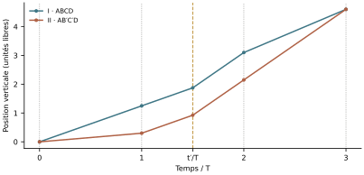
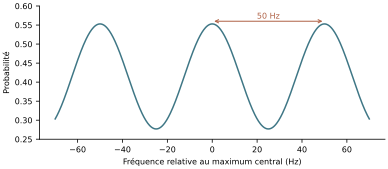
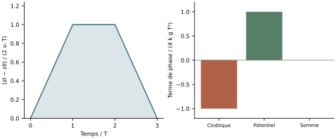
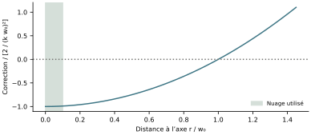
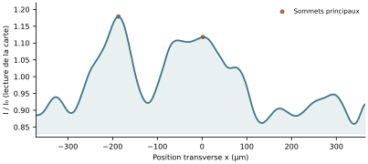

# Physique B — X-ENS PC 2023 · Corrigé brut

*Corrigé rédigé par IA, non officiel.*

**Rédaction** · GPT-6.2 Astra Ultra · vitesse non renseignée

## 1 · Mesurer une constante fondamentale

### Question 1 — Deux mesures indépendantes de l’inverse de la constante

La différence vaut $56\times10^{-9}$. L’écart-type de cette différence de mesures indépendantes est $10^{-9}\sqrt{11^2+30^2}=31{,}95\times10^{-9}$. L’écart normalisé vaut donc $1{,}75<2$. Les deux déterminations sont compatibles au seuil proposé. Le test est compatible avec la prédiction du Modèle standard utilisée dans la seconde détermination, dans la limite de ces incertitudes.

### Question 2 — Vitesse, énergie et raies de l’atome de Bohr

**a.** L’électron décrit une orbite circulaire classique sous l’action de Coulomb. Le postulat quantique porte sur son moment cinétique, $m_e r_n v_n=n\hbar$.
**b.** La projection centripète donne $m_e v_n^2/r_n=e^2/(4\pi\epsilon_0r_n^2)$. Diviser par la condition de quantification donne $v_n=e^2/(4\pi\epsilon_0n\hbar)=\alpha c/n$. Le maximum sur la première orbite vaut $c/137$, ce qui justifie l’approximation non relativiste.
**c.** Le potentiel nul à l’infini donne $E_p=-e^2/(4\pi\epsilon_0r_n)=-m_ev_n^2$. L’énergie $E_n=-m_e\alpha^2 c^2/(2n^2)$ est négative pour chaque état lié. Le photon émis lors du passage $n_2\to n_1$ emporte $hc/\lambda=E_{n_2}-E_{n_1}$. Ainsi
$$\frac1\lambda=R_\infty\left(\frac1{n_1^2}-\frac1{n_2^2}\right),\qquad R_\infty=\frac{m_e\alpha^2c}{2h}=\frac{m_ee^4}{8\epsilon_0^2h^3c}.$$

### Question 3 — Budget d’incertitude de la masse du rubidium

**a.** De $R_\infty=m_e\alpha^2c/(2h)$ on tire $\alpha=\sqrt{(2R_\infty/c)(m/m_e)(h/m)}$.
**b.** Notons $u_r(X)=u(X)/|X|$. Les trois déterminations expérimentales supposées indépendantes donnent $4u_r(\alpha)^2=u_r(R_\infty)^2+u_r(m/m_e)^2+u_r(m)^2$. Les coefficients logarithmiques valent $1/2,1/2,-1/2$ et leurs carrés interviennent. Les valeurs de $h$ et de $c$ sont fixées exactement dans le SI. Avec les données,
$$u_r(m)=\sqrt{(1{,}6\times10^{-10})^2-(7\times10^{-11})^2-(2\times10^{-12})^2}\simeq1{,}44\times10^{-10},$$
soit environ $1{,}5\times10^{-10}$.

## 2 · Recul, séparatrices et franges atomiques

### Question 4 — Recul et durée de vie des deux niveaux

**a.** Pour un recul négligé, le photon apporte $\hbar\omega=E_i-E_a=\Delta E_i$.
**b.** Le système isolé pendant l’absorption est l’atome avec le photon incident. Dans le référentiel où l’atome était au repos, $m\boldsymbol v_r=\hbar\boldsymbol k$ et $\hbar ck=\Delta E_i+mv_r^2/2$.
**c.** Posons $p=\hbar k$. La racine compatible avec un atome non relativiste est $p=mc[1-\sqrt{1-2\Delta E_i/(mc^2)}]\simeq\Delta E_i/c$, car $\Delta E_i\ll mc^2$. On en déduit $k\simeq\Delta E_i/(\hbar c)$ et $v_r\simeq\Delta E_i/(mc)$. Sur la figure 1a, les écarts sont $2\times10^{-5}\ \mathrm{eV}$ pour $b$ et $2\ \mathrm{eV}$ pour $c$. Avec les constantes arrondies du sujet, les reculs sont respectivement $6{,}7\times10^{-8}$ et $6{,}7\times10^{-3}\ \mathrm{m\,s^{-1}}$.
**d.** Le niveau $b$, de longue durée de vie, conserve la cohérence pendant l’expérience, mais sépare très peu les paquets. Le niveau $c$ donne un recul cent mille fois supérieur. Sa courte durée de vie et l’émission spontanée rendent cette séparation inexploitable sur une longue durée.

### Question 5 — Deux photons pour un grand recul entre états stables

L’atome absorbe $\hbar\boldsymbol k_1$ puis restitue $\hbar\boldsymbol k_2$ au champ. Il gagne donc $\hbar(\boldsymbol k_1-\boldsymbol k_2)\simeq2\hbar\boldsymbol k=2m\boldsymbol v_r$. Le recul élémentaire est le recul optique de la transition $a\to c$ de la question 4. Le transfert Raman aboutit à l’état durable $b$. On retient $k\simeq(2\times1{,}5\times10^{-19})/(10^{-34}\times3\times10^8)\simeq10^7\ \mathrm{m^{-1}}$.

### Question 6 — Évolution d’un état stationnaire

**a.** La projection de $j\hbar\partial_t\Psi=H\Psi$ sur chacun des deux états propres donne $j\hbar\dot a_i=E_i a_i$.
**b.** Ainsi $a_i(t)=a_i(0)e^{-jE_it/\hbar}$ et $A(t)=\operatorname{diag}(e^{-jE_1t/\hbar},e^{-jE_2t/\hbar})$.
**c.** Avec $(a_1(0),a_2(0))=(1,0)$, le second coefficient reste nul et $|a_1(t)|=1$. La phase évolue, la mesure de l’énergie donne toujours $E_1$ tant que le système évolue librement.

### Question 7 — Matrices des deux impulsions

Avec $\phi=\phi_{\mathrm{laser}}$, les formules (9) et (10) donnent
$$R(\pi/2)=\frac{1}{\sqrt2}\begin{pmatrix}1&-j e^{j\phi}\\-j e^{-j\phi}&1\end{pmatrix},\qquad
R(\pi)=\begin{pmatrix}0&-j e^{j\phi}\\-j e^{-j\phi}&0\end{pmatrix}.$$
La norme de chacune des deux colonnes vaut un.

### Question 8 — Séparatrice et miroir pour l’onde atomique

**a.** Posons $u_i(\boldsymbol r,t)=\phi_i(\boldsymbol r)e^{-jE_i t/\hbar}$. À $t=\tau$, on a $\Psi=[u_1(\boldsymbol r,\tau)-j e^{-j\phi}u_2(\boldsymbol r,\tau)]/\sqrt2$. Après l’impulsion la même expression vaut à tout $t>\tau$, chaque onde évoluant librement à sa pulsation. La transmission conserve la vitesse et vaut $t_a=1/\sqrt2$. La réflexion change de vitesse et vaut $r_a=-j e^{-j\phi}/\sqrt2$.
**b.** Pour une entrée dans l’état 2, la seconde colonne donne $t_b=1/\sqrt2$ et $r_b=-j e^{j\phi}/\sqrt2$ vers l’état 1.
**c.** Une impulsion $\pi$ échange complètement les deux états. C’est un miroir atomique idéal avec une phase de réflexion.

### Question 9 — Interférence optique et lame d’indice variable

Le chemin $A\!B\!D$ est transmis en $A$ puis réfléchi en $B$ et en $D$. Le chemin $A\!C\!D$ est réfléchi en $A$ et $C$ puis transmis en $D$. Chaque amplitude porte le facteur $r_o^2t_o$. Les longueurs géométriques sont égales. La lame sur $AC$ ajoute $(n-1)l$ au chemin optique. En sommant les amplitudes puis en prenant le module carré,
$$I=2I_0|r_o|^4|t_o|^2\left[1+\cos\left(\frac{2\pi(n-1)l}{\lambda_o}\right)\right].$$
À $n\ne1$, changer $l$ fait alterner maxima et extinctions avec une période $\lambda_o/|n-1|$.

### Question 10 — Somme des amplitudes et convention de phase Raman

Sur $I=ABCD$ l’état change en $A$ et $C$. Sur $II=AB'C'D$ il change en $B'$ et $D$. Chaque chemin contient deux transmissions et deux réflexions, d’où le même facteur $-\Psi_0/4$. Dans la convention de phase de lecture de l’équation (11), avec $\phi_n=\phi_{\mathrm{laser}}(nT)$, la somme s’écrit, à une phase commune près,
$$\Psi_D=-\frac{\Psi_0}{4}\left[e^{j(\Phi_I+\phi_0-\phi_2)}+e^{j(\Phi_{II}+\phi_1-\phi_3)}\right].$$
Par conséquent $P=|\Psi_0|^2[1+\cos(\Delta\Phi-\phi_0+\phi_1+\phi_2-\phi_3)]/8$. La visibilité idéale est un.
Le sens choisi pour la différence de phase entre les deux lasers intervient ici. Si l’on conserve littéralement la phase de la matrice (10), l’entrée $a\to b$ porte $e^{-j\phi}$ et le retour $b\to a$ porte $e^{j\phi}$. On obtient alors les signes opposés pour les quatre phases laser dans la formule précédente. Prendre pour phase de lecture l’opposé de celle de (10) retrouve (11). La suite emploie (11) et le signe de fréquence de la figure 5.

### Question 11 — Lire le temps entre deux impulsions

Sur la figure 5, trois sommets successifs se trouvent vers $-460$, $-410$ et $-360\ \mathrm{Hz}$ sur l’axe translaté. L’interfrange en fréquence vaut environ $50\ \mathrm{Hz}$. Puisque la phase commandée varie comme $2\pi\delta_{\mathrm{laser}}T$, on a $1/T\simeq50\ \mathrm{Hz}$, donc $T\simeq20\ \mathrm{ms}$.

### Question 12 — Différence de phase due au changement de vitesse

**a.** Le potentiel extérieur est constant et le temps total est $3T$ sur les deux trajets. Sur $I$, l’atome passe $2T$ dans $b$ puis $T$ dans $a$. Sur $II$, il passe $T$ dans $a$ puis $2T$ dans $b$. Les deux intégrales d’énergie électronique valent $2TE_b+TE_a$.
**b.** Sur une trajectoire $\mathrm d\boldsymbol r=\boldsymbol v\,\mathrm dt$. L’équation (12) devient $\hbar\Phi=\int(mv^2/2-E_p-E_i)\,\mathrm dt$. Après soustraction,
$$\Delta\Phi=\frac m\hbar\int_0^{3T}(\boldsymbol v_{II}-\boldsymbol v_I)\cdot\frac{\boldsymbol v_I+\boldsymbol v_{II}}2\,\mathrm dt.$$
**c.** Posons $\boldsymbol u=\boldsymbol v_r$. Sur les trois intervalles successifs, la différence $\boldsymbol v_{II}-\boldsymbol v_I$ vaut $-2\boldsymbol u,0,+2\boldsymbol u$. Les moyennes sont $\boldsymbol v_0+\boldsymbol u$ sur le premier intervalle, $\boldsymbol v_0+2\boldsymbol u$ puis $\boldsymbol v_0+2\boldsymbol u+\Delta\boldsymbol v$ de part et d’autre de $t'$ sur le deuxième, et $\boldsymbol v_0+\boldsymbol u+\Delta\boldsymbol v$ sur le troisième. Il reste $2mT\boldsymbol u\cdot\Delta\boldsymbol v/\hbar=2T\boldsymbol k\cdot\Delta\boldsymbol v$. Le mouvement initial s’élimine.

### Question 13 — Déduire la masse du centre des franges

**a.** L’ordre zéro vérifie $2T k\Delta v+2\pi\delta^*T=0$. Avec $\Delta v=2N\hbar k/m$,
$$\delta^*=-\frac{k\Delta v}{\pi}=-\frac{2N\hbar k^2}{\pi m}.$$
**b.** Donc $N=\pi m|\delta^*|/(2\hbar k^2)$. Pour $|\delta^*|=15\,907\,410{,}770\ \mathrm{Hz}$ et les données arrondies du sujet ($k\simeq10^7\ \mathrm{m^{-1}}$, $m\simeq1{,}5\times10^{-25}\ \mathrm{kg}$, $\hbar\simeq10^{-34}\ \mathrm{J\,s}$), on trouve environ $3{,}7\times10^2$ transitions. La valeur de $k$ vient d’un écart optique donné à un seul chiffre significatif. Ces arrondis permettent un ordre de grandeur, pas la détermination de l’entier à une unité près.
**c.** On inverse la relation en $m=2N\hbar k^2/(\pi|\delta^*|)$. L’entier commandé $N$ est connu et $\hbar$ est exacte. La fréquence optique $kc/(2\pi)\sim5\times10^{14}\ \mathrm{Hz}$ donne $2u_r(k)\sim4\times10^{-12}$, contre $0{,}047/15\,907\,410{,}770\simeq2{,}95\times10^{-9}$ pour la position de la frange. L’incertitude relative combinée est donc celle de $|\delta^*|$ à l’approximation recherchée.
**d.** La moyenne de $M$ mesures indépendantes réduit l’incertitude statistique d’un facteur $\sqrt M$. Il faut $M\simeq(2{,}95\times10^{-9}/1{,}5\times10^{-10})^2\simeq3{,}9\times10^2$, soit environ $390$ minutes ou $6{,}5$ heures. Les biais fixes doivent être corrigés séparément.

### Question 14 — Gravité, phase de propagation et référence laser

**a.** Prenons $z$ vers le haut, avec $\boldsymbol g=-g\boldsymbol e_z$. À temps égal, la différence $d=z_I-z_{II}$ vaut $2v_rt$ sur $[0,T]$, $2v_rT$ sur $[T,2T]$, puis $2v_r(3T-t)$ sur $[2T,3T]$. La chute commune ne la change pas. Dans l’action de la question 12, le potentiel $mgz$ ajoute à $\Phi_{II}-\Phi_I$ le terme $(mg/\hbar)\int d\,\mathrm dt=4kgT^2$. Dans la partie cinétique les deux vitesses gagnent $-gt\boldsymbol e_z$ et leur différence reste identique. Sa contribution supplémentaire vaut $-4kgT^2$. Les deux termes s’annulent, donc la **phase de propagation** de (14) est conservée. Le caractère conservatif de la pesanteur ne suffirait pas à le démontrer.
**b.** Les vitesses verticales dans le laboratoire sont celles de la figure 4 diminuées de $gt$. Sur le premier intervalle elles valent $(v_{Iz},v_{IIz})=(v_{0z}+2v_r,v_{0z})-gt(1,1)$. Sur le deuxième elles valent toutes deux $v_{0z}+2v_r+\Delta v\,H(t-t')-gt$. Sur le troisième la paire est $(v_{0z}+\Delta v,v_{0z}+2v_r+\Delta v)-gt(1,1)$.
La mesure compare deux sélections Raman référencées aux lasers du laboratoire, centrées aux instants $T/2$ et $5T/2$. La différence des vitesses moyennes sondées est $\Delta v-2gT$. Dans la convention de (11) le déphasage mesuré s’écrit donc
$$\Delta\Phi'=2kT(\Delta v-2gT),\qquad \Delta\Phi_g=-4kgT^2.$$
On peut calculer ce terme par la phase des fronts lumineux échantillonnés sur les trajectoires en chute. Le champ uniforme ne laisse aucun terme de pesanteur dans la seule action libre démontrée en a. Ajouter le terme cinétique isolé à l’action complète compterait deux fois une même contribution. Avec $T=20\ \mathrm{ms}$ et $\Delta v=600v_r\simeq4\ \mathrm{m\,s^{-1}}$, on trouve $\Delta\Phi_g/\Delta\Phi=-2gT/\Delta v\simeq-0{,}10$, très supérieur en module à $1{,}5\times10^{-10}$.
**c.** Pour les deux orientations, écrire $D_+=2kT\Delta v-4kgT^2$ et $D_-=-2kT\Delta v-4kgT^2$. Leur demi-différence restitue $2kT\Delta v$ tandis que la demi-somme donne le terme commun de pesanteur. Les deux séquences doivent partager la même géométrie et la même durée.

## 3 · Fronts d’onde et biais de recul

### Question 15 — Tolérance angulaire sur le faisceau

La projection de l’impulsion d’une onde plane inclinée vaut $\hbar k\cos\theta$. Ainsi $\delta k_{\rm rel}=\cos\theta-1\simeq-\theta^2/2$. Pour une erreur inférieure à $10^{-12}$ il faut $|\theta|\lesssim\sqrt{2}\times10^{-6}\ \mathrm{rad}$, soit environ $1{,}4\ \mu\mathrm{rad}$.

### Question 16 — Phase spatiale et impulsion locale

**a.** À temps fixé, la phase d’une onde plane vaut $\boldsymbol k\cdot\boldsymbol r+\mathrm{constante}$. Chaque surface équiphasée est donc un plan de normale $\boldsymbol k$.
**b.** Pour un déplacement tangent à une surface $\phi=\mathrm{constante}$, $\mathrm d\phi=\nabla\phi\cdot\mathrm d\boldsymbol r=0$. Le gradient, lorsqu’il est non nul, est normal à la surface.
**c.** Avec la relation locale donnée pour le transfert d’impulsion, $p_z=\hbar\nabla\phi\cdot\boldsymbol e_z=\hbar\,\partial\phi/\partial z$.

### Question 17 — Spectre angulaire du faisceau gaussien

**a.** Dans le vide, $k_z=+\sqrt{k^2-k_x^2-k_y^2}$. Les composantes transverses significatives sont de l’ordre de $1/w_0\ll k$. Le développement au premier ordre en $(k_x^2+k_y^2)/k^2$ donne $k_z\simeq k-(k_x^2+k_y^2)/(2k)$.
**b.** Dans (16), sortir $e^{jkz}$, puis regrouper les termes quadratiques de l’intégrande en $-a(k_x^2+k_y^2)/2$ avec $a=w_0^2/2+jz/k$. Les termes linéaires sont $j(xk_x+yk_y)$. L’intégrale gaussienne (17) donne $2\pi e^{-(x^2+y^2)/(2a)}/a$ car $\operatorname{Re}(a)>0$. Ainsi
$$E(\boldsymbol r)\ \propto\ \frac{e^{jkz}}{w_0^2/2+jz/k}\exp\!\left[-\frac{x^2+y^2}{w_0^2+2jz/k}\right].$$

### Question 18 — Phase de Gouy et correction de recul au foyer

**a.** Posons $u=z/z_R$, $z_R=kw_0^2/2$ et $r^2=x^2+y^2$. La phase du préfacteur est $kz-\arctan u$. L’exponentielle transverse a pour argument $\operatorname{Im}[-r^2/(w_0^2(1+ju))]=r^2u/[w_0^2(1+u^2)]$. Ainsi $\phi=kz+r^2z/[w(z)^2z_R]-\arctan(z/z_R)$ à une constante près, avec $w(z)=w_0\sqrt{1+u^2}$.
**b.** Dériver à $r$ fixé donne
$$p_z=\hbar\left[k+\frac1{z_R}\left(\frac{r^2}{w_0^2}\frac{1-u^2}{(1+u^2)^2}-\frac1{1+u^2}\right)\right].$$
Au foyer, la correction relative devient $\delta k_{\rm rel}(0)=2(r^2/w_0^4-1/w_0^2)/k^2$.
**c.** Dans le nuage $r/w_0\simeq0{,}1$. Le terme radial ne représente qu’environ $1\%$ du terme de phase axiale. Avec $k=2\pi/(800\ \mathrm{nm})$ et $w_0=5\ \mathrm{mm}$, $\delta k_{\rm rel}\simeq-1{,}3\times10^{-9}$ au centre, et pratiquement autant au bord du nuage. Son module est environ neuf fois la précision relative visée sur la masse.

### Question 19 — Signe du glissement longitudinal de phase

Sur la figure 6, on suit $z$ croissant vers le bas. Dans les contours pleins (maxima d’intensité), les teintes de la carte de phase se déplacent globalement vers les valeurs inférieures. Alors $\partial_z\phi'<0$. Dans les contours pointillés (minima), elles se déplacent vers les valeurs supérieures et $\partial_z\phi'>0$. Puisque $\delta k_{\rm rel}=(\partial_z\phi')/k$, sa valeur est respectivement négative et positive.

### Question 20 — Coupe transverse de l’intensité à 52 centimètres

**a.** La coupe de la figure 6 passe entre autres par deux crêtes bien visibles, vers $x=-190\ \mu\mathrm m$ et $x=0$, séparées par un creux vers $-120\ \mu\mathrm m$. Elle retrouve un large creux vers $+135\ \mu\mathrm m$, puis des ondulations plus faibles. Le tracé joint donne l’allure relevée sur l’échelle colorée du sujet. Autour du sommet de chaque bosse la courbe est concave, $\partial_x^2 I<0$. Autour des fonds elle est convexe, $\partial_x^2 I>0$. On passe d’une région à l’autre aux points d’inflexion.
**b.** Comme le champ est uniforme en $y$, (21) donne $\delta k_{\rm rel}\simeq\partial_x^2 I/(4k^2 I_0)$. On retrouve un recul longitudinal inférieur au recul d’onde plane sur une crête et supérieur dans un creux. Le maximum central d’un faisceau gaussien présente la même correction négative au foyer.

### Question 21 — Moyenne pondérée par les absorptions observées

Les atomes qui absorbent un photon contribuent davantage dans les régions lumineuses, où la correction est négative. Pour le voir quantitativement, soit $w(I)$ une probabilité d’absorption croissante. La correction observée a le signe de $\int w(I)I''\,\mathrm dx$. En moyennant sur plusieurs fluctuations avec terme de bord négligeable, on obtient $-\int w'(I)(I')^2\,\mathrm dx<0$. Le recul axial moyen est donc réduit.

### Question 22 — Sélection des atomes dans les creux d’intensité

Dans les minima conservés, $\partial_x^2 I>0$, donc $\langle p_z\rangle=\hbar k(1+\langle\delta k_{\rm rel}\rangle)>\hbar k$. Ce résultat peut surprendre car la projection de l’impulsion de chaque onde plane composante est au plus $\hbar k$. L’atome sélectionné mesure le gradient local de phase de la superposition cohérente. Un tel transfert conditionné par la position peut dépasser $\hbar k$. Le bilan global porte sur l’ensemble du champ et de la matière, y compris les régions et les événements écartés de la sélection.

[Sujet officiel](https://www.polytechnique.edu/admission-cycle-ingenieur/sites/admission/files/content/2023%20PC%20SUJET%20DE%20PHYSIQUE%20B%20(XEULS).pdf) · [Rapport du jury](https://www.polytechnique.edu/admission-cycle-ingenieur/sites/admission/files/content/2023%20PC%20RAPPORT%20ECRIT%20PHYSIQUE%20B%20(XEULS).pdf)
