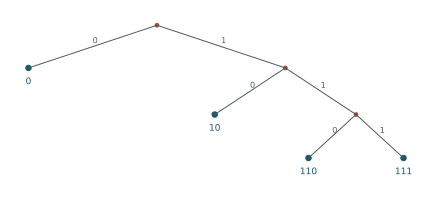
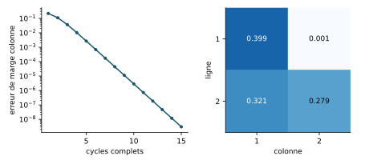

# X-ENS PSI — Mathématiques 2023 · Corrigé brut

*Corrigé rédigé par IA, non officiel. Signalez toute erreur.*

**Rédaction** · GPT-6.2 Astra Ultra · vitesse non renseignée

**Révision** · GPT-6.2 Astra Ultra · vitesse non renseignée

Les logarithmes sont naturels. Le plan indépendant de marges $\alpha,\beta$ est noté $p$.

## I. Convexité et points selles

### Question 1a

Pour $x,y\in C$ et $t\in[0,1]$, posons $z=(1-t)x+ty$. On additionne $f(z)\le(1-t)f(x)+tf(y)$ et l’inégalité analogue pour $g$. On obtient celle de $f+g$. Si $x\ne y$ et $0<t<1$, une seule inégalité stricte suffit à rendre la somme stricte.

### Question 1b

Si $x\ne y$ atteignent la même valeur minimale $m$, leur milieu appartient à $C$ et sa valeur est strictement inférieure à $(m+m)/2=m$. Cette contradiction prouve l’unicité éventuelle du minimiseur.

### Question 2a

$\langle Ax,\nu\rangle=\sum_{i=1}^m\sum_{j=1}^n A_{ij}x_j\nu_i=\sum_jx_j(A^{\mathsf T}\nu)_j=\langle x,A^{\mathsf T}\nu\rangle$.

### Question 2b

Si $Ax=0$, alors $\langle x,A^{\mathsf T}\nu\rangle=0$ pour tout $\nu\in\mathbb R^m$. Tous les éléments de $\operatorname{Im}A^{\mathsf T}$ s’écrivent ainsi, donc $x\in(\operatorname{Im}A^{\mathsf T})^\perp$.

### Question 2c

Si $x\perp\operatorname{Im}A^{\mathsf T}$, on a en particulier $0=\langle x,A^{\mathsf T}Ax\rangle=\|Ax\|^2$, donc $Ax=0$. L’autre inclusion vient de 2b.

### Question 3a

Si $Au=0$, alors $A(x_*+tu)+b=0$ et $x_*+tu\in U$ pour $|t|$ assez petit, car $U$ est ouvert. La fonction $t\mapsto h(x_*+tu)$ admet un minimum local en zéro, donc sa dérivée $\langle\nabla h(x_*),u\rangle$ y est nulle.

### Question 3b

Par 3a et 2c, $\nabla h(x_*)\in(\ker A)^\perp=((\operatorname{Im}A^{\mathsf T})^\perp)^\perp=\operatorname{Im}A^{\mathsf T}$. Il existe donc $\nu_*\in\mathbb R^m$ tel que $\nabla h(x_*)=A^{\mathsf T}\nu_*$.

### Question 3c

À $\nu$ fixé, $L(x,\nu)=h(x)-\langle A^{\mathsf T}\nu,x\rangle-\langle\nu,b\rangle$. Par suite $\nabla_xL(x_*,\nu_*)=\nabla h(x_*)-A^{\mathsf T}\nu_*=0$, donc chaque dérivée partielle demandée est nulle.

### Question 3d

La contrainte donne $L(x_*,\nu)=h(x_*)=L(x_*,\nu_*)$ pour tout $\nu$. À $\nu_*$ fixé, posons $F(t)=L(x_*+t(x-x_*),\nu_*)$. Cette fonction est convexe sur $[0,1]$ et $F'(0)=0$ par 3c. La pente de la corde est au moins la dérivée initiale, donc $F(1)\ge F(0)$. On obtient les deux inégalités du point selle.

## II. Entropie et codage préfixe

### Question 4a

Comme $x\ln x\to0$ en $0^+$, le prolongement continu est $\varphi(0)=1$. Nous utilisons le logarithme naturel, conformément à la précision du jury sur la notation « log » du sujet.

### Question 4b

Pour $x>0$, $\varphi'(x)=\ln x$ et $\varphi''(x)=1/x>0$. La fonction décroît jusqu’à $1$ puis croît et $\varphi(1)=0$. Sa valeur en zéro est $1$, d’où la positivité au sens large, avec égalité uniquement en $1$. La continuité vient de 4a. Pour un segment joignant $0$ à $y>0$ et $0<t<1$, on a
$$\varphi(ty)-(1-t)\varphi(0)-t\varphi(y)=ty\ln t<0.$$
Avec la stricte convexité sur $(0,+\infty)$, cela traite tous les segments.

### Question 4c

L’orthant $Q_{\mathcal X}$ est convexe coordonnée par coordonnée. Pour chaque $x$, $q_x\mapsto q'_x\varphi(q_x/q'_x)$ est positive au sens large et strictement convexe puisque $q'_x>0$. Pour deux vecteurs distincts, la coordonnée où ils diffèrent fournit une inégalité stricte dans la somme. Enfin KL est nulle si et seulement si chaque quotient vaut $1$, soit $q=q'$.

### Question 5a

Si $c(x)$ et $c(y)$ commencent par la même lettre $a$ et si $\bar c(y)=\bar c(x)w$, alors $c(y)=a\bar c(x)w=c(x)w$. Pour $x\ne y$, ceci contredit la propriété de préfixe, y compris pour le mot vide $w$. On obtient aussi $\bar c(x)\ne\bar c(y)$.

### Question 5b

S’il y a deux éléments ou plus dans $\mathcal X_a$, un suffixe vide serait préfixe d’un autre suffixe, contrairement à 5a. Tous les suffixes sont donc des mots non vides, distincts et sans relation de préfixe. La restriction est un code préfixe.

### Question 5c

Raisonnons par récurrence sur la longueur maximale $L$. Pour $L=1$, il y a au plus deux mots distincts, chacun de poids $1/2$. Pour $L>1$, partageons les mots suivant leur première lettre $a$. Si $\mathcal X_a$ est vide, sa contribution est nulle. Si c’est un singleton, son unique mot a longueur au moins un et pèse au plus $1/2$. Si $\mathcal X_a$ a au moins deux éléments, 5b donne un code préfixe de suffixes de longueur maximale au plus $L-1$. Par récurrence, la somme de leurs poids est au plus $1$. Rétablir la lettre initiale divise chaque poids par deux. Chacune des deux branches contribue donc au plus $1/2$, d’où $\sum_x2^{-|c(x)|}\le1$. Dans la figure les poids des feuilles valent $1/2,1/4,1/8,1/8$.

### Question 6a

Pour $q_x=2^{-|c(x)|}$, on a $-\ln q_x=|c(x)|\ln 2$. En multipliant par $p_x$ et en sommant, on obtient $-\sum_xp_x\ln q_x=\ln(2)\,\mathbb E|c(X)|$.

### Question 6b

Avec $\sum_xp_x=1$, la définition donne
$$\ln(2)\,\mathbb E|c(X)|=H(p)+\mathrm{KL}(p,q)+1-\sum_x q_x.$$
La divergence est positive au sens large par 4c et la dernière différence l’est par 5c. D’où $\mathbb E|c(X)|\ge H(p)/\ln 2$. L’égalité est atteinte quand $p_x=q_x$ pour tout $x$.

## III. Transport régularisé

### Question 7

Si $q,r\in F(\alpha,\beta)$ et $0\le t\le1$, les entrées de $(1-t)q+tr$ sont positives ou nulles. Pour chaque ligne, la somme est $(1-t)\alpha_i+t\alpha_i=\alpha_i$, et pour chaque colonne elle vaut $\beta_j$. La combinaison appartient donc à $F(\alpha,\beta)$.

### Question 8a

$\sum_i\sum_jq_{ij}=\sum_i\alpha_i=1$.

### Question 8b

Pour tout $i$, $\mathbb P(X_1=i)=\sum_jq_{ij}=\alpha_i$. De même, $\mathbb P(X_2=j)=\sum_iq_{ij}=\beta_j$.

### Question 8c

Si $q=p$, alors $\mathbb P(X_1=i,X_2=j)=\alpha_i\beta_j=\mathbb P(X_1=i)\mathbb P(X_2=j)$ pour tout couple. Les deux variables discrètes sont indépendantes.

### Question 9

La fonction $q\mapsto\sum_{ij}q_{ij}C_{ij}$ est linéaire, donc convexe. Par 4c, $q\mapsto\mathrm{KL}(q,p)$ est strictement convexe car $p_{ij}=\alpha_i\beta_j>0$. Son coefficient $\epsilon$ est strictement positif, donc leur somme $J_\epsilon$ est strictement convexe par 1a.

### Question 10a

L’orthant est fermé et les égalités de marges définissent des hyperplans affines fermés, donc leur intersection $F$ est fermée. Pour $q\in F$, $0\le q_{ij}\le\alpha_i\le1$ pour tout $i,j$. Le produit étant fini, $F$ est borné.

### Question 10b

Le plan indépendant $p=(\alpha_i\beta_j)$ appartient à $F$. Cet ensemble non vide est compact en dimension finie et $J_\epsilon$ est continue, y compris aux coordonnées nulles par 4a. Un minimum y est atteint. Les questions 7, 9 et 1b garantissent son unicité. On le note $q(\epsilon)$.

### Question 10c

Soit $I=J=\{1,2\}$ et $\alpha=\beta=(1/2,1/2)$. Si $C=0$ et $\epsilon=0$, tout plan admissible a pour valeur zéro. Par exemple les plans diagonal et antidiagonal dont les deux entrées non nulles valent $1/2$ sont deux minimiseurs distincts.

### Question 11a

Écrivons $q=q(\epsilon)$ et $q_t=(1-t)q+tp$. Par 7, le segment est admissible. Le quotient $(J_\epsilon(q_t)-J_\epsilon(q))/t$ a une contribution finie du coût linéaire, et une limite finie pour chaque cellule où $q_{ij}>0$. Dans une cellule nulle, sa contribution entropique est
$$\epsilon p_{ij}\,\frac{\varphi(t)-\varphi(0)}{t}=\epsilon p_{ij}(\ln t-1)\longrightarrow-\infty.$$
Dès qu’au moins une cellule est nulle, le quotient total tend vers $-\infty$ et $J_\epsilon(q_t)$ devient plus petit que le minimum pour $t>0$ assez petit. Chaque $q_{ij}(\epsilon)$ est donc strictement positif.

### Question 11b

Reprenons les marges uniformes de 10c avec $C_{11}=C_{22}=0$, $C_{12}=C_{21}=1$ et $\epsilon=0$. Le coût est $q_{12}+q_{21}\ge0$. Le seul plan réalisant zéro est diagonal, avec $q_{11}=q_{22}=1/2$. Ce minimiseur possède deux cellules nulles.

## IV. Dualité et itérations de Sinkhorn

### Question 12a

$Q_{>0}$ est l’intersection finie des demi-espaces ouverts $q_{ij}>0$, donc ouvert. Toute combinaison convexe de deux nombres strictement positifs est strictement positive, donc il est aussi convexe.

### Question 12b

Prenons $U=Q_{>0}$, $h=J_\epsilon$, $Aq=( (\sum_j q_{ij})_i,(\sum_iq_{ij})_j)$ et $b=-(\alpha,\beta)$. Le point $q(\epsilon)$ appartient à $U$ par 11a et minimise $h$ sous ces contraintes. Sur $U$, $h$ est convexe et de classe $C^1$. La question 3d fournit des multiplicateurs $(f(\epsilon),g(\epsilon))$ pour lesquels le lagrangien $\mathcal L$ a le point selle demandé. La dépendance entre les deux sommes totales des marges ne gêne pas cet argument.

### Question 13a

La dérivée de $\mathcal L$ en $q_{ij}>0$ est $C_{ij}+\epsilon\ln(q_{ij}/p_{ij})-f_i-g_j$. Son annulation donne $q(f,g)_{ij}=p_{ij}\exp((f_i+g_j-C_{ij})/\epsilon)>0$. La fonction en $q$ est différentiable strictement convexe sur un ouvert convexe. Ce point stationnaire réalise son unique minimum global.

### Question 13b

Au point $q=q(f,g)$, $C_{ij}+\epsilon\ln(q_{ij}/p_{ij})=f_i+g_j$. Ces termes se simplifient avec les contraintes, et $\sum_{ij}p_{ij}=1$. Il reste
$$G(f,g)=\sum_i\alpha_i f_i+\sum_j\beta_j g_j+\epsilon\left(1-\sum_{ij}p_{ij}e^{(f_i+g_j-C_{ij})/\epsilon}\right).$$

### Question 13c

Chaque exponentielle d’une forme affine est convexe. Son coefficient dans $G$ est $-\epsilon p_{ij}<0$, donc le terme est concave. La somme avec un terme affine reste concave sur tout $\mathbb R^I\times\mathbb R^J$.

### Question 14

Les dérivées valent $\partial_{f_i}G=\alpha_i-\sum_jq(f,g)_{ij}$ et $\partial_{g_j}G=\beta_j-\sum_iq(f,g)_{ij}$. Or la somme de ligne vaut $\alpha_i e^{f_i/\epsilon}\sum_j\beta_j e^{(g_j-C_{ij})/\epsilon}$. En la posant égale à $\alpha_i$, on trouve
$$f_*(g)_i=-\epsilon\ln\sum_j\beta_j e^{(g_j-C_{ij})/\epsilon}.$$
Le même calcul sur les colonnes donne $g_*(f)_j=-\epsilon\ln\sum_i\alpha_i e^{(f_i-C_{ij})/\epsilon}$. Chacune des dérivées annoncées est donc nulle au point indiqué.

### Question 15

À $f=f^k$ fixé, la fonction concave différentiable en $g$ a un gradient nul en $g^{k+1}=g_*(f^k)$, donc $G(f^k,g^k)\le G(f^k,g^{k+1})$. Avec $g^{k+1}$ fixé, $f^{k+1}=f_*(g^{k+1})$ maximise l’autre bloc. On en déduit $G(f^k,g^{k+1})\le G(f^{k+1},g^{k+1})$, d’où la croissance.

### Question 16a

Le domaine imprimé dans la définition de $G_*$ est une coquille. Le produit $I\times J$ indexe les cellules. Le supremum porte sur les couples de potentiels de $\mathbb R^I\times\mathbb R^J$, domaine de $G$ en 13c. Les sommes exponentielles sont strictement positives, donc $f_*$ et $g_*$ sont continues. Sous l’hypothèse de convergence de la question, $g^\infty=g_*(f^\infty)$ et $f^\infty=f_*(g^\infty)$. La question 14 annule alors toutes les dérivées de $G$. Par concavité, $G(f^\infty,g^\infty)$ est son maximum global $G_*$ sur l’espace des potentiels $\mathbb R^I\times\mathbb R^J$.

### Question 16b

Pour tout $(f,g)$, $G(f,g)=\min_{q>0}\mathcal L(q,(f,g))\le\mathcal L(q(\epsilon),(f,g))=J_\epsilon(q(\epsilon))$, grâce aux marges. Pour les multiplicateurs de 12b, le point selle donne l’égalité car $q(\epsilon)$ minimise alors le lagrangien. D’où $G(f(\epsilon),g(\epsilon))=G_*$.

### Question 16c

Pour chaque maximiseur dual, le majorant de 16b est atteint. Le plan $q(\epsilon)$ réalise alors le minimum en $q$ du lagrangien correspondant, donc, par l’unicité en 13a, $q(f^\infty,g^\infty)=q(f(\epsilon),g(\epsilon))=q(\epsilon)$. Le logarithme de la formule de 13a donne pour tous $i,j$
$$f_i(\epsilon)-f_i^\infty=-\big(g_j(\epsilon)-g_j^\infty\big).$$
Fixons $j_0$ et posons $a=g_{j_0}^\infty-g_{j_0}(\epsilon)$. Alors $f_i(\epsilon)=f_i^\infty+a$ pour tout $i$. En reportant cette identité dans la relation précédente, on obtient $g_j(\epsilon)=g_j^\infty-a$ pour tout $j$.

### Question 16d

Pour chaque cellule, la convergence supposée des potentiels et la formule de 13a donnent $q(f^k,g^k)_{ij}\to q(f^\infty,g^\infty)_{ij}=q(\epsilon)_{ij}$ par 16c. Le nombre de cellules étant fini, c’est aussi la convergence du plan dans toute norme. La figure illustre les marges $(0{,}40,0{,}60)$ et $(0{,}72,0{,}28)$, le coût $0$ sur la diagonale et $1$ ailleurs, et $\epsilon=0{,}35$. On part de $f^0=g^0=0$. Après quinze cycles colonnes puis lignes, l’écart maximal entre une somme de colonne et sa marge vaut environ $3{,}02\times10^{-9}$.

