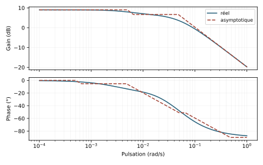
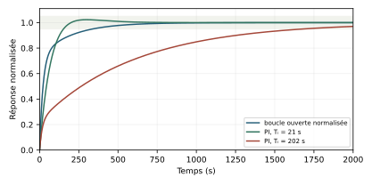
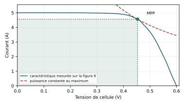
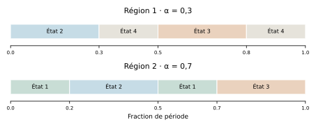
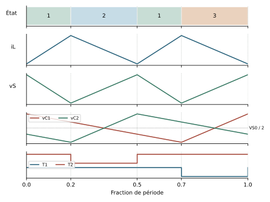
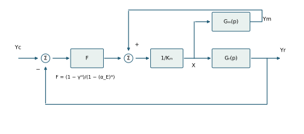

# X-ENS PSI · Modélisation 2023 · Corrigé guidé

*Corrigé rédigé par IA, non officiel. Signalez toute erreur.*

**Rédaction** · GPT-6.2 Astra Ultra · vitesse non renseignée · 24 novembre 2026

**Révision (tour 1)** · GPT-6.2 Astra Ultra · vitesse non renseignée · 26 novembre 2026

## Repères de résolution

Le bâtiment possède deux températures dynamiques, intérieure et d’enveloppe. Pour les questions thermiques, donner le signe des flux avant de passer en Laplace. Dans le convertisseur, garder le même ordre de condensateurs dans les quatre configurations. Dans le pilotage prédictif, distinguer le pas présent, le retard et l’horizon.

## Partie 1 · Base de données des capteurs

### Question 1 · Températures intérieure et extérieure

**Indication.** Le couple date–heure et les deux adresses permettent de conserver l’origine de chaque mesure.

#### Solution

```sql
SELECT adresse_I2C, heure_UTC, mesure
FROM capteurs
WHERE date = '2022-09-14'
  AND heure_UTC >= '14:00:00' AND heure_UTC < '14:30:00'
  AND adresse_I2C IN ('11110yz0', '11110yz2')
ORDER BY heure_UTC;
```
Le tableau 1 donne $21$ °C à 14 h à l’intérieur et $27$ °C à 14 h 05 à l’extérieur. La borne supérieure ouverte évite de prendre le deuxième relevé interne.

### Question 2 · Filtrage du vent

**Indication.** La mesure de 14 h 20 termine la fenêtre. Les deux précédentes appartiennent à des demi-heures antérieures.

#### Solution

```sql
SELECT AVG(mesure) AS vitesse_filtree
FROM (
    SELECT mesure FROM capteurs
    WHERE adresse_I2C = '11110yz8'
      AND (date < '2022-09-14'
           OR (date = '2022-09-14' AND heure_UTC < '14:30:00'))
    ORDER BY date DESC, heure_UTC DESC, id DESC
    LIMIT 3
) AS trois_dernieres;
```
On trie les relevés du capteur avant de limiter leur nombre, puis on moyenne les trois mesures retenues en m/s. La dernière vaut 14 m/s. Le tableau imprimé omet les deux plus anciennes, ce qui empêche d’en déduire une moyenne numérique.

### Question 3 · Puissance disponible

**Indication.** Multiplier l’irradiance par l’aire exposée puis par le rendement de conversion.

#### Solution

```sql
SELECT heure_UTC, mesure AS eclairement,
       20.0 * 0.20 * mesure AS puissance_W
FROM capteurs
WHERE adresse_I2C = '11110yz4' AND date = '2022-09-14'
  AND heure_UTC >= '14:00:00' AND heure_UTC < '14:30:00';
```
Le résultat de 14 h 10 est $166\ \mathrm{W/m^2}$, soit $20\times 0,20\times 166=664\ \mathrm W$ électriques. Le capteur d’éclairement fournit la donnée nécessaire.

## Partie 2 · Modélisation et contrôle thermique du bâtiment

### Question 4 · Flux et énergie thermique

**Indication.** Un watt vaut un joule par seconde.

#### Solution

Avec une même orientation positive pour le transfert et le flux, $\varphi=\mathrm dQ/\mathrm dt$ et $Q(t_1,t_2)=\int_{t_1}^{t_2}\varphi(t)\,\mathrm dt$. Pour une capacité constante, $Q=C_{\rm th}\Delta\theta$ et $\varphi=C_{\rm th}\dot\theta$.

### Question 5 · Suivi et régulation

**Indication.** Fixer tour à tour les perturbations puis la consigne et observer la sortie.

#### Solution

Pour étudier le suivi, on fait varier la consigne de température et on mesure l’écart de la température intérieure à cette consigne en maintenant les perturbations constantes. Pour étudier la régulation, on maintient la consigne constante, on impose par exemple un échelon de température extérieure puis on mesure l’écart maximal et l’écart résiduel. Dans les deux cas le correcteur agit par le flux de chauffage ou de refroidissement.

### Question 6 · Variables de petites variations

**Indication.** Choisir un point de fonctionnement permanent et en retrancher les valeurs aux signaux physiques.

#### Solution

Autour d’un équilibre $(\bar\theta_r,\bar\varphi_r,\ldots)$, on écrit $\theta_r=\bar\theta_r+s_r$ et $\varphi_r=\bar\varphi_r+u$. On conserve les termes du premier ordre si les lois sont non linéaires. Au voisinage de 21 °C, passer à 21,5 °C représente une variation $s_r=+0,5$ K. Les conditions initiales des variations sont nulles si le bâtiment part de l’équilibre choisi.

### Question 7 · Perturbations du bâtiment

**Indication.** Identifier quelles entrées le correcteur peut commander.

#### Solution

La température extérieure et le flux solaire modifient la température intérieure par les résistances thermiques et les apports à l’enveloppe. Le gestionnaire de chauffage ne fixe ni la météo ni le rayonnement. Ce sont deux perturbations distinctes, éventuellement mesurables, alors que $u$ est l’entrée manipulée.

### Question 8 · Transfert du chauffage

**Indication.** Écrire le bilan au nœud intérieur et au nœud enveloppe, avec les autres entrées de variation nulles.

#### Solution

On note $G_j=1/R_j$, $S_s$ la variation de température de l’enveloppe et $S_r$ celle de l’intérieur. Les deux bilans de flux donnent en Laplace

$$
\begin{pmatrix}C_rp+G_f+G_i&-G_i\\-G_i&C_sp+G_i+G_0\end{pmatrix}\binom{S_r}{S_s}=\binom{U+G_f\Theta_{ext}}{\Phi_s+G_0\Theta_{ext}}.
$$

Si $\Delta(p)$ désigne le déterminant de cette matrice, $H_{S_r,U}=(C_sp+G_i+G_0)/\Delta(p)$. Les définitions $\alpha=R_f/(R_f+R_i)$ et $g=R_0/(R_0+R_i)$ donnent $G_f+G_i=1/(\alpha R_i)$ et $G_i+G_0=1/(gR_i)$. Après normalisation à terme constant unité,

$$
D(p)=1+\frac{R_i(\alpha C_r+gC_s)}{1-\alpha g}p+\frac{\alpha g R_i^2C_rC_s}{1-\alpha g}p^2,\qquad H_{S_r,U}(p)=\frac{\alpha R_i}{1-\alpha g}\frac{1+gR_iC_s p}{D(p)}.
$$

Le gain statique s’exprime en kelvins par watt.

### Question 9 · Gain et stabilité

**Indication.** Les pôles sont les inverses négatifs des constantes de temps positives.

#### Solution

Le modèle fourni est $H(p)=2,83(1+154p)/[(1+21p)(1+202p)]$. Les pôles $-1/21$ et $-1/202$ s’expriment en $\mathrm{s^{-1}}$. Ils sont tous deux strictement négatifs, ce qui assure la stabilité. Le pôle dominant, le plus proche de l’axe imaginaire, est $-1/202\simeq-4,95\,10^{-3}\ \mathrm{s^{-1}}$. Le gain statique est $H(0)=2,83\ \mathrm{K/W}$.

### Question 10 · Diagramme de Bode

**Indication.** Classer les deux pôles et le zéro par pulsation croissante avant d’accumuler leurs pentes.

#### Solution

En rad/s, les cassures sont $1/202\simeq0,00495$ (pôle), $1/154\simeq0,00649$ (zéro), $1/21\simeq0,0476$ (pôle). Le gain asymptotique démarre à $20\log_{10}(2,83)=9,04$ dB. Ses pentes successives sont $0,-20,0,-20$ dB/décade. Le deuxième plateau vaut $20\log_{10}(2,83\times154/202)=6,68$ dB. Le tracé réel s’obtient avec

$$
G_{\rm dB}=20\log_{10}(2,83)+10\log_{10}\frac{1+(154\omega)^2}{[1+(21\omega)^2][1+(202\omega)^2]},\quad \phi=\arctan(154\omega)-\arctan(21\omega)-\arctan(202\omega).
$$

La phase passe de $0$ à $-90^\circ$. Pour son approximation affine en échelle logarithmique, chaque pôle contribue de $0$ à $-90^\circ$ entre un dixième et dix fois sa cassure. Le zéro apporte la contribution positive correspondante.



### Question 11 · Choix du correcteur

**Indication.** Examiner le gain en boucle ouverte à fréquence nulle puis le nombre de réglages indispensables.

#### Solution

Le procédé a un gain statique fini. Dans une boucle à retour unitaire, un P ou un PD laisse donc une erreur $1/(1+K_pH(0))$ à un échelon unité. Un PI introduit un intégrateur, annule l’erreur permanente si la boucle est stable et conserve deux paramètres pour régler la dynamique. Il suffit ici sans action dérivée.

### Question 12 · Réglage du PI

**Indication.** On peut imposer le comportement de la boucle à la pulsation de coupure.

#### Solution

Une synthèse fréquentielle fixe une pulsation de coupure compatible avec la rapidité souhaitée et une marge de phase compatible avec l’amortissement. On choisit $T_i$ et $K_p$ dans $C=K_p(1+T_ip)/(T_ip)$ pour satisfaire la phase puis $|C(j\omega_c)H(j\omega_c)|=1$, et l’on vérifie le temps à 5 % en boucle fermée. Avec la méthode de compensation annoncée dans le texte, le zéro du PI annule le pôle dominant pour $T_i=202$ s.

### Question 13 · Lecture du temps à 5 %

**Indication.** Relever la première entrée définitive dans la bande de 0,95 à 1,05.

#### Solution

La figure 3 désigne $K_p=0,15$. La boucle ouverte normalisée entre dans la bande vers $340$ s et la courbe correspondante vers $150$ à $170$ s. Pour $K_p=0,01$ la réponse est trop lente, et pour $K_p=1$ elle entre dans la bande en quelques dizaines de secondes.

Les données imprimées comportent une différence importante. La simulation de $CH/(1+CH)$ avec $T_i=21$ s, valeur prescrite à la question 15, donne environ $153$ s à $K_p=0,15$ pour $338$ s en boucle ouverte. Avec la compensation du pôle dominant annoncée, $T_i=202$ s donnerait environ $1\,678$ s pour ce même gain. Le choix graphique est approximatif et correspond au premier réglage.



### Question 14 · Transfert de la température extérieure

**Indication.** Conserver les deux termes de source provenant de la même température extérieure dans les bilans de la question 8.

#### Solution

Avec $U=\Phi_s=0$, le déterminant modifié du premier nœud donne $H_{S_r,\Theta_{ext}}=[G_f(C_sp+G_i+G_0)+G_iG_0]/\Delta(p)$. Le terme constant du numérateur est $G_fG_i+G_fG_0+G_iG_0=\Delta(0)$. En reprenant $D$ normalisé de la question 8,

$$
H_{S_r,\Theta_{ext}}(p)=\frac{1+g\,\dfrac{R_0}{R_0+gR_f}R_iC_sp}{D(p)}.
$$

Le gain statique unité traduit qu’en l’absence de variation d’apport thermique, une variation extérieure constante finit par se transmettre entièrement.

### Question 15 · Perturbation en boucle fermée

**Indication.** L’entrée extérieure est additive à la sortie du procédé et subit la sensibilité de la boucle.

#### Solution

À consigne nulle, $S_r=-H_{S_r,U}C S_r+H_{S_r,\Theta_{ext}}\Theta_{ext}$. Le transfert cherché est $H_{S_r,\Theta_{ext}}/(1+CH_{S_r,U})$. Avec les valeurs imposées $T_i=21$ s et $K_p=0,15$, on obtient

$$
\frac{S_r}{\Theta_{ext}}=\frac{21p(1+87p)}{(1+21p)\,[21p(1+202p)+0,4245(1+154p)]}.
$$

La simplification du facteur $1+21p$ s’effectue dans le produit de boucle et le canal perturbation conserve ce facteur dans son dénominateur.

### Question 16 · Réjection permanente

**Indication.** Appliquer la valeur finale au signal de sortie en réponse à $1/p$ et vérifier la stabilité.

#### Solution

Le facteur du second ordre au dénominateur est $4242p^2+86,373p+0,4245$. Ses trois coefficients positifs garantissent des racines à partie réelle négative, et le pôle $-1/21$ est stable. Pour un échelon extérieur unité, $s_r(\infty)=\lim_{p\to0}p\,(S_r/\Theta_{ext})/p=0$. La température peut varier pendant le transitoire et revient ensuite à sa consigne. L’erreur finale de régulation est également nulle.

## Partie 3 · Modélisation de la puissance photovoltaïque

### Question 17 · Aire de panneaux à Paris

**Indication.** Calculer la production du mois le plus défavorable par mètre carré, puis la comparer à la demande de ce mois.

#### Solution

La carte donne un ordre de grandeur de $1\,100$ à $1\,200\ \mathrm{kWh\,m^{-2}\,an^{-1}}$ autour de Paris. La toiture plein sud à $35^\circ$ a un facteur de 1 dans l’annexe. Décembre, mois le plus défavorable, reçoit $2,3\,\%$ de l’irradiation annuelle en 31 jours. Avec un rendement conservateur de 16 % pour le silicium monocristallin et $1\,100\ \mathrm{kWh/m^2}$ par an, un mètre carré produit environ $1\,100\times0,023\times0,16=4,05$ kWh en décembre. La demande est $31\times18=558$ kWh, d’où $S\simeq138\ \mathrm{m^2}$. Avec 20 % de rendement dans les mêmes conditions, on trouve $110\ \mathrm{m^2}$. Ces ordres de grandeur peuvent excéder l’aire disponible sur cette maison de 70 m² habitables.

On utilise les fractions mensuelles fournies, une consommation journalière constante et les pertes couvertes par le rendement retenu. Le calcul assure un bilan mensuel moyen. La vérification jour par jour nécessiterait la météo et la capacité de stockage. La surchauffe des cellules au-delà de 25 °C est moins probable en décembre près de Paris. En l’absence de température des cellules et de courbe de déclassement, on conserve le rendement nominal.

### Question 18 · Point de puissance maximale

**Indication.** Chercher le rectangle d’aire maximale sous la caractéristique, ou l’hyperbole de puissance constante tangente.

#### Solution

Pour un point de la courbe $I(V)$, le rectangle de côtés $V$ et $I$ a pour aire $P=VI$. Les puissances à $V=0$ et au circuit ouvert sont nulles. Au maximum intérieur, $I+V\,\mathrm dI/\mathrm dV=0$ et l’hyperbole $I=P_{\max}/V$ est tangente à la courbe. Le coude du document-réponse donne approximativement $V\simeq0,45$ V et $I\simeq4,6$ A, soit $P_{\max}\simeq2,1$ W. Les valeurs sont des lectures graphiques.



### Question 19 · Résistance raccordée directement

**Indication.** Sur un même repère, tracer la droite de charge et la caractéristique de la cellule.

#### Solution

En négligeant la chute de la diode passante, le point de fonctionnement vérifie simultanément la caractéristique photovoltaïque et $I=V/R$. L’intersection coïncide avec le maximum seulement pour $R=V_{\rm MPP}/I_{\rm MPP}$, environ $0,10\ \Omega$ pour cette cellule et cet éclairement. La température et l’éclairement déplacent le maximum même si $R$ reste fixe. Une chute de diode introduirait un décalage supplémentaire de la droite.

### Question 20 · États du convertisseur

**Indication.** Superposer deux créneaux de durée $\alpha T$, décalés entre eux de $T/2$, et raisonner modulo $T$.

#### Solution

Les états $1,2,3,4$ correspondent aux couples d’interrupteurs fermés $(1,1),(1,0),(0,1),(0,0)$. Avec $\tau=(t\bmod T)/T$, $T_1$ ferme pour $0\leq\tau<\alpha$ et $T_2$ ferme pendant la même durée à partir de $\tau=1/2$, en poursuivant sur la période suivante.

| Région | État à partir de $\tau=0$ | États suivants et instants de transition | Retour en fin de période |
|---|---|---|---|
| $0<\alpha<1/2$ | 2 | $4$ à $\alpha$, $3$ à $1/2$, $4$ à $1/2+\alpha$ | $4\to2$ |
| $1/2<\alpha<1$ | 1 | $2$ à $\alpha-1/2$, $1$ à $1/2$, $3$ à $\alpha$ | $3\to1$ |

Les flèches du diagramme portent ces instants comme gardes. À $\alpha=1/2$, les intervalles de recouvrement disparaissent et le cycle alterne $2,3$. À $\alpha=0$ les transistors restent ouverts, à $\alpha=1$ ils restent fermés.



### Question 21 · Chronogrammes en région 2

**Indication.** Identifier à chaque intervalle le condensateur qui reçoit le courant de l’inductance.

#### Solution

En région 2, sur les quatre intervalles de la question 20, $T_1$ prend les valeurs $1,1,1,0$ et $T_2$ les valeurs $1,0,1,1$. Le courant $i_L$ monte dans l’état 1, chute dans les états 2 et 3 car $V_s/2>V_E$ en régime établi pour $\alpha>1/2$. Le signe de la pente de chaque signal se lit ainsi.

| Signal | État 1 | État 2 | État 1 | État 3 |
|---|---|---|---|---|
| $i_L$ | monte | descend | monte | descend |
| $v_{C1}$ | descend | descend | descend | monte |
| $v_{C2}$ | descend | monte | descend | descend |
| $v_s=v_{C1}+v_{C2}$ | descend | monte | descend | monte |

Chacune des tensions de condensateur oscille autour de $V_{S0}/2$. En région 1, reporter $2,4,3,4$ dans la bande des états du document-réponse. Les axes du chronogramme ci-dessous sont normalisés pour distinguer les ondulations.



### Question 22 · Pentes des tensions

**Indication.** Un courant constant dans un condensateur donne une tension affine par morceaux.

#### Solution

La conduction est continue et l’ondulation est supposée assez faible pendant une période pour tenir $i_L$ et le courant de charge $i_s=v_s/R$ pratiquement constants dans le calcul des pentes. La tension de sortie varie donc peu devant sa moyenne. Suivant la position des interrupteurs, $C\,\dot v_{Cj}$ vaut $-i_s$ ou $i_L-i_s$, valeurs approximativement constantes. Les tensions sont alors affines par morceaux. La continuité de la tension seule ne suffirait pas à déduire cette forme.

### Question 23 · Pentes du courant d’inductance

**Indication.** Suivre la maille source–inductance et relever les tensions de condensateur rencontrées.

#### Solution

Avec le sens du courant du sujet, $L\,\mathrm di_L/\mathrm dt=V_E-v_{\rm après\,L}$. Dans les états 1 à 4, les valeurs successives de $L\dot i_L$ sont $V_E$, $V_E-v_{C2}$, $V_E-v_{C1}$, $V_E-v_{C1}-v_{C2}=V_E-v_s$. Dans l’approximation des petites ondulations équilibrées, on remplace chaque $v_{Cj}$ par $V_{S0}/2$ pour comparer les pentes.

### Question 24 · Gain de conversion

**Indication.** Le courant périodique retrouve sa valeur initiale après une période. Compter le temps d’insertion de chaque condensateur.

#### Solution

En régime permanent, $L\langle\dot i_L\rangle=0$. Chacun des deux condensateurs de tension moyenne $V_{S0}/2$ est inséré quand son interrupteur est ouvert, pendant $(1-\alpha)T$. Dans le modèle à faibles ondulations, $0=V_E-2(1-\alpha)V_{S0}/2$. Ainsi

$$
V_{S0}=\frac{V_E}{1-\alpha},\qquad G_V=\frac{1}{1-\alpha}.
$$

La durée de recouvrement change avec la région, mais la durée totale d’insertion de chaque condensateur est la même. La formule suppose $\alpha<1$ et la conduction continue.

### Question 25 · Validité du gain idéal

**Indication.** Regarder où les courbes mesurée et calculée se séparent et ce que devient le temps disponible pour le transfert d’énergie.

#### Solution

La figure 12 montre des courbes proches jusqu’à environ 80 % de rapport cyclique. L’écart croît ensuite. La sortie réelle culmine vers 90–95 % puis s’effondre aux très forts rapports, alors que le gain idéal diverge pour $\alpha\to1$. Les résistances de l’inductance et des interrupteurs, les chutes dans les diodes et les pertes de commutation deviennent importantes aux forts courants. Le temps de recharge des condensateurs se réduit, leur résistance série et l’ondulation de leurs tensions dégradent aussi les hypothèses de tensions équilibrées et presque constantes. Le seuil exact dépend de la charge et des composants.

### Question 26 · Matrices des quatre configurations

**Indication.** Écrire les deux bilans de courant des condensateurs avec deux indicatrices d’insertion.

#### Solution

Dans l’ordre imposé $x=(i_L,v_{C1},v_{C2})^\mathsf T$, soient $h_1,h_2$ égaux à 1 si l’interrupteur correspondant est ouvert. Les équations sont $L\dot i_L=V_E-h_1v_{C1}-h_2v_{C2}$, $C\dot v_{Cj}=h_j i_L-(v_{C1}+v_{C2})/R$. D’où

$$
A(h_1,h_2)=\begin{pmatrix}0&-h_1/L&-h_2/L\\ h_1/C&-1/(RC)&-1/(RC)\\ h_2/C&-1/(RC)&-1/(RC)\end{pmatrix},\quad B=\begin{pmatrix}1/L\\0\\0\end{pmatrix},\quad C_{\rm sortie}=\begin{pmatrix}0&1&1\end{pmatrix}.
$$

On a donc explicitement $A_1=A(0,0)$, $A_2=A(0,1)$, $A_3=A(1,0)$ et $A_4=A(1,1)$. Le vecteur $B$ et la ligne de sortie restent communs aux quatre états.

### Question 27 · Matrice moyenne

**Indication.** Pondérer chaque matrice par la fraction de la période passée dans cet état.

#### Solution

En région 1, $\bar A=\alpha A_2+\alpha A_3+(1-2\alpha)A_4$. En région 2, $\bar A=(2\alpha-1)A_1+(1-\alpha)(A_2+A_3)$. Dans les deux cas les coefficients somment à 1 et chaque $h_j$ prend la valeur moyenne $1-\alpha$. Comme la matrice est affine en ces indicatrices, $\bar A=A(1-\alpha,1-\alpha)$. À la frontière, les deux expressions donnent $(A_2+A_3)/2$.

### Question 28 · Portée du modèle moyen

**Indication.** Comparer la période de découpage à l’échelle temporelle des grandeurs que l’on cherche à commander.

#### Solution

Un seul modèle décrit l’évolution lente dans les deux régions avec une sortie moyenne et un rapport cyclique identiques. Il est adapté à une commande dont la bande passante est petite devant la fréquence de découpage, en conduction continue et avec de petites ondulations. Les instants de commutation, les valeurs crêtes et les pertes nécessitent le modèle commuté ou un modèle enrichi. Pour une commande variable, les produits de $\alpha$ par les variables d’état rendent le modèle moyen bilinéaire.

### Question 29 · Causes du déplacement du point maximal

**Indication.** Distinguer le déplacement de la caractéristique de charge des déplacements de la courbe photovoltaïque.

#### Solution

En (a), le niveau de puissance disponible chute fortement, ce qui correspond à une baisse d’ensoleillement. En (b), la courbe du générateur garde son maximum tandis que la caractéristique de charge change et déplace le point de fonctionnement. En (c), le maximum glisse vers une tension plus faible, avec une variation de puissance plus modeste, caractéristique d’une augmentation de température. Dans chaque cas la boucle réajuste ensuite le rapport cyclique.

### Question 30 · Pente de la caractéristique de puissance

**Indication.** Dériver d’abord par rapport à la tension à conditions météorologiques fixées, puis par rapport au temps.

#### Solution

Posons $v=V_{PV}$, $i=i_{PV}(v)$ et $P=vi$. Les primes désignent les dérivées partielles par rapport à $v$ à éclairement et température fixés. Alors $z_1=i+vi'$ et $b(v)=\partial z_1/\partial v=2i'+vi''$. Avec $C_P\dot v=i-i_L$,

$$
\dot z_1=\frac{b(v)}{C_P}(i-i_L).
$$

Si la caractéristique change rapidement avec le temps, sa dérivée explicite par rapport au temps s’ajoute. La loi calculée ci-après utilise l’approximation d’environnement localement constant.

### Question 31 · Décroissance de la première fonction

**Indication.** La dérivée de $z_1^2/2$ est $z_1\dot z_1$.

#### Solution

Fixons $K_1>0$ et imposons $\dot z_1=-K_1z_1$. Alors $V_1=z_1^2/2$ vérifie $\dot V_1=-K_1z_1^2<0$ pour $z_1\ne0$ et la pente de la courbe de puissance converge vers zéro.

### Question 32 · Consigne virtuelle de courant

**Indication.** Résoudre l’équation obtenue en identifiant les deux expressions de $\dot z_1$.

#### Solution

L’égalité $b(i-i_L)/C_P=-K_1z_1$ donne le courant souhaité

$$
i_{Lc}=i+\frac{C_PK_1}{b(v)}(i+vi').
$$

Cette expression suppose que $b(v)=\partial^2P/\partial v^2$ est non nul dans le voisinage suivi. Un maximum strict à courbure négative satisfait cette condition localement.

### Question 33 · Dynamique de l’erreur de courant

**Indication.** Dériver la différence courant réel moins consigne en gardant la dérivée de la consigne.

#### Solution

Avec $z_2=i_L-i_{Lc}$ et l’équation moyenne de la bobine,

$$
\dot z_2=\frac{V_{PV}-(1-\alpha)V_s}{L}-\dot i_{Lc}.
$$

La consigne dépend de la tension et des mesures. Son évolution intervient donc même à rapport cyclique constant.

### Question 34 · Premier bilan avec erreur de courant

**Indication.** Substituer $i_L=i_{Lc}+z_2$ dans le résultat de la question 30.

#### Solution

La consigne virtuelle donne $\dot z_1=-K_1z_1-bz_2/C_P$. On en déduit

$$
\dot V_1=-K_1z_1^2-\frac{b}{C_P}z_1z_2.
$$

Le produit croisé peut prendre les deux signes. C’est le terme à compenser avec la dynamique de $z_2$.

### Question 35 · Deuxième fonction de Lyapunov

**Indication.** Choisir $\dot z_2$ pour annuler le terme croisé dans $\dot V_1+z_2\dot z_2$.

#### Solution

Avec $V_2=(z_1^2+z_2^2)/2$, prendre $\dot z_2=(b/C_P)z_1-K_2 z_2$, où $K_2>0$. Par substitution $\dot V_2=-K_1z_1^2-K_2z_2^2$, négative hors de l’origine. Les erreurs convergent vers zéro dans le domaine du modèle et de la commande.

### Question 36 · Rapport cyclique au point de puissance maximale

**Indication.** Identifier les deux expressions de $\dot z_2$ et isoler $\alpha$.

#### Solution

Les questions 33 et 35 imposent $V_{PV}-(1-\alpha)V_s=L[\dot i_{Lc}+(b/C_P)z_1-K_2z_2]$. Pour $V_s>0$,

$$
\alpha=1-\frac{V_{PV}}{V_s}+\frac{L}{V_s}\left(\dot i_{Lc}+\frac{b}{C_P}z_1-K_2z_2\right).
$$

Au maximum de la courbe, en régime constant, $z_1=z_2=\dot i_{Lc}=0$ et $V_s=V_{PV}/(1-\alpha)$. La décroissance démontrée suppose un rapport réalisable dans $[0,1[$ et un voisinage où la puissance est concave. Une saturation limiterait cette preuve locale.

## Partie 4 · Construction de la loi de pilotage prédictive

### Question 37 · Bloqueur d’ordre zéro

**Indication.** Écrire un créneau unité comme différence de deux échelons.

#### Solution

En prenant l’origine à l’instant où arrive l’impulsion, le bloqueur délivre $u_{\rm BOZ}(t)=\mathbf 1_{t\ge0}-\mathbf 1_{t\ge T_e}$. Sa transformée de Laplace est $U_{\rm BOZ}(p)=(1-e^{-T_ep})/p$. Pour une impulsion arrivant à $t_0$, toute la réponse se décale de $t_0$ et sa transformée est multipliée par $e^{-t_0p}$.

### Question 38 · Équation retardée et pas d’Euler

**Indication.** Appliquer le théorème du retard puis évaluer la dérivée au début de l’intervalle.

#### Solution

La relation $(1+\tau_r p)Y_r=K_r e^{-\eta_r p}X$ donne $\tau_r\dot y_r(t)+y_r(t)=K_r x(t-\eta_r)$ pour les variations initialement nulles. En notant $y_k=y_r(t_k)$, Euler explicite donne

$$
y_{k+1}\simeq y_k+\frac{T_e}{\tau_r}\bigl[K_rx(t_k-\eta_r)-y_k\bigr].
$$

La commande retardée est celle du début du pas. Sous maintien à gauche, l’intégration exacte sur ce même pas utilise aussi $x(t_k-\eta_r)$. Le sujet écrit $x(t_{k+1}-\eta_r)$ dans sa récurrence exacte, ce qui suppose une indexation par la fin du créneau. Il faut aligner les conventions pour comparer les deux modèles.

### Question 39 · Coefficients de la récurrence approchée

**Indication.** Regrouper le terme en $y_k$ et le terme en commande retardée.

#### Solution

L’équation précédente devient $y_{k+1}=\alpha_E y_k+\beta_E x(t_k-\eta_r)$ dans le modèle discret d’Euler, avec $\alpha_E=1-T_e/\tau_r$ et $\beta_E=K_r T_e/\tau_r$. Pour $\eta_r=dT_e$, la commande à mémoriser est $x_{k-d}$.

### Question 40 · Précision de la discrétisation

**Indication.** Développer l’exponentielle au premier ordre en $T_e/\tau_r$.

#### Solution

On a $\beta_E=K_r(1-\alpha_E)$. En posant $h=T_e/\tau_r$, le coefficient exact est $\alpha_r=e^{-h}=1-h+h^2/2+O(h^3)$. D’où $\alpha_r-\alpha_E=h^2/2+O(h^3)$ et la précision demande $T_e\ll\tau_r$. La condition de stabilité d’Euler pour le pôle est seulement $0<h<2$, moins exigeante que la précision.

### Question 41 · Prédiction à commande constante

**Indication.** Dérouler la récurrence et sommer une suite géométrique, en tenant compte du moment où la commande arrive.

#### Solution

Si la commande qui atteint le système vaut $x_k$ sur les $H$ intervalles considérés, la récurrence donne

$$
y_r(t_{k+H})=\alpha_E^H y_r(t_k)+K_r(1-\alpha_E)\sum_{j=0}^{H-1}\alpha_E^j x_k
=\alpha_E^H y_r(t_k)+K_r(1-\alpha_E^H)x_k.
$$

C’est la forme demandée avec un horizon compté après l’arrivée de la commande, ou avec un retard déjà compensé. Pour une commande changée à $k$ et un retard physique $d=\eta_r/T_e>0$, les premiers pas utilisent l’historique. La formule générale à partir de $k$ est

$$
y_{k+H}=\alpha_E^H y_k+K_r(1-\alpha_E)\sum_{j=0}^{H-1}\alpha_E^{H-1-j}x_{k+j-d}.
$$

En particulier, pour $H\le d$ la nouvelle valeur de commande n’a pas encore modifié la sortie.

### Question 42 · Prédiction du modèle

**Indication.** Reprendre la solution de la récurrence pour le gain et le coefficient du modèle interne.

#### Solution

Le modèle interne est sans retard et sa commande reste $x_k$. Dans la notation demandée,

$$
y_m(t_{k+H})=\alpha_E^H y_m(t_k)+K_m(1-\alpha_E^H)x_k.
$$

Si on choisit une constante de temps du modèle $\tau_m$ différente de celle du bâtiment, le coefficient dans cette expression est celui du modèle $1-T_e/\tau_m$ (ou $e^{-T_e/\tau_m}$ pour la discrétisation exacte).

### Question 43 · Incrément de référence

**Indication.** Évaluer l’exponentielle au temps $HT_e$ après le recalage.

#### Solution

À $t=t_{k+H}$, $\exp[-(t-t_k)/\tau_c]=\gamma^H$ avec $\gamma=e^{-T_e/\tau_c}$. La coïncidence recherchée fixe donc $\Delta_r(t_{k+H})=(y_c-y_{\rm ref}(t_k))(1-\gamma^H)$. Cet incrément est nul si la sortie de référence est déjà à la consigne.

### Question 44 · Incrément prédit

**Indication.** Retrancher la valeur actuelle du modèle à sa prédiction à l’horizon.

#### Solution

Par la question 42,

$$
\Delta_m(t_{k+H})=y_m(t_{k+H})-y_m(t_k)=(1-\alpha_E^H)\,[K_mx_k-y_m(t_k)].
$$

Pour une commande déjà à l’équilibre du modèle, la différence s’annule pour tout horizon.

### Question 45 · Loi prédictive

**Indication.** Égaliser les incréments après avoir recalé la référence sur la température mesurée.

#### Solution

Avec $y_{\rm ref}(t_k)=y_r(t_k)$, les questions 43 et 44 donnent

$$
x_k=\frac{1}{K_m}\left[y_m(t_k)+\frac{1-\gamma^H}{1-\alpha_E^H}(y_c-y_r(t_k))\right].
$$

Le calcul suppose $K_m\ne0$, $H\ge1$ et $1-\alpha_E^H\ne0$. Le premier terme compense l’état actuel du modèle, le second corrige l’écart mesuré. Le facteur $\gamma$ dépend du temps de réponse de référence choisi et intervient même si la liste finale de variables du sujet l’omet.

### Question 46 · Schéma-bloc de commande

**Indication.** Placer séparément le retour négatif de la sortie réelle et le retour positif de la sortie du modèle.

#### Solution

Former $e=Y_c-Y_r$, appliquer $F=(1-\gamma^H)/(1-\alpha_E^H)$ puis sommer $Fe$ et $Y_m$. Le gain $1/K_m$ fournit $X$. Brancher $X$ à la fois sur $G_r$ et sur $G_m$. Le premier fournit $Y_r$ au comparateur en retour négatif, le second fournit $Y_m$ au second sommateur en retour positif. La figure complète la structure de la figure 22 dans l’approximation continue indiquée.



### Question 47 · Nature de la prédiction

**Indication.** Observer la nature de la cible donnée à l’algorithme.

#### Solution

La cible est l’un des six intervalles de variation de température de la figure 23. On cherche donc une classification supervisée multiclasse. L’ordre des classes correspond à celui des intervalles physiques.

### Question 48 · Apprentissage supervisé

**Indication.** Construire les exemples sans utiliser d’information future parmi les prédicteurs.

#### Solution

Pour chaque pas $k$, construire une ligne avec les capteurs disponibles, la commande, les caractéristiques DPE et les prévisions alors connues. Former son étiquette en classant la sortie observée ou fournie par le modèle au pas $k+1$. Réserver les périodes les plus récentes à la validation et au test, puis ajuster le prétraitement sur la partie apprentissage. On peut entraîner un arbre de décision sur les six classes, choisir sa profondeur sur validation, puis mesurer la sensibilité de chaque classe sur le jeu de test indépendant. Si les étiquettes proviennent du modèle physique, des observations réelles réservées permettent aussi de contrôler les prévisions en service.

### Question 49 · Sensibilité par classe

**Indication.** Repérer sur quel axe se trouvent les classes vraies avant de calculer les dénominateurs.

#### Solution

Les colonnes de la figure 25 sont les classes vraies. Le rappel de la classe $j$ est $n_{jj}/\sum_i n_{ij}$, c’est-à-dire la fraction des vrais cas de cette classe qui sont correctement reconnus.

| Classe | Vrais positifs / effectif réel | Sensibilité |
|---|---:|---:|
| 1 | $24/30$ | 80,0 % |
| 2 | $33/42$ | 78,6 % |
| 3 | $90/101$ | 89,1 % |
| 4 | $86/96$ | 89,6 % |
| 5 | $29/35$ | 82,9 % |
| 6 | $17/24$ | 70,8 % |

Seules les classes 3, 4 et 5 dépassent le seuil strict de 80 %. La classe 1 atteint exactement le seuil, les classes 2 et 6 sont en dessous. Le critère n’est donc pas satisfait pour toutes les classes.

### Question 50 · Évolution du logement

**Indication.** Associer une prédiction à la mesure qui arrive au pas suivant et prévoir une adaptation dans le temps.

#### Solution

Un apprentissage supervisé en ligne peut mettre à jour le classifieur après réception de la vraie classe. On peut aussi le réentraîner périodiquement sur une fenêtre glissante d’observations récentes. Après un changement d’isolation ou de chauffage, les nouvelles données ont ainsi davantage de poids. On suit le rappel de chaque classe sur les blocs chronologiques suivants pour décider s’il faut adapter la fenêtre ou l’entraînement. Si la tâche devient le choix d’une commande, un apprentissage par renforcement utiliserait une récompense de confort et de consommation, ce qui demande en plus un modèle des actions et de leurs effets.
