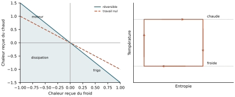
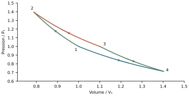
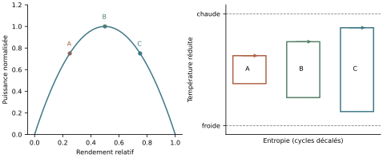
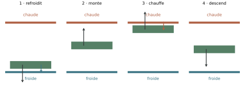
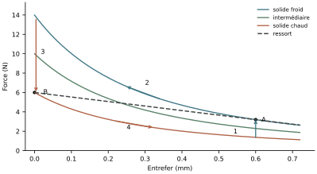
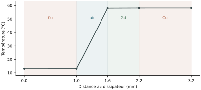
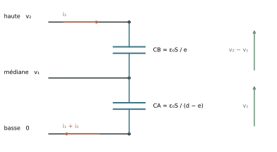
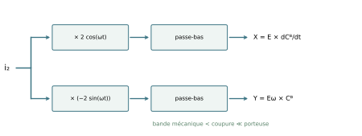

# Physique PSI — X-ENS PSI 2023 · Corrigé guidé

*Corrigé rédigé par IA, non officiel.*

**Rédaction** · GPT-6.2 Astra Ultra · vitesse non renseignée

On suit la chaleur depuis le gisement industriel jusqu’à la conversion en travail. Le choix du sens des échanges détermine les signes des cycles. Pour la partie mécanique, la coordonnée croît de la plaque chaude vers la plaque froide.

## I · Chaleur industrielle récupérable

### Question 1 — Premier et deuxième principes

> [!INDICATION]
> Sur un cycle, les états extrêmes coïncident, pas les différentielles à tout instant.

#### Solution

Pour le système fermé, avec les échanges reçus positifs, $\mathrm dU=\delta W+\sum_i\delta Q_i$ et $\mathrm dS=\sum_i\delta Q_i/T_i+\mathrm dS_c$, avec $\mathrm dS_c\ge0$. Sur un cycle ce sont les intégrales qui s’annulent, $\Delta U=\Delta S=0$. Il vient $W+\sum_iQ_i=0$ et $\sum_iQ_i/T_i=-S_c\le0$ pour des réservoirs à températures constantes.

### Question 2 — Diagramme de Raveau

> [!INDICATION]
> Tracer les deux droites à partir des deux bilans, puis donner un sens énergétique à chaque secteur.

#### Solution

Prenons en abscisse $Q_f$ et en ordonnée $Q_h$, chaleurs reçues du froid et du chaud avec $T_h>T_f$. La droite de réversibilité est $Q_h=-(T_h/T_f)Q_f$ ; le domaine permis est situé en dessous. Sur $Q_h=-Q_f$ le travail est nul. Pour $Q_h>0$, $Q_f<0$ et $Q_h+Q_f>0$, la machine produit du travail. Pour $Q_f>0$ et $Q_h<0$ dans le domaine permis, elle consomme du travail et transporte la chaleur du froid au chaud (réfrigérateur ou pompe à chaleur). Si $Q_h>0$, $Q_f<0$ et leur somme est négative, elle consomme du travail tout en transférant du chaud au froid. Recevoir deux chaleurs négatives correspond à une dissipation de travail dans les deux réservoirs. Les machines idéales réversibles se trouvent sur la première droite.

### Question 3 — Cycle de Carnot moteur dans le plan entropique

> [!INDICATION]
> Sur une transformation réversible adiabatique la variation d’entropie est nulle.

#### Solution

Le cycle comprend une compression adiabatique réversible de $T_f$ à $T_h$, une détente isotherme réversible à $T_h$, une détente adiabatique réversible jusqu’à $T_f$ et une compression isotherme réversible à $T_f$. Dans le diagramme d’abscisse $S$ et d’ordonnée $T$, les adiabatiques sont verticales, les isothermes horizontales. Le cycle moteur parcourt le rectangle vers la droite sur sa branche chaude.

### Question 4 — Rendement réversible

> [!INDICATION]
> Éliminer la chaleur à la source froide entre les deux bilans.

#### Solution

Le travail produit vaut $W_{\rm out}=Q_h+Q_f$. La réversibilité donne $Q_h/T_h+Q_f/T_f=0$, donc $Q_f=-Q_h T_f/T_h$. Ainsi $\eta_C=W_{\rm out}/Q_h=1-T_f/T_h$, avec températures absolues.

### Question 5 — Travail maximal de la chaleur fatale

> [!INDICATION]
> Comparer deux énergies thermiques identiques à deux températures différentes.

#### Solution

Pour un gisement à $T_h=T_f+\Delta T$, la fraction idéalement convertible est $\eta_C=\Delta T/(T_f+\Delta T)$. L’écart de température indique donc la qualité de la ressource. Avec $T_f\simeq300\,\mathrm K$, $20\ \mathrm{TWh}$ à un écart de $30\,\mathrm K$ donnent idéalement $20(30/330)\simeq1{,}82\times10^{12}\ \mathrm{Wh}$ par an. Pour $75\,\mathrm K$, on trouve $20(75/375)=4{,}0\times10^{12}\ \mathrm{Wh}$ par an. Les nombres supposent une source maintenue à température et une valorisation réversible.

## II · Un cycle de référence pour un gaz parfait

### Question 6 — Les quatre variations de pression

> [!INDICATION]
> L’état 1 précède immédiatement la compression adiabatique.

#### Solution

De 1 à 2, compression adiabatique et échauffement font monter $P$. De 2 à 3 la détente isotherme chaude la fait baisser. De 3 à 4 la détente adiabatique accompagnée du refroidissement la fait encore baisser. De 4 à 1 la compression isotherme froide la ramène vers $P_1$.

### Question 7 — Pentes des isothermes et des adiabatiques

> [!INDICATION]
> Dériver les deux invariants le long de leurs courbes respectives.

#### Solution

À température constante $PV=\mathrm{constante}$ et $\mathrm dP/\mathrm dV=-P/V$. Sur une adiabatique réversible du gaz parfait à $\gamma$ constant, $PV^\gamma=\mathrm{constante}$ et $\mathrm dP/\mathrm dV=-\gamma P/V$. L’adiabatique est plus raide au même point. Le cycle moteur est horaire dans le plan $(V,P)$, avec détente chaude à pression supérieure à celle de la compression froide aux volumes communs.

### Question 8 — Différentielle d’entropie du gaz

> [!INDICATION]
> Utiliser l’enthalpie pour choisir naturellement les variables température et pression.

#### Solution

L’identité de Gibbs $\mathrm dh=T\,\mathrm ds+v\,\mathrm dP$, appliquée au gaz parfait avec $\mathrm dh=c_p\,\mathrm dT$, donne $\mathrm dS=m c_p\,\mathrm dT/T-nR\,\mathrm dP/P$. Avec $m(c_p-c_v)=nR=P_1V_1/T_1$,
$$\mathrm dS=\frac{P_1V_1}{T_1}\left[\frac{c_p}{c_p-c_v}\frac{\mathrm dT}{T}-\frac{\mathrm dP}{P}\right].$$

### Question 9 — Pressions aux quatre sommets

> [!INDICATION]
> Appliquer la loi de Laplace sur les deux transformations adiabatiques, et la chute de pression seulement sur l’isotherme chaude.

#### Solution

Sur les adiabatiques $T^\gamma P^{1-\gamma}=\mathrm{constante}$. Posons $r=(T_h/T_f)^{\gamma/(\gamma-1)}=(330/300)^{3{,}5}\simeq1{,}40$. Alors $P_2=rP_1$, $P_3=P_2-0{,}4\ \mathrm{bar}$ et $P_4=P_3/r$. On obtient, à partir de $P_1=1\ \mathrm{bar}$, environ $1{,}40$, $1{,}00$ et $0{,}71\ \mathrm{bar}$. La variation imposée sur l’isotherme chaude est une baisse de pression.

### Question 10 — Deux échanges de chaleur

> [!INDICATION]
> Transformer le rapport de volumes en rapport inverse de pressions à température constante.

#### Solution

Pour l’isotherme chaude réversible, $Q_h=nRT_h\ln(V_3/V_2)=(P_1V_1/T_1)T_h\ln(P_2/P_3)$. Pour l’isotherme froide, $Q_f=(P_1V_1/T_1)T_f\ln(P_4/P_1)$. Ici $V_1=10^{-7}\ \mathrm{m^3}$ et $P_1V_1=10^{-2}\ \mathrm J$. On trouve environ $Q_h=3{,}7\ \mathrm{mJ}$ et $Q_f=-3{,}4\ \mathrm{mJ}$, ou $3{,}3$ et $-3{,}0\ \mathrm{mJ}$ avec les logarithmes arrondis du formulaire.

### Question 11 — Travail récupéré par cycle

> [!INDICATION]
> Factoriser le travail avant d’arrondir.

#### Solution

Le rapport $P_2/P_3=P_1/P_4$ est commun aux deux logarithmes, d’où $W_{\rm out}=(P_1V_1/T_1)(T_h-T_f)\ln(P_2/P_3)\simeq3{,}4\times10^{-4}\ \mathrm J$. On retrouve $W_{\rm out}/Q_h=(T_h-T_f)/T_h\simeq9{,}1\%$. Garder des chiffres en réserve évite une perte de précision par soustraction.

### Question 12 — Utilité d’un changement d’état à pression constante

> [!INDICATION]
> À pression donnée, distinguer chaleur sensible et chaleur latente.

#### Solution

Pendant un changement d’état d’un corps pur à pression fixée, sa température de saturation reste constante et il échange une chaleur latente importante. Une branche isobare d’évaporation ou de condensation peut donc approcher une isotherme au voisinage de la température du réservoir. L’écart de température et la création d’entropie des transferts peuvent ainsi diminuer.

## III · Puissance et écarts aux sources

### Question 13 — Cycle endoréversible

> [!INDICATION]
> Distinguer les deux températures de surface active et celles des deux réservoirs.

#### Solution

Notons $T_h=T_{\rm ch}$, $T_f=T_{\rm fr}$ et $T_h>T_1>T_2>T_f$. Dans le plan $(S,T)$, dessiner entre les deux températures internes $T_1,T_2$ un rectangle de Carnot intérieur, avec détente à $T_1$ et compression à $T_2$. Le rectangle réversible de référence atteint $T_h,T_f$. À même variation entropique, le rectangle intérieur a une aire plus petite. Les écarts aux réservoirs autorisent des flux finis. Le sens moteur adopté corrige l’ambiguïté de la figure signalée par le jury.

### Question 14 — Flux à travers les deux contacts

> [!INDICATION]
> Appliquer la loi de conductance pendant le seul intervalle où l’interrupteur thermique est fermé.

#### Solution

Pour la suite, $Q_h$ et $Q_{\rm rej}$ désignent ici des **valeurs positives** de chaleur reçue du chaud et rejetée au froid, conformément au bilan de puissance imprimé. Pendant le contact chaud, $q_h=K(T_h-T_1)>0$ et $Q_h=Kt_1(T_h-T_1)$. Pendant le contact froid, $q_{\rm rej}=K(T_2-T_f)>0$ et $Q_{\rm rej}=Kt_2(T_2-T_f)$. Hors du contact correspondant, le flux est nul.

### Question 15 — Rapport des temps de contact

> [!INDICATION]
> Dans le bilan de l’intérieur, diviser par les températures internes.

#### Solution

Le cycle intérieur étant réversible, $Q_h/T_1=Q_{\rm rej}/T_2$. Après remplacement des chaleurs,
$$\frac{t_1}{t_2}=\frac{T_1(T_2-T_f)}{T_2(T_h-T_1)}.$$
Les réservoirs extérieurs produisent de l’entropie aux deux contacts.

### Question 16 — Puissance moyenne du thermogénérateur

> [!INDICATION]
> Diviser numérateur et dénominateur par le même temps de contact.

#### Solution

Posons $a=T_h-T_1$ et $b=T_2-T_f$. En remplaçant $t_1/t_2=T_1 b/(T_2 a)$ dans $\mathcal P=K(a t_1-b t_2)/(t_1+t_2)$, il vient
$$\mathcal P=K\frac{(T_1-T_2)(T_h-T_1)(T_2-T_f)}{T_h T_2-T_f T_1}.$$
Dans la forme (2) cela correspond à $T_x=T_1$, $T_y=T_2$, $T_z=T_h$ et $T_w=T_f$. Les trois écarts du numérateur sont positifs. Le résultat a la dimension d’une puissance.

### Question 17 — Rendement relatif

> [!INDICATION]
> Distinguer la largeur du cycle en température et l’écart disponible entre les sources.

#### Solution

Le moteur intérieur a $\eta_{\rm endo}=1-T_2/T_1$. Écrivons $\Delta T_{\rm adia}=T_1-T_2$ et $\Delta T_{\rm res}=T_h-T_f$. En divisant par le rendement de Carnot des réservoirs, on obtient $\eta_{\rm rel}=(\Delta T_{\rm adia}/\Delta T_{\rm res})(T_h/T_1)$.

### Question 18 — Développement pour une faible différence de température

> [!INDICATION]
> Simplifier d’abord la fraction contenant la racine. Les termes d’ordre zéro et un du numérateur d’origine se compensent.

#### Solution

$\eta_C=\Delta T_{\rm res}/T_h\ll1$. En posant $s=\sqrt{1-\eta_C}$, la fonction imprimée se simplifie exactement en $f=(1-s)^2/\eta_C=(1-s)/(1+s)\sim\eta_C/4$. Pour $r=\Delta T_{\rm adia}/\Delta T_{\rm res}$, on obtient à l’ordre dominant
$$\mathcal P_{\max}\simeq\frac{K\,\Delta T_{\rm res}^2}{4T_h}r(1-r),\qquad
\eta_{\rm rel}^{\max}=\frac{r}{r+(1-r)s}\simeq r.$$

### Question 19 — Ordonnée de la parabole de compromis

> [!INDICATION]
> Lire l’échelle verticale au sommet puis déterminer la constante de normalisation.

#### Solution

Pour un écart des sources donné et faible, éliminer $r$ au profit de $\eta=\eta_{\rm rel}^{\max}$. On trouve $\mathcal P_{\max}\simeq[K\Delta T_{\rm res}^2/(4T_h)]\eta(1-\eta)$. L’ordonnée de la figure 2 est la puissance normalisée par son maximum $K\Delta T_{\rm res}^2/(16T_h)$, donc $4\eta(1-\eta)$. Elle s’annule aux deux extrémités et atteint 1 pour $\eta=1/2$.

### Question 20 — Choix entre les points A, B et C

> [!INDICATION]
> Comparer les hauteurs des rectangles et lire les abscisses des deux points de même ordonnée.

#### Solution

À faible écart, les hauteurs des cycles intérieurs sont environ $\Delta T_{\rm res}/4$ pour A, $\Delta T_{\rm res}/2$ pour B et $3\Delta T_{\rm res}/4$ pour C. Le dessin joint les situe entre les mêmes sources. La parabole a la symétrie $\eta\leftrightarrow1-\eta$. A et C produisent donc la même puissance réduite, voisine de $0{,}75$, avec un rendement beaucoup plus élevé en C. À puissance imposée et à ressources comparables on retient C, qui exige moins de chaleur d’entrée. B répond à un autre critère, la puissance maximale.

## IV · Le gadolinium, milieu magnétocalorique

### Question 21 — Variables naturelles de l’enthalpie libre

> [!INDICATION]
> Différencier chacun des deux produits avant de substituer l’identité de départ.

#### Solution

Pour une masse fixée, $\mathrm du=T\,\mathrm ds+(\mu_0/\rho)H\,\mathrm dM$. En différentiant $g=u-Ts-(\mu_0/\rho)HM$, les termes en $\mathrm ds$ et $\mathrm dM$ se compensent. Il reste $\mathrm dg=-s\,\mathrm dT-(\mu_0/\rho)M\,\mathrm dH$. La masse volumique est constante dans le modèle.

### Question 22 — Dérivées croisées

> [!INDICATION]
> Indiquer la variable fixée à chaque dérivation.

#### Solution

Les coefficients de la différentielle donnent $s=-(\partial g/\partial T)_H$ et $\mu_0M/\rho=-(\partial g/\partial H)_T$. Pour $g$ deux fois continûment dérivable, l’égalité des dérivées mixtes impose
$$(\partial s/\partial H)_T=(\mu_0/\rho)(\partial M/\partial T)_H.$$
Si le second membre est non nul, une variation du champ à température constante modifie l’entropie.

### Question 23 — Entropie d’une aimantation isotherme

> [!INDICATION]
> Sur le graphique, distinguer le champ porté en abscisse de l’excitation H.

#### Solution

Le modèle linéaire donne $(\partial M/\partial T)_H=-C_2/\mu_0$, soit $(\partial s/\partial H)_T=-C_2/\rho$. L’intégration à température fixée de zéro à $\mu_0H_f=1\,\mathrm T$ conduit à $\Delta s=-C_2\Delta(\mu_0 H)/(\rho\mu_0)\simeq-3{,}0\ \mathrm{J\,kg^{-1}K^{-1}}$. Les moments s’ordonnent lorsque l’excitation croît. La dérivation en degrés Celsius ou en kelvins donne le même coefficient.

### Question 24 — Échauffement adiabatique

> [!INDICATION]
> Le logarithme comporte un rapport de températures absolues.

#### Solution

Avec $c_H=T(\partial s/\partial T)_H$, la différentielle est $\mathrm ds=(c_H/T)\,\mathrm dT-(C_2/\rho)\,\mathrm dH$. Une transformation adiabatique réversible a $\mathrm ds=0$. Il vient $\ln(T_f/T_i)=C_2\Delta(\mu_0 H)/(\rho\mu_0 c_H)=z$. Ainsi $\Delta T_{\rm adia}=T_i(\exp z-1)\simeq T_i z$. Avec $T_i=298\,\mathrm K$, $c_H=300\ \mathrm{J\,kg^{-1}K^{-1}}$, $\rho=7900\ \mathrm{kg\,m^{-3}}$, on trouve $z\simeq0{,}010$ et $\Delta T_{\rm adia}\simeq+3{,}0\ \mathrm K$. Une démagnétisation adiabatique refroidit le matériau.

### Question 25 — Choisir l’écart de température des sources

> [!INDICATION]
> Comparer les hauteurs du cycle intérieur et du cycle de référence de la question 13.

#### Solution

Le saut réel indiqué est de l’ordre de $2\ \mathrm K$. Pour des réservoirs proches, il peut représenter une part appréciable de leur écart. L’isentrope amène alors le solide près de la température de son prochain contact, ce qui limite la création d’entropie. Si l’écart des réservoirs est grand devant ce saut, il reste un fort écart aux échanges. Le rendement relatif diminue. Des écarts de contact positifs demeurent nécessaires pour obtenir une puissance finie.

## V · Circulation, énergie et force magnétique

### Question 26 — Quatre étapes de l’oscillateur

> [!INDICATION]
> Tracer séparément l’effort qui plaque ou lance le solide et le transfert de chaleur.

#### Solution

L’axe $e=e_{\rm air}$ est orienté vers le bas, de la paroi chaude ($e=0$) à la froide ($e=d$). En 1 le solide reste au froid, cède de la chaleur à la paroi et le ressort l’y maintient jusqu’au seuil. En 2 l’attraction l’emporte, il quitte le froid et monte rapidement, avec un échange thermique négligeable. En 3 l’attraction le maintient en haut et il reçoit de la chaleur du chaud. En 4 le ressort l’emporte, il redescend rapidement sans échange thermique appréciable. Aux contacts la réaction de la paroi équilibre la force d’appui tant qu’il y reste.

### Question 27 — Circulation de l’excitation

> [!INDICATION]
> Les aimants sont opposés dans le repère vertical, mais leurs contributions ont le même signe le long du contour fermé.

#### Solution

Le contour suit le flux en faisant le tour du fer et du gadolinium. Il traverse deux aimants orientés dans le sens du contour et deux entrefers. Il n’enlace aucun courant libre. Le théorème d’Ampère donne donc $2e_m H_m+2eH_{\rm air}+l_{\rm fer}H_{\rm fer}+l_{\rm MC}H_{\rm MC}=0$, avec des composantes algébriques le long du contour.

### Question 28 — Champ dans des sections inégales

> [!INDICATION]
> Exprimer d’abord chaque excitation en fonction du seul champ dans l’air.

#### Solution

Écrivons $B=B_{\rm air}$, $r_i=S_{\rm air}/S_i$ et $b=C_2(35-T)$, où $T$ est exprimée en degrés Celsius pour cette loi ajustée. La conservation du flux donne $B_i=r_i B$. Les excitations valent respectivement $B/\mu_0$, $r_mB/\mu_0-M_m$, $r_{\rm fer}B/(\mu_0\mu_r)$ et $(r_{\rm MC}B-b)/[\mu_0(1+C_1)]$. La substitution dans la circulation précédente donne
$$B=\frac{2e_mM_m+l_{\rm MC}b/[\mu_0(1+C_1)]}{(2e+2e_mr_m)/\mu_0+l_{\rm MC}r_{\rm MC}/[\mu_0(1+C_1)]+l_{\rm fer}r_{\rm fer}/(\mu_0\mu_r)}.$$
Les cinq coefficients demandés sont donc $a_1=2e_m,\ a_2=l_{\rm MC},\ a_3=2e+2e_mr_m,\ a_4=l_{\rm MC}r_{\rm MC},\ a_5=l_{\rm fer}r_{\rm fer}$.

### Question 29 — Rôle de l’entrefer

> [!INDICATION]
> Le champ double dans la section de gadolinium, de surface moitié moindre.

#### Solution

Pour $S_m=S_{\rm air}=S_{\rm fer}=2S_{\rm MC}=S$ et $\mu_r$ très grand, posons $N=\mu_0e_mM_m+l_{\rm MC}b/[2(1+C_1)]$ et $D=e_m+l_{\rm MC}/(1+C_1)$. Il reste $B_{\rm air}=N/(e+D)$ et $B_{\rm MC}=2N/(e+D)$. Rapprocher le matériau des aimants réduit l’entrefer et augmente le champ dans le matériau, à température fixée sur la branche considérée.

### Question 30 — Énergie dans les parties linéaires

> [!INDICATION]
> Comptabiliser les deux lames d’air.

#### Solution

La densité d’énergie pour $H=B/\mu$ vaut $\int_0^B H(B')\,\mathrm dB'=B^2/(2\mu)$. Les deux volumes d’air donnent $\mathcal E_{\rm air}=2Se\,B^2/(2\mu_0)=SeB^2/\mu_0$. Le fer donne $\mathcal E_{\rm fer}=S_{\rm fer} l_{\rm fer}B_{\rm fer}^2/(2\mu_0\mu_r)$, qui tend vers zéro quand $\mu_r$ tend vers l’infini à flux fixé.

### Question 31 — Énergie des deux aimants

> [!INDICATION]
> L’expression du champ dans l’aimant contient un terme indépendant de B.

#### Solution

L’excitation est $H_m=B_m/\mu_0-M_m$ avec rémanence fixée. Intégrer cette droite affine depuis zéro et multiplier par le volume des deux aimants donne $\mathcal E_m=2e_m S_m[B_m^2/(2\mu_0)-M_mB_m]$. Le terme linéaire provient de l’ordonnée à l’origine non nulle.

### Question 32 — Énergie du gadolinium

> [!INDICATION]
> Intégrer en champ à température constante.

#### Solution

La loi du solide donne $H_{\rm MC}=(B_{\rm MC}-b)/[\mu_0(1+C_1)]$. À température fixée on en tire
$$\mathcal E_{\rm MC}=\frac{S_{\rm MC}l_{\rm MC}}{\mu_0(1+C_1)}\left(\frac{B_{\rm MC}^2}{2}-b B_{\rm MC}\right),\qquad b=C_2(35-T).$$

### Question 33 — Rapporter les énergies au champ dans l’air

> [!INDICATION]
> Reporter à la fois les rapports de champ et ceux de surface.

#### Solution

Ici $B_m=B$, $B_{\rm MC}=2B$, $S_m=S$ et $S_{\rm MC}=S/2$. Il vient $\mathcal E_m=(Se_m/\mu_0)(B^2-2\mu_0M_m B)$ et $\mathcal E_{\rm MC}=Sl_{\rm MC}(B^2-bB)/[\mu_0(1+C_1)]$. Ces deux facteurs géométriques sont différents.

### Question 34 — Énergie totale à température et position imposées

> [!INDICATION]
> Identifier séparément le coefficient de B carré et celui de B avant la substitution.

#### Solution

L’addition des quatre contributions donne $\mathcal E=(S/\mu_0)[(e+D)B^2-2NB]$. Avec le champ de la question 29,
$$\mathcal E_{\rm mag}=-\frac{C_3(T)}{e+C_4},\qquad C_3=\frac{S}{\mu_0}\left[\mu_0 e_mM_m+\frac{l_{\rm MC}C_2(35-T)}{2(1+C_1)}\right]^2,\quad C_4=e_m+\frac{l_{\rm MC}}{1+C_1}.$$
L’origine de l’énergie suit l’intégrale donnée dans le sujet. $C_4$ est une longueur, $C_3$ une énergie fois une longueur.

### Question 35 — Projection de la force magnétique

> [!INDICATION]
> Garder le signe moins de la convention de travail.

#### Solution

Dans le bilan fourni, le coefficient de $\mathrm de$ est $-F_{\rm mag}$ à température fixée. Ainsi $F_{\rm mag}=-(\partial\mathcal E_{\rm mag}/\partial e)_T=-C_3/(e+C_4)^2$. La force est dirigée perpendiculairement aux plaques, vers les aimants et vers l’entrefer décroissant.

### Question 36 — Quel coefficient dépend de la température

> [!INDICATION]
> Distinguer le terme d’aimantation du terme purement géométrique.

#### Solution

Dans $N$, la contribution du gadolinium décroît lorsque $T$ augmente. Pour $N>0$ sur la plage de fonctionnement, $C_3=SN^2/\mu_0$ décroît donc aussi. $C_4$ est constant dans ce modèle. À position donnée la valeur absolue de la force diminue avec la température, ce qui permet au ressort de décoller le matériau réchauffé.

## VI · Mécanique des deux contacts

### Question 37 — Cycle dans le plan force–déplacement

> [!INDICATION]
> Tracer d’abord les deux segments verticaux, pour lesquels la position est imposée.

#### Solution

En ordonnée on représente $G=-F_{\rm mag}>0$. En 1, à $e=d$, le refroidissement accroît $G$ jusqu’en A. En 2 le solide va de A vers la gauche sur la branche d’attraction forte. En 3, à $e=0$, le réchauffement fait descendre $G$ jusqu’en B. En 4 le trajet repart vers la droite sur la branche faible. Le dessin indique les sens et les changements de contact. Les températures du solide pendant les sauts rapides peuvent légèrement varier par effet magnétocalorique.

### Question 38 — Dynamique avec réactions unilatérales

> [!INDICATION]
> Une paroi peut pousser le solide, mais la réaction s’annule dès le décollage.

#### Solution

Dans la direction de l’entrefer croissant, le modèle de la figure donne $m_{\rm MC}\ddot e=k(e_0-e)-G(e,T)+F_{\rm contact}$. Le ressort travaille vers la paroi froide et les aimants vers la paroi chaude. Au milieu, $F_{\rm contact}=0$. En haut, la réaction est positive ou nulle. En bas, elle est négative ou nulle. La comparaison de forces du graphique suppose le poids négligeable ou compensé dans le réglage statique de référence.

### Question 39 — Perte du contact froid

> [!INDICATION]
> Appliquer le signe autorisé de la réaction inférieure.

#### Solution

Au repos en $d$, $F_{\rm contact}=G(d,T)-k(e_0-d)\leq0$. Lors du refroidissement, $G$ augmente, alors que le ressort garde la même longueur. La réaction passe d’une valeur négative à zéro en A. Si $G$ croît encore, il faudrait une réaction positive au contact inférieur. Le matériau quitte donc ce contact.

### Question 40 — Divergence d’une petite perturbation

> [!INDICATION]
> Comparer les pentes locales des deux tracés à leur intersection.

#### Solution

Au seuil A, les termes constants s’annulent. Poser $e=d+\delta$ et considérer une perturbation vers l’intérieur, donc sans réaction. À température quasi fixée,
$$m_{\rm MC}\ddot\delta=\left[-k+\frac{2C_3(T_A)}{(d+C_4)^3}\right]\delta.$$
L’équilibre est instable si le crochet est positif, car la solution contient une exponentielle croissante. Cela revient à $|\partial G/\partial e|>k$ en A. La courbe magnétique y descend plus vite que la droite du ressort sur la figure 6, ce qui entraîne le départ vers le haut.

### Question 41 — Équilibres et bistabilité

> [!INDICATION]
> Étudier le signe de la force libre de part et d’autre du croisement, puis le signe des réactions admises aux deux bornes.

#### Solution

Pour $T_A<T<T_B$, en $0$ l’attraction domine et plaque le solide au chaud, tandis qu’en $d$ le ressort domine et le plaque au froid. Entre les deux, le croisement de la courbe magnétique et de la droite du ressort est instable sur la figure. Un déplacement vers la gauche renforce la résultante vers la gauche, et inversement. Il y a donc deux équilibres stables de contact séparés par un équilibre intérieur instable. En dessous de $T_A$ la branche observée conduit au contact chaud, au-dessus de $T_B$ au contact froid. Aux seuils, l’une des réactions s’annule.

### Question 42 — Températures permettant l’aller-retour

> [!INDICATION]
> Identifier sur quelle paroi chaque seuil intervient.

#### Solution

Pour atteindre le seuil A en refroidissant, la source froide doit être plus froide que $T_A\simeq20\,^\circ\mathrm C$. Pour franchir B en chauffant, la source chaude doit être plus chaude que $T_B\simeq40\,^\circ\mathrm C$. On demande ainsi $T_{\rm fr}<T_A<T_B<T_{\rm ch}$. À l’égalité, un contact thermique passif tend asymptotiquement vers le seuil, ce qui empêche une oscillation régulière de période finie dans ce modèle.

## VII · Chauffage du prototype

### Question 43 — Puissance moyenne du hacheur

> [!INDICATION]
> Moyenner la puissance instantanée sur la période de découpage.

#### Solution

Sur une période $\tau_d$, l’interrupteur idéal impose $u_R=E$ pendant $\alpha\tau_d$ et zéro pendant le reste. La puissance instantanée est donc successivement $E^2/R$ et zéro. Sa moyenne est $P_R=\alpha E^2/R$. Avec $E\simeq10\ \mathrm V$, $R\simeq100\ \Omega$, on a $P_R\simeq\alpha\ \mathrm W$. Le rapport des temps de commutation et de diffusion justifie l’usage de cette moyenne.

### Question 44 — Diffusion dans l’empilement

> [!INDICATION]
> Écrire la loi de Fourier avec l’orientation de la figure avant de projeter les deux flux sortants.

#### Solution

Dans chaque couche homogène, sans production volumique, $c_i\partial_tT_i=k_i\partial_x^2 T_i$. Le flux de chaleur vers les $x$ croissants est $-k_iS\partial_xT_i$. L’axe va du radiateur ($0$) vers le chauffage ($x_4$). Au radiateur, $k_{\rm Cu}S\partial_xT(0,t)=[T(0,t)-T_{\rm amb}]/R_{\rm th}$. Au chauffage, dont toute la puissance est dirigée vers le radiateur, $k_{\rm Cu}S\partial_xT(x_4,t)=P_R$. Les températures de part et d’autre de chacune des trois interfaces $x_1,x_2,x_3$ sont égales. Les valeurs de $k_i\partial_xT_i$ y sont également continues, en l’absence de résistance de contact et de stockage surfacique.

### Question 45 — Températures atteintes de part et d’autre du matériau

> [!INDICATION]
> La dernière lame de cuivre se trouve au-delà de x trois.

#### Solution

En régime stationnaire, le même débit thermique $P_R$ traverse en série chaque couche, dont la résistance vaut $R_i=e_i/(k_i S)$. En partant de l’ambiance et en remontant vers le chauffage,
$$T(x_1)=T_{\rm amb}+P_R(R_{\rm th}+R_{\rm Cu}),\qquad T(x_3)=T_{\rm amb}+P_R(R_{\rm th}+R_{\rm Cu}+R_{\rm air}+R_{\rm MC}).$$
Le premier point est à la surface du cuivre froid. Le second est à la surface du cuivre chaud en contact avec le matériau. Pour $S=10^{-4}\ \mathrm{m^2}$, les résistances valent respectivement $0{,}033$, $300$ et $0{,}60\ \mathrm{K\,W^{-1}}$ pour une lame de cuivre, l’air et le gadolinium.

### Question 46 — Intervalle de puissance

> [!INDICATION]
> Associer chacun des deux seuils à la température de la bonne surface de cuivre.

#### Solution

Les seuils de la question 42 imposent $T(x_1)<T_A$ et $T(x_3)>T_B$ dans le modèle de dimensionnement proposé, matériau au contact chaud. Comme les résistances sont positives,
$$\frac{T_B-T_{\rm amb}}{R_{\rm th}+R_{\rm Cu}+R_{\rm air}+R_{\rm MC}}<P_R<\frac{T_A-T_{\rm amb}}{R_{\rm th}+R_{\rm Cu}}.$$
Il faut que cet intervalle rencontre la plage du hacheur. Un chauffage insuffisant empêche le décollage du chaud, un chauffage excessif empêche de retrouver le seuil froid.

### Question 47 — Réglage numérique du rapport cyclique

> [!INDICATION]
> Lire la résistance du radiateur à vitesse nulle et convertir les surfaces en mètres carrés.

#### Solution

Sans ventilation forcée, la figure 10 donne $R_{\rm th}\simeq20\ \mathrm{K\,W^{-1}}$ à vitesse d’air nulle. À $10\,^\circ\mathrm C$ d’ambiance, avec $T_A\simeq20\,^\circ\mathrm C$, $T_B\simeq40\,^\circ\mathrm C$ et $E^2/R\simeq1\ \mathrm W$, les bornes sont $30/320{,}63\simeq0{,}094$ et $10/20{,}03\simeq0{,}50$. À un chiffre significatif, le réglage recherché est donc approximativement $0{,}09<\alpha<0{,}5$. Les limites représentent des seuils estimés sur les graphiques.

## VIII · Lecture capacitive du mouvement

### Question 48 — Champ du condensateur plan

> [!INDICATION]
> Superposer les champs des deux nappes en précisant leur sens.

#### Solution

Pour des plaques portant $+q$ et $-q$, de surface $S$, la densité surfacique est $\sigma=q/S$. Loin des bords, chaque nappe crée un champ de module $\sigma/(2\varepsilon_0)$ sur chacune de ses faces. Les deux contributions s’ajoutent entre les plaques. Le champ intérieur est uniforme, perpendiculaire aux plaques et dirigé de la positive vers la négative, de module $q/(\varepsilon_0 S)$ pour $q>0$. Elles s’annulent à l’extérieur dans l’approximation plane.

### Question 49 — Capacité et épaisseur

> [!INDICATION]
> Relier d’abord la différence de potentiel à l’intégrale du champ.

#### Solution

Le potentiel de l’armature positive dépasse celui de la négative de $U=|\mathbf E|e=qe/(\varepsilon_0 S)$. Donc $C=q/U=\varepsilon_0 S/e$. L’air est assimilé au vide, les franges de champ et l’épaisseur du revêtement isolant sont négligées.

### Question 50 — Deux capacités à électrode commune

> [!INDICATION]
> Les tensions des deux condensateurs sont respectivement v deux moins v un, et v un.

#### Solution

Le schéma relie la plaque supérieure ($v_2$) à la médiane ($v_1$) par $C_B=\varepsilon_0S/e$. La médiane est reliée à la plaque inférieure de référence ($0$) par $C_A=\varepsilon_0S/(d-e)$. L’électrode intermédiaire est alimentée séparément. Ces deux capacités varient en sens opposé lorsque le matériau se déplace. Les expressions idéales valent pour $0<e<d$. Le film d’isolement réel limite les valeurs aux contacts.

### Question 51 — Condensateur de capacité variable

> [!INDICATION]
> Appliquer la règle de dérivation d’un produit.

#### Solution

Avec la convention récepteur, la charge de l’armature de potentiel positif est $q=C(t)u(t)$. Sa dérivée donne $i=C\dot u+u\dot C$. Même à tension maintenue constante un mouvement des plaques engendre donc un courant.

### Question 52 — Courants fournis par les deux alimentations

> [!INDICATION]
> Faire le bilan des charges de chacune des deux électrodes alimentées.

#### Solution

Posons $\Delta v=v_2-v_1$. L’alimentation supérieure apporte le courant de charge de l’armature haute de B, $i_2=\mathrm d(C_B\Delta v)/\mathrm dt$. L’alimentation médiane charge les deux faces du conducteur central, soit
$$i_1=\frac{\mathrm d}{\mathrm dt}\left[C_Av_1-C_B(v_2-v_1)\right].$$
Les signes des deux contributions de B sont opposés car ses armatures portent des charges opposées.

### Question 53 — Combinaisons directement mesurées

> [!INDICATION]
> Additionner avant de développer les deux dérivées.

#### Solution

En notant $i_\Sigma=i_1+i_2$, l’addition élimine la branche supérieure. Le système devient
$$i_\Sigma=C_A\dot v_1+v_1\dot C_A,\qquad i_2=C_B\,\dot{\Delta v}+\Delta v\,\dot C_B.$$
Chaque mesure en courant ne contient qu’une capacité et sa dérivée.

### Question 54 — Positionnement des quatre sondes

> [!INDICATION]
> Exploiter la loi des nœuds pour mesurer la somme avec une seule sonde de courant.

#### Solution

Placer une sonde de courant en série entre la source $v_2$ et la plaque haute, orientée vers la plaque, pour mesurer $i_2$. Une seconde sur le fil commun reliant la plaque basse au retour des deux sources mesure $i_\Sigma$, orientée de la plaque vers le retour. Brancher une sonde différentielle entre la plaque haute (entrée +) et la médiane (entrée −) pour $\Delta v$, puis une autre entre médiane (+) et masse (−) pour $v_1$. Ces branchements figurent sur le schéma de la question 50.

### Question 55 — Courants en polarisation constante

> [!INDICATION]
> Dériver les deux distances entre plaques en tenant compte de leur signe relatif.

#### Solution

Pour $v_1=E$, $v_2=2E$ et $v=\dot e$, les deux tensions de branche sont constantes et valent $E$. Il vient
$$i_\Sigma=\frac{E\varepsilon_0 S\,v}{(d-e)^2},\qquad i_2=-\frac{E\varepsilon_0 S\,v}{e^2}.$$
Si la plaque s’éloigne du haut, le condensateur supérieur débite tandis que le condensateur inférieur se charge.

### Question 56 — Perte de mesure à l’arrêt

> [!INDICATION]
> Tester un mobile immobile à deux positions différentes.

#### Solution

Les deux courants sont nuls lorsque $v=0$, quelle que soit la position. Quand le mobile se déplace, leur rapport élimine la vitesse et donne $e=d/[1+\sqrt{-i_2/i_\Sigma}]$. À l’arrêt, ce rapport est indéterminé et à faible vitesse il devient sensible au bruit. Une intégration à partir d’un courant demande une valeur initiale de capacité et accumule les offsets.

### Question 57 — Excitation sinusoïdale commune

> [!INDICATION]
> Conserver les deux termes de la règle du produit.

#### Solution

Avec les deux tensions de branche égales à $E\cos\omega t$, la dérivation des charges donne
$$i_\Sigma=E\varepsilon_0S\left[\frac{v\cos\omega t}{(d-e)^2}-\frac{\omega\sin\omega t}{d-e}\right],\quad
i_2=E\varepsilon_0S\left[-\frac{v\cos\omega t}{e^2}-\frac{\omega\sin\omega t}{e}\right].$$
Dans chaque courant, le terme en sinus mesure la capacité, celui en cosinus sa dérivée.

### Question 58 — Intérêt et coût de la porteuse

> [!INDICATION]
> Examiner les deux quadratures quand la vitesse tend vers zéro.

#### Solution

Même immobile le mobile détermine une capacité et un courant alternatif mesurables, en quadrature avec la tension. La composante en phase renseigne sur la vitesse. L’excitation alternative fournit donc une mesure absolue de position à l’arrêt et évite de devoir intégrer un courant continu. Elle exige une référence de phase stable, une bande passante adaptée et la maîtrise des capacités parasites et du déphasage des sondes.

### Question 59 — Détection synchrone de position et de vitesse

> [!INDICATION]
> Les produits de deux sinusoïdes de même fréquence comportent une composante continue et une composante à fréquence double.

#### Solution

Choisir la voie $i_2=E\dot C_B\cos\omega t-E\omega C_B\sin\omega t$ et deux références tirées de la même horloge. Multiplier le courant par $2\cos\omega t$ dans une branche, et par $-2\sin\omega t$ dans l’autre. Après filtrage passe-bas, les termes doubles à $2\omega$ disparaissent. Les sorties sont $X=E\dot C_B$ et $Y=E\omega C_B$. Prendre la fréquence de coupure au-dessus de la bande de mouvement utile et très inférieure à celle de la porteuse, avec une acquisition qui résolve cette dernière. Ainsi $C_B=Y/(E\omega)$, $\dot C_B=X/E$, puis
$$e=\varepsilon_0 S/C_B,\qquad v=-\varepsilon_0 S\dot C_B/C_B^2.$$
La même détection sur $i_\Sigma$ fournit $C_A$ et une vérification indépendante via $e=d-\varepsilon_0S/C_A$. Une calibration des gains, de la quadrature et des capacités parasites fixe les unités physiques.

[Sujet officiel](https://ens-paris-saclay.fr/sites/default/files/CONCOURS/ANNALES_1C/1C_PSI/2023_PHYSIQUE_PSI_001.pdf) · [Rapport du jury](https://ens-paris-saclay.fr/sites/default/files/CONCOURS/ANNALES_1C/1C_PSI/2023_PSI_rapport_ecrit_Physique.pdf)
