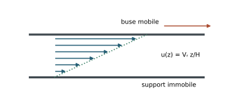
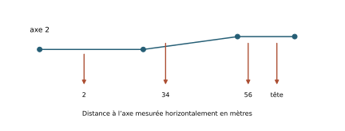
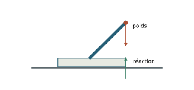
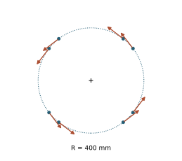
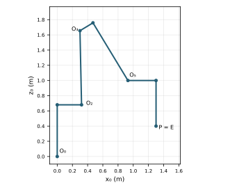
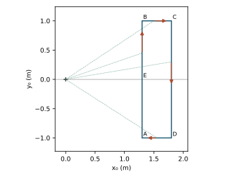
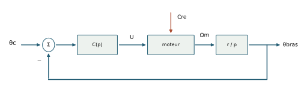
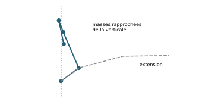
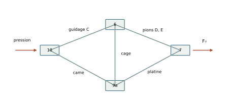
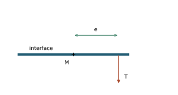

# X-ENS PSI · Sciences industrielles 2023 · Corrigé brut

*Corrigé rédigé par IA, non officiel. Signalez toute erreur.*

**Rédaction** · GPT-6.2 Astra Ultra · vitesse non renseignée · 24 novembre 2026

## Partie 1 · Mise en contexte

### Question 1.1 · Choisir la section de la buse

La symétrie de révolution rend l’ouverture indépendante de l’orientation de la tête autour de son axe. Le robot peut tourner dans le plan du mur sans réorienter une fente pour conserver la même largeur de dépose. La largeur finale résulte ensuite du débit et de l’écrasement sur le support.

### Question 1.2 · Écoulement dans l’entrefer

Dans le repère du support, tracer deux parois parallèles distantes de $H$. La paroi inférieure est immobile, la face inférieure de la buse se déplace à $V_r$ selon $x$. Le modèle local de Couette, permanent, plan, sans gradient de pression et à adhérence, donne $u(0)=0$, $u(H)=V_r$ et $u(z)=V_r z/H$ pour un fluide newtonien. Le jet entrant au voisinage de l’ouverture possède en outre une vitesse verticale $V_e$. Le ciment est une pâte à seuil et la géométrie locale comporte une surface libre. Ce modèle représente le cisaillement dû à la translation, à distinguer du bilan global de débit.

### Question 1.3 · Conserver la matière

Dans un temps $dt$, la buse émet $(\pi D^2/4)V_e\,dt$ et trace une longueur $V_r dt$ de cordon. À masse volumique constante, sans perte ni accumulation, $(\pi D^2/4)V_e=V_rS_c=V_rBH$. Les deux membres sont des débits en $\mathrm{m^3\,s^{-1}}$.

### Question 1.4 · Choisir et piloter les paramètres

Le dessin impose le trajet, la largeur $B$, la hauteur de couche $H$ et donc $S_c$. Le diamètre $D$ résulte du choix de buse compatible avec ces dimensions et la granulométrie. L’automate du robot règle $V_r$ et la garde verticale. La pompe règle $V_e$ ou, de manière équivalente pour une buse fixée, le débit. Le rapport débit/vitesse doit rester adapté jusque dans les ralentissements de trajectoire. Une vitesse d’avance excessive ou un débit trop faible amincit le cordon et peut le rompre. Les écarts opposés créent une surépaisseur. Une garde erronée modifie l’écrasement et l’adhésion entre couches. Une modification de $D$ à $V_e$ fixé agit au carré sur le débit.

### Question 1.5 · Tenue d’une couche fraîche

Pour une couche de hauteur $H$, la pression de poids propre maximale est $p_{\rm base}=\rho gH$. Le critère fourni donne $p_{\rm adm}=\sqrt3\,\tau_s^0$. Ainsi $H\le H_0=\sqrt3\tau_s^0/(\rho g)$. Ici $\rho$ désigne la masse volumique, en $\mathrm{kg\,m^{-3}}$.

### Question 1.6 · Tenue d’un empilement

En prenant le début de la première couche comme origine, $T_n=(n-1)L_c/V_r$. Au même point du trajet, lorsque la $n$-ième couche vient d’être déposée, la première supporte environ $\rho gnH$ et sa limite vaut $\sqrt3(\tau_s^0+A T_n)$. La hauteur admissible par le matériau de base à cet instant vaut donc

$$
H_{\rm adm}(T_n)=\frac{\sqrt3}{\rho g}\left(\tau_s^0+A\frac{(n-1)L_c}{V_r}\right).
$$

Il faut $nH\le H_{\rm adm}(T_n)$ et $H\le H_0$ pour la couche fraîche. En posant $s=\sqrt3 A L_c/(\rho gV_r)$, les couches intermédiaires imposent toutes les inégalités $kH\le H_0+(k-1)s$ pour $1\le k\le n$. Si $H>s$ et que la première couche tient, le dernier entier possible est $\lfloor(H_0-s)/(H-s)\rfloor$ et la hauteur atteinte est cet entier multiplié par $H$. Si $H\le s$ et $H\le H_0$, ce seul critère ne donne pas de limite finie. Le flambage peut en donner une.

### Question 1.7 · Moment du poids au-dessus de la coupe

Par unité de largeur dans la direction longitudinale du mur, la tranche à la cote $s$ a une masse $\rho b\,ds$, à l’ordre des petites pentes. Son poids vertical a pour bras de levier $v(s)-v(z_p)$ par rapport à la coupe. Avec le signe de flexion de la figure 5, l’intégration sur le tronçon isolé donne $M_P(z_p)=\int_{z_p}^{L}\rho gb\,[v(s)-v(z_p)]\,ds$. Une translation horizontale uniforme de toute la poutre laisse bien ce moment inchangé.

### Question 1.8 · Courbure en petite pente

Si $\theta$ est l’angle avec la verticale initiale, $\tan\theta=v'(z)$ et $ds=\sqrt{1+v'(z)^2}\,dz$. Avec le signe associé à $v$, $\gamma=d\theta/ds=v''/(1+v'^2)^{3/2}$. À petite rotation $|v'|\ll1$, on obtient $\gamma\simeq v''$.

### Question 1.9 · Équation de flambage

À temps fixé, $E$ et $I$ sont uniformes et $EI v''(z)=\int_z^h w[v(s)-v(z)]\,ds$, où $w=\rho gb$ est le poids par unité de hauteur pour la tranche choisie en Q1.7. À la borne mobile $s=z$, l’intégrande est nul. La dérivée donne $EI v'''+w(h-z)v'=0$. Le sujet écrit $\rho g$ au lieu de $w$ dans l’équation finale. Cette écriture emploie une masse linéique effective pour $\rho$ ou une normalisation commune de la charge et de la rigidité. Si l’on conserve la masse volumique de Q1.5 et $I=b^3/12$ pour la largeur unité, le facteur $b$ de Q1.7 doit rester dans $w$.

### Question 1.10 · Lire les trois modes de rupture

A pointe le seuil du premier cordon, soumis à son propre poids (Q1.5). B pointe l’escalier des couches superposées, chaque passage ajoutant un poids supplémentaire (Q1.6). C pointe la courbe de flambage, continue dans le modèle de poutre (Q1.9). Une impression réalisable doit satisfaire simultanément la tenue de la pâte à la charge courante et la condition de stabilité de la paroi.

### Question 1.11 · Pomper une pâte abrasive

Le béton reste enfermé dans une canalisation souple. Les organes mécaniques de la pompe sont donc isolés du mélange chargé de particules et sujet à la prise. Le tube remplaçable facilite le nettoyage, la pompe est autoamorçante et le débit moyen est pilotable par la vitesse des galets. En contrepartie, les cycles d’écrasement usent le tube et le passage successif des galets produit des pulsations de débit.

### Question 1.12 · Débit de la pompe à galets

Pour un diamètre effectif de trajectoire $D_p$, un tour déplace idéalement le contenu de $\pi D_p$ de tube. Si $d$ est son diamètre intérieur, $S=\pi d^2/4$ et $Q_{\rm idéal}=S\pi D_p\,\omega_p/(2\pi)=\pi d^2D_p\omega_p/8$. À $D_p$ et $\omega_p$ fixés, on choisit donc la section intérieure du tube. Les volumes successifs isolés par les galets se partagent la circonférence, ce qui évite de multiplier ce résultat par le nombre de galets. Le débit réel peut intégrer un rendement volumétrique.

### Question 1.13 · Injecter l’accélérateur près de la sortie

L’accélérateur doit agir pendant la tenue du cordon déposé. Le mélanger près de la sortie limite le temps de séjour de la pâte en cours de prise dans les conduites et la pompe. Les pertes de charge, les risques de bouchage et le béton adjuvanté à purger lors des arrêts diminuent. Il reste à assurer une longueur de mélange suffisante pour obtenir une pâte homogène.

## Partie 2 · Analyse statique du robot

### Question 2.1 · Chaîne des liaisons et actions

Le sol est encastré au socle 0. Les pivots motorisés $L_i$ relient successivement $0,1,2,3,4,5,6$ et la tête d’impression est encastrée sur 6. Chaque solide subit son poids en son centre de gravité, les actions des liaisons adjacentes et, aux articulations, les deux couples moteur opposés sur stator et rotor. Le support transmet au socle le torseur de sol. Les six pivots idéaux en chaîne ouverte laissent six rotations indépendantes et cinq inconnues de réaction chacun. Une coupe de chaque liaison permet de déterminer les réactions de proche en proche, en statique pour une position maintenue par les couples moteurs. Le modèle ouvert est isostatique.

### Question 2.2 · Couples en sortie des réducteurs

Avec $i=\omega_m/\omega_s$, $C_s=\eta iC_m$. En prenant $\eta=1$, les axes 1, 2, 3, 5 et 6 donnent respectivement $14\times191=2674$, $9\times243=2187$, $9\times201=1809$, $12\times48=576$ et $4\times81=324\ \rm N\,m$. Sur l’axe 4, le couple vaut $12i_4\ \rm N\,m$ avant pertes. Le tableau n’indique pas $i_4$.

### Question 2.3 · Capacité de charge pour 100 kg

Le graphique de l’annexe D situe les limites vers $Z_{\max}\simeq0,50\ \rm m$ à $L=0$ et $L_{\max}\simeq0,37\ \rm m$ à $Z=0$. Il faut rester à l’intérieur de la courbe pour un couple $(L,Z)$. Pour un poids de $981\ \rm N$, ces distances correspondent à des moments de plusieurs centaines de newtons-mètres. Un modèle statique du poignet donne $mgL\le383\ \rm N\,m$ en prenant l’orientation du poids la plus défavorable pour l’axe 6, soit $L\lesssim0,39\ \rm m$. Pour un axe transversal d’origine décalée d’environ $0,20\ \rm m$ par rapport à M, on obtient $mg\sqrt{L^2+(Z+0,20)^2}\le736\ \rm N\,m$, soit à $L=0$ un ordre de grandeur $Z\lesssim0,55\ \rm m$. Les enveloppes constructeur incluent ses propres marges et limitations.

### Question 2.4 · Position défavorable à l’épaule

Dans le plan vertical du bras, étendre le bras et l’avant-bras horizontalement du même côté de $O_2$ tout en maintenant la tête verticale. Les bras de levier des masses distales sont alors longs et leurs moments s’ajoutent. Pour l’ensemble en aval de $L_2$, le théorème du moment statique selon son axe donne, en valeur absolue, $C_2=g|m_2 d_2+m_{34}d_{34}+m_{56}d_{56}+m_t d_t|$. Les $d_j$ sont les abscisses horizontales signées des centres de gravité par rapport à $O_2$. Une optimisation exacte des faibles déports des centres de gravité peut légèrement déplacer la posture de maximum.

### Question 2.5 · Comparer les données d’épaule au besoin statique

Dans la posture étendue de Q2.4, avec $\vec z_2$ et $\vec x_3$ horizontaux et $\vec x_5$ horizontal (buse verticale), l’annexe C donne $d_2=0,418$, $d_{34}=0,975+0,210=1,185$ et $d_{56}=0,975+0,887+0,100=1,962$ et $d_t=0,975+0,887+0,370=2,232\ \rm m$. Le déport vertical n’intervient pas dans un moment de poids. La tête seule demande environ $50\times9,81\times2,232=1095\ \rm N\,m$, inférieur à 2187. En incluant les masses de 117, 246 et 55 kg données par l’annexe, on trouve

$$
C_2\simeq9,81[117(0,418)+246(1,185)+55(1,962)+50(2,232)]\simeq5,49\ \rm kN\,m.
$$

Les 9 N·m et le rapport 243 publiés en Q2.2 ne suffisent donc pas, dans ce modèle idéal **non compensé**, à maintenir le poids complet en extension. La charge utile seule est compatible. Pour valider l’ensemble il faudrait un couple d’équilibrage ramené en sortie d’au moins $3,31\ \rm kN\,m$ dans cette posture, ou des données d’actionneur différentes. Un rendement inférieur à un accentue l’écart.

### Question 2.6 · Mobilité du train épicycloïdal

Pour un satellite et la couronne libre, les trois roues centrales ou porte-satellite ont trois rotations et la rotation propre du satellite en ajoute une. Les deux engrènements imposent deux contraintes scalaires indépendantes. Il reste deux mobilités. Avec quatre pivots parfaits et deux contacts imposant chacun une équation de roulement, $h=4\times5+2-6\times4+2=0$. Pour trois satellites, il y a six pivots, six équations de contact et toujours deux mobilités globales, d’où $h=6\times5+6-6\times6+2=2$. Les deux relations supplémentaires répètent la même relation de Willis. Des satellites répartis à $120^\circ$ équilibrent les efforts radiaux et répartissent la charge entre dentures si la géométrie et les raideurs permettent ce partage.

### Question 2.7 · Rapport de réduction d’un étage

Notons $\omega_c$ la vitesse du porte-satellites et $\omega_i$ celle de la roue $i$. Le contact extérieur soleil–satellite impose $Z_{11}(\omega_{11}-\omega_c)=-Z_{12}(\omega_{12}-\omega_c)$. Le contact intérieur satellite–couronne impose $Z_{12}(\omega_{12}-\omega_c)=Z_{14}(\omega_{14}-\omega_c)$. Avec $\omega_{14}=0$, on obtient $\omega_{13}/\omega_{11}=Z_{11}/(Z_{11}+Z_{14})$, positif et inférieur à un. Le porte-satellites tourne dans le même sens que le soleil.

### Question 2.8 · Limite de basculement

Avec pour seules actions le poids et le sol horizontal, leurs résultantes sont verticales opposées et ont la même droite d’action. Tant que la projection du centre de gravité total reste dans le polygone d’appui, des pressions non négatives peuvent assurer l’équilibre. À la limite, le poids descend par le bord et la réaction monte sur ce même bord. L’autre côté commence à se délester. Au-delà, l’équilibre exigerait que le sol tire sur le socle.

### Question 2.9 · Loi de Coulomb

Pour un contact sec non adhésif, la réaction sur le solide étudié est $N\vec n+\vec T$, avec $N\ge0$, $\vec T\cdot\vec n=0$. En adhérence, la vitesse relative tangentielle est nulle et $\|\vec T\|\le\mu_s N$. À la limite de glissement l’égalité est atteinte. En glissement, pour la vitesse du solide par rapport au support $\vec v_t\ne0$, $\vec T=-\mu_d N\vec v_t/\|\vec v_t\|$. En séparation $N=0$ et l’effort tangent s’annule.

### Question 2.10 · Boulons modélisés par deux rotules

Avec huit boulons, neuf solides mobiles, seize rotules et un appui-plan lisse, le nombre d’inconnues statiques est $16\times3+3=51$. Chaque boulon peut tourner sur son axe. Le bilan formel sous l’**hypothèse d’encastrement global** du sujet donne $h=51-6\times9+8=5$. Ce bilan suppose que les trois mouvements plans sont effectivement supprimés.

Dans la géométrie dessinée, les huit doubles rotules alignées verticalement sont des tirants axiaux. En linéarisation instantanée, un appui lisse avec ces seuls tirants conserve les deux translations en plan et la rotation verticale. Avec ces trois mobilités supplémentaires on obtient $h=8$. La liaison matérielle doit donc être complétée par l’adhérence sous précharge ou par des éléments de positionnement. Un appui rugueux adhérent, modélisé comme un encastrement à six inconnues, conserve les huit rotations propres et donne aussi huit redondances dans ce modèle. En construction, surfaces planes, jeux adaptés, rondelles et déformations élastiques rendent le serrage multiple possible et conditionnent la répartition.

### Question 2.11 · Répartir un couple autour de la verticale

Pour huit points sur un cercle de rayon $R$, proposer sur le socle huit forces tangentielles de même norme, toutes opposées à la rotation imposée. Chaque paire diamétralement opposée a une résultante nulle et les moments s’ajoutent. On obtient $F_t=|M_z|/(8R)$ par point. Ce partage exige une précharge et une raideur équivalentes, une répartition symétrique et l’absence de glissement local. La statique seule fixe le moment total.

### Question 2.12 · Influence de la pente du socle

Pour une masse $m$ de coordonnées $(x,z)$ dans le plan de pente lié au socle et pour l’inclinaison défavorable $\beta$, la distance horizontale à l’axe de basculement vaut $x\cos\beta+z\sin\beta$. Si le moment admissible imposé est $M_*$ et que les autres pièces apportent $M_0(\beta)$, alors $m_{\max}(\beta)=[M_*-M_0(\beta)]/[g(x\cos\beta+z\sin\beta)]$ sur la branche considérée. Pour une tenue limitée par le cisaillement, la composante nouvelle à reprendre parallèlement au socle est $mg\sin\beta$. Le dimensionnement retient la plus restrictive des limites de couple et d’effort. L’angle de $15^\circ$ seul ne fixe pas une masse numérique.

### Question 2.13 · Du couple de serrage aux efforts transmissibles

Le travail idéal par tour donne $2\pi C=F_0 p$ avec $p=0,003\ \rm m$, soit $F_0\simeq1,52\ \rm MN$ **par boulon** sans frottement. Cette valeur idéale surestime très fortement la précharge réelle. À titre d’estimation avec le modèle de serrage $C=K dF_0$, $d=0,024\ \rm m$ et un facteur de serrage supposé $K=0,20$, on trouve $F_0\simeq151\ \rm kN$ et une force normale totale d’environ $1,21\ \rm MN$. Le sujet ne fournit ni $K$ ni le frottement de l’interface. Les capacités en cisaillement et en torsion pure deviennent $F_{xy,\max}\simeq8\mu F_0$ et $M_{z,\max}\simeq8\mu F_0 R$ pour $R=0,40\ \rm m$. Par exemple, avec $\mu=0,20$, elles valent $242\ \rm kN$ et $96,7\ \rm kN\,m$, à comparer aux $15,5\ \rm kN$ et $10,4\ \rm kN\,m$ en arrêt d’urgence dans l’annexe D. Ces deux capacités pures ne s’additionnent pas en charge combinée. Une validation de fabrication demanderait les coefficients réels, la résistance des boulons et celle du support.

## Partie 3 · Étude cinématique et dynamique du robot

### Question 3.1 · Géométrie directe et orientation

En notant $\vec x_i,\vec y_i,\vec z_i$ les vecteurs unitaires instantanés, on trouve par Chasles

$$
\overrightarrow{O_0P}=a_1\vec x_1+c_1\vec z_1+c_2\vec z_2+a_3\vec x_3+c_3\vec z_3+a_4\vec x_4+a_5\vec x_5+a_P\vec x_6-c_P\vec z_6 .
$$

Pour obtenir les composantes dans 0, prendre $R_{0\leftarrow6}=R_z(\theta_1)R_y(\theta_2)R_y(\theta_3)R_x(\theta_4)R_y(\theta_5)R_x(\theta_6)$. Les colonnes sont les axes de la base 6 exprimés dans 0. Chaque facteur utilise l’axe local avant l’articulation. $R_x,R_y,R_z$ désignent les rotations directes autour des axes indiqués. Par exemple $R_y(t)(x,y,z)=(x\cos t+z\sin t,y,-x\sin t+z\cos t)$, les deux autres se déduisent par permutation cyclique des coordonnées. La matrice de passage des composantes de 0 vers 6 est la transposée.

### Question 3.2 · Résolution du codeur

Un cran correspond à $2\pi/1024$ au moteur et à $\Delta\theta_2=2\pi/(1024\times243)=2,53\,10^{-5}\ \rm rad=0,00145^\circ$ en sortie. Le déplacement entre deux codes vaut $2R\sin(\Delta\theta_2/2)\simeq R\Delta\theta_2$, $R$ étant la distance de P à l’axe 2. Le pire cas est le bras le plus déployé perpendiculairement à l’axe. Avec une portée représentative de $2,20\ \rm m$ (annexe B), le pas est $0,056\ \rm mm$, soit une demi-quantification de $0,028\ \rm mm$ avec arrondi au plus proche. À l’extrémité de la **buse** il faut inclure le déport de l’outil. L’annexe C donne un majorant de portée $0,975+\sqrt{0,887^2+0,200^2}+\sqrt{0,370^2+0,600^2}=2,59\ \rm m$, soit $0,065\ \rm mm$ par cran. Ces ordres de grandeur sont voisins de la répétabilité annoncée de $\pm0,03\ \rm mm$ et montrent la limite d’un jugement sur le codeur seul. Répétabilité mesurée, justesse absolue et pas de quantification décrivent des propriétés distinctes.

### Question 3.3 · Torseur des vitesses à la buse

Posons $\vec u_i=(\vec z_1,\vec y_2,\vec y_3,\vec x_4,\vec y_5,\vec x_6)_i$. La composition des six champs de vitesses rigides donne

$$
\vec\Omega_{6/0}=\sum_{i=1}^6\dot\theta_i\vec u_i,\qquad
\vec V_{P,6/0}=\sum_{i=1}^6\dot\theta_i\vec u_i\times\overrightarrow{O_iP}.
$$

Les vecteurs $O_iP$ sont les sommes des tronçons restants dans Q3.1. Les projections de ces deux vecteurs sur la même base donnent les six composantes du torseur. Cette forme conserve les contributions géométriques des six axes sans développer des expressions trigonométriques longues.

### Question 3.4 · Liaison équivalente du poignet

L’axe 4 passe par $O_5$ car $O_4O_5$ lui est parallèle. L’axe 5 y passe par définition. Enfin $O_5O_6$ est porté par l’axe 6. Le centre $O_5$ est donc fixe pour le mouvement relatif du poignet par rapport à 3. Les trois axes réalisent localement les trois rotations d’une rotule de centre $O_5$, avec les limites de course de l’assemblage. Les axes 4 et 6 alignés donnent une configuration singulière.

### Question 3.5 · Jacobiens de position et de vitesse

La règle de chaîne donne $J_{ij}=\partial f_i/\partial\theta_j$ et $\dot X_{P,i}=\sum_jJ_{ij}\dot\theta_j$. Les trois premières lignes traduisent directement la vitesse de P. Si les trois paramètres d’orientation sont des angles d’Euler, leurs dérivées forment un taux de coordonnées. Pour obtenir les composantes cartésiennes de $\vec\Omega$, appliquer la matrice cinématique du paramétrage ou employer le Jacobien géométrique dont la colonne $j$ est $(\vec u_j\times O_jP,\vec u_j)$.

### Question 3.6 · Plusieurs solutions inverses

Une pose de P fixe $O_5$ une fois l’orientation de la tête imposée. En coupe plane, $O_3$ se trouve à $c_2$ de $O_2$ et à $b=\sqrt{(a_3+a_4)^2+c_3^2}$ de $O_5$. Lorsque $|c_2-b|<O_2O_5<c_2+b$, ces cercles ont deux intersections, symétriques par rapport à la droite $O_2O_5$. À chacun des deux coudes correspondent un angle d’épaule et un angle de coude, puis une orientation de poignet rétablissant celle de l’outil. Les butées peuvent ensuite exclure l’une des branches pour une pose donnée.

### Question 3.7 · Singularité et trajectoire praticable

Pour $\theta_5=0$, les axes 4 et 6 sont confondus. Les colonnes 4 et 6 du Jacobien géométrique sont identiques, donc un mouvement relatif des deux pivots peut ne produire aucun mouvement de l’outil. Lors de la planification, choisir une branche inverse continue, surveiller la plus petite valeur singulière du Jacobien et déplacer la trajectoire ou réorienter légèrement la tête avant l’alignement. Une inversion régularisée limite aussi les grandes vitesses au voisinage, au prix d’une erreur de suivi.

### Question 3.8 · Hauteur et horizontalité

Posons $u=\theta_2+\theta_3$ et $a=a_3+a_4$. Sur la branche où $\vec x_6$ pointe radialement vers l’extérieur, $\theta_2+\theta_3+\theta_5=0$ modulo $2\pi$. Ainsi $\vec z_6=\vec z_0$. La projection verticale de Q3.1 donne

$$
H_t=c_1+c_2\cos\theta_2-a\sin u+c_3\cos u-c_P .
$$

La projection radiale est $r=a_1+c_2\sin\theta_2+a\cos u+c_3\sin u+a_5+a_P$. Ces équations restent valables pendant la rotation d’azimut de l’ensemble.

### Question 3.9 · Reporter la posture initiale sur DR2

Dans la coupe $(x_0,z_0)$ en mètres, placer $O_0=(0,0)$, $O_2=(0,320,0,680)$, $P=E=(1,300,0,400)$ et $O_5=(1,300-0,370,\,0,400+0,600)=(0,930,1,000)$. L’intersection supérieure des cercles de Q3.6 donne $O_3\simeq(0,299,1,655)$. Relier les centres en tenant compte de $c_3$ sur l’avant-bras, puis tracer le déport terminal de $0,60\ \rm m$ vers le bas. À l’échelle 1/25, $200\ \rm mm$ réels occupent $8\ \rm mm$ sur DR2. Le schéma ci-dessous emploie le même rapport d’échelle entre ses deux axes.

### Question 3.10 · Résoudre la géométrie inverse en E

Posons $D_1=H_t+c_P-c_1=0,320$, $D_2=d_t-a_1-a_5-a_P=0,610$, en mètres. Alors $D_1=c_2\cos\theta_2-a\sin u+c_3\cos u$ et $D_2=c_2\sin\theta_2+a\cos u+c_3\sin u$. Élever au carré après avoir isolé les deux termes contenant $u$, puis additionner. Il vient

$$
D_1\cos\theta_2+D_2\sin\theta_2=D_3,\qquad
D_3=\frac{D_1^2+D_2^2+c_2^2-a^2-c_3^2}{2c_2}.
$$

Si $\phi=\operatorname{atan2}(D_2,D_1)$ et $D=\sqrt{D_1^2+D_2^2}$, alors $\theta_2=\phi\pm\arccos(D_3/D)$. En posant $X=D_2-c_2\sin\theta_2$, $Z=D_1-c_2\cos\theta_2$, on tire $u=\operatorname{atan2}(c_3,a)-\operatorname{atan2}(Z,X)$, puis $\theta_3=u-\theta_2$ et $\theta_5=-u$. La posture de DR2 donne $\theta_2=-1,23^\circ$, $\theta_3=60,00^\circ$ et $\theta_5=-58,77^\circ$. L’autre intersection donne $\theta_2\simeq125,9^\circ$ et $\theta_3\simeq-214,6^\circ$ ou $145,4^\circ$, hors de la course de l’axe 3.

### Question 3.11 · Azimut sur les quatre côtés

Sur DR3, joindre $O_0$ à P, puis tracer le vecteur unitaire radial et sa normale directe. $\theta_1=\operatorname{atan2}(y_P,x_P)$ et $\dot\theta_1=(x_P\dot y_P-y_P\dot x_P)/(x_P^2+y_P^2)$. Sur A vers B, $\dot y_P=+V_a$ et $\dot x_P=0$, donc $\dot\theta_1=V_a x_P/r^2$. Sur C vers D le signe est opposé. Sur B vers C, $\dot x_P=+V_a$ donc $\dot\theta_1=-V_a y_P/r^2$. Sur D vers A, $\dot x_P=-V_a$ donc $\dot\theta_1=V_a y_P/r^2$. Au point E au départ, $\dot\theta_1=0,1/1,3=0,0769\ \rm rad/s$.

### Question 3.12 · Vérifier les limites cinématiques

Le périmètre est $2(2+0,5)=5\ \rm m$, donc le temps de parcours est 50 s. La figure 12 place l’axe 1 entre environ $-38^\circ$ et $+38^\circ$, l’axe 2 entre environ $-1^\circ$ et $37^\circ$, l’axe 3 entre environ $6^\circ$ et $60^\circ$ et l’axe 5 entre environ $-59^\circ$ et $-43^\circ$. Ces intervalles respectent ceux de l’annexe C. Le calcul sur les cinq segments donne des maxima de vitesse de $4,41$, $4,46$, $7,78$ et $3,33^\circ/\rm s$ sur les axes 1, 2, 3 et 5, loin des limites de 90 à $120^\circ/\rm s$ des quatre axes actifs. Le parcours est compatible en position et en vitesse sur ses segments. Les changements de direction aux sommets posent une question distincte d’accélération en Q3.22.

### Question 3.13 · Centrer la tête sur son axe de rotation

Si $G_t$ appartient à $(O_5,\vec x_5)$, le poids n’exerce aucun moment autour de cet axe quelle que soit l’orientation. Le centre de masse ne décrit pas de cercle excentré lors de la rotation de l’organe terminal. On limite ainsi le balourd et les sollicitations au poignet.

### Question 3.14 · Masse et inertie équivalentes du poignet

La masse totale vaut $m=55+50=105\ \rm kg$ et $x_G=(55\times0,100+50\times0,370)/105=0,22857\ \rm m$. Dans la configuration plane considérée, les bases des tenseurs indiquées par l’annexe coïncident. Les transports sur $\vec x_5$ ajoutent à chacun $m_j(x_j-x_G)^2\operatorname{diag}(0,1,1)$. Avec les tenseurs numériques de l’annexe C, on obtient $I_G=\operatorname{diag}(11,6,\ 14,61,\ 5,01)\ \rm kg\,m^2$ à l’arrondi près. La somme des corrections transverses vaut $55\times50(0,27)^2/105=1,91\ \rm kg\,m^2$. Le tenseur est diagonal, sans que les trois moments principaux soient égaux.

### Question 3.15 · Symétries des tenseurs

Dans une base principale les trois produits d’inertie s’annulent. Des plans de symétrie matériels donnent des intégrandes impairs et justifient ces termes nuls pour les modèles homogènes simplifiés des pièces 2, 34, 56 et de la tête. Une symétrie de révolution entraîne en outre l’égalité des deux moments transverses, visible pour 56 autour de $x$ et pour la tête autour de $z$ dans les données. L’embase et ses accessoires sont dissymétriques et les axes géométriques de l’annexe ne sont pas ses directions principales. Ses trois termes hors diagonale sont donc admissibles.

### Question 3.16 · Énergie cinétique et matrice d’inertie

Pour la pièce $i$, $E_i=\tfrac12m_i\|V_{G_i}\|^2+\tfrac12\Omega_i^TI_{G_i}\Omega_i$, les composantes d’une même contraction étant exprimées dans une base commune. Aux positions fixées, $V_{G_i}=J_{v,i}\dot\Theta$ et $\Omega_i=J_{\omega,i}\dot\Theta$. La somme donne $E_c=\tfrac12\dot\Theta^TA(\Theta)\dot\Theta$, avec $A=\sum_i(m_iJ_{v,i}^TJ_{v,i}+J_{\omega,i}^TI_{G_i}J_{\omega,i})$. C’est la matrice d’inertie généralisée, symétrique. Ses termes diagonaux sont des inerties articulaires et ses termes hors diagonale expriment des couplages.

### Question 3.17 · Équations dynamiques du robot

Pour les six coordonnées indépendantes, calculer $U_g=\sum_i m_i g z_{G_i}$ puis appliquer $d(\partial E_c/\partial\dot\theta_j)/dt-\partial E_c/\partial\theta_j+\partial U_g/\partial\theta_j=Q_j$. Le premier groupe donne $A(\Theta)\ddot\Theta$, les termes quadratiques de vitesse se rassemblent en $B(\Theta,\dot\Theta)\dot\Theta$ (Coriolis et centrifuges), le gradient du potentiel en $C(\Theta)$. Sans effort extérieur au point P, $Q=\Gamma$ est le vecteur des couples moteurs. Si un torseur $F$ est appliqué de l’extérieur, sa puissance $F^T J\dot\Theta$ ajoute $J^TF$ au membre droit, avec le Jacobien géométrique correspondant aux mêmes composantes.

### Question 3.18 · Vitesse et moment cinétique du dernier ensemble

Prendre $\vec e_r=\vec x_5$, $\vec e_\theta=\vec y_5$ et $\vec e_z=\vec z_0$. Si $r=\sqrt{x_P^2+y_P^2}$, le centre de masse a pour rayon $r_G=r-a_5-a_P+x_G$ et une hauteur constante $H_t+c_P$. Donc $V_G=\dot r\vec e_r+r_G\dot\theta_1\vec e_\theta$. Comme $\Omega=\dot\theta_1\vec e_z$ et que le tenseur est diagonal dans cette base, $\vec\sigma_G=C_{56t}\dot\theta_1\vec e_z$. Cette expression est le moment cinétique au centre de masse.

### Question 3.19 · Couple de maintien du poignet

La dérivée de $\vec\sigma_G$ est verticale. Le terme de transport $O_5G\times m\vec a_G$ est vertical lui aussi, car les deux vecteurs sont horizontaux. Le moment dynamique projeté sur $\vec y_5$ est donc nul. Le poids $-mg\vec z_0$ exerce autour de cet axe le moment $+mgx_G$ et le pivot parfait ne transmet aucun couple passif selon son axe. Ainsi $C_5=-mgx_G$, constant sur la trajectoire. Avec les masses et centres de l’annexe C il vaut $-235\ \rm N\,m$ environ. La courbe de la figure 13 est bien horizontale, mais à environ $-189\ \rm N\,m$. Son niveau numérique ne correspond pas au produit $g(55\times0,100+50\times0,370)$ des données imprimées.

### Question 3.20 · Gravité et rotation de l’embase

L’énergie potentielle totale est indépendante de l’azimut $\theta_1$. Par conséquent $\partial U_g/\partial\theta_1=0$. On retrouve le même résultat en projetant sur la verticale le moment de poids tous verticaux. Le couple moteur $C_1$ peut néanmoins comprendre les inerties et couplages d’accélération.

### Question 3.21 · Lire les couples sur les segments

La figure 13 situe $C_1$ près de zéro entre sommets et $C_5$ reste pratiquement constant. Pour 2 et 3, les couples varient régulièrement avec la portée horizontale des masses, sur des niveaux de l’ordre du kilonewton-mètre. Sur ces segments à $0,1\ \rm m/s$, l’effet statique du poids domine. Une vitesse cartésienne constante n’impose pas des vitesses articulaires constantes et de faibles termes dynamiques subsistent.

### Question 3.22 · Pics aux changements de direction

Aux sommets après 10, 15, 35 et 40 s, la vitesse imposée tourne instantanément de $90^\circ$ en conservant son module. Elle saute donc et son accélération contient une impulsion de Dirac. Théoriquement le pic de couple sur un axe concerné n’a pas de valeur finie. Les hauteurs affichées proviennent notamment de la discrétisation des changements de direction. Les actionneurs satureraient et exciteraient les modes souples. Arrondir les angles avec un rayon compatible avec le cordon, ou ralentir jusqu’à l’arrêt et redémarrer avec une loi de vitesse à accélération bornée, rend les demandes dynamiques réalisables.

### Question 3.23 · Affiner le modèle

Un réducteur réel présente des frottements secs et visqueux. On peut ajouter $C_f\operatorname{sgn}(\dot\theta)+b\dot\theta$ aux couples résistants avec un modèle d’adhérence à l’arrêt. La souplesse des bras et des transmissions stocke de l’énergie et produit des vibrations. Des ressorts et amortisseurs entre les inerties moteur et charge permettent de les représenter. Ces termes affectent respectivement la consommation et la réponse aux changements de direction.

### Question 3.24 · Puissances motrices et puissance absorbée

$P_i=C_i\dot\theta_i$. Entre les sommets, $C_1$ est très petit puisque l’axe vertical n’a aucun couple de pesanteur à compenser et les efforts d’inertie restent faibles. Le produit est donc quasi nul. Pour l’axe 3, quand vitesse et couple ont des signes opposés, la charge fournit de l’énergie au moteur qui freine. Sa restitution électrique dépend du variateur, alors que la courbe représente la puissance mécanique signée.

### Question 3.25 · Comparer l’énergie positive des parcours

$E_i^+=\int_0^T\max(0,C_i\dot\theta_i)\,dt$. La table de la figure 14 donne pour $d_t=1,0$ à $1,5\ \rm m$ des totaux croissants de 3011,8 à 4404,5 J, soit environ $46\%$ de plus à l’extrémité de la série. Les axes 2 et 3 expliquent presque toute la dépense et le couple de gravité à vaincre croît lorsque les bras se déploient. La variation de la géométrie modifie aussi les courses articulaires. Parmi les six positions testées, $d_t=1,0\ \rm m$ minimise l’énergie positive. Une position encore plus proche demanderait une vérification de l’accessibilité, des butées et des collisions.

## Partie 4 · Asservissement du robot

### Question 4.1 · Fréquence de l’ondulation

À vitesse de dépose $v=80\ \rm mm/s$, une longueur d’onde $\lambda\simeq30\ \rm mm$ est parcourue en $T=\lambda/v\simeq0,375\ \rm s$. D’où $f_b=v/\lambda\simeq2,67\ \rm Hz$, compatible avec les $2,6\ \rm Hz$ annoncés à la précision de la lecture.

### Question 4.2 · Modèle du moteur en transformée de Laplace

Pour de petites variations, paramètres constants et conditions initiales nulles, $J_{eq}p\Omega_m=C_m-C_{re}$, $(R+Lp)I=U-K_e\Omega_m$, $C_m=K_tI$ et $\Theta_m=\Omega_m/p$. Le schéma se construit en chaîne : soustraire $K_e\Omega_m$ à $U$, appliquer $1/(R+Lp)$ puis $K_t$, soustraire $C_{re}$, appliquer $1/(J_{eq}p)$ pour obtenir $\Omega_m$, puis $1/p$ pour l’angle. En posant $D_m=J_{eq}p(R+Lp)+K_eK_t$, la forme réduite est $\Omega_m=[K_tU-(R+Lp)C_{re}]/D_m$.

### Question 4.3 · Compléter la boucle de DR4

Au comparateur de DR4, calculer $\varepsilon=\Theta_c-\Theta_{bras}$. Mettre le correcteur $C(p)$ entre $\varepsilon$ et $U$. Conserver le bloc moteur à deux entrées de Q4.2. Après $\Omega_m$, placer $r/p$ où $r=\omega_{bras}/\omega_m$, puis renvoyer $\Theta_{bras}$ avec le signe moins. Pour l’axe 1, $r=1/191$.

### Question 4.4 · Réponse à la consigne et au couple

De Q4.2 et DR4, $pD_m\Theta_{bras}=rK_tC(\Theta_c-\Theta_{bras})-r(R+Lp)C_{re}$. D’où

$$
\Theta_{bras}=\frac{rK_tC}{pD_m+rK_tC}\Theta_c-\frac{r(R+Lp)}{pD_m+rK_tC}C_{re}.
$$

Le signe négatif du second transfert provient de la convention de couple résistant.

### Question 4.5 · Erreur statique sous échelons

Pour $\Theta_c=\theta_0/p$ et $C_{re}=C_0/p$, si la boucle fermée est stable,

$$
\varepsilon_\infty=\lim_{p\to0}\frac{pD_m\theta_0+r(R+Lp)C_0}{pD_m+rK_tC(p)} .
$$

Avec un correcteur statique $C(0)$ fini positif, la consigne constante est suivie et il subsiste $RC_0/[K_tC(0)]$ en présence du couple. Avec un PID possédant une action intégrale non nulle, $C(p)\sim K_i/p$ et le résultat est nul pour les deux échelons, tant que l’actionneur a la réserve de couple nécessaire.

### Question 4.6 · Vibration d’un axe élastique

Mesurer $\theta_{bras}$ relativement à la position d’équilibre de l’axe 2. Le couple élastique additionnel vaut $-k\theta_{bras}$. En négligeant amortissement et variations gravitaires par rapport à la raideur retenue, le théorème du moment dynamique autour du pivot donne $J\ddot\theta_{bras}=-k\theta_{bras}$. $J$ et $k$ sont tous deux ramenés du même côté du réducteur.

### Question 4.7 · Pulsation propre

En divisant par $J$, on obtient $\ddot\theta_{bras}+(k/J)\theta_{bras}=0$. La pulsation propre est $\omega_b=\sqrt{k/J}$ en rad/s. Une raideur multipliée par quatre double la pulsation. Une inertie multipliée par quatre la divise par deux.

### Question 4.8 · Identifier la raideur à partir de la fréquence

$k=J(2\pi f_b)^2$. Pour $f_b=2,6\ \rm Hz$, $k\simeq267J$ en N·m/rad si $J$ est en kg·m². La référence $100\ \rm daN\,m/{}^\circ$ correspond à environ $5,73\,10^4\ \rm N\,m/rad$, donc à $J\simeq215\ \rm kg\,m^2$ pour cette fréquence. La fréquence seule identifie le rapport $k/J$.

### Question 4.9 · Mesurer la raideur

Maintenir l’arbre moteur immobile dans une configuration connue. Appliquer au bras une force mesurée par dynamomètre, perpendiculairement à un levier de longueur connue $l$, de sorte que le supplément de couple soit $Fl$. Un capteur angulaire sur le bras ou un comparateur à distance $d$ du pivot donne $\Delta\theta\simeq\Delta x/d$. Relever plusieurs paliers de charge, puis de décharge. La pente $\Delta(Fl)/\Delta\theta$ donne $k$ et la comparaison des deux séries permet de repérer les jeux ou l’hystérésis.

### Question 4.10 · Configuration d’inertie minimale

Le critère est $J_z=\int r^2\,dm$. Replier le coude en orientant les éléments massifs au-dessus de l’axe 1 et ramener le poignet et la tête au plus près de cette verticale, dans les butées autorisées. La position A maintient une partie des masses à la distance du déport d’épaule. Le dessin représente la posture visée par rapport à l’axe.

### Question 4.11 · Inertie du robot replié

La base tournante fournit $35\ \rm kg\,m^2$. Pour un ordre de grandeur du robot nu figuré, remplacer les parties aval par la masse $m=117+246+55=418\ \rm kg$. La distance radiale représentative d’un bras replié dans A est de l’ordre du déport d’épaule $a_1=0,320\ \rm m$. Le modèle ponctuel donne $J_A\simeq35+418\times0,320^2=77,8\ \rm kg\,m^2$. Si l’on prend $r=0,40\ \rm m$ au lieu de 0,32, le résultat passe à $102\ \rm kg\,m^2$, ce qui illustre la précision du modèle demandé. Une tête installée ajoute sa propre inertie et $m_t r_t^2$.

### Question 4.12 · Inertie du robot déployé

Modélisons les mêmes 418 kg par une barre horizontale homogène allant du rayon $a_1=0,32\ \rm m$ jusqu’au poignet, de longueur approchée $l=0,975+0,887+0,200=2,062\ \rm m$. Son centre est au rayon $a_1+l/2$. Ainsi $J_B\simeq35+m[l^2/12+(a_1+l/2)^2]\simeq946\ \rm kg\,m^2$. L’inertie est de l’ordre de $10^3\ \rm kg\,m^2$. La répartition réelle des masses de l’annexe C peut remplacer cette barre si les angles exacts sont connus.

### Question 4.13 · Ramener les inerties au moteur

Avec $r=\omega_{bras}/\omega_m$, l’énergie vaut $\tfrac12J_{mot}\omega_m^2+\tfrac12J_{bras}(r\omega_m)^2$. On identifie $J_{eq}=J_{mot}+r^2J_{bras}$, ici avec $r=1/191$. La réduction intervient au carré.

### Question 4.14 · Deux valeurs d’inertie équivalente

En conservant les hypothèses numériques des Q4.11 et Q4.12, $J_{eq,A}=0,010+77,8/191^2\simeq0,0121\ \rm kg\,m^2$ et $J_{eq,B}=0,010+946/191^2\simeq0,0359\ \rm kg\,m^2$. Le rapport ramené au moteur est voisin de trois. L’inertie du rotor réduit le contraste entre configurations mais la variation reste suffisante pour affecter un réglage fixe.

### Question 4.15 · Déplacer la coupure mécanique

Le modèle en vitesse devient $G(p)=K/(1+\tau_m p)$, avec $\tau_m=R J_{eq}/(K_e K_t)$ sans frottement visqueux. Une inertie accrue déplace la cassure $1/\tau_m$ vers les basses fréquences, sans modifier le gain statique de ce modèle. À fréquence fixée, le module diminue et la phase $-\arctan(\tau_m\omega)$ devient plus négative. L’intégration en position et les autres facteurs de la boucle se multiplient à ce terme.

### Question 4.16 · Changement de configuration avec un PID fixe

En B, la coupure mécanique baisse. Un PID ajusté en A donne usuellement moins de bande passante et une réponse moins rapide. Le retard de phase supplémentaire peut réduire les marges, augmenter le dépassement ou faire perdre la stabilité. Leur valeur exacte exige le correcteur et le calcul de la nouvelle pulsation de croisement. Tant que la boucle reste stable et sans saturation, le gain en continu dû à l’intégration conserve une erreur nulle pour l’échelon.

### Question 4.17 · Commande en couple par dynamique inverse

Poser $v=\ddot\theta_c+K_v(\dot\theta_c-\dot\theta_m)+K_p(\theta_c-\theta_m)$. La commande est $C_m=\Gamma(v,\dot\theta_m,\theta_m)=A(\theta_m)v+B(\theta_m,\dot\theta_m)+C(\theta_m)$, en regroupant dans $B$ le terme dépendant des vitesses. Pour les six axes, les gains deviennent des matrices et $A$ est l’inertie généralisée.

### Question 4.18 · Équation de l’erreur de poursuite

Dans ce cas et pour $A$ inversible, $\ddot\theta_m=v$. En posant $\varepsilon=\theta_c-\theta_m$, on trouve $\ddot\varepsilon+K_v\dot\varepsilon+K_p\varepsilon=0$. Les racines sont $s_\pm=(-K_v\pm\sqrt{K_v^2-4K_p})/2$. Pour deux racines réelles distinctes, $\varepsilon=A_1e^{s_+t}+A_2e^{s_-t}$. Pour une racine double, $\varepsilon=(A_1+A_2t)e^{-K_vt/2}$. Pour des racines complexes, $\varepsilon=e^{-K_vt/2}(A_1\cos\omega_dt+A_2\sin\omega_dt)$ avec $\omega_d=\sqrt{K_p-K_v^2/4}$.

### Question 4.19 · Gains, amortissement et rapidité

Pour $K_p,K_v>0$, $\omega_n=\sqrt{K_p}$ et $\zeta=K_v/(2\sqrt{K_p})$. En régime sous-amorti, l’enveloppe décroît avec la constante $2/K_v$, donc $K_v$ règle explicitement la rapidité d’amortissement. L’amortissement critique correspond à $K_v=2\sqrt{K_p}$. Au-delà, le mode lent tend vers $-K_p/K_v$ lorsque $K_v$ devient très grand. Augmenter indéfiniment ce gain à $K_p$ fixé peut donc ralentir le retour.

## Partie 5 · Fixation de la tête d’impression

### Question 5.1 · Détection de verrouillage du changeur

Un détecteur de proximité inductif peut voir la tige métallique ou une cible solidaire du piston à la position verrouillée. Un deuxième détecteur repère la position déverrouillée. Une solution magnétique avec aimant solidaire du piston et détecteurs à effet Hall convient également. Le capteur de position renseigne sur la course atteinte, qui intervient dans l’autorisation de reprise du travail.

### Question 5.2 · Graphe d’une branche à bille

Le changeur fixe 6 guide axialement le piston 10 en C. Les deux pions en D et E guident la platine 7 par rapport à 6. Pour la bille 9a, les trois arêtes du graphe sont les contacts ponctuels avec la cage 6 en $I_{96}$, la platine 7 en $I_{97}$ et la came 10 en $I_{910}$. Dessiner cinq autres branches de même type à $60^\circ$ pour le mécanisme complet. Ajouter la pression du fluide sur 10 suivant $+\vec x_6$, la réaction opposée sur le corps du vérin, l’arrachement $F_7\vec x_6$ sur la platine et l’action du bras sur 6.

### Question 5.3 · Redondances et guidages

Dans le modèle spatial de la figure 18, deux pions cylindriques parallèles distincts en D et E sont deux pivots glissants de quatre contraintes chacun. Ils réalisent ensemble un guidage en translation à cinq contraintes indépendantes. Leur hyperstatisme propre vaut donc $8-5=3$. Les trois normales de contact de chaque bille appartiennent à son plan radial. Pour une position donnée du piston et de la platine, elles portent sur les deux translations du centre dans ce plan. En les éliminant, il reste une relation entre les deux translations axiales de 7 et 10. Les six branches en imposent six copies dont une indépendante. Il y a donc cinq redondances supplémentaires et $h=3+5=8$ pour ce modèle, avec la liaison du piston en C supposée isostatique. Les rotations libres des billes et le déplacement tangent non décrit par les trois contacts ponctuels ne transmettent pas d’efforts.

Un guidage long plus un pion dégagé de type losange peut supprimer les redondances de centrage des pions. Des portées ajustables ou une cage élastique répartissent les efforts entre les six billes. Supprimer des branches réduit aussi le degré théorique mais change la capacité et la symétrie du dispositif. Le calcul du partage en Q5.4 suppose des branches mécaniquement identiques.

### Question 5.4 · Relier pression et effort axial

Posons $N_1=\|F_{7\to9a}\|$, $N_2=\|F_{10\to9a}\|$ et $F_p=p_pS_{\rm eff}$. Les six billes se partagent la charge par symétrie. Les normales des portées sont $\vec w_1$ et $\vec w_2$, d’angles $\alpha$ et $\beta$ avec $\vec x_6$. Sur la bille agissent $N_1\vec w_1$ et $-N_2\vec w_2$ ainsi que la réaction axiale de la cage. La projection radiale donne $N_1\sin\alpha=N_2\sin\beta$. L’équilibre axial de la platine donne $F_7=6N_1\cos\alpha$. Celui du piston donne $F_p+6N_2\cos\beta=0$. Ainsi

$$
F_7=-p_p S_{\rm eff}\frac{\tan\beta}{\tan\alpha}.
$$

Les angles orientés $62^\circ$ et $106^\circ$ rendent ce facteur positif. $S_{\rm eff}$ est l’aire pressurisée, pleine côté fond, annulaire si la tige la traverse.

### Question 5.5 · Effort transmis par une bille

Chaque force a pour composante axiale $N_1\cos\alpha$. Les composantes radiales s’annulent deux à deux. Il vient $N_1=kF_7$ avec $k=1/(6\cos62^\circ)=0,355$. Cet effort normal local dépasse $F_7/6$ car la surface est inclinée.

### Question 5.6 · Vérification de la pression disponible

Pour la tête de $50\ \rm kg$, $F_7=mg\simeq491\ \rm N$ et $N_1\simeq174\ \rm N$. Le rapport de transmission Q5.4 vaut 1,854. L’effort piston nécessaire est $265\ \rm N$. L’aire pleine pour le diamètre de 80 mm vaut $5,027\,10^{-3}\ \rm m^2$, d’où $p_p\simeq0,53\ \rm bar$. En comptant la section de tige de 24 mm du côté alimenté, l’aire annulaire vaut $4,574\,10^{-3}\ \rm m^2$ et $p_p\simeq0,58\ \rm bar$. Même la valeur conservatrice reste bien inférieure au minimum de service de $4,1\ \rm bar$ (plage annoncée 4,1–6,9 bar). Il s’agit du maintien du seul poids à l’équilibre.

### Question 5.7 · Maintien sans pression

Un verrou mécanique à ressort peut engager un cran du piston en fin de course. Il conserve la position après la dépressurisation, la rétraction pneumatique commandée du verrou permettant ensuite le changement de tête. Un ressort de rappel vers le verrouillage peut aussi suffire si sa précharge couvre les efforts de retour calculés.

### Question 5.8 · Comprendre l’autoblocage géométrique

Dans la coupe de la figure 19, les normales actives passent par le centre de la bille. Vérifions leurs signes dans les coordonnées $(x_6,y_6)$. Le rayon vers $I'$ est $R\vec w_2$, avec $\vec w_2=(\cos\beta,\sin\beta)$. La corde $d=I'I''=(a_{10}-b_{10})\vec u_2+c_{10}\vec x_6$ vaut $(2,961,\,0,276)\ \rm mm$ car $\vec u_2=(-\sin\beta,\cos\beta)$. Comme $\|R\vec w_2+d\|=R$, on trouve $R=-\|d\|^2/(2\vec w_2\cdot d)\simeq8,02\ \rm mm$. Les composantes axiales des deux rayons valent respectivement $-2,21$ et $+0,75\ \rm mm$. Les réactions compressives peuvent donc se combiner pour transmettre une poussée radiale sans effort de remontée du piston. La bille est prise dans le creux de la came. Augmenter l’arrachement augmente les réactions de contact sans commander la translation $-\vec x_6$. Le modèle parfaitement rigide ne donne aucune limite finie à $F_7$. Les contraintes de contact, les déformations, la rupture ou l’usure de la came, de la cage et de la platine fixent des limites réelles.

### Question 5.9 · Moment effectif du changeur

Isoler l’outillage de masse $M$ et de centre de gravité G à la distance perpendiculaire $L$ du changeur. Le théorème du moment dynamique inclut le poids, l’action du changeur et l’effet inertiel de l’accélération. Dans le cas défavorable où leur effet s’ajoute, avec $\|\vec a_G\|=ag$ et en négligeant l’inertie de rotation propre, le moment demandé vaut $M_{\rm eff}=MgL(1+a)=PL(1+a)$. Le coefficient $a$ est exprimé en multiples de $g$. Une charge excentrée peut surcharger quelques billes par un couple de basculement même si son effort axial global est faible. Le moment effectif couvre cette sollicitation que le modèle axial symétrique de Q5.4 laisse de côté.

### Question 5.10 · Moment autour de l’axe transverse

Une traction $T\vec x_6$ dont la droite d’action est à l’excentricité $e$ suivant $z_6$ a pour moment transverse $|M_{y_6}|=Te$. Si elle est centrée, ce moment est nul. Sur l’annexe E, le cercle de diamètre 125 mm donne un rayon représentatif $e=0,0625\ \rm m$. Si la traction et la compression sont localisées sur les deux bords opposés, le bras de couple utilisé est au plus environ $0,125$ à $0,16\ \rm m$ selon les portées retenues. Avec la traction de référence de l’annexe D, $T=5340\ \rm N$, on obtient ainsi $334\ \rm N\,m$ pour une traction excentrée de 62,5 mm, ou environ $670$ à $850\ \rm N\,m$ pour le couple de deux efforts opposés. Le moment admissible $2490\ \rm N\,m$ de l’interface du robot ne se déduit pas de cette seule traction. Il correspondrait à un bras de $0,466\ \rm m$ pour 5340 N. Les deux documents décrivent des composants et cas de chargement différents. Une capacité en couple engage notamment un champ de pressions sur les faces, la géométrie des fixations et leur précharge.

