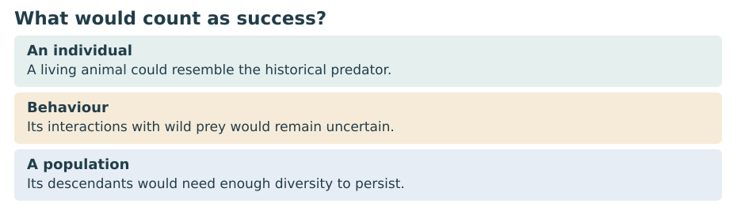

# École polytechnique FUI-FF, session 1 — Anglais 2023 · Corrigé brut

*Corrigé rédigé par IA, non officiel.*

**Rédaction** · modèle exact non renseigné (famille GPT-6) · effort non renseigné · vitesse non renseignée

**Révision** · modèle exact non renseigné (famille GPT-6) · effort non renseigné · vitesse non renseignée

**Révision** · GPT-6.2 Astra Ultra · vitesse non renseignée

**Révision** · GPT-6.2 Astra Ultra · vitesse non renseignée

**Révision (tour 4)** · GPT-6.2 Astra Ultra · vitesse non renseignée

## Reading comprehension

### 1. Two difficulties in bringing the thylacine back

Morton raises two difficulties. First comes identity: even an animal resembling the historical predator might inherit differences and would grow up without older members of its species to learn from. Its behaviour outdoors would therefore remain uncertain. Next comes survival: founding a lasting population requires sufficient inherited variation. Producing a single healthy individual would settle neither issue. (Morton, lines 45–61).

### 2. What “ghostlining” means

The term occurs in the exam question alone. In a separate interview historian Kris Manjapra describes how racial hierarchies determine whose experiences disappear from collective memory. His example concerns emancipation. Former owners received compensation while the people they had enslaved went unpaid for their labour and suffering. Morton discusses a marsupial and its public image in Tasmania. His article supplies no historical definition of this term. (Manjapra, 2022. Morton, lines 30–35).

### 3. How conservation and research are funded

Morton explicitly rejects the suggested financial trade-off. Some scientists feel neglected when an extinct animal attracts wealthy backers, but Ritchie regards that private money as additional. He draws a different comparison within public policy. An earlier Australian administration offered ten million dollars for a hundred endangered species while subsidising fossil energy by billions and allowing forests to disappear. Morton wants political leaders to protect wildlife before extinction occurs. (Morton, lines 62–77).

### 4. A possible ecological role

The proposed return might restore an ecological role left vacant after the animal disappeared. Australia once had this marsupial as a top predator. Its former ecological position has remained largely vacant, although Morton mentions introduced cats as a qualification. Perhaps a successor could again affect prey populations in a similar way. Morton presents that outcome as a possibility. Without observing how such animals behave, nobody can confidently predict their influence upon the landscape. (Morton, lines 36–40 and 46–55).

## Essay

Imagine a council discussing two proposals at the same meeting. One would save a patch of woodland where a declining bird still nests. The other would support research that might revive a bird already gone. The second proposal promises an extraordinary photograph. The first might succeed without producing any spectacular / news. A government that rewards only visible breakthroughs will find prevention difficult to defend.

The difference becomes clearer if we consider what each proposal could deliver. Protecting woodland leaves nesting places available next spring. It can also protect insects, plants and waterways that the public rarely notices. Researchers who produced / a bird resembling an extinct species would still need somewhere for it to live. If the original habitat had become a shopping centre, a successful experiment would have solved only part of the problem. Preserving places gives future decision makers options that a collection of impressive animals cannot supply.

There / is nevertheless a case for research. A private donor fascinated by an extinct bird might never contribute to a woodland purchase. Refusing the gift would not automatically pay a single ranger. Scientific curiosity can inspire students, improve knowledge about a threatened animal or help a community reconnect with a part / of its past. I would welcome such possibilities, provided that publicity distinguishes the work already achieved from the outcome its supporters hope eventually to see.

What worries me most is the message sent by public decisions outside the research budget. A council cannot plausibly claim that it cares about wildlife / while licensing avoidable destruction wherever development offers an immediate financial return. It could publish a map of nesting sites, consult residents about their use of the woodland and explain which planning choices preserved it. Visitors would then be able to recognise a success that might otherwise remain invisible. Scientists could / still pursue a difficult experiment under separate funding and honest expectations.

A future child should be able to hear birds outside the classroom as well as learn about remarkable discoveries inside it. Keeping that possibility open requires patient decisions about ordinary spaces. I would judge leaders by whether they protect / those spaces before the last breeding pair disappears, and by whether local people can see and challenge the evidence behind each decision.

*372 words.*
