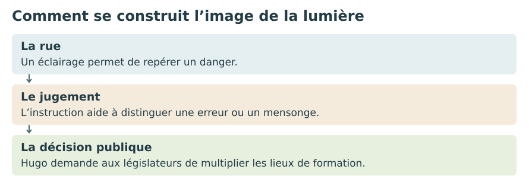

# École polytechnique FUI-FF, session 1 — Français 2023 · Corrigé brut

*Corrigé rédigé par IA, non officiel.*

**Rédaction** · modèle exact non renseigné (famille GPT-6) · effort non renseigné · vitesse non renseignée

**Révision** · modèle exact non renseigné (famille GPT-6) · effort non renseigné · vitesse non renseignée

**Révision** · GPT-6.2 Astra Ultra · vitesse non renseignée

**Révision (tour 3)** · GPT-6.2 Astra Ultra · vitesse non renseignée

L’épreuve n° 2 de la session d’automne dure deux heures. Le sujet reproduit un extrait du discours d’ouverture du Congrès littéraire international prononcé par Victor Hugo le 7 juin 1878. La première partie demande de dégager la thèse, de relever une phrase du texte et d’expliquer deux images. La seconde est un bref essai de forme libre sans limite de mots. Le sujet interdit les dictionnaires et traducteurs électroniques.

## A1 · La thèse, sa portée et une phrase à retenir

Hugo soutient que la littérature fait progresser les sociétés en mettant les intelligences en mouvement. À la puissance passagère d’une armée, l’orateur oppose la durée de l’*Iliade*, que des générations continuent à lire. Cervantès fait aussitôt penser à l’Espagne, Dante à l’Italie. Leurs œuvres, que reconnaît un auditoire international, franchissent pourtant les frontières. Un peuple donne au monde une façon de penser et, à son tour, apprend à se voir à travers les livres des autres. Je retiendrais la phrase « On peut dire que littérature et civilisation sont identiques. » Hugo y rassemble les deux définitions qu’il vient de proposer. La littérature met l’esprit en marche. La civilisation est ce que l’humanité découvre à mesure qu’elle avance.

## A2a · Les écoles et la lumière

Hugo fait de la lumière une image de la connaissance. Les écoles sont les lieux où les livres se transmettent, où l’on apprend à raisonner et où chacun peut exercer son jugement. En les multipliant, une société rend ces possibilités accessibles en un plus grand nombre de lieux. Les impératifs adressés à l’auditoire, en particulier celui de multiplier les écoles, font de chaque point lumineux une décision concrète d’instruction.

## A2b · L’éclairage des rues et celui des esprits

L’éclairage d’une rue permet de voir où l’on va et de déceler un danger. Par analogie, l’éducation permet de reconnaître un mensonge ou une superstition qui pourraient tirer profit de l’ignorance. Hugo admet qu’un responsable public doive assurer la sécurité matérielle des habitants. Le « soit » accorde au public le bien-fondé de cette dépense. Avec « surtout », Hugo retourne contre lui son propre souci de sécurité. Une rue éclairée protège le passant. Un esprit exercé peut reconnaître l’erreur qui, selon l’orateur, se dissimule comme un voleur.

## B · Essai sur la littérature et la société contemporaine

Il y a des phrases que je n’aurais jamais entendues si elles n’avaient pas été mises dans un livre. Je pense au *Dernier Jour d’un condamné*. Pendant quelques pages, c’est l’homme qui va mourir qui commande le temps du lecteur. Il regarde la porte, s’attache à un bruit, attend quelqu’un. Je peux discuter à distance d’une peine prononcée par un tribunal. J’ai beaucoup plus de mal à rester distant quand il faut attendre avec celui qui la subira. Voilà une raison pour laquelle la confiance de Victor Hugo dans la littérature continue de me toucher.

Ce pouvoir a pourtant une limite. Aucun roman, même celui-là, ne permet à lui seul de savoir comment une justice fonctionne. Pour se prononcer sérieusement, il faut aussi connaître les lois, les conditions d’un procès et les témoignages de personnes dont les parcours diffèrent. Il arrive même qu’une œuvre emporte mon adhésion par un récit si bien construit que je cesse momentanément de chercher ce qu’il a laissé hors de mon regard. La littérature sollicite mon jugement. Elle peut aussi le séduire.

J’en ai pris conscience en lisant les premières pages de *Germinal*. En suivant Étienne qui marche de nuit vers la mine, j’ai d’abord éprouvé le froid et l’incertitude du personnage. Une photographie d’archives et un plan de mine m’ont aidé ensuite à mieux comprendre les lieux du roman. La description a donné un sens humain aux documents, tandis que les documents m’ont conduit à relire autrement la description. Aucun des deux ne remplaçait l’autre.

Je suis donc Hugo lorsqu’il demande de rendre les livres largement accessibles. J’hésite lorsqu’il mesure la valeur d’un peuple à ses grands écrivains. Dans *Les Années* (2008), Annie Ernaux décrit des photographies de famille et fait entendre, autour des repas, les mots que plusieurs générations se sont transmis. J’y découvre quelque chose que le palmarès des grands noms de chaque pays saisirait mal. La littérature conserve jusqu’aux façons de parler de ceux qui, eux-mêmes, ne publient jamais de livre. Cette voix-là mérite aussi une place dans nos bibliothèques.
