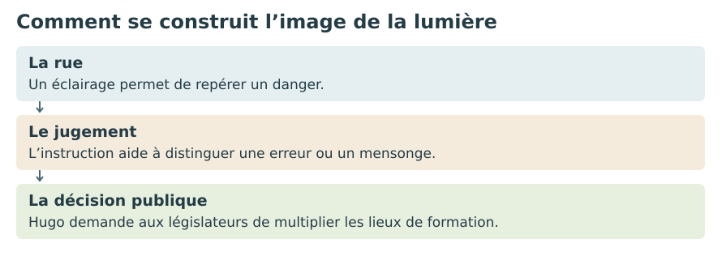

# École polytechnique FUI-FF, session 1 — Français 2023 · Corrigé guidé

*Corrigé rédigé par IA, non officiel.*

**Rédaction** · modèle exact non renseigné (famille GPT-6) · effort non renseigné · vitesse non renseignée

**Révision** · modèle exact non renseigné (famille GPT-6) · effort non renseigné · vitesse non renseignée

Cette épreuve de la filière universitaire internationale de formation francophone dure deux heures. Le sujet reproduit un extrait du discours de Victor Hugo au Congrès littéraire international de 1878. La compréhension comporte une question sur la thèse et deux explications de formules. L’essai est libre, sans limite de mots imposée.

[Sujet officiel de la session 1](https://www.polytechnique.edu/admission-cycle-ingenieur/sites/admission/files/content/2023%20FUI-FF%20S1%20SUJET%20DE%20FRANCAIS.pdf)

## A1 · La thèse, sa portée et une phrase à retenir

> [!INDICATION]
> Quel rapport le discours établit-il entre la survie des œuvres et le progrès des peuples ? Choisir une seule phrase exacte.

Hugo soutient que la littérature fait progresser les sociétés en mettant les intelligences en mouvement. Les œuvres survivent même aux puissances militaires qui semblaient dominer leur époque. Tout en faisant rayonner la langue d’un peuple, elles s’adressent à d’autres peuples et peuvent les instruire. Je retiendrais la phrase « On peut dire que littérature et civilisation sont identiques. » Elle condense l’ambition du discours, qui confère à la littérature un rôle décisif dans le développement de l’humanité.

## A2a · Les écoles et la lumière

> [!INDICATION]
> Quel est le sens intellectuel de la lumière et comment le pluriel des écoles permet-il de le préciser ?

Hugo fait de la lumière une image de la connaissance. Les écoles sont les lieux où les livres se transmettent, où l’on apprend à raisonner et où chacun peut exercer son jugement. En les multipliant, une société rend ces possibilités accessibles en un plus grand nombre de lieux. L’image des points lumineux suggère cette diffusion.

## A2b · L’éclairage des rues et celui des esprits

> [!INDICATION]
> Repérer ce que le discours concède sur la sécurité urbaine, puis la priorité qu’il assigne à l’instruction.

L’éclairage d’une rue permet de voir où l’on va et de déceler un danger. Par analogie, l’éducation permet de reconnaître un mensonge ou une superstition qui pourraient tirer profit de l’ignorance. Hugo admet qu’un responsable public doive assurer la sécurité matérielle des habitants. Il demande à ses auditeurs d’accorder une attention plus grande encore à leur formation intellectuelle.

## B · Essai sur la littérature et la société contemporaine

> [!INDICATION]
> Examiner ce qu’une lecture personnelle a rendu possible et en préciser les limites.

Il y a des phrases que je n’aurais jamais entendues si elles n’avaient pas été mises dans un livre. Je pense au *Dernier Jour d’un condamné*. Pendant quelques pages, c’est l’homme qui va mourir qui commande le temps du lecteur. Il regarde la porte, s’attache à un bruit, attend quelqu’un. Je peux discuter à distance d’une peine prononcée par un tribunal. J’ai beaucoup plus de mal à rester distant quand il faut attendre avec celui qui la subira. Voilà une raison pour laquelle la confiance de Victor Hugo dans la littérature continue de me toucher.

Ce pouvoir a pourtant une limite. Aucun roman, même celui-là, ne permet à lui seul de savoir comment une justice fonctionne. Pour se prononcer sérieusement, il faut aussi connaître les lois, les conditions d’un procès et les témoignages de personnes dont les parcours diffèrent. Il arrive même qu’une œuvre emporte mon adhésion par un récit si bien construit que je cesse momentanément de chercher ce qu’il a laissé hors de mon regard. La littérature sollicite mon jugement. Elle peut aussi le séduire.

J’en ai pris conscience en lisant les premières pages de *Germinal*. En suivant Étienne qui marche de nuit vers la mine, j’ai d’abord éprouvé le froid et l’incertitude du personnage. Une photographie d’archives et un plan de mine m’ont aidé ensuite à mieux comprendre les lieux du roman. La description a donné un sens humain aux documents, tandis que les documents m’ont conduit à relire autrement la description. Aucun des deux ne remplaçait l’autre.

Je suis donc Hugo lorsqu’il demande de rendre les livres largement accessibles. J’hésite lorsqu’il mesure la valeur d’un peuple à ses grands écrivains. Un lecteur peut gagner en liberté grâce à une œuvre écrite ailleurs, dans une autre langue, par quelqu’un que l’histoire littéraire a longtemps ignoré. Ce qui m’importe est la possibilité de rencontrer cette voix et d’en discuter avec d’autres.

> [!METHODE]
> Vérifier que chaque exemple est suivi d’une observation personnelle sur son effet. La copie peut être défendue sans supposer que le lecteur connaît déjà toutes les œuvres mentionnées.
