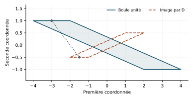
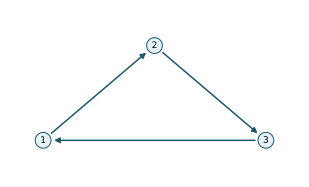

# École polytechnique, FUI-FF session 1 — Mathématiques 2023 · Corrigé brut

*Corrigé rédigé par IA, non officiel. Signalez toute erreur.*

**Rédaction** · GPT-6.2 Astra Ultra · vitesse non renseignée · 24 novembre 2026

**Révision** · GPT-6.2 Astra Ultra · vitesse non renseignée · 26 novembre 2026

L’écrit d’automne établit la formule du rayon spectral puis les théorèmes de Perron et de Frobenius. Les questions 4c–d et 13 demandent de préciser les arguments pour les hypothèses imprimées.

## Partie 1 · Rayon spectral

### Question 1

En dimension finie, la boule unité fermée est compacte et $X\mapsto\|AX\|$ est continue. Le maximum $N(A)$ est donc fini et atteint. Pour tout $X$, l’homogénéité donne $\|AX\|\le N(A)\|X\|$ (normaliser $X$ s’il est non nul). Ainsi $N(A)=0$ implique $AX=0$ pour tout $X$, donc $A=0$ et la réciproque est immédiate. L’homogénéité absolue et l’inégalité triangulaire passent au maximum, puisque $\|(A+B)X\|\le\|AX\|+\|BX\|$. Enfin $\|ABX\|\le N(A)N(B)\|X\|$, d’où $N(AB)\le N(A)N(B)$.

### Question 2

Choisissons $AX=\lambda X$ avec $|\lambda|=\rho(A)$ et $\|X\|=1$. On a $\rho(A)=\|AX\|\le N(A)$. Comme $A^kX=\lambda^k X$, on obtient également $\rho(A)^k\le N(A^k)$ pour tout $k\ge1$.

### Question 3

Si une puissance de $A$ est nulle, toute valeur propre a une puissance nulle et vaut zéro. Réciproquement $\rho(A)=0$ implique que toutes les valeurs propres complexes sont nulles. Le polynôme caractéristique est $X^d$, donc $A^d=0$ par Cayley–Hamilton.

### Question 4a

Si $A^n\to0$, alors $A^nX\to0$ pour tout $X$. Sur un vecteur propre unitaire, cela donne $|\lambda|^n\to0$, donc $|\lambda|<1$. Le spectre étant fini, $\rho(A)<1$.

### Question 4b

La question 1 donne $N(A^n)\le N(A)^n\to0$ si $N(A)<1$. C’est la convergence de $A^n$ vers zéro, commune à toutes les normes de l’espace matriciel de dimension finie.

### Question 4c

L’assertion imprimée est fausse pour la norme arbitrairement fixée au début de la partie. Sur $\mathbb C^2$, prenons $\|(x,y)\|=\max(|x+3y|,|y|)$ (la norme infinie après un changement de coordonnées inversible) et $A=T=D=\operatorname{Diag}(1/2,-1/2)$. Le vecteur $v=(-3,1)$ a norme un, mais $Dv=(-3/2,-1/2)$ a norme trois. On a même $N(D)=7/2$. Dans les coordonnées $(u,v)=(x+3y,y)$, $D$ envoie $(u,v)$ sur $(u/2-3v,-v/2)$. Sur $\max(|u|,|v|)\le1$, le premier module est au plus $7/2$, valeur atteinte pour $(u,v)=(-1,1)$. Or $\rho(A)=1/2$.

Pour achever la preuve de l’équivalence, on peut choisir **une norme auxiliaire**. Avec la norme vectorielle $\|X\|_\infty=\max_i|X_i|$, sa norme subordonnée $N_\infty$ vérifie $N_\infty(D)=\max_i|D_{ii}|=\rho(A)<1$. La convergence des puissances est indépendante de ce choix en dimension finie.

### Question 4d

Le coefficient $(i,j)$ de $U_\delta^{-1}TU_\delta$ vaut $\delta^{j-i}T_{ij}$ si $j\ge i$ et zéro si $j<i$. Lorsque $\delta\downarrow0$, cette matrice tend vers $D$. Dans la norme auxiliaire de 4c, la continuité donne $N_\infty(U_\delta^{-1}TU_\delta)<1$ pour $\delta$ assez petit. Avec la norme arbitraire initiale, la conclusion littérale peut encore échouer. Dans le contre-exemple diagonal de 4c, la conjugaison laisse $D$ fixe pour tout $\delta$.

### Question 4e

Posons $B=U_\delta^{-1}TU_\delta$ pour un choix de 4d et $S=PU_\delta$. On a $A^n=SB^nS^{-1}$, où $S$ est fixe. Par 4b dans la norme auxiliaire, $B^n\to0$, puis $A^n\to0$ par continuité des produits. Avec 4a, ceci établit l’équivalence voulue pour toute norme initiale.

### Question 5a

Les valeurs propres de $\widetilde A$ sont les $\lambda/(\rho(A)+\varepsilon)$, donc son rayon spectral est strictement inférieur à un. Par 4, $\widetilde A^n\to0$ dans la norme initiale. Il existe donc $n_0$ tel que $N(\widetilde A^n)\le1$ pour $n\ge n_0$.

### Question 5b

Pour $n\ge n_0$, l’homogénéité et 5a donnent $N(A^n)^{1/n}\le\rho(A)+\varepsilon$. La minoration $\rho(A)\le N(A^n)^{1/n}$ vient de 2. Tout $\varepsilon>0$ convenant, $N(A^n)^{1/n}\to\rho(A)$, y compris lorsque ce rayon est nul.

### Question 6

Posons $B=A-I_d$. Son spectre est $\{0\}$ et $B\ne0$. Soit $m\ge1$ maximal tel que $B^m\ne0$, existant par 3. Pour $n\ge m$, $A^n=\sum_{j=0}^m\binom nj B^j$. En divisant par $n^m$, seul le dernier terme a une limite non nulle, $B^m/m!$. Ainsi $N(A^n)/n^m\to N(B^m)/m!>0$, ce qui prouve la divergence demandée.

## Partie 2 · Théorème de Perron

### Question 7

Chaque $(AX)_i=\sum_j a_{ij}x_j$ est positif ou nul si $A,X\ge0$. Si en outre $A>0$ et $X\ne0$, on choisit $j$ tel que $x_j>0$, et le terme $a_{ij}x_j$ est strictement positif pour chaque $i$. Enfin, pour $X$ complexe et $A\ge0$, $|(AX)_i|\le\sum_j a_{ij}|x_j|=(A|X|)_i$ par l’inégalité triangulaire.

### Question 8

Si $A>0$, le produit de deux matrices strictement positives est strictement positif car chacune de ses entrées est une somme de produits positifs. Par récurrence $A^n>0$ pour tout $n\ge1$. Ainsi $A$ n’est pas nilpotente et 3 impose $\rho(A)>0$.

### Question 9a

Pour $X\ne0$ tel que $AX=\lambda X$ et $|\lambda|=\rho(A)=r$, la question 7 donne $A|X|\ge|AX|=r|X|$.

### Question 9b

Sous l’hypothèse de contradiction, $H=A|X|-r|X|$ est positif et non nul. Par la stricte positivité de $A$, la question 7 donne $AH>0$, soit $A^2|X|>rA|X|$ coordonnée par coordonnée.

### Question 9c

Le vecteur $W=A|X|$ est strictement positif par 7. Posons $\varepsilon=\min_i ((AW)_i/W_i-r)>0$ par 9b. On a $AW\ge(r+\varepsilon)W$. Comme $A$ préserve l’ordre, une récurrence donne $A^n W\ge(r+\varepsilon)^nW$ pour $n\ge1$, ce qui est l’inégalité annoncée.

### Question 9d

La matrice $C=A/(r+\varepsilon)$ a rayon spectral inférieur à un. La question 4 donne $C^nW\to0$. Or 9c assure $C^nW\ge W>0$ à chaque indice. Cette contradiction établit $A|X|=r|X|$.

### Question 9e

Le vecteur $|X|$ est positif et non nul, donc $A|X|>0$ par 7. Puisque $r>0$ par 8, l’identité de 9d donne $|X|=A|X|/r>0$. Ainsi $Y=|X|$ est le vecteur propre réel strictement positif recherché.

### Question 10

Le raisonnement de 9 vaut pour tout vecteur propre périphérique $Y$ et donne $A|Y|=r|Y|$ ainsi que $|Y|>0$. Pour une ligne fixée $i$, il y a égalité entre $|\sum_j a_{ij}Y_j|$ et $\sum_j a_{ij}|Y_j|$. Tous les $a_{ij}$ sont strictement positifs et aucun $Y_j$ n’est nul. L’égalité triangulaire complexe impose donc un même argument à tous les $Y_j$ (projeter les termes sur la direction de leur somme). En multipliant $Y$ par $\alpha$ de module un et d’argument opposé, on a $\alpha Y=|Y|>0$. Alors $\lambda|Y|=A(\alpha Y)=A|Y|=r|Y|$, donc $\lambda=r$.

## Partie 3 · Chemins et théorème de Frobenius

### Question 11

Pour $A_k=A+k^{-1}I_d$, le spectre est $\{\lambda+1/k:\lambda\in\mathrm{Sp}(A)\}$. Or $\bigl||\lambda+1/k|-|\lambda|\bigr|\le1/k$ pour chaque $\lambda$. Prendre le maximum sur le même ensemble fini donne $|\rho(A_k)-\rho(A)|\le1/k$.

### Question 12

Le simplexe $Q$ est l’intersection des demi-espaces fermés $x_i\ge0$ et de l’hyperplan fermé $\sum_i x_i=1$. Pour tout $X\in Q$, $0\le x_i\le1$ pour chaque $i$, donc $Q$ est borné. En dimension finie il est compact.

### Question 13

Le décalage diagonal de 11 laisse les éventuels zéros hors diagonale. Pour obtenir un **vecteur non nul**, comme l’exige l’interprétation en vecteur propre, perturbons toutes les entrées. Soit $J$ la matrice entièrement formée de uns et $B_k=A+k^{-1}J>0$. Par 9, il existe $Y_k\in Q$ avec $B_kY_k=r_kY_k$, où $r_k=\rho(B_k)$.

Vérifions $r_k\to r=\rho(A)$. Pour des matrices positives, la norme subordonnée infinie est la plus grande somme de ligne. Ainsi $0\le A^m\le B_k^m$ donne $N_\infty(A^m)\le N_\infty(B_k^m)$, puis $r\le r_k$ par 5b. D’autre part $r_k\le N_\infty(B_k^m)^{1/m}$ par 2. Pour chaque $m\ge1$ fixé, $B_k^m\to A^m$, donc $\limsup_k r_k\le N_\infty(A^m)^{1/m}$. Faire tendre $m$ vers l’infini donne $\limsup r_k\le r$.

Par 12 une sous-suite $Y_{k_j}$ converge vers $X\in Q$. À la limite dans l’équation propre on obtient $AX=rX$. Comme $\sum_i X_i=1$, ce vecteur positif est non nul.

### Question 14

Pour $\ell\ge1$, $(A^\ell)_{ij}$ est la somme des produits $a_{i s_1}a_{s_1 s_2}\cdots a_{s_{\ell-1}j}$ sur les sommets intermédiaires. Ces termes sont tous positifs ou nuls. Un produit est strictement positif exactement lorsque toutes les arêtes correspondantes existent, donc lorsque cette liste décrit un chemin de longueur $\ell$. Pour $\ell=0$, $A^0=I_d$ et l’unique possibilité est $i=j$, en accord avec la convention.

Dans la matrice à quatre sommets dessinée dans le sujet, la troisième ligne est nulle, donc aucun chemin de longueur positive ne part de 3. Pour aller de 2 à 3 en deux pas, l’unique possibilité est $2\to1\to3$. Son poids est $a_{21}a_{13}=\tfrac12$, qui vaut bien $(A^2)_{23}$.

### Question 15

Par irréductibilité, pour $i\ne j$ on peut choisir un plus court chemin. Il ne répète aucun sommet, car on pourrait supprimer la portion entre deux répétitions. Sa longueur $\ell$ est donc au plus $d-1$. Pour $i=j$, prenons $\ell=0$. Par 14, $(A^\ell)_{ij}>0$. Dans le développement $(I_d+A)^{d-1}=\sum_{t=0}^{d-1}\binom{d-1}t A^t$, cette entrée reçoit au moins une contribution strictement positive et les autres sont positives ou nulles. Cela vaut aussi pour $d=1$.

### Question 16a

Sur $\mathbb C$, $A$ est semblable à une triangulaire de diagonale $\lambda_1,\ldots,\lambda_d$. En lui appliquant $P(X)=(1+X)^{d-1}$, on obtient une triangulaire de diagonale $(1+\lambda_i)^{d-1}$ semblable à $B$. Ce sont toutes ses valeurs propres, avec multiplicités.

### Question 16b

Si $d\ge2$, on a $|(1+\lambda)^{d-1}|\le(1+|\lambda|)^{d-1}\le(1+r)^{d-1}$. Par 13, $r$ est valeur propre de $A$, donc la borne est atteinte. Pour $d=1$, $B=I_1$ et la formule $\rho(B)=(1+r)^0=1$ reste valable.

### Question 16c

Par 13, il existe $X\ge0$, non nul, tel que $AX=rX$. Alors $BX=(1+r)^{d-1}X$. Par 15, $B>0$, donc $BX>0$ par 7. Comme $(1+r)^{d-1}>0$, il s’ensuit que $X>0$. C’est le vecteur strictement positif associé à $\rho(A)$ recherché.
