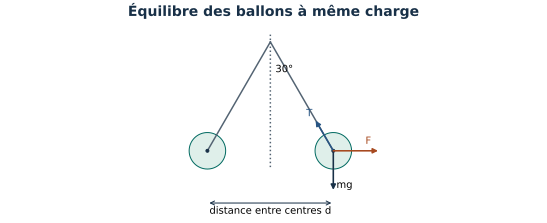
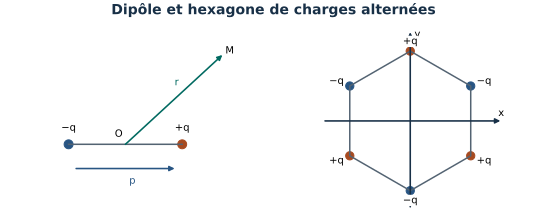
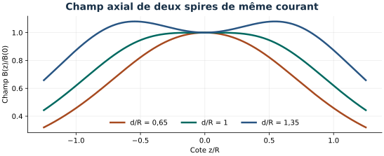
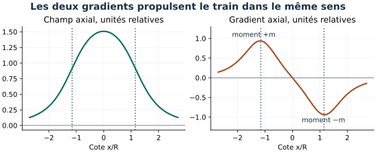

# École polytechnique, FUI-FF session 1 — Physique 2023 · Corrigé guidé

*Corrigé rédigé par IA, non officiel. Signalez toute erreur.*

**Rédaction** · modèle exact non renseigné (famille GPT-6) · effort non renseigné · vitesse non renseignée

**Révision** · modèle exact non renseigné (famille GPT-6) · effort non renseigné · vitesse non renseignée · 24 novembre 2026

**Révision (tour 2)** · GPT-6.2 Astra Ultra · vitesse non renseignée · 24 novembre 2026

**Révision (tour 3)** · GPT-6.2 Astra Ultra · vitesse non renseignée · 26 novembre 2026

Formation francophone, session 1 (automne), trois heures sans calculatrice.

## Présentation du sujet

Le même principe de superposition relie ces quatre exercices. Pour les deux premiers, observez d’abord quelles composantes ou quels moments s’annulent par symétrie. Pour les deux derniers, distinguez la valeur du champ au centre et son comportement très loin des bobines.

## Exercice 1 — Ballons chargés

### Question 1

> [!INDICATION]
> Quelle charge intervient dans le potentiel à la surface d’une sphère ?

#### Solution

$Q$ est la charge algébrique portée par **un** ballon. Dans le modèle d’une sphère isolée à répartition uniforme, son potentiel de surface, référencé à l’infini, vaut $Q/(4\pi\varepsilon_0 R)$. L’expérience renseigne ici sur sa valeur absolue.

### Question 2

> [!INDICATION]
> Utilisez la dimension de la permittivité dans la loi de Coulomb.

#### Solution

De $F=q_1q_2/(4\pi\varepsilon_0r^2)$, on tire $[\varepsilon_0]=\mathrm{C^2/(N\,m^2)}$. Ainsi $[Q/(\varepsilon_0 R)]=\mathrm{N\,m/C}=\mathrm V$. Plus généralement, pour un monôme en $Q,\varepsilon_0,R$, l’identification des dimensions impose les puissances $1,-1,-1$. Le nombre sans dimension $1/(4\pi)$ vient de la symétrie sphérique et de la loi de Gauss. Pour les deux ballons, le rapport $R/d$ peut aussi intervenir dans le coefficient.

### Question 3

> [!INDICATION]
> Tracez le triangle formé par le point de suspension et les centres.

#### Solution

On interprète $d=40\,\mathrm{cm}$ comme la distance entre centres. Par symétrie, chaque centre est à $d/2$ de la verticale. Avec $\alpha=30^\circ$, la longueur entre le point de suspension et le centre est $L_{\rm eff}=d/(2\sin\alpha)=0{,}40\,\mathrm m$. C’est la longueur $L$ dans le modèle ponctuel. Si l’on mesure uniquement la ficelle jusqu’à son point d’attache à la surface dans le prolongement du rayon, sa longueur matérielle vaut $L_{\rm eff}-R=0{,}30\,\mathrm m$.

### Question 4

> [!INDICATION]
> Éliminez la tension entre les projections horizontale et verticale.

#### Solution

Soit $T$ la tension de la ficelle. À l’équilibre, le poids est compensé par $T\cos\alpha=mg$ ; la répulsion de l’autre ballon vaut $F=T\sin\alpha=mg\tan\alpha$. Le modèle des charges centrées donne $F=Q^2/(4\pi\varepsilon_0d^2)$ pour deux charges égales de même signe. Avec $m=4{,}0\times10^{-3}\,\mathrm{kg}$,
$$|Q|=d\sqrt{4\pi\varepsilon_0mg\tan\alpha}\simeq6{,}3\times10^{-7}\,\mathrm C,\qquad |\Delta V|\sim\frac{|Q|}{4\pi\varepsilon_0 R}\simeq5{,}7\times10^4\,\mathrm V.$$
Il s’agit du potentiel de chaque ballon par rapport à l’air suffisamment distant. Les deux ballons identiques ont le même potentiel par symétrie.

### Question 5

> [!INDICATION]
> Comparez tension et charge disponible.

#### Solution

Environ $60\,\mathrm{kV}$ dépasse de plusieurs centaines de fois la tension efficace du secteur ($230\,\mathrm V$) et de plusieurs dizaines de milliers de fois celle d’une pile ($1{,}5\,\mathrm V$). Une tension élevée est compatible avec la petite charge calculée. L’énergie électrostatique d’un ballon isolé est de l’ordre de $|Q\Delta V|/2\simeq 0{,}02\,\mathrm J$. L’air sec limite les fuites qui déchargeraient la surface.

## Exercice 2 — Charges sur un hexagone

### Question 1

> [!INDICATION]
> Développez les deux distances inverses à partir du milieu du dipôle.

#### Solution

Les charges $-q,+q$ sont placées symétriquement autour de $O$ et séparées par le vecteur $\boldsymbol\ell$ allant du signe moins au signe plus. Le moment est $\mathbf p=q\boldsymbol\ell$. Pour $\mathbf r=\overrightarrow{OM}=r\mathbf u_r$ avec $r\gg\ell$, on a $1/|\mathbf r\mp\boldsymbol\ell/2|=1/r\pm(\boldsymbol\ell\cdot\mathbf u_r)/(2r^2)+\cdots$. La superposition, puis $\mathbf E=-\nabla V$, donnent
$$V=\frac{\mathbf p\cdot\mathbf u_r}{4\pi\varepsilon_0r^2},\qquad \mathbf E=\frac{3(\mathbf p\cdot\mathbf u_r)\mathbf u_r-\mathbf p}{4\pi\varepsilon_0r^3}$$
à l’ordre dominant. Pour un angle $\theta$ entre $\mathbf p$ et $\mathbf r$, les composantes $(E_r,E_\theta)$ sont proportionnelles à $(2\cos\theta,\sin\theta)$.

### Question 2

> [!INDICATION]
> Regroupez les contributions selon leur puissance en distance inverse.

#### Solution

Pour des charges $q_i$ confinées dans une région de taille $a\ll r$ autour de $O$, posons $Q=\sum q_i$ et $\mathbf p=\sum q_i\mathbf r_i$. Alors
$$V(M)=\frac{1}{4\pi\varepsilon_0}\left(\frac Qr+\frac{\mathbf p\cdot\mathbf u_r}{r^2}+O(r^{-3})\right).$$
La neutralité annule le monopôle et rend $\mathbf p$ indépendant de l’origine. Si $\mathbf p\ne0$, le terme dipolaire domine dans une direction où son coefficient est non nul. Il décroît en $r^{-2}$ pour le potentiel, en $r^{-3}$ pour le champ.

### Question 3

> [!INDICATION]
> Observez les triangles équilatéraux des charges de même signe.

#### Solution

Trois charges $+q$ et trois charges $-q$ donnent $Q=0$. Les trois rayons des sommets positifs constituent une étoile à $120^\circ$ et leur somme vectorielle est nulle. Il en va de même des rayons des sommets négatifs. Donc $\mathbf p=q\sum_+\mathbf r_i-q\sum_-\mathbf r_i=\mathbf0$.

### Question 4

> [!INDICATION]
> Comparez un sommet à son opposé.

#### Solution

Dans la définition de l’énoncé, $\mathcal Q_{\alpha\beta}=\sum_i q_i r_{i\alpha}r_{i\beta}$. À $(q_i,\mathbf r_i)$ correspond au sommet opposé $(-q_i,-\mathbf r_i)$. Le produit des coordonnées est inchangé tandis que la charge change de signe. Les trois paires se compensent pour tout couple $(\alpha,\beta)$ et $\mathcal Q$ est la matrice nulle.

### Question 5

> [!INDICATION]
> Le long de quel axe une charge occupe-t-elle une position extrême ?

#### Solution

Choisissons $y$ vertical comme sur la figure et $a$ égal au côté, donc aussi au rayon circonscrit. Les ordonnées sont $+a$ (charge $+q$), $-a$ (charge $-q$), $+a/2$ (deux charges $-q$) et $-a/2$ (deux charges $+q$). D’où
$$\mathcal O_{yyy}=\sum_i q_i y_i^3=2qa^3-4q(a/2)^3=\tfrac32qa^3\ne0.$$
Le changement de signe de la charge et celui du cube se compensent aux sommets opposés.

### Question 6

> [!INDICATION]
> Quel terme du développement est le premier à survivre ?

#### Solution

Le développement multipolaire classe par puissances de $a/r$ les termes du développement de $1/|\mathbf r-\mathbf r_i|$. Le multipôle d’ordre $n$ donne un potentiel en $r^{-(n+1)}$ avec un coefficient angulaire. Ici les ordres 0, 1 et 2 disparaissent. Pour vérifier que le moment cubique produit bien un terme de potentiel, prenons l’axe $+y$. Le coefficient d’ordre 3 est proportionnel à $\sum_i q_i(5y_i^3-3a^2 y_i)/2=15qa^3/4$. Ainsi, dans une direction générique, $V\propto r^{-4}$, soit $n=-4$ dans la notation $V\propto r^n$ du sujet. Certaines directions de symétrie ont un coefficient nul.

## Exercice 3 — Bobines de Helmholtz

### Question 1

> [!INDICATION]
> Projetez Biot et Savart sur l’axe et additionnez les contributions décalées.

#### Solution

Orientons les courants pour que le champ central soit dirigé selon $+\mathbf e_z$. Pour une spire de centre à la cote $z_0$, un élément $R\,d\varphi\,\mathbf e_\varphi$ se trouve à distance $[R^2+(z-z_0)^2]^{1/2}$ du point axial. Les projections transversales se compensent sur un tour et la projection axiale du produit vectoriel vaut $R^2d\varphi$. Après intégration puis superposition,
$$B_z(z)=\frac{\mu_0 I R^2}{2}\left(\frac1{[R^2+(z-d/2)^2]^{3/2}}+\frac1{[R^2+(z+d/2)^2]^{3/2}}\right).$$

### Question 2

> [!INDICATION]
> La parité annule la dérivée première au centre. Annulez la dérivée seconde.

#### Solution

Pour $f(u)=(R^2+u^2)^{-3/2}$, $f''(u)=3(4u^2-R^2)/(R^2+u^2)^{7/2}$. La symétrie garantit $B_z'(0)=0$, et $B_z''(0)$ est proportionnel à $d^2-R^2$. Pour **$d=R$**, le premier écart au centre est quartique en $z$. La valeur centrale est $B_z(0)=(4/5)^{3/2}\mu_0 I/R$.

Le premier écart au champ central peut être chiffré. Posons $u=z/R$. À $d=R$ le rapport $B_z(z)/B_z(0)$ est la demi-somme de $[1+4(u^2+u)/5]^{-3/2}$ et de $[1+4(u^2-u)/5]^{-3/2}$. Le terme en $u^2$ s’annule. Au premier ordre non nul,
$$\frac{B_z(z)}{B_z(0)}=1-\frac{144}{125}u^4+O(u^6).$$
À $z=R/5$, la diminution relative est ainsi estimée à $0{,}184\,\%$, contre $0{,}176\,\%$ avec la formule exacte de la question 1.

### Question 3

> [!INDICATION]
> Développez simultanément les deux termes de Biot et Savart. Les puissances impaires du décalage s’annulent.

#### Solution

Pour $z>0$, $z\gg R,d$, en factorisant $z^{-3}$ et en utilisant le binôme aux deux arguments, on obtient
$$B_z=\frac{\mu_0 I R^2}{z^3}\left[1+\frac{3(d^2-R^2)}{2z^2}+\frac{15(d^4-6d^2R^2+2R^4)}{16z^4}+O(z^{-6})\right].$$
Avec $d=R$, le terme en $z^{-5}$ disparaît. On trouve $B_z=\mu_0IR^2 z^{-3}-(45/16)\mu_0 IR^6 z^{-7}+O(z^{-9})$, soit les deux puissances annoncées. Sur l’autre demi-axe, la parité demande de remplacer $z$ par $|z|$ dans cette expression.

### Question 4

> [!INDICATION]
> Superposez deux dispositifs dont les moments magnétiques sont opposés.

#### Solution

Ajoutons une seconde paire de Helmholtz concentrique et coaxiale, de rayon $S\ne R$, d’écartement $S$ et de courant signé $J$ choisi avec $JS^2=-IR^2$. Le terme dipolaire en $z^{-3}$ s’annule. Chaque paire annule déjà son propre $z^{-5}$. Le terme commun restant est
$$B_z\sim-\frac{45\mu_0}{16}\,(IR^6+JS^6)\,|z|^{-7}.$$
Le coefficient est non nul si $I\ne0$ et $S\ne R$. Il s’agit de la loi dominante loin des sources, les ordres supérieurs subsistant à distance finie.

## Exercice 4 — Bobine hélicoïdale et petit train

### Question 1

> [!INDICATION]
> Prenez l’axe $Ox$ et faites avancer la cote d’un pas par tour.

#### Solution

Posons $h=p/(2\pi)$ et choisissons l’origine de l’angle sur $+Oy$. Une paramétrisation droite dans le sens du courant de la figure est
$$\mathbf r(\theta)=h\theta\,\mathbf e_x+R\cos\theta\,\mathbf e_y+R\sin\theta\,\mathbf e_z,\qquad -2\pi N\leq\theta\leq2\pi N.$$
Les extrémités sont aux cotes $\mp Np$, la longueur axiale est $L=2Np$ et l’hélice comporte $2N$ tours.

### Question 2

> [!INDICATION]
> Orientez l’élément de fil dans le sens du courant et le vecteur de position depuis cet élément vers le point d’observation.

#### Solution

Dans la base cylindrique autour de $Ox$, $d\boldsymbol\ell=(h\mathbf e_x+R\mathbf e_\theta)d\theta$ et $\overrightarrow{MO}=-h\theta\mathbf e_x-R\mathbf e_\rho$. La loi de Biot et Savart donne
$$d\mathbf B_O=\frac{\mu_0I}{4\pi}\frac{R^2\mathbf e_x-Rh\theta\mathbf e_\rho-hR\mathbf e_\theta}{(R^2+h^2\theta^2)^{3/2}}\,d\theta.$$
En particulier le numérateur de sa projection axiale est $R^2d\theta$, indépendamment du pas.

### Question 3

> [!INDICATION]
> Transformez l’intégration sur l’angle en intégration sur la cote.

#### Solution

Puisque $d\theta=2\pi\,dx/p$, la projection devient
$$B_{Ox}=\frac{\mu_0 I}{2p}\int_{-L/2}^{L/2}\frac{R^2\,dx}{(R^2+x^2)^{3/2}}=\frac{\mu_0 I}{2p}\left[\frac{x}{\sqrt{R^2+x^2}}\right]_{-L/2}^{L/2}=\frac{\mu_0 I}{p}\frac{L/2}{\sqrt{R^2+(L/2)^2}}.$$

### Question 4

> [!INDICATION]
> Gardez le nombre de tours par unité de longueur constant.

#### Solution

Pour $L\gg R$, au centre loin des deux bords, $(L/2)/\sqrt{R^2+(L/2)^2}=1+O(R^2/L^2)$. On retrouve $B_x\simeq\mu_0 nI$ avec $n=2N/L=1/p$. Pour assimiler tout le champ à celui d’un solénoïde continu, on suppose aussi les spires serrées et on néglige les effets du fil de retour.

### Question 5

> [!INDICATION]
> Repérez les spires parcourues par le courant et le signe du gradient à chaque extrémité.

#### Solution

Les deux aimants conducteurs font contact avec la bobine. Le courant de la pile traverse les spires comprises entre ces contacts. Leur champ axial pointe vers $+x$ dans le schéma et son intensité augmente en entrant par la gauche, puis diminue en sortant à droite. À gauche, $m_{1x}>0$ et $\partial_x B_x>0$. À droite, $m_{2x}<0$ et $\partial_x B_x<0$. Ainsi $F_x=m_x\partial_xB_x$ est positif aux deux extrémités. Les deux forces font avancer l’ensemble. La portion alimentée se déplace avec les contacts.

### Question 6

> [!INDICATION]
> Comment le gradient d’un champ de bobine varie-t-il avec le courant ?

#### Solution

Pour une géométrie donnée, Biot et Savart est linéaire en $I$, donc $\partial_x B_x$ aussi. Les moments permanents sont fixes dans le train. En additionnant les deux produits $m_{ix}\partial_xB_x(x_i)$, on obtient $F_x=CI$. Les dimensions de $C$ sont celles d’une force par ampère. Inverser seulement le courant inverse le sens de la force.

### Question 7

> [!INDICATION]
> Dans l’intégrale du champ, remplacez la distance axiale à l’origine par celle au point d’observation.

#### Solution

Pour un point d’abscisse $x$ et une spire de cote $\xi$, la distance axiale est $x-\xi$. L’intégration précédente devient
$$B_x(x)=\frac{\mu_0 I}{2p}\int_{-L/2}^{L/2}\frac{R^2\,d\xi}{[R^2+(x-\xi)^2]^{3/2}}=\frac{\mu_0 I}{2p}\,[f(x+L/2)-f(x-L/2)],\quad f(u)=\frac u{\sqrt{R^2+u^2}}.$$
Le champ axial est pair et l’expression au centre redonne la question 3.

### Question 8

> [!INDICATION]
> Évaluez la dérivée aux deux centres d’aimants et tenez compte des signes de leurs moments.

#### Solution

Dans l’approximation dipolaire, prenons $x_1=-L/2$, $x_2=L/2$, $m_{1x}=m$, $m_{2x}=-m$. Avec $f'(u)=R^2/(R^2+u^2)^{3/2}$,
$$B'_x(-L/2)=\frac{\mu_0 I}{2p}\left(\frac1R-\frac{R^2}{(R^2+L^2)^{3/2}}\right)=-B'_x(L/2).$$
Les deux forces s’ajoutent, d’où
$$C=\frac{\mu_0m}{p}\left(\frac1R-\frac{R^2}{(R^2+L^2)^{3/2}}\right).$$
Le pas est la distance entre deux tours successifs (notée $s$ sur le dessin du train). Pour des moments de normes distinctes, on remplace $m$ par $(|m_1|+|m_2|)/2$.

Le coefficient du train s’écrit $C=(\mu_0m/pR)[1-(1+L^2/R^2)^{-3/2}]$. Pour $L\ll R$, les gradients aux deux bords sont peu marqués et $C\simeq3\mu_0mL^2/(2pR^3)$. Pour $L\gg R$, chaque extrémité se comporte comme celle d’un solénoïde semi-infini et $C$ tend vers $\mu_0m/(pR)$.

## Bilan

Une distribution globalement neutre peut encore produire un champ. À grande distance, le terme dominant est celui du premier moment non nul. Pour les bobines, la compensation du champ lointain est une question distincte de l’uniformité près du centre.
