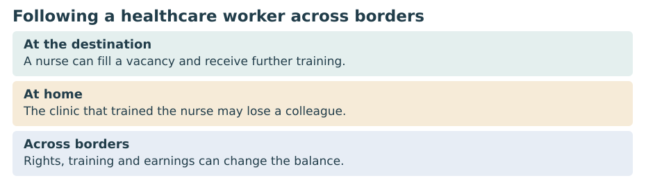
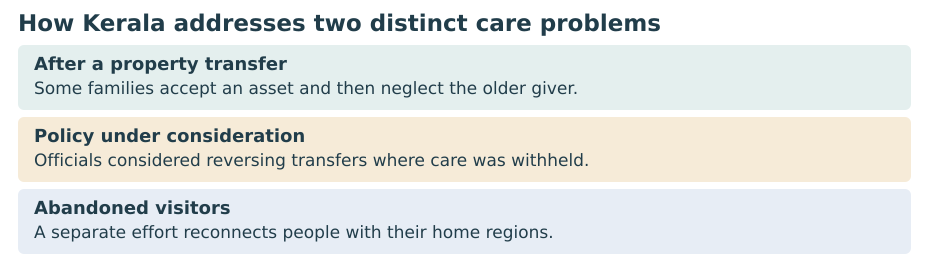
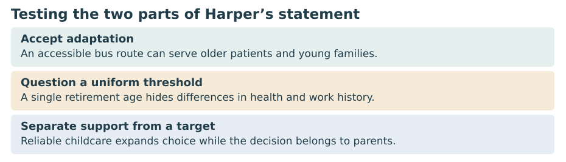

# École polytechnique FUI-FF, session 2 — Anglais 2023 · Corrigé guidé

*Corrigé rédigé par IA, non officiel.*

**Rédaction** · modèle exact non renseigné (famille GPT-6) · effort non renseigné · vitesse non renseignée

**Révision** · modèle exact non renseigné (famille GPT-6) · effort non renseigné · vitesse non renseignée

**Révision** · GPT-6.2 Astra Ultra · vitesse non renseignée

L’épreuve dure deux heures. Le sujet demande au moins 50 mots par réponse de compréhension et un essai de 360 à 440 mots, avec une barre tous les 50 mots. Les renvois aux lignes identifient les idées reprises de l’article.

[Sujet officiel](https://www.polytechnique.edu/admission-cycle-ingenieur/sites/admission/files/content/2023%20FUI-FF%20Session%20Printemps%20SUJET%20ANGLAIS.pdf)

## Reading comprehension

### 1. Benefits and costs of migration

> [!INDICATION]
> Comparer les effets du recrutement dans le pays d’arrivée et dans le pays où le travailleur a été formé.

Receiving countries can fill vacant jobs and support services when their workforce is shrinking. Migrants may send earnings home or return with useful skills, especially when employers respect their rights and provide training. Yet recruiting nurses abroad can leave communities that paid for their education without adequate medical care. Benefits accruing to the destination cannot by themselves justify the damage elsewhere. (Graham-Harrison and McCurry, lines 72–79).

### 2. Retirement reforms in France and the United States

> [!INDICATION]
> Préciser quand le changement a été annoncé dans chaque pays par rapport au départ des personnes concernées.

French workers protested when ministers proposed moving the threshold to sixty-four, two years later than before. Many protesters had already made plans for the near future. Across the Atlantic, legislators raised the threshold for the postwar generation around 1985, well before those workers expected to retire. According to Crimmins, that timing limited opposition but left some Americans discovering their new entitlement surprisingly late. (Graham-Harrison and McCurry, lines 29–40).

### 3. Two policy responses in Kerala

> [!INDICATION]
> Rattacher à chaque situation la réponse publique correspondante.

Some older residents in Kerala are neglected after transferring property to relatives and have too few resources left to support themselves. Officials were considering powers to reclaim the assets from neglectful children and give the property back to the older owners. Other households travel into Kerala to leave an ill relative there. Prathyasa, a separate scheme, seeks to help those abandoned individuals go back to the states they came from. (Graham-Harrison and McCurry, lines 7–19).

### 4. Women, work and decisions about parenthood

> [!INDICATION]
> Relier la décision de chaque famille aux écarts entre naissances souhaitées et effectives.

Education and employment give women options that often accompany smaller families. Childbearing becomes still less attractive when it damages a career and mothers perform most unpaid care. Harper argues that dependable childcare could allow parents who would welcome another baby to act on that preference. She illustrates the possible difference by comparing an average of 1.3 children with 1.8; that shift could slow population decline. (Graham-Harrison and McCurry, lines 59–66).

À la question 3, suivre dans chaque cas ce qui doit revenir à son point de départ. Dans le premier dossier il s’agit de rendre un bien aux parents délaissés. Dans le second, Prathyasa vise à permettre aux personnes abandonnées au Kerala de retourner dans leur État d’origine.

## Essay

> [!INDICATION]
> Examiner séparément les deux propositions de Harper : adapter les institutions au vieillissement et souhaiter le renouvellement des générations. Le quartier et ses habitants sont imaginés.

A neighbourhood can learn a great deal from its bus timetable. A route designed decades ago may take teenagers quickly to a school that now has empty classrooms, while residents needing regular appointments have no convenient service to a clinic. Calling the neighbourhood too old tells its residents very little. / Asking which journeys have become difficult gives them a practical question to discuss together.

I agree with the suggestion that public institutions should adapt to changing ages. A reliable bus and an accessible pavement can help an older person continue volunteering, caring for a partner or working several mornings each / week. They can also help a parent taking a child to nursery. A policy often described as an expense incurred by one generation may improve ordinary life for several. Making such changes early gives residents time to test them and point out problems before a crisis develops.

However, age alone / cannot show who is able to carry an extra burden. A retired builder with painful joints may find each journey exhausting, while a retired accountant of the same age might enjoy a new part-time role. Simply delaying everybody’s pension would hide those differences behind a single birthday. Offering flexible work / and a secure income floor gives both people more control. It also recognises the contributions of carers whose efforts never appear on an employer’s payroll.

I hesitate over the idea that each generation ought to replace itself. Parents deciding whether to have another child face intimate choices about health, money, / time and hopes. Governments can remove obstacles by making childcare dependable and sharing leave more fairly. They cannot reasonably require families to produce a particular national total. Migration can help communities renew their workforce, provided that newcomers receive proper rights and recruitment does not deprive their former neighbours of vital / services.

For me, successful adaptation concerns the quality of relationships between people who share a place. I would ask whether residents can travel, contribute, rest and receive care according to their circumstances. A timetable revised after conversations at the school, the clinic and the bus stop might sound like a / small achievement. It would show that a changing population can shape its institutions, instead of being treated as a demographic defect in need of correction.

*375 words.*

## Vérification des longueurs

Les quatre réponses de compréhension comptent respectivement 61, 63, 70 et 65 mots hors références. Dans l’essai, un groupe relié par un trait d’union compte pour un seul mot.
